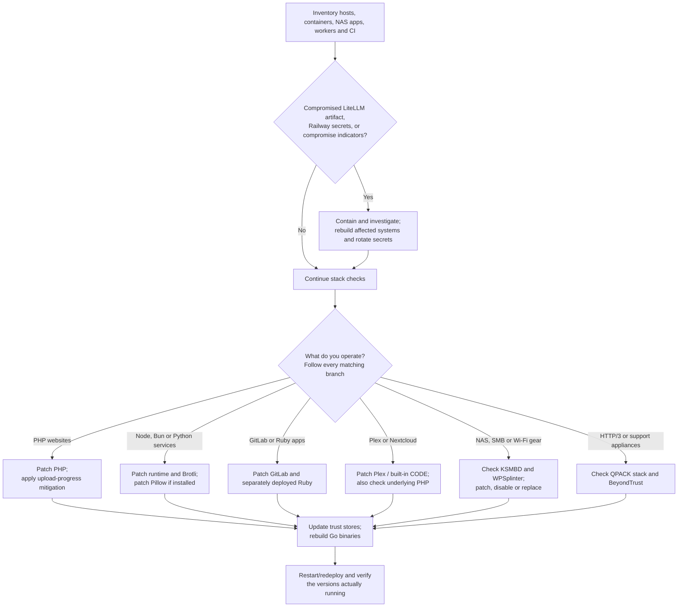

# Black October: What Broke, What’s Exposed, and What to Patch

**As of October 25, 2026**

“Black October” is an informal label for the unusually dense run of vulnerability disclosures and security incidents this month—particularly the October 19–23 cluster. It is **not one coordinated attack, one vulnerability family, or an official advisory list**.

The concern is justified: several flaws sit below application code, in runtimes, image decoders, and infrastructure components. Updating your application dependencies alone may leave the vulnerable runtime or bundled native library untouched.

This report covers the major disclosures most relevant to developers and operators of personal infrastructure, plus related incidents that require credential rotation rather than a patch. It is not an exhaustive catalog of October CVEs. Some vulnerabilities were fixed earlier but received public technical disclosures or exploitation reports this month.

## The short version

- **Prioritize exposed PHP, GitLab, Plex, and Nextcloud installations using the built-in Collabora CODE server.**
- **Update Node.js, Bun, and Python’s Brotli packages.** The Brotli flaw can arrive through an outbound HTTP response, not just an incoming request.
- **Update Pillow wherever you process untrusted images**, including thumbnail workers and document pipelines.
- **Check Ruby separately from GitLab.** The underlying regex bugs affect other applications compiling attacker-controlled patterns.
- **Update certificate trust data and rebuild Go applications.** The eMudhra incident affects clients even if your own website uses another certificate authority.
- **If you ran the compromised LiteLLM release or stored secrets in Railway, patching alone is insufficient.**

Severity scores below are attributed where ratings differ. CVSS measures technical severity, not whether exploitation has been observed or whether your particular deployment is reachable.

### How to use the impact checks

The checks below are **read-only inventory checks, not exploit probes**. Run them against your own deployments, including each container, worker, virtual environment, and appliance. Replace example paths with actual deployment paths. A missing command, inaccessible configuration, or absent package in one environment means **unknown for the rest of your infrastructure**, not “safe.”

Interpret results in three steps: **is the component present; does its exact build include the fix; can untrusted input reach the affected feature?** Compare versions within the appropriate release branch and verify vendor backports. Installed files can differ from a still-running process. None of these checks establishes whether a system was previously compromised. If compromise is suspected, inspect a snapshot from a clean system rather than executing its interpreters or application tools.

**Companion files:** Download these alongside the Markdown report. The commands below assume you are in the download directory; use absolute script paths when running as another user. Review the scripts before executing them. They do not install packages, patch services, send exploit payloads, or require API credentials.

| File | Purpose | Requirements |
|---|---|---|
| `stack-inventory.sh` | PHP settings, Node/Bun/Ruby versions, GitLab information, Nextcloud app list, or Go binary build metadata | POSIX shell and the selected product's tool |
| `python-package-inventory.py` | Brotli, brotlicffi, Pillow, olefile, and LiteLLM package metadata without importing them | Trusted Python 3.8+; no third-party dependencies |
| `linux-service-inventory.sh` | KSMBD presence, SMB/Plex listeners, and visible RDMA devices | Linux; `ss` for listener inspection |

An exit status of zero means the requested inventory commands completed, **not that the system is patched**. Nonzero status means the check failed or its input/tool is unavailable. The Linux script may finish with explicitly marked `UNKNOWN` partial results; read its output. Shell checks inspect tools on the current user's PATH, so run inside the correct deployment or set PATH to the intended runtime. Do not run them against a suspected compromised installation; use clean-host snapshot inspection instead.

## 1. PHP2Shell: unauthenticated execution below your application

**CVE-2026-109618 and CVE-2026-109619 — Critical, CVSS 4.0: 9.2 each**  
**Emergency release: October 21**

These are PHP runtime flaws, not WordPress plugins or Laravel application bugs.

| Vulnerability | What fails | Worst-case result |
|---|---|---|
| **CVE-2026-109618** | Out-of-memory handling interrupts initialization; cleanup subsequently treats partially initialized request data as valid. | **Unauthenticated remote code execution**, with access to the PHP process’s files, credentials, and databases. |
| **CVE-2026-109619** | Request-owned global state survives after its backing memory is freed and can be reused by a later request in the same worker. | **Unauthenticated remote code execution** through stale memory. |

**Affected technology:** PHP serving web requests through Apache `mod_php`, PHP-FPM, CGI, FrankenPHP, or LiteSpeed. Think WordPress, Drupal, Joomla, Nextcloud, Laravel, and custom PHP applications—but inventory the actual runtime.

PHP identifies **`mod_php` as the highest-risk configuration**, with demonstrated exploitation before application code runs. Application authentication therefore cannot be assumed to protect the vulnerable path.

**Patch:** PHP **8.5.12, 8.4.27, 8.3.36, or 8.2.35**, or a distribution package explicitly backporting both fixes. Restart all affected workers. Older upstream branches need a verified vendor backport or migration.

**Exploitation status:** Proofs of concept exist. CISA’s October 23 update said it had **not observed successful in-the-wild exploitation**; that is not a reason to delay.

### The October 23 follow-up matters

**CVE-2026-115560** is an additional, narrowly conditional RCE risk involving session upload progress. It requires an unusual combination: configuring `php_binary` or `php_serialize`, switching to `php` at runtime, and then starting a session while upload progress remains enabled.

PHP recommends:

```ini
session.upload_progress.enabled=0
```

Apply it in the effective server/PHP configuration and restart workers. **Keep this mitigation even after installing the October 21 emergency releases** until the follow-up fix is available. PHP had not published a full advisory or severity score for this issue at the report cutoff.

**Am I impacted?** Inventory the PHP version and server integration used by each website. If it serves requests with an affected, unpatched PHP build, treat it as a patch candidate even when the application requires login. For a first local inventory:

```sh
sh stack-inventory.sh php
```

**These commands inspect CLI PHP only.** Confirm the web runtime separately using your hosting panel, FPM binary/package, Apache module package, or container build. Inspect its loaded INI files, FPM pool overrides, and per-site configuration; do not publish a `phpinfo()` endpoint. For CVE-2026-115560, check whether upload progress is enabled and whether application code changes `session.serialize_handler` from `php_binary`/`php_serialize` to `php` before `session_start()`. A CLI value alone cannot rule this out. If you cannot establish the effective settings, apply PHP's upload-progress mitigation.

Sources: [PHP advisories, including the October 23 update](https://www.php.net/archive/2026.php), [CISA alert](https://www.cisa.gov/news-events/alerts/2026/10/21/critical-vulnerabilities-php-require-immediate-patching).

## 2. HTTP2Shell / Node2Shell: a cross-stack Brotli decoder vulnerability

**CVE-2026-111497 — Node.js: High; Google’s CVSS 4.0 rating: 9.2 Critical**  
**Disclosed: October 21**

**HTTP2Shell and Node2Shell are names for the same vulnerability, not separate CVEs.** The broader HTTP2Shell name reflects its impact beyond Node.js: the flaw resides in Google's native Brotli decoder and can affect any application embedding a vulnerable copy. Despite the name, it is **not specific to HTTP/2**; exposure depends on decoding attacker-controlled Brotli data, not the HTTP protocol version.

Malformed Brotli input can overflow an internal buffer in Google’s native decoder.

**Worst case:** **RCE, process-memory disclosure, or denial of service.** Researchers demonstrated RCE on a specific official Node.js Linux ARM64 build; that does not establish universal exploit reliability across every consumer.

**Affected technology:** Node.js, Bun, Python `Brotli` and `brotlicffi`, and other applications embedding the vulnerable C library. Envoy and Istio are relevant when configured to decompress Brotli.

The important exposure distinction:

- A server can be vulnerable when middleware decodes a request with `Content-Encoding: br`.
- A client or backend worker can be vulnerable when it fetches and automatically decompresses an attacker-controlled response.
- A plain Node HTTP server does not automatically decompress incoming bodies merely because it uses Node.

**Patch targets:**

| Component | Fixed release |
|---|---|
| Node.js | **22.23.4 / 24.22.1 / 26.12.1** |
| Bun | **1.4.4** |
| Python `Brotli` | **1.2.1** |
| Python `brotlicffi` | **1.2.1.0** |
| Google Brotli C library | **1.0.10 / 1.1.1 / 1.2.1**, depending on branch |
| Envoy | **1.36.12 / 1.37.8 / 1.38.6 / 1.39.3 / 1.40.0** |
| Istio | **1.29.9 / 1.30.6 / 1.31.2** |

**Do not rely solely on a WAF or removing `br` from `Accept-Encoding`.** A malicious server can still return Brotli data, and an inbound WAF does not protect outbound response decoding.

### Other high-severity Node.js fixes in the same release

| CVE | Impacted behavior | Worst-case result |
|---|---|---|
| **CVE-2026-105482** | DNS resolution silently truncates hostnames containing NUL bytes. | Hostname-allowlist bypass; potentially **SSRF or unintended connections**, depending on application logic. |
| **CVE-2026-105483** | TLS hostname validation mishandles IP addresses written with fullwidth digits. | **Server impersonation / traffic interception** under the required certificate and connection conditions. Affects 24.x and 26.x. |
| **CVE-2026-106069** | TLS validation and the platform resolver interpret noncanonical IPv4 addresses differently. | A connection can authenticate against the wrong IP identity, enabling **server impersonation**. |

The Node.js versions above fix all four high-severity issues.

**Am I impacted?** Check the runtime inside each deployed service, not just its lockfile:

```sh
sh stack-inventory.sh node
sh stack-inventory.sh bun
```

Run only the commands for runtimes you use. Compare with the patch table; for custom builds, confirm the embedded library or vendor backport. Trace incoming decompression middleware, direct Brotli calls, and outbound HTTP clients that automatically decompress responses. An affected decoder that receives attacker-controlled bytes is exposed; compression-only use does not establish exposure to this decoder bug. For Envoy/Istio, inspect the deployed proxy image/SBOM and effective decompressor configuration, including response decompression. An application-level Node update does not update the proxy.

For Python, **`python-package-inventory.py` reads distribution metadata without importing Brotli or Pillow**. Run it with a trusted Python 3.8+ interpreter and the actual deployed `site-packages` directory. `-I -S` avoids ordinary Python startup hooks and environment-based import paths. Supply every relevant package directory as an additional argument; it does not discover them automatically.

```sh
python3 -I -S python-package-inventory.py /path/to/venv/lib/python3.12/site-packages
```

Compare `Brotli` and `brotlicffi` with their fixed releases above. Missing metadata does not rule out vendored libraries, zip imports, system packages, or another virtual environment. Metadata is inventory evidence, not proof of binary integrity.

For the **three additional Node.js vulnerabilities**, review whether user-controlled URLs/hostnames reach DNS resolution, hostname allowlists, or TLS clients. The NUL-truncation issue concerns DNS/allowlist handling; the two IP-format issues concern TLS identity validation. Even if Brotli is unused, these are independent reasons to install the Node security release.

Sources: [Node.js security release](https://nodejs.org/en/blog/vulnerability/october-2026-security-releases), [Python advisory](https://github.com/advisories/GHSA-9v8h-qqgm-4m35), [HTTP2Shell naming and cross-stack scope](https://www.aikido.dev/blog/python-packages-vulnerable-node2shell-brotli-cve-2026-111497), [cross-ecosystem impact and patch matrix](https://thehackernews.com/2026/10/brotli-decoder-flaw-behind-nodejs-rce.html).

## 3. GitLab and Ruby: regex compilation becomes code execution

**CVE-2026-97229 and CVE-2026-110264 — Critical, CVSS 3.1: 10.0 each**  
**GitLab releases: October 12 and October 21; Ruby release: October 23**

Both vulnerabilities involve memory corruption while compiling specially crafted regular expressions.

| CVE | Scope | Worst-case result |
|---|---|---|
| **CVE-2026-97229** | GitLab CE/EE 19.2–19.4 before the October 12 fixes; attacker-controlled patterns in CI/CD configuration. | **Unauthenticated RCE** under the conditions described by GitLab. |
| **CVE-2026-110264** | Much broader: affected GitLab versions extend back to **7.0**. | **Unauthenticated RCE** through an integer overflow in regex compilation. |

A compromised GitLab server can expose source code and accessible CI/CD secrets and enable tampering with builds or deployments. The downstream reach depends on the credentials and permissions available to that installation.

**If you patched on October 12, patch again.** The first release does not cover the October 21 issue.

**GitLab fixes:** **19.5.1, 19.4.3, 19.3.6, 19.2.9, 19.1.9, 19.0.10, or 18.11.13** for the latest RCE. Prefer a currently supported branch; the older backports are not equivalent to receiving every other security fix. Follow GitLab’s required upgrade stops and migration guidance.

GitLab.com was patched by the vendor. GitLab Dedicated customers should verify the vendor’s listed internal release status.

### Related GitLab identity vulnerabilities

The October 21 supported-branch releases also address:

- **CVE-2026-15723 — High, 8.2:** an authenticated attacker can take over an LDAP-backed account when **OmniAuth SAML and LDAP auto-linking are both enabled**.
- **CVE-2026-112212 — High, 7.5:** OAuth/OIDC discovery cache poisoning can redirect authentication flows to attacker-controlled infrastructure, risking **credential or authentication-data disclosure**.

For these fixes, use **19.3.6, 19.4.3, or 19.5.1**, or later supported releases.

### Ruby applications need their own update

The underlying Onigmo bugs are not exclusive to GitLab. Ruby applications are exposed when they compile **attacker-controlled regex patterns**, rather than merely matching attacker-controlled text against developer-written patterns.

**Patch:** Ruby **4.0.9, 3.4.12, or 3.3.13**. Ruby 4.0.8 is insufficient for the complete set. Neither regex timeouts nor pattern-length limits reliably mitigate compilation bugs.

**Am I impacted?** For self-managed GitLab, obtain the deployed CE/EE version from the instance's Help page or, on a Linux-package installation:

```sh
sudo sh /path/to/stack-inventory.sh gitlab
# Separately deployed Ruby applications: use their actual runtime/container.
sh stack-inventory.sh ruby
```

Compare GitLab against the October 21 fixed release for its branch; do not stop after checking the narrower October 12 affected range. For other Ruby applications, trace user-supplied patterns into `Regexp.new`/`Regexp.compile` or interpolated regex construction. Matching untrusted text with a fixed developer-supplied pattern is a different condition. A shell's `ruby -v` does not establish GitLab's bundled Ruby version.

For **CVE-2026-15723**, inspect the effective identity configuration for both OmniAuth SAML and LDAP auto-linking; both must be enabled for the described takeover path. For **CVE-2026-112212**, check whether the instance uses OAuth/OIDC discovery and consult the advisory for the affected flow. Do not infer safety for either identity issue merely from the RCE patch status of an older backport branch; use a supported release covering all listed fixes.

Sources: [October 12 GitLab advisory](https://docs.gitlab.com/releases/patches/patch-release-gitlab-19-4-2-released/), [October 21 GitLab advisory](https://docs.gitlab.com/releases/patches/patch-release-gitlab-19-5-1-released/), [Ruby advisory](https://www.ruby-lang.org/en/news/2026/10/23/regexp-fixes-for-gitlab-cves/).

## 4. Pillow: untrusted images reach native memory corruption and command execution

**Multiple vulnerabilities; ratings range from Moderate to Critical**  
**Fixed release: October 16**

Pillow is common in Python upload handlers, thumbnail services, document conversion, and machine-learning pipelines. Several independent paths matter:

| Vulnerability | Trigger / condition | Severity and worst case |
|---|---|---|
| **CVE-2026-96639** | Processing successive image frames with different modes reuses incompatible native storage. | **Critical, 9.8:** memory disclosure, crashes, and demonstrated **RCE in specific runtime profiles**. |
| **CVE-2026-112398** | Crafted FlashPix images reach JPEG decoding when optional `olefile` support is installed. | **Critical:** heap corruption and potential **RCE**. The published command-execution reproduction uses a constrained, ASLR-disabled environment. |
| **CVE-2026-112900** | Attacker-controlled EPS filename passed to installed Ghostscript. | Maintainer **Moderate**, CVE score **9.2**: **command execution**. Filename control—not just malicious image contents—is the important prerequisite. |
| **CVE-2026-112393** | Saving compressed TIFF output to an in-memory file object. | Maintainer **High**, CVE score **9.2**: heap corruption; **RCE demonstrated with a separate address-disclosure flaw**. |
| **CVE-2026-112403** | Thumbnailing/draft decoding of crafted lossless JPEGs. | Maintainer **Critical**, CVE score **9.2**: heap overflow and demonstrated **crash/DoS**; do not treat RCE as established for this specific path. |

**Patch:** **Pillow 13.0.0**, which also fixes additional memory-disclosure and resource-exhaustion bugs. It requires **Python 3.11 or newer**.

Extension filtering alone is insufficient: Pillow recognizes formats from content. Update the actual processing workers and their images, not just the frontend accepting uploads.

**Am I impacted?** Run `python3 -I -S python-package-inventory.py /path/to/worker/site-packages` against every image-processing worker's package directories. If Pillow is present and you cannot verify the 13.0.0 fixes or vendor backports, inspect these paths and prioritize an upgrade:

| Check your application for… | Relevant issue |
|---|---|
| Iterating/seeking through untrusted multi-frame images | CVE-2026-96639 |
| Opening untrusted FlashPix files with `olefile` installed | CVE-2026-112398 |
| Opening EPS with attacker-influenced filenames and Ghostscript available | CVE-2026-112900 |
| Saving compressed TIFF to `BytesIO` or another in-memory file object | CVE-2026-112393 |
| Thumbnail/draft processing of untrusted lossless JPEGs | CVE-2026-112403 |

The metadata script also lists `olefile`. On Linux/macOS, `command -v gs` checks whether Ghostscript is on the worker user's PATH; also inspect configured absolute executable paths. A missing optional dependency only addresses that particular path, not the other Pillow flaws. Do not upload malicious test images to production to establish exposure.

Sources: [Pillow release notes](https://pillow.readthedocs.io/en/stable/releasenotes/13.0.0.html), [multi-frame advisory](https://github.com/python-pillow/Pillow/security/advisories/GHSA-v9pv-5gc8-w2m6), [FlashPix advisory](https://github.com/python-pillow/Pillow/security/advisories/GHSA-5x8w-8jj5-q52h), [additional vulnerability details](https://thehackernews.com/2026/10/critical-flaw-in-pythons-popular-pillow.html).

## 5. Plex2Shell: a home-server compromise chain is being exploited

**CVE-2026-96652, -96654, -96655, and -96656**  
**Researcher’s combined-chain rating: Critical, CVSS 3.1: 9.8**  
**Public disclosure: October 16; fixes released in August**

The chain combines:

1. **CVE-2026-96652:** unauthenticated SSRF.
2. **CVE-2026-96654:** plugin-function abuse to obtain the owner’s administrator token.
3. **CVE-2026-96655:** authenticated SSRF for payload retrieval.
4. **CVE-2026-96656:** attacker-controlled file placement and execution through the codec path.

**Worst case:** **Unauthenticated RCE** on Plex Media Server, exposing whatever media, mounts, credentials, and network access its service account holds.

**Exploitation status:** In-the-wild exploitation has been reported, including miners and Linux proxy/backdoor payloads.

**Patch:** **Plex Media Server 1.43.3.10861 or later**; use the latest supported release. Check NAS-packaged installations and containers, which may lag upstream. Remove unnecessary public exposure on port 32400.

If an exposed installation remained vulnerable, investigate for compromise. **Installing the update does not remove an existing backdoor.**

**Am I impacted?** In Plex Web, select the actual server and check **Settings → General** for the **Media Server** version—not the web, desktop, or mobile client version. Compare it with **1.43.3.10861**. Repeat for each NAS package/container and verify the running server after updating.

Inspect Plex's Remote Access settings, router port forwards/UPnP mappings, reverse proxies, and VPN access. On a Linux host, run `sh linux-service-inventory.sh` and inspect the TCP 32400 output. It shows local listeners, **not** internet reachability, and a container may live in another network namespace. An unpatched server reachable by an attacker is a priority, including on a LAN. Use deployment history to establish whether it was exposed before patching; a clean-looking current version cannot rule out earlier compromise.

Sources: [researcher disclosure](https://zmain.info/blog/plex2shell), [exploitation reporting and fixed version](https://thehackernews.com/2026/10/hackers-exploit-plex2shell-flaws-to.html).

## 6. Nextcloud’s built-in Collabora CODE server: unauthenticated command injection

**CVE-2026-110447 — Critical, CVSS 4.0: 9.2**  
**Advisory: October 14; fix released in September**

This affects the optional **Collabora Online – Built-in CODE Server** app, `richdocumentscode`, rather than every Collabora deployment.

An unauthenticated request to its proxy can execute an OS command **when the bundled CODE server is stopped**—for example, after a restart, crash, or upgrade.

**Worst case:** **RCE as the web-server user**, with potential access to Nextcloud data and credentials. Attacks planting webshells have been reported.

**Patch:** `richdocumentscode` **26.4.303 or later**, or **remove the app**. The vendor explicitly warns that **disabling it is insufficient**.

Standalone Collabora servers are not affected by this particular flaw. Nextcloud’s PHP runtime still needs the separate PHP2Shell fixes.

**Am I impacted?** Review Nextcloud's Apps administration page for **Collabora Online – Built-in CODE Server**, including disabled apps. From a typical Linux installation, adjusting the account and path:

```sh
sudo -u www-data sh /path/to/stack-inventory.sh nextcloud /var/www/nextcloud/occ
```

Find `richdocumentscode` and its version in both the enabled and disabled lists. Also inspect configured app directories for leftover copies containing its proxy even if the app is not registered. A copy older than **26.4.303** without a verified backport needs updating or removal. Confirm whether your reverse proxy can serve that app's PHP files. Do not stop CODE as a test: the stopped state is the dangerous condition, and an otherwise running server can enter it later. A standalone Collabora deployment without this app does not meet this flaw's component prerequisite.

Sources: [vendor advisory](https://github.com/CollaboraOnline/online/security/advisories/GHSA-g3vx-3m76-fghh), [exploitation reporting](https://www.bleepingcomputer.com/news/security/hackers-exploit-collabora-rce-flaw-to-backdoor-nextcloud-servers/).

## 7. Linux KSMBD: serious kernel-level reports, but not “every Linux server”

**ZDI-CAN-33774 and ZDI-CAN-33549 — ZDI rating: Critical, 9.0 each**  
**Public reports: October 21–22**

These affect **KSMBD, the in-kernel SMB server**. They do not imply that ordinary Samba installations or all Linux machines are vulnerable.

| Report | Exposure | Worst-case reported impact |
|---|---|---|
| **ZDI-CAN-33774** | Protocol-dispatch race reachable before authentication; stronger write paths involve share access. | Kernel memory corruption, potentially **RCE**. |
| **ZDI-CAN-33549** | SMB Direct with an RDMA-capable interface and a writable share. | Integer underflow leading to kernel buffer corruption and potentially **RCE**. |

No universal fixed distribution version was established in the sources reviewed. Maintainers were discussing fixes on October 23; **a proposed patch is not the same as a deployed distribution update**.

**Action:** Identify whether you actually use KSMBD. Disable it if unnecessary, restrict access to trusted networks, and obtain an explicit remediation status from your kernel/NAS vendor. Never expose SMB directly to the internet.

**Am I impacted?** Run these read-only checks on the Linux/NAS host, not just inside an application container:

```sh
sh linux-service-inventory.sh
```

A port 445 listener alone does not identify KSMBD; Samba can use it too. Check kernel `CONFIG_SMB_SERVER`, KSMBD service/share configuration, and vendor documentation. An empty RDMA device listing does not settle the first report; RDMA/SMB Direct and a writable share are specific prerequisites for **ZDI-CAN-33549**. For **ZDI-CAN-33774**, assess KSMBD protocol access independently. Ask the vendor to map your exact kernel/firmware build to **both** reports; kernel version strings alone cannot confirm a fix.

Sources: [disclosure overview](https://thehackernews.com/2026/10/two-cvss-90-linux-ksmbd-rce-flaws.html), [October 23 maintainer discussion](https://lists.samba.org/archive/samba-technical/2026-October/141179.html).

## 8. WPSplinter: nearby attackers can compromise vulnerable routers

**Broadcom legacy WPS implementation — no CVE or standardized score published**  
**Disclosed: October 16**

A Wi-Fi attacker within radio range can exploit fragmented WPS message handling **without the network password or completing WPS enrollment**.

**Worst case:** **Memory disclosure and arbitrary code execution**, including root-level execution on demonstrated devices, Wi-Fi password theft, and access to the local network.

The affected component appears across numerous vendors and ISP gateways. **A Broadcom chipset alone does not establish vulnerability**; firmware and hardware revision matter.

**Action:** Check the researcher’s device list and ask the vendor/ISP about this specific issue. Install a confirmed fixed firmware or replace unsupported equipment. Do not assume the ordinary “disable WPS” toggle removes the vulnerable parser.

There is no universal firmware version to recommend. Older eCos-based devices may have no practical migration path.

**Am I impacted?** Record the router/access point's **manufacturer, exact model, hardware revision, firmware build, and ISP customization** from its label and management interface. Compare that tuple with the researcher's device guidance and your vendor's advisory. Include mesh nodes, extenders, and ISP-supplied gateways, not just your primary router.

A listed vulnerable model/build is actionable; an unlisted model is **unknown**, not cleared. Ask the vendor whether its firmware contains the vulnerable Broadcom WPS parser and which build fixes or removes it. Neither a MAC-address vendor lookup nor a “WPS disabled” screen proves remediation. There is no dependable generic read-only Python check for this firmware-level condition; avoid crash/exploit probes against your access point.

Source: [researcher’s WPSplinter advisory and device guidance](https://qkaiser.github.io/broadcom-wps/).

## 9. Header Accordions: HTTP/3 compression becomes resource exhaustion

**Multiple implementations; includes CVE-2025-64702, CVE-2026-12523, and CVE-2025-13945**  
**Research published: October 20**

Small QPACK-compressed header blocks expand into disproportionate memory usage. Affected implementations enforce decoded-header limits too late, incompletely, or not at all.

**Worst case:** **Denial of service** through memory exhaustion, crashes, or CPU pinning—not established RCE or data theft.

Relevant software includes HTTP/3 deployments built on **quic-go, Cloudflare quiche, lsquic, Bun, aioquic/mitmproxy, and Rust’s `h3`**. Wireshark has a related capture-decoding crash rather than a public-server attack surface.

**Fixed library versions:** quic-go **0.57.0**, Cloudflare quiche **0.29.3**, lsquic **4.9.0**; Wireshark **4.6.2 / 4.4.12**. Several fixes predate October.

For affected stacks without a verified fix, disable HTTP/3 or apply the researcher’s stack-specific mitigation. **Bun’s Brotli fix should not be assumed to fix this separate HTTP/3 issue.**

**Am I impacted?** First identify **where HTTP/3 terminates**: CDN, load balancer, reverse proxy, or application. A CDN offering HTTP/3 does not prove that the origin uses it. Check each terminator's HTTP/3 configuration and its deployed library version against the researcher's implementation matrix. For a Go-based server, inspect the deployed executable without running it:

```sh
sh stack-inventory.sh go /path/to/deployed-server
```

Look for `github.com/quic-go/quic-go`, its version, and any replacement module. Missing build metadata is inconclusive; use the product's SBOM/build provenance or vendor advisory. For quiche, lsquic, Bun, Rust `h3`, or Python-based servers, check their corresponding build/lock metadata and actual deployed artifacts. A UDP 443 listener or an `Alt-Svc: h3` header is only a clue, not proof of this vulnerability. Wireshark users should check **Help → About** (or `tshark --version` if installed); its exposure comes from decoding captures, even without running an HTTP/3 server.

Source: [FoxIO research and implementation matrix](https://foxio.io/blog/header-accordions-qpack-amplification-attacks-against-http-3-servers).

## 10. BeyondTrust Remote Support: an already-exploited appliance vulnerability

**CVE-2026-102764 — Critical, CVSS 4.0: 9.3**  
**Disclosed: October 15**

Improper origin validation in internal messaging permits an unauthenticated remote attacker to perform file operations on affected Remote Support appliances.

**Affected:** Remote Support **26.2.3 and earlier**.

**Worst case:** The observed attack chain progressed to **root-level appliance compromise, credential theft, and lateral movement**. These are campaign outcomes, not merely the vendor’s narrow description of the initial file-operation primitive.

**Exploitation status:** Reported exploitation since August.

**Patch:** Apply **BT26-05-RS**. Versions older than **24.3.1** must first upgrade to a version that can receive the patch. SaaS was patched by BeyondTrust. Privileged Remote Access operators should also follow the vendor’s precautionary guidance for shared code.

**Am I impacted?** In the appliance's administrative interface, record the **Remote Support product version and installed security-patch history**. If it is **26.2.3 or earlier**, verify installation of **BT26-05-RS** rather than assuming a base-version string reflects a hotfix. Check every appliance, including standby/failover nodes. For SaaS, confirm remediation with the vendor; for Privileged Remote Access, follow its separate precautionary guidance.

Review exposure and appliance/security logs back through the reported exploitation period beginning in August, using vendor investigation guidance. Do not run arbitrary scripts on a support appliance or treat a successful login/version query as a compromise check. If patch history is unavailable, ask BeyondTrust to verify the exact appliance build and remediation state.

Sources: [vendor advisory](https://www.beyondtrust.com/trust-center/security-advisories/bt26-05), [observed attack reporting](https://www.bleepingcomputer.com/news/security/beyondtrust-patches-zero-day-exploited-in-attacks-since-august/).

## Related incidents: these need more than vulnerability patching

| Incident | What happened / worst case | Required response |
|---|---|---|
| **eMudhra / emSign CA compromise** | Eight intermediate CA private keys were trivially recoverable because of defective key generation. Attackers could issue fraudulent certificates, enabling **TLS impersonation/interception** or fraudulent code-signing trust where the chains remain accepted. This is not a general break of TLS cryptography. | Update OS, browser, runtime, and application trust data. **Go 1.27.3 / 1.26.10**, tracked as **CVE-2026-111943**, add blocking: rebuild and redeploy Go binaries. Replace certificates chaining through affected issuers. Your own use of another CA does not protect your clients from trusting forged certificates. |
| **LiteLLM 1.107.0 supply-chain compromise** | Malicious PyPI wheels and container images contained a **credential stealer and remote-code loader**. Floating tags such as `latest` and `main-stable` also pointed to malicious images during the incident. | Isolate affected environments, preserve evidence, rebuild from verified clean artifacts, and revoke/rotate reachable secrets from a clean system. **Do not start by running `pip` in the infected environment:** Python startup hooks can rerun the malware. The incident guidance identified **1.106.2** as a clean rollback target. |
| **Railway secret exposure** | Attackers accessed internal systems and decrypted some customers’ stored environment variables. Worst case: **API-key, database, cloud, or registry compromise**, depending on stored credentials. | Follow Railway’s recommendation to revoke and replace sensitive variables stored before October 21, redeploy with replacements, and review provider/registry audit logs. A local application patch does not address this exposure. |

The LiteLLM postmortem attributes the entry point to an **exposed master key that was not revoked**, followed by theft of overprivileged GitHub tokens. Earlier speculation about other causes should not supersede that finding.

### Am I impacted by the related incidents?

**eMudhra / emSign:** Inventory client trust stores as well as your server certificates: operating-system stores, browsers, Java truststores, Python/application CA bundles, containers, and embedded clients can update independently. Match certificate fingerprints/serials and affected issuer chains against the incident record; a name containing “emSign” is not a precise affected-certificate test. Inspect Go build versions with `sh stack-inventory.sh go /path/to/deployed-binary` and compare with the fixed branches above. Updating the installed Go compiler does not repair existing binaries. For third-party appliances or opaque applications, obtain the vendor's trust-update status. A successful TLS connection is not proof that fraudulent chains are rejected.

**LiteLLM:** Inspect **historical** dependency manifests, CI install logs, registry digests, and deployment records for **1.107.0** and the malicious image digests in the incident guidance. A floating tag or today's package version cannot establish what ran during the incident. On a clean analysis host, run `python3 -I -S python-package-inventory.py /mnt/snapshot/path/to/site-packages` against a read-only mounted snapshot; use the clean host's interpreter, not the snapshot's. Do not run ordinary `python`, `pip`, or the LiteLLM CLI inside a suspected infected environment. Metadata/version matches identify candidates, not trustworthy integrity; compare artifact hashes with the vendor's indicators. If a malicious artifact executed, treat reachable secrets as exposed even when logs show no obvious exfiltration.

**Railway:** From a clean browser/session, review your projects, shared variables, environment-specific variables, deployment history, and Railway's incident notices. Identify credentials stored before October 21 and the external services they authorize. Do not export or print secret values to perform this inventory; variable names, owners, creation/history records, and provider key IDs are sufficient. If you cannot establish whether a still-valid credential was present during the window, include it in the vendor-recommended rotation. Audit the credential's provider for unexpected use; absence of suspicious logs does not prove it was not disclosed. There is no local package-version script that can rule out this server-side exposure.

Sources: [Mozilla’s eMudhra incident record](https://bugzilla.mozilla.org/show_bug.cgi?id=2083449), [Go security announcement](https://groups.google.com/g/golang-announce/c/66pojueaQek), [LiteLLM postmortem](https://docs.litellm.ai/blog/security-incident-oct-21-2026-attack-chain), [LiteLLM remediation guidance](https://github.com/BerriAI/litellm/issues/47826), [Railway preliminary report](https://blog.railway.com/p/preliminary-report-october-security-incident).

---

## What should I patch? A stack-based decision guide

**Apply every matching branch.** Most personal infrastructure uses more than one of these components.



| Your stack | Minimum action |
|---|---|
| **PHP / WordPress / Laravel / Drupal / Joomla** | PHP **8.5.12 / 8.4.27 / 8.3.36 / 8.2.35** or verified backport; disable session upload progress pending the follow-up fix. |
| **Node.js / Bun** | Node **22.23.4 / 24.22.1 / 26.12.1**; Bun **1.4.4**. Rebuild containers and restart workers. |
| **Python** | `Brotli` **1.2.1**, `brotlicffi` **1.2.1.0**, Pillow **13.0.0** where installed. Pillow may require a Python upgrade. |
| **GitLab** | Latest supported patch release covering October 21; **19.3.6 / 19.4.3 / 19.5.1** also cover the identity flaws above. |
| **Other Ruby applications** | Ruby **3.3.13 / 3.4.12 / 4.0.9**, especially where users supply regex patterns. |
| **Plex** | Media Server **1.43.3.10861 or later**; investigate previously exposed vulnerable servers. |
| **Nextcloud + built-in CODE** | `richdocumentscode` **26.4.303+**, or remove it. **Patch PHP separately.** |
| **KSMBD / Broadcom Wi-Fi** | Obtain an exact vendor fix status; restrict or disable the affected service, or replace unsupported hardware. |
| **HTTP/3** | Upgrade the product to a build containing the fixed QPACK library, or disable affected HTTP/3 support. |
| **BeyondTrust Remote Support** | Apply **BT26-05-RS** and investigate vulnerable appliances exposed during the exploitation window. |
| **All stacks making TLS connections** | Refresh trust data; rebuild Go software with **1.27.3 / 1.26.10 or later supported releases**. |

**Before calling remediation finished:**

1. **Verify the deployed artifact, not your laptop’s version.** Check every container, virtual environment, PHP pool, background worker, and NAS package.
2. **Accept verified distribution backports.** An older-looking upstream version can be patched; require the vendor’s advisory or package changelog as evidence.
3. **Restart or redeploy.** Updating files does not replace libraries already loaded into running processes.
4. **Treat compromise separately from exposure.** Patch vulnerable systems; investigate compromised systems and revoke stolen credentials. One does not substitute for the other.
