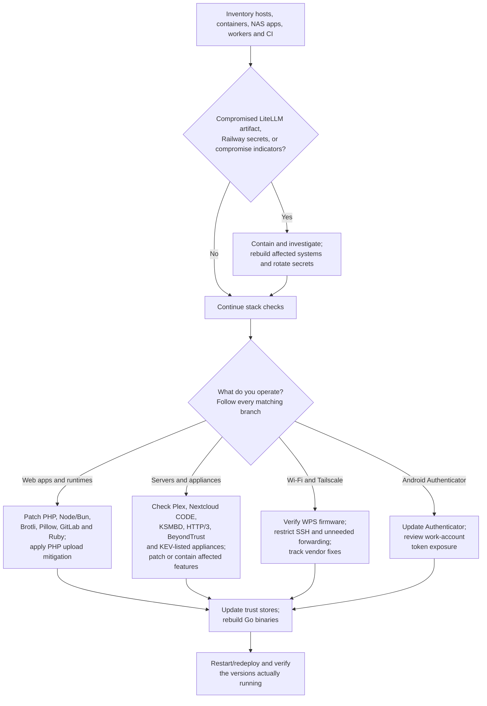

# Black October: What Broke, What’s Exposed, and What to Patch

**As of October 26, 2026**

[Security updates](../CHANGELOG.md) · [Hourly maintenance process](MAINTENANCE.md)

“Black October” is an informal label for the unusually dense run of vulnerability disclosures and security incidents this month—particularly the October 19–23 cluster. It is **not one coordinated attack, one vulnerability family, or an official advisory list**.

The concern is justified: several flaws sit below application code, in runtimes, image decoders, and infrastructure components. Updating your application dependencies alone may leave the vulnerable runtime or bundled native library untouched.

This report covers the major disclosures most relevant to developers and operators of personal infrastructure, plus related incidents that require credential rotation rather than a patch. It is not an exhaustive catalog of October CVEs. Some vulnerabilities were fixed earlier but received public technical disclosures or exploitation reports this month.

## Table of contents

- [The short version](#the-short-version)
  - [How to use the impact checks](#how-to-use-the-impact-checks)
- [VeloCloud Orchestrator — authenticated SQL injection](#velocloud-orchestrator-authenticated-sql-injection-to-superuser-operator-cve-2026-114625)
- [Siemens Software Center — exploited DLL side-loading](#siemens-software-center-dll-side-loading-exploited-in-clickfix-campaign-cve-2026-110936)
- [PAN-OS — authenticated management interface RCE (CVE-2026-0322)](#pan-os-authenticated-management-interface-rce-cve-2026-0322)
- [Cisco Secure Email Gateway — exploited AMP path traversal (CVE-2026-76519)](#cisco-secure-email-gateway-amp-attachment-path-traversal-cve-2026-76519)
- [SiteGuard Server Edition — root command injection](#siteguard-server-edition-root-command-injection-via-statistics-feature-cve-2026-106931)
- [Windows Shell — exploited MOTW bypass (CVE-2026-96951)](#windows-shell-mark-of-the-web-bypass-zero-day-cve-2026-96951)
- [Ivanti Connect Secure — authentication bypass to command execution](#ivanti-connect-secure-authentication-bypass-to-command-execution-cve-2026-104935)
- [Atlassian Data Center — unauthenticated web-root file read](#atlassian-data-center-unauthenticated-web-root-file-read-cve-2026-21589)
- [AhsayCBS — exploited auth bypass and command injection (CVE-2026-105133, CVE-2026-105134)](#ahsaycbs-authentication-bypass-and-command-injection-chain-cve-2026-105133-and-cve-2026-105134)
- [NetScaler — SAML memory overflow DoS](#netscaler-saml-memory-overflow-denial-of-service-cve-2026-88779)
- [FortiMail — unauthenticated file write](#fortimail-unauthenticated-file-write-cve-2026-104286)
- [Zammad — session hijack RCE and root escalation chain](#zammad-session-hijack-rce-and-root-escalation-chain-cve-2026-102489-and-cve-2026-102490)
- [Tailworm — Tailscale SSH and related findings under review](#tailworm-tailscale-ssh-and-related-findings-under-review)
- [AuthMask — Microsoft Authenticator for Android](#authmask-microsoft-authenticator-for-android-token-theft)
- [PHP2Shell](#1-php2shell-unauthenticated-execution-below-your-application)
  - [The October 23 follow-up](#the-october-23-follow-up-matters)
- [HTTP2Shell / Node2Shell — Brotli](#2-http2shell--node2shell-a-cross-stack-brotli-decoder-vulnerability)
  - [Other high-severity Node.js fixes](#other-high-severity-nodejs-fixes-in-the-same-release)
- [GitLab and Ruby](#3-gitlab-and-ruby-regex-compilation-becomes-code-execution)
  - [GitLab identity vulnerabilities](#related-gitlab-identity-vulnerabilities)
  - [Ruby applications](#ruby-applications-need-their-own-update)
- [Pillow](#4-pillow-untrusted-images-reach-native-memory-corruption-and-command-execution)
- [Plex2Shell](#5-plex2shell-a-home-server-compromise-chain-is-being-exploited)
- [Nextcloud’s built-in Collabora CODE server](#6-nextclouds-built-in-collabora-code-server-unauthenticated-command-injection)
- [Linux KSMBD](#7-linux-ksmbd-serious-kernel-level-reports-but-not-every-linux-server)
- [WPSplinter](#8-wpsplinter-nearby-attackers-can-compromise-vulnerable-routers)
- [Header Accordions — HTTP/3](#9-header-accordions-http3-compression-becomes-resource-exhaustion)
- [BeyondTrust Remote Support](#10-beyondtrust-remote-support-an-already-exploited-appliance-vulnerability)
- [eMudhra / emSign — certificate-authority compromise](#emudhra--emsign)
- [LiteLLM — malicious release and credential theft](#litellm)
- [Railway — exposed environment secrets](#railway)
- [What should I patch? A stack-based decision guide](#what-should-i-patch-a-stack-based-decision-guide)

## The short version

- **Patch KEV-listed edge and enterprise software first.** CISA added FortiMail, Zammad, NetScaler, Ivanti Connect Secure, Windows Shell, PAN-OS, AhsayCBS, Cisco Secure Email Gateway, Atlassian Data Center, SiteGuard, Siemens Software Center and VeloCloud flaws to its Known Exploited Vulnerabilities catalog in October; several require forensic triage, not just patching.
- **Review Tailscale SSH authorization and forwarding.** Tailworm's principal SSH chains require existing authorized access; disable unnecessary forwarding and track official fixes, rather than treating every VPN node as remotely exploitable.
- **Update Microsoft Authenticator on Android**, especially devices with signed-in work accounts. AuthMask requires a malicious local app; patching does not revoke already stolen tokens.
- **Prioritize exposed PHP, GitLab, Plex, and Nextcloud installations using the built-in Collabora CODE server.**
- **Update Node.js, Bun, and Python’s Brotli packages.** The Brotli flaw can arrive through an outbound HTTP response, not just an incoming request.
- **Update Pillow wherever you process untrusted images**, including thumbnail workers and document pipelines.
- **Check Ruby separately from GitLab.** The underlying regex bugs affect other applications compiling attacker-controlled patterns.
- **Update certificate trust data and rebuild Go applications.** The eMudhra incident affects clients even if your own website uses another certificate authority.
- **If you ran the compromised LiteLLM release or stored secrets in Railway, patching alone is insufficient.**

Severity scores below are attributed where ratings differ. CVSS measures technical severity, not whether exploitation has been observed or whether your particular deployment is reachable.

### How to use the impact checks

The checks below are **read-only inventory checks, not exploit probes**. Run them against your own deployments, including each container, worker, virtual environment, and appliance. Replace example paths with actual deployment paths. A missing command, inaccessible configuration, or absent package in one environment means **unknown for the rest of your infrastructure**, not “safe.”

Interpret results in three steps: **is the component present; does its exact build include the fix; can untrusted input reach the affected feature?** Compare versions within the appropriate release branch and verify vendor backports. Installed files can differ from a still-running process. None of these checks establishes whether a system was previously compromised. If compromise is suspected, inspect a snapshot from a clean system rather than executing its interpreters or application tools.

**Companion files:** Download these alongside the Markdown report. The commands below assume you are in the download directory; use absolute script paths when running as another user. Review the scripts before executing them. They do not install packages, patch services, send exploit payloads, or require API credentials.

| File | Purpose | Requirements |
|---|---|---|
| [stack-inventory.sh](stack-inventory.sh) | PHP settings, Node/Bun/Ruby versions, GitLab information, Nextcloud app list, or Go binary build metadata | POSIX shell and the selected product's tool |
| [python-package-inventory.py](python-package-inventory.py) | Brotli, brotlicffi, Pillow, olefile, and LiteLLM package metadata without importing them | Trusted Python 3.8+; no third-party dependencies |
| [linux-service-inventory.sh](linux-service-inventory.sh) | KSMBD presence, SMB/Plex listeners, and visible RDMA devices | Linux; `ss` for listener inspection |
| [check_brotli.py](check_brotli.py) | Response-header compression inventory; **not a vulnerability verdict**. [Usage and limits](details/brotli.md#response-header-inventory-script) | Python 3.9+; standard library; authorized HTTP(S) GET requests |

An exit status of zero means the requested inventory commands completed, **not that the system is patched**. Nonzero status means the check failed or its input/tool is unavailable. The Linux script may finish with explicitly marked `UNKNOWN` partial results; read its output. Shell checks inspect tools on the current user's PATH, so run inside the correct deployment or set PATH to the intended runtime. Do not run them against a suspected compromised installation; use clean-host snapshot inspection instead.

Each item links to a detailed operational guide. **Last updated** changes only when that item's content changes, not whenever a scheduled review runs. Unknown private-discovery or patch dates are marked explicitly; announcement, release, revocation and deployment are different events. Dates below are in 2026 unless stated otherwise; detailed timelines preserve source timezones.

**Reading the date tables:** `Time/TZ unknown` means the source date is known but its time and timezone have not been established; it does not mean midnight. UTC timestamps retain the precision recorded in the detailed timeline. **Last updated** is the guide's revision timestamp in America/New_York, not a new vulnerability event or a fresh research pass.

## VeloCloud Orchestrator: authenticated SQL injection to superuser operator (CVE-2026-114625)

[Back to TOC](#table-of-contents)

**[CVE-2026-114625](https://www.cve.org/CVERecord?id=CVE-2026-114625): Arista CVSS 3.1 9.9 Critical; Arista CVSS 4.0 9.4 Critical; in CISA KEV**

| Event | Date and time (timezone) | Notes |
|---|---|---|
| Discovery | Unknown date | Detected by Arista itself. |
| Hosted and Dedicated VCO patched | Unknown; on or before 2026-10-22 | Arista gives no date. |
| Arista Security Advisory 0199 and on-prem fixes | 2026-10-22; time/TZ unknown | Already known to be exploited. CVE published 20:47 UTC. |
| CISA KEV addition | 2026-10-23 (date only) | Due **2026-10-26**; forensic triage required. |
| **Last updated** | **2026-10-26 09:28 EDT (UTC−04:00)** | Added from CISA KEV backlog review and primary sources. |

**[Detailed guide](details/velocloud.md):** [Detection](details/velocloud.md#detection) · [Remediation](details/velocloud.md#remediation) · [Verification](details/velocloud.md#verification) · [Timeline](details/velocloud.md#timeline)

This is a SQL injection flaw in **on-premises** VeloCloud Orchestrator (VCO). Any authenticated user, down to the *Enterprise Read Only* role, can pose as a local "superuser operator" and reach internal-only functions. Arista says no configuration prevents the exposure. Hosted VCO, including Dedicated, has been patched by Arista. VeloCloud Edge and Gateway are not affected.

**Worst case:** Full compromise of the orchestrator host and its data, and through it the SD-WAN edges and gateways it manages.

**Exploitation:** Confirmed by Arista. The observed attacking IPs are 74.82.197.86 and 38.54.50.151. This is the third exploited VCO flaw in CISA KEV in 2026. The Hacker News reports that releases fixing the July and September flaws are still affected by this one.

**Am I impacted?** Check whether you run on-prem VCO on one of these trains below the fixed build:

- 5.2 before **5.2.3.18**
- 6.1 before **6.1.3.10**
- 6.4 before **6.4.2.12**

Arista has not assessed end-of-support releases. Review web access logs for the two IPs, encoded or internal-service path components and high request rates, and look for operator-level actions by low-privilege users.

**Patch:** Upgrade to the fixed build on your train, or contact Arista TAC if your train is unsupported. Until then, restrict the UI to trusted admin networks, block the IPs, and monitor outbound traffic, webshells and admin changes. Preserve VCO, database and system logs before you upgrade if you suspect compromise.

Sources: [Arista Security Advisory 0199](https://www.arista.com/en/support/advisories-notices/security-advisory/24838-security-advisory-0199), [CVE record](https://cveawg.mitre.org/api/cve/CVE-2026-114625), [CISA KEV](https://www.cisa.gov/known-exploited-vulnerabilities-catalog?field_cve=CVE-2026-114625), [The Hacker News](https://thehackernews.com/2026/10/arista-warns-of-critical-velocloud-sql.html).

## Siemens Software Center: DLL side-loading exploited in ClickFix campaign (CVE-2026-110936)

[Back to TOC](#table-of-contents)

**[CVE-2026-110936](https://www.cve.org/CVERecord?id=CVE-2026-110936): Siemens CVSS 4.0 8.4 High, but Siemens CVSS 3.1 6.7 Medium (both local, high privilege); in CISA KEV**

| Event | Date and time (timezone) | Notes |
|---|---|---|
| Private report | Unknown | Credited to Jose Oregon (Huntress Labs); no date given. |
| Siemens advisory SSA-580366 | 2026-10-15; time/TZ unknown | CVE published 14:01 UTC. |
| Fix V4.0.9.8 added to advisory | 2026-10-17; time/TZ unknown | SSA V1.1. The release date of the build itself is not established. |
| Active exploitation and IOCs | 2026-10-19; time/TZ unknown | Siemens ProductCERT blog post. Exploitation start date unknown. |
| CISA KEV addition | 2026-10-20 (date only) | Due 2026-11-03; no forensic triage required. |
| **Last updated** | **2026-10-26 09:28 EDT (UTC−04:00)** | Added from CISA KEV backlog review and primary sources. |

**[Detailed guide](details/siemens-software-center.md):** [Detection](details/siemens-software-center.md#detection) · [Remediation](details/siemens-software-center.md#remediation) · [Verification](details/siemens-software-center.md#verification) · [Timeline](details/siemens-software-center.md#timeline)

Siemens Software Center versions before V4.0.9.8 load DLLs from an uncontrolled search path. Attackers bundled a **genuine, signed** copy (version 3.5.8.7) with malicious DLLs and delivered it as `AllMyBasic.msi` through the "Romulus" ClickFix campaign.

**Worst case:** Malware runs under a trusted Siemens-signed process on Windows PCs, including PCs that never had Siemens software. Siemens does not describe the payload's full capabilities.

**Exploitation:** Confirmed by Siemens. Siemens says no Siemens system or update channel was breached.

**Am I impacted?** You have two separate things to check:

- **Your own installations:** any Siemens Software Center older than 4.0.9.8.
- **The campaign:** `SiemensSoftwareCenter.exe` running from `AppData\Local\Programs`, started by `msiexec`. Other signs are an `SM Software Provisioning Service` folder, `activate.bak` or `statinfosta.DB` next to the executable, `AppData\Local\FTSuite\ftc.uml`, or connections to `96.62.218[.]59` or `wizardexpensive[.]com`.

A valid Siemens signature does **not** clear a file. The [detail guide](details/siemens-software-center.md#read-only-host-check-powershell) has read-only PowerShell checks.

**Patch:** Update to **V4.0.9.8 or later**. Starting the application installs the update automatically. Download Siemens software only from official sources, and block the published IOCs. Patching your own copy does not stop attackers from dropping an old signed copy, so keep hunting by folder and behaviour. If you find an infection, isolate the PC, stop the process, remove the start-up entry and task, and reset passwords.

Sources: [Siemens SSA-580366](https://cert-portal.siemens.com/productcert/html/ssa-580366.html), [Siemens exploitation blog](https://productcert.siemens.com/news/2026/10/19/active-exploitation-of-cve-2026-110936-in-siemens-software-center/), [CVE record](https://cveawg.mitre.org/api/cve/CVE-2026-110936), [CISA KEV](https://www.cisa.gov/known-exploited-vulnerabilities-catalog?field_cve=CVE-2026-110936).

## PAN-OS: authenticated management interface RCE (CVE-2026-0322)

[Back to TOC](#table-of-contents)

**[CVE-2026-0322](https://www.cve.org/CVERecord?id=CVE-2026-0322) — Palo Alto Networks CVSS 4.0: 8.6 High (8.5 if management is limited to a jump box); NVD CVSS 3.1: 7.2 High; CISA KEV**

| Event | Date and time (timezone) | Notes |
|---|---|---|
| Private discovery | Unknown | Found internally by Palo Alto Networks. |
| Vendor disclosure and most fixes | 2026-10-14 16:00 UTC | Hotfix builds listed for 10.2 through 12.2. |
| CISA KEV addition | 2026-10-14; time/TZ unknown | Federal due date 2026-10-17. |
| PAN-OS 11.2.16 published | 2026-10-15 18:30 UTC | The only fix for 11.2.14–11.2.15. |
| **Last updated** | **2026-10-26 09:28 EDT (UTC−04:00)** | Added from CISA KEV backlog review and primary sources. |

**[Detailed guide](details/pan-os.md):** [Detection](details/pan-os.md#detection) · [Remediation](details/pan-os.md#remediation) · [Verification](details/pan-os.md#verification) · [Timeline](details/pan-os.md#timeline)

A code-injection flaw in the PAN-OS management interface lets an **authenticated** administrator-level attacker run code as **root**. It affects PA-Series and VM-Series firewalls and **Panorama**. Cloud NGFW and Prisma Access are not affected.

**Worst case:** someone who already holds management credentials, or reaches the interface with stolen ones, takes full control of the firewall or Panorama, including its secrets and policy. The vendor does not claim unauthenticated exploitation.

**Exploitation:** Palo Alto Networks reports "very limited exploitation" and lists three source IPs in its advisory FAQ.

**Am I impacted?** Run `show system info` on each firewall and Panorama and compare `sw-version` with the [fixed-build table](details/pan-os.md#inventory-and-version). Then check whether the management interface, or any dataplane interface with a management profile, can be reached from untrusted networks. Exposure to the internet is the highest-risk case.

**Patch:** Upgrade to the fixed build for your branch, for example 12.2.4, 12.1.10-h2, 11.2.16, 11.1.16-h3, 10.2.18-h12, or the listed intermediate hotfixes. There is no workaround. Restrict management access to trusted IPs or a jump box now. Threat IDs 510046/510047 give only limited coverage, and only with management traffic decrypted.

Sources: [Palo Alto Networks advisory](https://security.paloaltonetworks.com/CVE-2026-0322), [CNA record](https://cveawg.mitre.org/api/cve/CVE-2026-0322), [NVD](https://services.nvd.nist.gov/rest/json/cves/2.0?cveId=CVE-2026-0322), [CISA KEV feed](https://www.cisa.gov/sites/default/files/feeds/known_exploited_vulnerabilities.json).

## Cisco Secure Email Gateway: AMP attachment path traversal (CVE-2026-76519)

[Back to TOC](#table-of-contents)

**[CVE-2026-76519](https://www.cve.org/CVERecord?id=CVE-2026-76519) — Cisco CVSS 3.1: 9.8 Critical; Cisco SIR: Critical; CISA KEV**

| Event | Date and time (timezone) | Notes |
|---|---|---|
| Private discovery | Unknown | Found by Cisco during internal security scanning. |
| Fixed AsyncOS builds first listed | 2026-09-14 16:00 GMT | September hardening release; it did not name this CVE until 2026-10-14. |
| Cisco learns of exploitation | 2026-10 (exact day not established) | Per Cisco PSIRT. |
| Cisco advisory | 2026-10-14 16:00 GMT | `cisco-sa-esa-afw-zqYJkjxp`. |
| CISA KEV addition | 2026-10-14; time/TZ unknown | Federal due date 2026-10-17. |
| **Last updated** | **2026-10-26 09:28 EDT (UTC−04:00)** | Added from CISA KEV backlog review and primary sources. |

**[Detailed guide](details/cisco-seg.md):** [Detection](details/cisco-seg.md#detection) · [Remediation](details/cisco-seg.md#remediation) · [Verification](details/cisco-seg.md#verification) · [Timeline](details/cisco-seg.md#timeline)

A path traversal in how the gateway's AMP **File Reputation** feature handles attachments lets an unauthenticated attacker write files and run commands as **root**, simply by sending an email through the gateway. No recipient needs to click anything.

**Worst case:** root on the mail gateway, with access to mail flow, credentials and cluster SSH keys, which can lead to compromise of other cluster members.

**Exploitation:** Cisco confirms active exploitation. Cisco contacted Secure Email Cloud customers where it found malicious activity.

**Am I impacted?** A physical or virtual Secure Email Gateway is affected only if **File Reputation is enabled on a mail policy** *and* **Content Scanner Tools is older than 25.3.0.5525** (check with `contentscannerstatus`). **Secure Email and Web Manager and Secure Web Appliance are not affected**, though SEWM has separate CVEs in the September hardening release. Run Cisco's `grep "System Security" system_logs` check on every cluster member.

**Patch:** Update Content Scanner Tools to **25.3.0.5525+**, which needs no reboot, or upgrade AsyncOS to **15.5.5-014** or **16.5.0-780**; 16.0 must migrate to a fixed release. There are no workarounds. Secure Email Cloud has already been fixed by Cisco. If the appliance may be compromised, preserve evidence before upgrading and rebuild as Cisco directs.

Sources: [Cisco advisory](https://sec.cloudapps.cisco.com/security/center/content/CiscoSecurityAdvisory/cisco-sa-esa-afw-zqYJkjxp), [Cisco hardening release](https://sec.cloudapps.cisco.com/security/center/content/CiscoSecurityAdvisory/cisco-sa-hardening-esa-dfCrfXkm), [Cisco CNA record](https://cveawg.mitre.org/api/cve/CVE-2026-76519), [CISA KEV feed](https://www.cisa.gov/sites/default/files/feeds/known_exploited_vulnerabilities.json).

## SiteGuard Server Edition: root command injection via statistics feature (CVE-2026-106931)

[Back to TOC](#table-of-contents)

**[CVE-2026-106931](https://www.cve.org/CVERecord?id=CVE-2026-106931): JPCERT/CC (CNA) and vendor CVSS 4.0 8.5 High and CVSS 3.0 7.8 High; vendor label 緊急 (urgent) and JVN label "Critical"; in CISA KEV**

| Event | Date and time (timezone) | Notes |
|---|---|---|
| Private discovery/report | Unknown | The developer reported the flaw to IPA; no date given. |
| Vendor notice to support-contract customers | 2026-09-29; time/TZ unknown | Customers with direct support contracts were told about the flaw and the upgrade or patch. |
| Public vendor advisory, JVN and JPCERT/CC alert | 2026-10-14; time/TZ unknown | Exploitation already confirmed by the vendor. CVE published 04:45 UTC. |
| CISA KEV addition | 2026-10-20 (date only) | Due 2026-10-23; forensic triage required. |
| **Last updated** | **2026-10-26 09:28 EDT (UTC−04:00)** | Added from CISA KEV backlog review and primary sources. |

**[Detailed guide](details/siteguard.md):** [Detection](details/siteguard.md#detection) · [Remediation](details/siteguard.md#remediation) · [Verification](details/siteguard.md#verification) · [Timeline](details/siteguard.md#timeline)

SiteGuard Server Edition is EG Secure Solutions' host-based web application firewall (WAF) for Apache httpd, Nginx and IIS, and is widely used in Japan. Its **statistics feature**, enabled by default, has an OS command injection flaw. The published CVSS vectors are **local, low-privilege** (AV:L/PR:L). The reviewed sources do not explain how attackers in the wild reached the feature.

**Worst case:** Arbitrary OS commands run as **root or SYSTEM** on the web server.

**Exploitation:** The vendor and JVN say exploitation has been confirmed. They publish no IOCs, start date or attribution.

**Am I impacted?** You are affected if you run Ver2.20 or later with statistics enabled and your version is below:

- **Ver8.00 Update 5** for Apache, Nginx and IIS
- **Ver7.00 Update 6** for Apache and Nginx on FreeBSD

IIS Ver3.10 through Ver4.00 Update 4 are not affected. Check the version and the statistics setting in the SiteGuard web administration console.

**Patch:** First, download the diagnostic information (診断情報) from the console and store it elsewhere, because updating may erase attack traces. Then update to the fixed version. If you cannot upgrade, apply the vendor's statistics-file patch, which is also available for end-of-life versions, or disable the statistics feature (JPCERT/CC workaround). Treat affected hosts as possibly compromised.

Sources: [EG Secure Solutions advisory (Japanese)](https://www.eg-secure.co.jp/siteguard/news/alert-202610-1), [JVN#88474777](https://jvn.jp/en/jp/JVN88474777/), [JPCERT-AT-2026-0032](https://www.jpcert.or.jp/at/2026/at260032.html), [CVE record](https://cveawg.mitre.org/api/cve/CVE-2026-106931), [CISA KEV](https://www.cisa.gov/known-exploited-vulnerabilities-catalog?field_cve=CVE-2026-106931).

## Windows Shell: Mark of the Web bypass zero-day (CVE-2026-96951)

[Back to TOC](#table-of-contents)

**[CVE-2026-96951](https://www.cve.org/CVERecord?id=CVE-2026-96951) — Microsoft CVSS 3.1: 8.8 High; vendor severity: Important; Microsoft: Exploited: Yes; CISA KEV**

| Event | Date and time (timezone) | Notes |
|---|---|---|
| Private discovery/report | Unknown | MSRC credits external researchers but gives no report dates. |
| Microsoft disclosure and Windows updates | 2026-10-13 07:00 PDT (UTC−07:00) | October 2026 Patch Tuesday; exploited as a zero-day. |
| CVE record published | 2026-10-13 19:01:26 UTC | Microsoft CNA record. |
| CISA KEV addition | 2026-10-13; time/TZ unknown | Federal due date 2026-10-16. Not the date exploitation started. |
| **Last updated** | **2026-10-26 09:28 EDT (UTC−04:00)** | Added from CISA KEV backlog review and primary sources. |

**[Detailed guide](details/windows-shell.md):** [Detection](details/windows-shell.md#detection) · [Remediation](details/windows-shell.md#remediation) · [Verification](details/windows-shell.md#verification) · [Timeline](details/windows-shell.md#timeline)

A command-injection flaw in Windows Shell lets a crafted file or link evade **Mark of the Web (MOTW)** protections. The user must open the file or click the link, for example from email or instant messaging. Microsoft also lists Outlook.com, which it fixed on the service side.

**Worst case:** a malicious download or attachment runs without the usual SmartScreen or Protected View warnings, as the signed-in user. It is a bypass that enables a follow-on payload, not user-free remote code execution.

**Exploitation:** Microsoft reports exploitation detected but has published no actor, campaign or IOCs.

**Am I impacted?** Every supported Windows 10, Windows 11 and Windows Server 2012 R2–2025 branch below the October fixed build. Examples: 24H2 `26100.9711`, 25H2 `26200.9711`, 23H2 `22631.7652`, 22H2 `19045.7807`, Server 2022 `20348.5761`, Server 2025 `26100.33650`. Read `CurrentBuild` and `UBR` from the registry as shown in the [detail guide](details/windows-shell.md#establish-exposure). A device that has not reported recently counts as unknown.

**Patch:** Install the October 2026 cumulative update for each branch and reboot. KBs: 24H2/25H2/26H2 KB5127648; 26H1 KB5127646; 23H2 KB5126653; Windows 10 21H2/22H2 KB5126657; 1809/Server 2019 KB5126651; 1607/Server 2016 KB5126868; Server 2022 KB5126655; Server 2025 KB5126646; Server 2012 R2 KB5126836. Attachment filtering and ASR rules reduce risk but do not replace the update.

Sources: [Microsoft advisory](https://msrc.microsoft.com/update-guide/vulnerability/CVE-2026-96951), [Microsoft CNA record](https://cveawg.mitre.org/api/cve/CVE-2026-96951), [CISA KEV feed](https://www.cisa.gov/sites/default/files/feeds/known_exploited_vulnerabilities.json), [Rapid7 analysis](https://www.rapid7.com/blog/post/em-patch-tuesday-october-2026/).

## Ivanti Connect Secure: authentication bypass to command execution (CVE-2026-104935)

[Back to TOC](#table-of-contents)

**[CVE-2026-104935](https://www.cve.org/CVERecord?id=CVE-2026-104935) — Ivanti (CNA) CVSS 3.1: 8.6 High (the advisory labels the vector CVSS 3.0); no NVD score of its own; CISA KEV (forensic triage required)**

| Event | Date and time (timezone) | Notes |
|---|---|---|
| Partial internal discovery and fix | 2026-07 (exact day not established) | Ivanti fixed "a portion" in 25.1.3.0 and was backporting it. |
| Exploitation start | 2026-10-03; time/TZ unknown | Earliest exploitation observed by Volexity (UTA0576) against 22.8R2.4. |
| Fixed releases 25.1.1.2 / 22.8R2.5 | 2026-10-05 / 2026-10-12; time/TZ unknown | Release dates from Ivanti's advisory. Volexity says the patches were released October 13. |
| Ivanti public advisory | 2026-10-13; time/TZ not shown | Discloses limited exploitation. |
| CVE record published | 2026-10-13 15:31:07 UTC | CNA metadata. |
| CISA KEV addition | 2026-10-13 (date only) | Due 2026-10-16. |
| Chained privilege escalation [CVE-2026-111357](https://www.cve.org/CVERecord?id=CVE-2026-111357) | 2026-10-15 20:56:58 UTC | Assigned by the MITRE CNA (CVSS 3.1: 7.0); fix not confirmed in reviewed sources. |
| **Last updated** | **2026-10-26 09:28 EDT (UTC−04:00)** | Added from CISA KEV backlog review and primary sources. |

**[Detailed guide](details/ivanti-connect-secure.md):** [Detection](details/ivanti-connect-secure.md#detection) · [Remediation](details/ivanti-connect-secure.md#remediation) · [Verification](details/ivanti-connect-secure.md#verification) · [Timeline](details/ivanti-connect-secure.md#timeline)

A spoofed internal-routing header (`X-DSCGI-PATH`) sent to the public `welcome.cgi` login script reaches a protected CGI. Combined with a file-write race in `wu.cgi`, this lets an unauthenticated attacker execute commands on the Connect Secure VPN appliance.

**Worst case:** Unauthenticated command execution on the VPN edge. In the wild, it was chained with a separate root escalation, and attackers stole LDAP credentials, searched for LAPS passwords and BitLocker keys, sniffed traffic, and exfiltrated data.

**Exploitation status:** Ivanti, CISA and Volexity confirm zero-day exploitation. The chain runs largely in memory and erases log entries, so Ivanti's Integrity Checker Tool **may not detect it**. Confirming compromise requires memory and network forensics.

**Am I impacted?** Check each appliance's running version. Affected versions are **25.1.1.1 and prior, 25.1.2.2 and prior, and 22.8R2.4 and prior**. **22.7R2.14 and prior are not affected.** The CNA description's "before 25.1.3.0" is shorthand; 25.1.1.2 and 22.8R2.5 also fix the issue. Hunt for `welcome.cgi` requests carrying `X-DSCGI-PATH` headers and for Volexity's indicators.

**Patch:** Update to **25.1.1.2**, **25.1.3.0/25.1.3.1** (requires the ISA4500/6500/8500 platform), or **22.8R2.5**. Ivanti recommends that 22.8 customers move to 25.1, because 22.7 and 22.8 reach end of life on 2027-01-31. If compromise is suspected, follow Ivanti's recovery steps (factory reset or rebuild, then reset all passwords, certificates and API keys) and investigate Active Directory.

Sources: [Ivanti advisory](https://hub.ivanti.com/s/article/Security-Advisory-Ivanti-Connect-Secure-CVE-2026-104935?language=en_US), [Ivanti CNA record](https://cveawg.mitre.org/api/cve/CVE-2026-104935), [CISA alert](https://www.cisa.gov/news-events/alerts/2026/10/13/cisa-urges-patching-newly-exploited-vulnerability-ivanti-connect-secure), [Volexity analysis](https://www.volexity.com/blog/2026/10/13/a-series-of-unauthenticated-events-chained-exploitation-of-ivanti-connect-secure-zero-days/), [CVE-2026-111357 record](https://cveawg.mitre.org/api/cve/CVE-2026-111357), [CISA KEV feed](https://www.cisa.gov/sites/default/files/feeds/known_exploited_vulnerabilities.json).

## Atlassian Data Center: unauthenticated web-root file read (CVE-2026-21589)

[Back to TOC](#table-of-contents)

**[CVE-2026-21589](https://www.cve.org/CVERecord?id=CVE-2026-21589): Atlassian CVSS 4.0 9.3 Critical; NVD CVSS 3.1 7.5 High; in CISA KEV**

| Event | Date and time (timezone) | Notes |
|---|---|---|
| Private discovery/report | Unknown | Not stated in the reviewed sources. |
| Atlassian advisory and fixed releases | 2026-10-05; time/TZ unknown | Out-of-band advisory. CVE published 2026-10-05 21:30 UTC. |
| watchTowr technical analysis | 2026-10-06; time/TZ unknown | Root cause, PoC URLs and a Crowd credential chain. |
| First exploitation attempts | 2026-10-06 (per SANS ISC) | Honeypots saw the published PoC URLs. |
| CISA KEV addition | 2026-10-15 (date only) | Due 2026-10-18; forensic triage required. |
| **Last updated** | **2026-10-26 09:28 EDT (UTC−04:00)** | Added from CISA KEV backlog review and primary sources. |

**[Detailed guide](details/atlassian-dc.md):** [Detection](details/atlassian-dc.md#detection) · [Remediation](details/atlassian-dc.md#remediation) · [Verification](details/atlassian-dc.md#verification) · [Timeline](details/atlassian-dc.md#timeline)

A shared Atlassian web-resource library turns `::` back into `/`. That lets an unauthenticated attacker read any file inside the application's web root, as long as they know its exact path. It cannot list directories or read files outside the Tomcat context. The affected products are Bitbucket, Confluence, Jira Software, Jira Service Management, Bamboo and Crowd Data Center, plus Crucible and Fisheye. Atlassian has patched its Cloud products; no Cloud customer action is required.

**Worst case:** It depends on configuration. watchTowr read the plaintext Crowd application password from Jira's `WEB-INF/classes/crowd.properties`, used it to call Crowd's API, and added a user to `jira-administrators`.

**Exploitation:** Scanning with the published PoC URLs began within about a day of the advisory, and CISA lists the flaw in KEV. A KEV listing does not tell you whether your own instance was read.

**Am I impacted?** Check the exact version of every node, mirror and Crowd server against Atlassian's per-branch fixes. A lower version on a different release line is not fixed. End-of-life Server editions get no fix. Search access, proxy and WAF logs with Atlassian's regex using the [read-only log search](details/atlassian-dc.md#access-log-search-read-only).

**Patch:** Fixed versions by product:

- Bitbucket: 9.4.26, 10.2.8, 10.5.1
- Confluence: 9.2.26, 10.2.19
- Jira Software: 9.12.40, 10.3.26, 11.3.12
- Jira Service Management: 5.12.40, 10.3.26, 11.3.12
- Bamboo: 10.2.24, 12.1.12
- Crowd: 6.3.7, 7.0.3, 7.1.7, 7.2.4
- Crucible and Fisheye: 4.9.15

Until you can upgrade, take the instance off the internet and apply Atlassian's WAF, `RewriteValve` or `urlrewrite.xml` mitigation on every node. If you may have been exposed, rotate secrets stored in the web root.

Sources: [Atlassian advisory](https://confluence.atlassian.com/security/cve-2026-21589-arbitrary-file-access-vulnerability-impacts-multiple-products-1870495748.html), [CVE record](https://cveawg.mitre.org/api/cve/CVE-2026-21589), [NVD](https://services.nvd.nist.gov/rest/json/cves/2.0?cveId=CVE-2026-21589), [CISA KEV](https://www.cisa.gov/known-exploited-vulnerabilities-catalog?field_cve=CVE-2026-21589), [watchTowr analysis](https://labs.watchtowr.com/you-wont-hear-about-these-even-in-myths-atlassian-jira-confluence-and-more-pre-auth-arbitrary-file-read-cve-2026-21589), [SANS ISC](https://isc.sans.edu/diary/Scans+for+Atlassian+vulnerablity+CVE202621589/33406/).

## AhsayCBS: authentication bypass and command injection chain (CVE-2026-105133 and CVE-2026-105134)

[Back to TOC](#table-of-contents)

**[CVE-2026-105133](https://www.cve.org/CVERecord?id=CVE-2026-105133) — VulDB CVSS 3.1: 7.3 High; VulDB CVSS 4.0: 6.9 Medium per the CNA record, 5.5 Medium as displayed by NVD with `E:P`. [CVE-2026-105134](https://www.cve.org/CVERecord?id=CVE-2026-105134) — VulDB CVSS 3.1: 10.0 Critical; CVSS 4.0: 10.0 (CNA) / 9.3 (NVD display). Both in CISA KEV.**

| Event | Date and time (timezone) | Notes |
|---|---|---|
| CVE records published | 2026-10-04 05:15–05:30 UTC | VulDB CNA; dated its own advisory 2026-10-03. Public exploit stated. |
| Exploitation observed | 2026-10-07 23:20:15 UTC | Huntress; webshells and XMRig miners. |
| v10 hotfix 10.3.4.45 | 2026-10-10 per Ahsay (Huntress: 2026-10-12) | Sources disagree on the date. |
| v7–v9 hotfix 9.15.2.70 | 2026-10-12; time/TZ unknown | v7/v8 first upgrade to 9.15.0.0. |
| CISA KEV addition | 2026-10-14; time/TZ unknown | Federal due date 2026-10-17. |
| **Last updated** | **2026-10-26 09:28 EDT (UTC−04:00)** | Added from CISA KEV backlog review and primary sources. |

**[Detailed guide](details/ahsaycbs.md):** [Detection](details/ahsaycbs.md#detection) · [Remediation](details/ahsaycbs.md#remediation) · [Verification](details/ahsaycbs.md#verification) · [Timeline](details/ahsaycbs.md#timeline)

AhsayCBS is a backup server used mainly by MSPs. Attackers chain the two flaws: an authentication bypass in `checkSysPwd`, then OS command injection via `/rps/api/json/UpdateReceivers.do`. Together they give unauthenticated remote code execution (SYSTEM on the Windows hosts Huntress investigated).

**Worst case:** an attacker fully controls the backup server and can reach customers' backups, add malicious replication receivers, and plant webshells.

**Exploitation:** Huntress observed attacks from October 7, against five organizations by October 8. Ahsay began receiving partner reports on October 9.

**Am I impacted?** The CVE record's range ("up to 10.3.2; 10.3.4 unaffected") is **wrong**. Huntress showed 10.3.4 is affected, and Ahsay says the earlier 10.3.4.0 and 9.15.2.59 patches did not fully fix the flaws. Treat any v7–v10 server without the hotfix as affected, especially if its console is reachable from the internet. Check for the [Ahsay and Huntress IOCs](details/ahsaycbs.md#indicators-to-check-read-only).

**Patch:** v10: apply hotfix **10.3.4.45** or later. v7–v9: apply **9.15.2.70** (v7/v8 first upgrade to 9.15.0.0). Reboot after either. Ahsay says these fully address both CVEs. A later hardening hotfix (Oct 22) and v10.3.6 are additional hardening. If the server shows indicators, rebuild it as Ahsay describes rather than patching in place.

Sources: [Ahsay status and IOCs](https://www.ahsay.com/en/company/announcements/ahsaycbs-vulnerability-status-update), [Ahsay hotfix alert](https://www.ahsay.com/en/company/announcements/patch-cve-105133-105134-update), [VulDB CNA record 105133](https://cveawg.mitre.org/api/cve/CVE-2026-105133), [VulDB CNA record 105134](https://cveawg.mitre.org/api/cve/CVE-2026-105134), [Huntress research](https://www.huntress.com/blog/ahsaycbs-flaws-exploit), [CISA KEV feed](https://www.cisa.gov/sites/default/files/feeds/known_exploited_vulnerabilities.json).

## NetScaler: SAML memory overflow denial of service (CVE-2026-88779)

[Back to TOC](#table-of-contents)

**[CVE-2026-88779](https://www.cve.org/CVERecord?id=CVE-2026-88779) — NetScaler (CNA) CVSS 4.0: 8.7 High; NVD CVSS 3.1: 7.5 High; Citrix severity: High; CISA KEV**

| Event | Date and time (timezone) | Notes |
|---|---|---|
| Private discovery/report | Unknown | Citrix credits JPMorgan Chase, Bishop Fox and watchTowr; no report date. |
| Citrix bulletin CTX697174 and fixed builds | 2026-10-03 (Citrix labels it "PST") | Initial publication with fixed builds for all supported branches. |
| CVE record published | 2026-10-04 02:35:35 UTC | CNA `datePublic` 2026-10-04 02:19 UTC. |
| CISA KEV addition | 2026-10-04 (date only) | Due 2026-10-07. Not the exploitation start date. |
| CISA alert links it to [CVE-2026-88771](https://www.cve.org/CVERecord?id=CVE-2026-88771) | 2026-10-09; time/TZ unknown | CISA says it "may" be used to force a reboot that runs code injected through CVE-2026-88771. |
| Rapid7 chained-intrusion analysis | 2026-10-19; time/TZ unknown | Describes an early-October root compromise using both CVEs. |
| **Last updated** | **2026-10-26 09:28 EDT (UTC−04:00)** | Added from CISA KEV backlog review and primary sources. |

**[Detailed guide](details/netscaler.md):** [Detection](details/netscaler.md#detection) · [Remediation](details/netscaler.md#remediation) · [Verification](details/netscaler.md#verification) · [Timeline](details/netscaler.md#timeline)

A memory-bounds flaw lets an unauthenticated network attacker crash NetScaler ADC or Gateway authentication when the appliance acts as a **SAML Service Provider or Identity Provider**. Appliances without SAML configured do not meet Citrix's precondition.

**Worst case:** On its own, an authentication outage (denial of service) with no data-integrity impact, according to Citrix. In unpatched deployments, attackers have used the crash and reboot to execute commands injected through **CVE-2026-88771**, leading to root, web shells, and configuration and key theft (Rapid7).

**Exploitation status:** CISA lists the CVE in KEV and its ADP SSVC entry shows active exploitation. Rapid7 documents chained use in the wild. The exploitation start date is unknown.

**Am I impacted?** Check `show ns version` (read-only) on every node, including HA pairs and FIPS/NDcPP builds. Affected builds are those **before 14.1-73.41, 13.1-64.28, 14.1-73.41 FIPS, or 13.1-37.282 (FIPS/NDcPP)**. Then search the configuration for `add authentication samlAction` or `add authentication samlIdPProfile`. End-of-life branches are not covered by the bulletin. Customer-managed appliances only; Citrix-managed cloud services are updated by Cloud Software Group.

**Patch:** Upgrade to the fixed build for your branch. This update is separate from the CTX697096 fixes for CVE-2026-88771 through [CVE-2026-88778](https://www.cve.org/CVERecord?id=CVE-2026-88778), and both are needed. If compromise is suspected, preserve evidence before updating, run Citrix's IoC script, and rotate secrets after restoring a known-good backup.

Sources: [Citrix CTX697174](https://support.citrix.com/support-home/kbsearch/article?articleNumber=CTX697174), [NetScaler CNA record](https://cveawg.mitre.org/api/cve/CVE-2026-88779), [NVD](https://nvd.nist.gov/vuln/detail/CVE-2026-88779), [CISA alert](https://www.cisa.gov/news-events/alerts/2026/09/27/critical-zero-day-vulnerabilities-exploited-citrix-netscaler-adc-gateway), [Rapid7 analysis](https://www.rapid7.com/blog/post/ra-netscaler-intrusions-chaining-cve-2026-88771-and-cve-2026-88779/), [CISA KEV feed](https://www.cisa.gov/sites/default/files/feeds/known_exploited_vulnerabilities.json).

## FortiMail: unauthenticated file write (CVE-2026-104286)

[Back to TOC](#table-of-contents)

**[CVE-2026-104286](https://www.cve.org/CVERecord?id=CVE-2026-104286) — Fortinet CVSS 3.1: 9.8 Critical; Fortinet severity: Critical; CISA KEV (forensic triage required)**

| Event | Date and time (timezone) | Notes |
|---|---|---|
| Private discovery/report | Unknown | Found internally by Fortinet's Product Security team; no date given. |
| Exploitation start | Unknown; by 2026-10-01 | Fortinet reported exploitation in the wild at first publication. |
| Fortinet advisory FG-IR-26-175 | 2026-10-01; time/TZ unknown | Published with workarounds and IoCs; fixes then described as upcoming. |
| CVE record published | 2026-10-01 19:17:38 UTC | CNA metadata. |
| CISA KEV addition | 2026-10-01 (date only) | Due 2026-10-04. Not the exploitation start date. |
| Fixed releases / solution update | 2026-10-05; time/TZ unknown | Advisory "Solution update"; FortiMail Cloud moved to 7.6.7/8.0.2 GA that day. The release date of 7.4.9 was not established. |
| **Last updated** | **2026-10-26 09:28 EDT (UTC−04:00)** | Added from CISA KEV backlog review and primary sources. |

**[Detailed guide](details/fortimail.md):** [Detection](details/fortimail.md#detection) · [Remediation](details/fortimail.md#remediation) · [Verification](details/fortimail.md#verification) · [Timeline](details/fortimail.md#timeline)

A path traversal with NULL-byte mishandling in FortiMail's web interface lets an unauthenticated attacker write arbitrary files on the appliance through crafted HTTP/HTTPS requests. Fortinet's workaround targets the IBE (Identity-Based Encryption) service exposed through webmail.

**Worst case:** Arbitrary file write that Fortinet classifies as unauthorized code or command execution on the mail gateway. Fortinet's IoCs include a root cron command and a rogue remote **archive account**, which suggests a route for persistence and mail exfiltration.

**Exploitation status:** Fortinet confirms exploitation in the wild, and CISA lists the CVE in KEV. Fortinet's IoCs include two IP addresses and specific system-event and encryption-log entries (see the [detail guide](details/fortimail.md#indicators-published-by-fortinet)). Absence of these indicators does not establish that a unit is clean.

**Am I impacted?** Check the firmware of each FortiMail unit (`get system status`, read-only). Fortinet lists **8.0.0–8.0.1, 7.6.0–7.6.6, 7.4.0–7.4.8 and 7.2.0–7.2.9** as affected. The CNA record's machine-readable data conflicts with this and also names 7.0.x; treat 7.0 as unknown. Units are most at risk when IBE is enabled and webmail is reachable from the internet. FortiMail Cloud customers need no action, according to Fortinet.

**Patch:** Upgrade to **8.0.2+, 7.6.7+ or 7.4.9+**. 7.2 has no fix, so move to 7.4 or later. Until you can upgrade, disable IBE or restrict webmail to trusted networks. Patching does not remove attacker persistence. Preserve logs and hunt for the IoCs first.

Sources: [Fortinet FG-IR-26-175](https://fortiguard.fortinet.com/psirt/FG-IR-26-175), [Fortinet CNA record](https://cveawg.mitre.org/api/cve/CVE-2026-104286), [NVD](https://nvd.nist.gov/vuln/detail/CVE-2026-104286), [CISA KEV feed](https://www.cisa.gov/sites/default/files/feeds/known_exploited_vulnerabilities.json).

## Zammad: session hijack RCE and root escalation chain (CVE-2026-102489 and CVE-2026-102490)

[Back to TOC](#table-of-contents)

**[CVE-2026-102489](https://www.cve.org/CVERecord?id=CVE-2026-102489) — DIVD CVSS 4.0: 8.7 High (9.4 Critical when chained); NVD CVSS 3.1: 9.8 Critical. [CVE-2026-102490](https://www.cve.org/CVERecord?id=CVE-2026-102490) — DIVD CVSS 4.0: 8.5 High (9.4 Critical when chained); Zammad GHSA CVSS 4.0: 8.5 High; NVD CVSS 3.1: 7.8 High. Both in CISA KEV.**

| Event | Date and time (timezone) | Notes |
|---|---|---|
| CVE-2026-102489 first reported to Zammad | 2026-08 (exact day not established) | According to Zammad. |
| Exploited against DIVD | 2026-09-21; time/TZ unknown | DIVD says the chain was used to breach its network. |
| DIVD report to Zammad | 2026-09-24; time/TZ unknown | Zammad says it received the LPE technical details only on 2026-10-01. |
| Public announcement | 2026-09-26; time/TZ unknown | DIVD limited disclosure, scanning and owner notification. |
| CVE records published | 2026-09-30 16:21 UTC | CNA `datePublic` 2026-09-29 20:00 UTC. |
| CISA KEV addition (both) | 2026-10-02 (date only) | Due 2026-10-05. Not the exploitation start date. |
| Zammad 7.2.2 (fixes CVE-2026-102490) | 2026-10-08 10:01 UTC (tag) | DEB/RPM local-root fix; GHSA published 10:19 UTC. |
| Zammad 6.5.5 (CVE-2026-102489 stopgap) | 2026-10-15; time/TZ unknown | Emergency fix for the unsupported 6.5 series; requires the new package repository. |
| **Last updated** | **2026-10-26 09:28 EDT (UTC−04:00)** | Added from CISA KEV backlog review and primary sources. |

**[Detailed guide](details/zammad.md):** [Detection](details/zammad.md#detection) · [Remediation](details/zammad.md#remediation) · [Verification](details/zammad.md#verification) · [Timeline](details/zammad.md#timeline)

**CVE-2026-102489** is a session hijack in Zammad that leads to remote code execution as the `zammad` user. It is exploitable on **6.3.0–6.5.4**. The bug is present in 7.0–7.1, but DIVD and Zammad say it cannot be exploited there, and 7.2.0 hardens the code. **CVE-2026-102490** affects only **DEB/RPM (packager.io) installs**: packaged services ran as root and executed files the `zammad` account could write. It affects every packaged version from 1.5.0 up to, but not including, 7.2.2. Source installs and official container images are not affected.

**Worst case:** Chained, the two flaws give an unauthenticated attacker root on the host, plus access to ticket data and stored integration credentials.

**Exploitation status:** DIVD reports the chain was used against its own network on 2026-09-21. CISA lists both CVEs in KEV. On its own, CVE-2026-102490 requires an existing foothold as the `zammad` user.

**Am I impacted?** Check the installed version and install method (`dpkg-query -W zammad`, `rpm -q zammad`, or container image tags; all read-only). Internet-exposed 6.3–6.5 instances are at highest risk. Any packaged install older than 7.2.2 is exposed to the root escalation. Run DIVD's log check for leaked session cookies in error logs. A clean result does not prove the instance was not compromised.

**Patch:** Upgrade self-hosted installs to **7.2.2 or later**. **6.5.5** closes only CVE-2026-102489 and requires switching package repositories. Zammad SaaS needs no action. After suspected compromise, rebuild the host, invalidate sessions, and rotate credentials.

Sources: [DIVD case](https://csirt.divd.nl/DIVD-2026-00015), [CNA record CVE-2026-102489](https://cveawg.mitre.org/api/cve/CVE-2026-102489), [CNA record CVE-2026-102490](https://cveawg.mitre.org/api/cve/CVE-2026-102490), [Zammad GHSA](https://github.com/zammad/zammad/security/advisories/GHSA-p97w-927q-8vxq), [Zammad statement](https://community.zammad.org/t/take-care-local-privilege-escalation-cve-2026-102490-is-reported-as-being-actively-exploited/21297/2), [Zammad 6.5.5](https://zammad.com/en/product/releases/6-5-5), [CISA KEV feed](https://www.cisa.gov/sites/default/files/feeds/known_exploited_vulnerabilities.json).

## Tailworm: Tailscale SSH and related findings under review

[Back to TOC](#table-of-contents)

**Several researcher-rated High findings; no Tailworm-specific CVE or vendor CVSS rating established**

| Event | Date and time (timezone) | Notes |
|---|---|---|
| Initial discovery/private reporting | Unknown | Exact dates and coordinated-reporting history not established. |
| Research testing | 2026-10-22–24; time/TZ unknown | Tailscale 1.104.2 and headscale 0.29.5; not complete affected ranges. |
| Serve correction merged | 2026-10-25 00:39:53 UTC | PR 21931 addresses cross-mount capability leakage. |
| Public circulation/vendor response | 2026-10-25; time/TZ unknown | Exact first-publication time unknown; original X headline needs qualification. |
| SSH forwarding correction merged | 2026-10-26 03:08:59 UTC | PR 21942; source merge is not a stable release. |
| Fixed stable release | Not established at 2026-10-26 12:44 UTC | Latest Tailscale stable found was 1.104.2; do not mark it or headscale 0.29.6 fixed for this report. |
| **Last updated** | **2026-10-26 08:47 EDT (UTC−04:00)** | Added with researcher/vendor distinctions and current source-fix status. |

**[Detailed guide](details/tailworm.md):** [Detection](details/tailworm.md#detection) · [Remediation](details/tailworm.md#remediation) · [Verification](details/tailworm.md#verification) · [Timeline](details/tailworm.md#timeline)

Erica Windisch reports **11 findings across SSH, Serve/Funnel, an experimental connector and headscale/DERP**. This is not 11 confirmed unauthenticated Tailscale SSH vulnerabilities. The principal SSH escalation chains require **an already-authorized source, permitted target access and applicable forwarding**. Ordinary OpenSSH carried over Tailscale is distinct. This developing report is included at the owner's request, with its severity attribution visible.

**Worst case claimed/demonstrated in the lab:** Root-level execution on permitted SSH targets, privileged socket/file operations, credential interception and rogue-node enrollment in the tested configuration. Other findings concern SSRF-like destination access, resource exhaustion or capability-header leakage with different prerequisites. Claimed automated spread remains bounded by access policy; it is not unrestricted access to every tailnet device. No in-the-wild campaign was established in the reviewed primary material.

**Am I impacted?** Inventory the deployed Tailscale/headscale version, whether **embedded Tailscale SSH** is enabled, who can reach which target/local user, and whether forwarding is allowed. Separately inspect Serve/Funnel, experimental connectors and custom DERP/headscale exposure. `tailscale version` is an inventory clue, not a complete vulnerability check. See the [per-finding prerequisites](details/tailworm.md#interpret-the-eleven-findings-separately); some reported paths fail closed or require non-default configuration.

**Action now:** Tailscale recommends **`TS_SSH_DISABLE_FORWARDING=1` in the `tailscaled` service environment**, then restarting the daemon, where forwarding is unnecessary. Preserve another administrative path first. This mitigates forwarding chains, not every finding; tighten SSH scope and remove dangerous Serve socket mappings too. The vendor **does not recommend universally disabling SSH or the VPN**. Follow official release notes for shipped fixes rather than deploying arbitrary development builds or treating a merged PR as complete remediation.

Sources: [researcher report](https://tailworm.com/), [Tailscale engineering response](https://www.reddit.com/r/Tailscale/comments/1xeoj1l/recent_tailscale_vulnerability_reports/), [vendor mitigation](https://www.reddit.com/r/Tailscale/comments/1xeoj1l/comment/19rnk0ct2vkdc/), [SSH correction](https://github.com/tailscale/tailscale/pull/21942), [Serve correction](https://github.com/tailscale/tailscale/pull/21931), [user-provided X lead](https://x.com/IntCyberDigest/status/2114291878720151623).

## AuthMask: Microsoft Authenticator for Android token theft

[Back to TOC](#table-of-contents)

**[CVE-2026-80097](https://www.cve.org/CVERecord?id=CVE-2026-80097) — Microsoft CVSS 3.1: 8.6 High; vendor severity: Important**

| Event | Date and time (timezone) | Notes |
|---|---|---|
| Private discovery/report | Unknown | Researcher confirms coordinated reporting, without exact dates. |
| Fixed Android build | 2026-07; day/time/TZ unknown | July availability reported by Cyber Security News; precise rollout date not established in reviewed primary sources. |
| Microsoft public disclosure | 2026-09-08 14:00 UTC | CNA public-disclosure timestamp; not an October zero-day. |
| Fixed-build correction | 2026-09-15; time/TZ unknown | MSRC corrected the fix build number. |
| AuthMask technical research | 2026-10-23; time/TZ unknown | Detailed Enclave disclosure; news lead published October 26. |
| **Last updated** | **2026-10-26 08:43 EDT (UTC−04:00)** | Added from the user-supplied lead and verified primary sources. |

**[Detailed guide](details/authmask.md):** [Detection](details/authmask.md#detection) · [Remediation](details/authmask.md#remediation) · [Verification](details/authmask.md#verification) · [Timeline](details/authmask.md#timeline)

An untrusted app on the same Android device can impersonate an installed Microsoft first-party app when requesting tokens from Authenticator's broker. The demonstrated setup has a signed-in work account. **Zero declared Android permissions does not mean remote exploitation without an installed malicious app.**

**Worst case:** Account-token disclosure and unauthorized delegated access to Microsoft 365 mail, files and calendars, with researcher-demonstrated scopes for changing authentication methods/passkeys. This can enable account persistence; it is not established device-root RCE or extraction of every user's TOTP secrets.

**Am I impacted?** Check the installed **Microsoft Authenticator for Android** version in Android App info or current EMM/Intune inventory, including work/personal profiles. Microsoft lists **6.0.0 through versions before 6.2606.4246** as affected. Check for signed-in work accounts and untrusted local apps; a benign-looking permission list is not clearance. Existing repository inventory scripts do not inspect Android apps; the [detail guide](details/authmask.md#establish-the-affected-device-and-app-profile) includes an optional read-only ADB version query.

**Patch:** Install **6.2606.4246 or a later supported release** through the official app channel and verify the installed build. For suspected abuse, preserve evidence, remove the malicious app, and coordinate Entra token/session revocation and authentication-method review from a clean device. Updating Authenticator alone does not end all existing access.

**Important source disagreement:** Microsoft's FAQ and CVSS **UI:R** require a user authentication flow; Enclave reports no further approval once the work account is signed in. Both require a malicious local app. MSRC's “Exploited: No” is its original-publication assessment, not a current guarantee.

Sources: [Microsoft advisory](https://msrc.microsoft.com/update-guide/vulnerability/CVE-2026-80097), [Microsoft CNA record](https://cveawg.mitre.org/api/cve/CVE-2026-80097), [Enclave research](https://enclave.ai/blog/authmask-we-made-microsoft-authenticator-hand-over-tokens), [user-provided X lead](https://x.com/The_Cyber_News/status/2114630691896127947).

<a name="1-php2shell-unauthenticated-execution-below-your-application"></a>

## PHP2Shell: unauthenticated execution below your application

[Back to TOC](#table-of-contents)

**[CVE-2026-109618](https://www.cve.org/CVERecord?id=CVE-2026-109618) and [CVE-2026-109619](https://www.cve.org/CVERecord?id=CVE-2026-109619) — Critical, CVSS 4.0: 9.2 each**

| Event | Date and time (timezone) | Notes |
|---|---|---|
| Private discovery/report | Unknown | Not established in the public notices. |
| Advance notice | 2026-10-20; time/TZ unknown | Upcoming emergency release. |
| Public advisories and patches | 2026-10-21; time/TZ unknown | Both emergency PHP fixes released. |
| Earliest reported exploitation attempt | 2026-10-17; time/TZ unknown | Amazon honeypot telemetry, before disclosure; success not established. |
| Exploitation attempts using proofs of concept | 2026-10-21 ~02:00–08:00 UTC | Amazon; before public disclosure. |
| Upload-progress mitigation | 2026-10-23; time/TZ unknown | Separate follow-up issue; full patch not established in the reviewed notice. |
| Confirmed RCE against honeypots | 2026-10-24 15:35 UTC (first shell) | Researcher honeypots running PHP 8.4.26 Apache `mod_php`; consistent with CVE-2026-109618. |
| CISA KEV | Not listed (catalog 2026.10.23) | Checked 2026-10-26. |
| **Last updated** | **2026-10-26 09:27 EDT (UTC−04:00)** | Pre-disclosure exploitation attempts, confirmed honeypot RCE and follow-up fix status. |

**[Detailed guide](details/php2shell.md):** [Detection](details/php2shell.md#detection) · [Remediation](details/php2shell.md#remediation) · [Verification](details/php2shell.md#verification) · [Timeline](details/php2shell.md#timeline)

These are PHP runtime flaws, not WordPress plugins or Laravel application bugs.

| Vulnerability | What fails | Worst-case result |
|---|---|---|
| **CVE-2026-109618** | Out-of-memory handling interrupts initialization; cleanup subsequently treats partially initialized request data as valid. | **Unauthenticated remote code execution**, with access to the PHP process’s files, credentials, and databases. |
| **CVE-2026-109619** | Request-owned global state survives after its backing memory is freed and can be reused by a later request in the same worker. | **Unauthenticated remote code execution** through stale memory. |

**Affected technology:** PHP serving web requests through Apache `mod_php`, PHP-FPM, CGI, FrankenPHP, or LiteSpeed. Think WordPress, Drupal, Joomla, Nextcloud, Laravel, and custom PHP applications—but inventory the actual runtime.

PHP identifies **`mod_php` as the highest-risk configuration**, with demonstrated exploitation before application code runs. Application authentication therefore cannot be assumed to protect the vulnerable path.

**Patch:** PHP **8.5.12, 8.4.27, 8.3.36, or 8.2.35**, or a distribution package explicitly backporting both fixes. Restart all affected workers. Older upstream branches need a verified vendor backport or migration.

**Exploitation status:** Amazon reported exploitation attempts from 2026-10-17, before disclosure. On 2026-10-24 a researcher documented successful RCE against PHP 8.4.26 `mod_php` honeypots. CISA’s earlier no-observed-success statement predates this evidence. Not in CISA KEV as of catalog 2026.10.23. [Investigate exposed systems from at least 2026-10-17](details/php2shell.md#exploitation-status).

### The October 23 follow-up matters

**[CVE-2026-115560](https://www.cve.org/CVERecord?id=CVE-2026-115560)** is an additional, narrowly conditional RCE risk involving session upload progress. It requires an unusual combination: configuring `php_binary` or `php_serialize`, switching to `php` at runtime, and then starting a session while upload progress remains enabled.

PHP recommends:

```ini
session.upload_progress.enabled=0
```

Apply it in the effective server/PHP configuration and restart workers. **Keep this mitigation even after installing the October 21 emergency releases** until the follow-up fix is available. As of 2026-10-26, PHP had not released a fix, full advisory or severity score for this issue, and its CVE record was not yet published; PHP says the advisory will accompany the next regular release.

**Am I impacted?** Inventory the PHP version and server integration used by each website. If it serves requests with an affected, unpatched PHP build, treat it as a patch candidate even when the application requires login. For a first local inventory:

```sh
sh stack-inventory.sh php
```

**These commands inspect CLI PHP only.** Confirm the web runtime separately using your hosting panel, FPM binary/package, Apache module package, or container build. Inspect its loaded INI files, FPM pool overrides, and per-site configuration; do not publish a `phpinfo()` endpoint. For CVE-2026-115560, check whether upload progress is enabled and whether application code changes `session.serialize_handler` from `php_binary`/`php_serialize` to `php` before `session_start()`. A CLI value alone cannot rule this out. If you cannot establish the effective settings, apply PHP's upload-progress mitigation.

Sources: [PHP advisories, including the October 23 update](https://www.php.net/archive/2026.php), [CISA alert](https://www.cisa.gov/news-events/alerts/2026/10/21/critical-vulnerabilities-php-require-immediate-patching), [Amazon pre-disclosure exploitation report](https://aws.amazon.com/blogs/security/amazon-threat-intelligence-identifies-php2shell-exploitation-prior-to-public-disclosure-in-madpot), [confirmed honeypot RCE](https://github.com/0x4D31/honeypot-data/blob/main/reports/php2shell/2026-10-24-confirmed-rce.md).

<a name="2-http2shell--node2shell-a-cross-stack-brotli-decoder-vulnerability"></a>

## HTTP2Shell / Node2Shell: a cross-stack Brotli decoder vulnerability

[Back to TOC](#table-of-contents)

**[CVE-2026-111497](https://www.cve.org/CVERecord?id=CVE-2026-111497) — Node.js: High; Google’s CVSS 4.0 rating: 9.2 Critical**

| Event | Date and time (timezone) | Notes |
|---|---|---|
| Private discovery/report | Unknown | Not established in the public advisory. |
| Node announcement and patches | 2026-10-21; time/TZ unknown | Node security releases; Google Brotli library fixes also released this day. |
| Bun patch | 2026-10-22; time/TZ unknown | Bun 1.4.4. |
| Python Brotli patch | 2026-10-22 13:57 UTC | First PyPI upload of Brotli 1.2.1. |
| Python brotlicffi patch | 2026-10-22 16:19 UTC | First PyPI upload of brotlicffi 1.2.1.0. |
| Proxy fixes | Varies by component | Separate Envoy/Istio release dates in the detailed timeline; do not infer from Node's date. |
| Java / Ruby binding updates | 2026-10-24; time/TZ unknown | Brotli4j advisory identifies 1.24.0; Ruby maintainer confirms gem 0.9.1 fix. |
| PHP extension patch | 2026-10-24 23:49 UTC | php-ext-brotli 0.21.1 bundles fixed Brotli 1.2.1. |
| .NET patches | 2026-10-25; time/TZ unknown | Microsoft released fixed runtime/SDK builds; see matrix below. |
| **Last updated** | **2026-10-26 09:23 EDT (UTC−04:00)** | Cross-language fixes, decoder containment and response-header inventory guidance. |

**[Detailed guide](details/brotli.md):** [Detection](details/brotli.md#detection) · [Remediation](details/brotli.md#remediation) · [Verification](details/brotli.md#verification) · [Timeline](details/brotli.md#timeline)

**HTTP2Shell and Node2Shell are names for the same vulnerability, not separate CVEs.** The broader HTTP2Shell name reflects its impact beyond Node.js: the flaw resides in Google's native Brotli decoder and can affect any application embedding a vulnerable copy. Despite the name, it is **not specific to HTTP/2**; exposure depends on decoding attacker-controlled Brotli data, not the HTTP protocol version.

Malformed Brotli input can overflow an internal buffer in Google’s native decoder.

**Worst case:** **RCE, process-memory disclosure, or denial of service.** Researchers demonstrated RCE on a specific official Node.js Linux ARM64 build; that does not establish universal exploit reliability across every consumer.

**Affected technology:** Node.js, Bun, Python `Brotli` and `brotlicffi`, modern .NET, native Java/Scala/PHP/Ruby bindings, and other applications embedding the vulnerable C library. Envoy and Istio are relevant when configured to decompress Brotli. Language presence alone is not exposure: identify the actual decoder and input path. Pure-Go/Java/Rust implementations do not automatically inherit the C exploit.

The important exposure distinction:

- A server can be vulnerable when middleware decodes a request with `Content-Encoding: br`.
- A client or backend worker can be vulnerable when it fetches and automatically decompresses an attacker-controlled response.
- A plain Node HTTP server does not automatically decompress incoming bodies merely because it uses Node.

**Patch targets:**

| Component | Fixed release |
|---|---|
| Node.js | **22.23.4 / 24.22.1 / 26.12.1** |
| Bun | **1.4.4** |
| Python `Brotli` | **1.2.1** |
| Python `brotlicffi` | **1.2.1.0** |
| Google Brotli C library | **1.0.10 / 1.1.1 / 1.2.1**, depending on branch |
| Envoy | **1.36.12 / 1.37.8 / 1.38.6 / 1.39.3 / 1.40.0** |
| Istio | **1.29.9 / 1.30.6 / 1.31.2** |
| .NET runtime | **8.0.33 / 9.0.22 / 10.0.14**; preview **11.0.0-rc.3.26522.148** |
| Java / Scala `Brotli4j` and `native-*` artifacts | **1.24.0**; update the BOM/wrapper and native artifacts together |
| PHP `php-ext-brotli` | **0.21.1**; assess libcurl's decoder separately |
| Ruby `brotli` gem | **0.9.1+**; **0.9.0 is not fixed** |

Microsoft separately rates .NET's impact **8.1 High (CVSS 3.1)** and excludes .NET Framework from its advisory. Default ASP.NET Core/HttpClient configurations do not enable automatic Brotli decompression. Upgrade shared runtimes and restart; **rebuild/redeploy self-contained and NativeAOT apps**, which retain their own decoders. See the [language-by-language inventory and remediation](details/brotli.md#inventory-by-language-and-deployment), including Go/Rust and vendor-backport caveats.

**Envoy 1.36 and Istio 1.29 are unsupported branches**; a fix for this CVE does not restore general security support. Prefer a supported branch. See the [cross-stack guidance](https://patchtheplanet.org/brotli) for embedded clients and temporary decoding controls.

**Do not rely solely on a WAF or removing `br` from `Accept-Encoding`.** A malicious server can still return Brotli data, and an inbound WAF does not protect outbound response decoding.

### Other high-severity Node.js fixes in the same release

| CVE | Impacted behavior | Worst-case result |
|---|---|---|
| **[CVE-2026-105482](https://www.cve.org/CVERecord?id=CVE-2026-105482)** | DNS resolution silently truncates hostnames containing NUL bytes. | Hostname-allowlist bypass; potentially **SSRF or unintended connections**, depending on application logic. |
| **[CVE-2026-105483](https://www.cve.org/CVERecord?id=CVE-2026-105483)** | TLS hostname validation mishandles IP addresses written with fullwidth digits. | **Server impersonation / traffic interception** under the required certificate and connection conditions. Affects 24.x and 26.x. |
| **[CVE-2026-106069](https://www.cve.org/CVERecord?id=CVE-2026-106069)** | TLS validation and the platform resolver interpret noncanonical IPv4 addresses differently. | A connection can authenticate against the wrong IP identity, enabling **server impersonation**. |

The Node.js versions above fix all four high-severity issues.

**Am I impacted?** Check the runtime inside each deployed service, not just its lockfile:

```sh
sh stack-inventory.sh node
sh stack-inventory.sh bun
```

Run only the commands for runtimes you use. Compare with the patch table; for custom builds, confirm the embedded library or vendor backport. Trace incoming decompression middleware, direct Brotli calls, and outbound HTTP clients that automatically decompress responses. An affected decoder that receives attacker-controlled bytes is exposed; compression-only use does not establish exposure to this decoder bug. For Envoy/Istio, inspect the deployed proxy image/SBOM and effective decompressor configuration, including response decompression. An application-level Node update does not update the proxy.

For Python, **`python-package-inventory.py` reads distribution metadata without importing Brotli or Pillow**. Run it with a trusted Python 3.8+ interpreter and the actual deployed `site-packages` directory. `-I -S` avoids ordinary Python startup hooks and environment-based import paths. Supply every relevant package directory as an additional argument; it does not discover them automatically.

```sh
python3 -I -S python-package-inventory.py /path/to/venv/lib/python3.12/site-packages
```

Compare `Brotli` and `brotlicffi` with their fixed releases above. Missing metadata does not rule out vendored libraries, zip imports, system packages, or another virtual environment. Metadata is inventory evidence, not proof of binary integrity.

For optional response-compression inventory, run `python3 check_brotli.py https://example.com/` with your authorized URL. It sends two GET header probes without reading/decompressing bodies. **`BR_ADVERTISED` is not evidence of a vulnerable server, and `NOT_OBSERVED` is not clearance.** See [script usage, JSONL results and operating limits](details/brotli.md#response-header-inventory-script). Establish exposure through deployed versions and decoding paths, then [contain before the first decoder](details/brotli.md#contain-before-the-first-decoder).

For the **three additional Node.js vulnerabilities**, review whether user-controlled URLs/hostnames reach DNS resolution, hostname allowlists, or TLS clients. The NUL-truncation issue concerns DNS/allowlist handling; the two IP-format issues concern TLS identity validation. Even if Brotli is unused, these are independent reasons to install the Node security release.

Sources: [Node.js security release](https://nodejs.org/en/blog/vulnerability/october-2026-security-releases), [Python advisory](https://github.com/advisories/GHSA-9v8h-qqgm-4m35), [HTTP2Shell naming and cross-stack scope](https://www.aikido.dev/blog/python-packages-vulnerable-node2shell-brotli-cve-2026-111497), [cross-ecosystem impact and patch matrix](https://thehackernews.com/2026/10/brotli-decoder-flaw-behind-nodejs-rce.html).

Additional patch sources: [Microsoft .NET advisory](https://github.com/dotnet/announcements/issues/494), [Brotli4j advisory](https://github.com/hyperxpro/Brotli4j/security/advisories/GHSA-x524-jrqf-vwq6), [PHP extension release](https://github.com/kjdev/php-ext-brotli/releases/tag/0.21.1), [Ruby maintainer confirmation](https://github.com/miyucy/brotli/issues/64).

<a name="3-gitlab-and-ruby-regex-compilation-becomes-code-execution"></a>

## GitLab and Ruby: regex compilation becomes code execution

[Back to TOC](#table-of-contents)

**[CVE-2026-97229](https://www.cve.org/CVERecord?id=CVE-2026-97229) and [CVE-2026-110264](https://www.cve.org/CVERecord?id=CVE-2026-110264) — Critical, CVSS 3.1: 10.0 each**

| Event | Date and time (timezone) | Notes |
|---|---|---|
| Private discovery/reports | Unknown | Exact dates not established. |
| First GitLab announcement/patches | 2026-10-12; time/TZ unknown | CVE-2026-97229. |
| Second GitLab announcement/patches | 2026-10-21; time/TZ unknown | CVE-2026-110264 and the identity flaws. |
| Partial upstream Ruby fix | 2026-10-22; time/TZ unknown | Ruby 4.0.8 is insufficient for the complete set. |
| Complete upstream Ruby fixes | 2026-10-23; time/TZ unknown | Ruby 4.0.9 / 3.4.12 / 3.3.13. |
| **Last updated** | **2026-10-26 08:36 EDT (UTC−04:00)** | Main-guide date presentation updated. |

**[Detailed guide](details/gitlab-ruby.md):** [Detection](details/gitlab-ruby.md#detection) · [Remediation](details/gitlab-ruby.md#remediation) · [Verification](details/gitlab-ruby.md#verification) · [Timeline](details/gitlab-ruby.md#timeline)

Both vulnerabilities involve memory corruption while compiling specially crafted regular expressions.

| CVE | Scope | Worst-case result |
|---|---|---|
| **CVE-2026-97229** | GitLab CE/EE 19.2–19.4 before the October 12 fixes; attacker-controlled patterns in CI/CD configuration. | **Unauthenticated RCE** under the conditions described by GitLab. |
| **CVE-2026-110264** | Much broader: affected GitLab versions extend back to **7.0**. | **Unauthenticated RCE** through an integer overflow in regex compilation. |

A compromised GitLab server can expose source code and accessible CI/CD secrets and enable tampering with builds or deployments. The downstream reach depends on the credentials and permissions available to that installation.

**If you patched on October 12, patch again.** The first release does not cover the October 21 issue.

**GitLab fixes:** **19.5.1, 19.4.3, 19.3.6, 19.2.9, 19.1.9, 19.0.10, or 18.11.13** for the latest RCE. Prefer a currently supported branch; the older backports are not equivalent to receiving every other security fix. Follow GitLab’s required upgrade stops and migration guidance.

GitLab.com was patched by the vendor. GitLab Dedicated customers should verify the vendor’s listed internal release status.

### Related GitLab identity vulnerabilities

The October 21 supported-branch releases also address:

- **[CVE-2026-15723](https://www.cve.org/CVERecord?id=CVE-2026-15723) — High, 8.2:** an authenticated attacker can take over an LDAP-backed account when **OmniAuth SAML and LDAP auto-linking are both enabled**.
- **[CVE-2026-112212](https://www.cve.org/CVERecord?id=CVE-2026-112212) — High, 7.5:** OAuth/OIDC discovery cache poisoning can redirect authentication flows to attacker-controlled infrastructure, risking **credential or authentication-data disclosure**.

For these fixes, use **19.3.6, 19.4.3, or 19.5.1**, or later supported releases.

### Ruby applications need their own update

The underlying Onigmo bugs are not exclusive to GitLab. Ruby applications are exposed when they compile **attacker-controlled regex patterns**, rather than merely matching attacker-controlled text against developer-written patterns.

**Patch:** Ruby **4.0.9, 3.4.12, or 3.3.13**. Ruby 4.0.8 is insufficient for the complete set. Neither regex timeouts nor pattern-length limits reliably mitigate compilation bugs.

**Am I impacted?** For self-managed GitLab, obtain the deployed CE/EE version from the instance's Help page or, on a Linux-package installation:

```sh
sudo sh /path/to/stack-inventory.sh gitlab
# Separately deployed Ruby applications: use their actual runtime/container.
sh stack-inventory.sh ruby
```

Compare GitLab against the October 21 fixed release for its branch; do not stop after checking the narrower October 12 affected range. For other Ruby applications, trace user-supplied patterns into `Regexp.new`/`Regexp.compile` or interpolated regex construction. Matching untrusted text with a fixed developer-supplied pattern is a different condition. A shell's `ruby -v` does not establish GitLab's bundled Ruby version.

For **CVE-2026-15723**, inspect the effective identity configuration for both OmniAuth SAML and LDAP auto-linking; both must be enabled for the described takeover path. For **CVE-2026-112212**, inspect GitLab's discovery endpoints and reverse-proxy/shared-cache behavior; this is not limited to GitLab acting as an external OIDC client. Do not infer safety for either identity issue merely from the RCE patch status of an older backport branch; use a supported release covering all listed fixes.

GitLab now links threat-detection rules from both release notices. Use the [detailed detection guidance](details/gitlab-ruby.md#use-gitlabs-threat-detections) to correlate native worker crashes and suspicious CI/render requests; no alert does not prove no compromise.

Sources: [October 12 GitLab advisory](https://docs.gitlab.com/releases/patches/patch-release-gitlab-19-4-2-released/), [October 21 GitLab advisory](https://docs.gitlab.com/releases/patches/patch-release-gitlab-19-5-1-released/), [Ruby advisory](https://www.ruby-lang.org/en/news/2026/10/23/regexp-fixes-for-gitlab-cves/).

<a name="4-pillow-untrusted-images-reach-native-memory-corruption-and-command-execution"></a>

## Pillow: untrusted images reach native memory corruption and command execution

[Back to TOC](#table-of-contents)

**Multiple vulnerabilities; ratings range from Moderate to Critical**

| Event | Date and time (timezone) | Notes |
|---|---|---|
| Private discovery/reports | Unknown | Exact dates not established. |
| Fixed release and release notes | 2026-10-16; time/TZ unknown | Pillow 13.0.0. |
| Individual advisories published | 2026-10-17 UTC; time unknown | Five highlighted advisories, published after the release. |
| Advisory revisions | 2026-10-19 UTC; time unknown | Several advisory records revised, including [CVE-2026-112403](https://www.cve.org/CVERecord?id=CVE-2026-112403) to maintainer High; not another package release. |
| **Last updated** | **2026-10-26 09:27 EDT (UTC−04:00)** | Corrected CVE-2026-112403 maintainer severity. |

**[Detailed guide](details/pillow.md):** [Detection and affected ranges](details/pillow.md#detection) · [Remediation](details/pillow.md#remediation) · [Verification](details/pillow.md#verification) · [Timeline](details/pillow.md#timeline)

Pillow is common in Python upload handlers, thumbnail services, document conversion, and machine-learning pipelines. Several independent paths matter:

| Vulnerability | Trigger / condition | Severity and worst case |
|---|---|---|
| **[CVE-2026-96639](https://www.cve.org/CVERecord?id=CVE-2026-96639)** | Processing successive image frames with different modes reuses incompatible native storage. | **Critical, 9.8:** memory disclosure, crashes, and demonstrated **RCE in specific runtime profiles**. |
| **[CVE-2026-112398](https://www.cve.org/CVERecord?id=CVE-2026-112398)** | Crafted FlashPix images reach JPEG decoding when optional `olefile` support is installed. | **Critical:** heap corruption and potential **RCE**. The published command-execution reproduction uses a constrained, ASLR-disabled environment. |
| **[CVE-2026-112900](https://www.cve.org/CVERecord?id=CVE-2026-112900)** | Attacker-controlled EPS filename passed to installed Ghostscript. | Maintainer **Moderate**, CVE score **9.2**: **command execution**. Filename control—not just malicious image contents—is the important prerequisite. |
| **[CVE-2026-112393](https://www.cve.org/CVERecord?id=CVE-2026-112393)** | Saving compressed TIFF output to an in-memory file object. | Maintainer **High**, CVE score **9.2**: heap corruption; **RCE demonstrated with a separate address-disclosure flaw**. |
| **CVE-2026-112403** | Thumbnailing/draft decoding of crafted lossless JPEGs. | Maintainer **High** (revised), CVE score **9.2** Critical: heap overflow and demonstrated **crash/DoS**; do not treat RCE as established for this specific path. |

**Patch:** **Pillow 13.0.0**, which also fixes additional memory-disclosure and resource-exhaustion bugs. It requires **Python 3.11 or newer**.

Extension filtering alone is insufficient: Pillow recognizes formats from content. Update the actual processing workers and their images, not just the frontend accepting uploads.

**Am I impacted?** Run `python3 -I -S python-package-inventory.py /path/to/worker/site-packages` against every image-processing worker's package directories. If Pillow is present and you cannot verify the 13.0.0 fixes or vendor backports, inspect these paths and prioritize an upgrade:

| Check your application for… | Relevant issue |
|---|---|
| Iterating/seeking through untrusted multi-frame images | CVE-2026-96639 |
| Opening untrusted FlashPix files with `olefile` installed | CVE-2026-112398 |
| Opening EPS with attacker-influenced filenames and Ghostscript available | CVE-2026-112900 |
| Saving compressed TIFF to `BytesIO` or another in-memory file object | CVE-2026-112393 |
| Thumbnail/draft processing of untrusted lossless JPEGs | CVE-2026-112403 |

The metadata script also lists `olefile`. On Linux/macOS, `command -v gs` checks whether Ghostscript is on the worker user's PATH; also inspect configured absolute executable paths. A missing optional dependency only addresses that particular path, not the other Pillow flaws. Do not upload malicious test images to production to establish exposure.

Sources: [Pillow release notes](https://pillow.readthedocs.io/en/stable/releasenotes/13.0.0.html), [multi-frame advisory](https://github.com/python-pillow/Pillow/security/advisories/GHSA-v9pv-5gc8-w2m6), [FlashPix advisory](https://github.com/python-pillow/Pillow/security/advisories/GHSA-5x8w-8jj5-q52h), [additional vulnerability details](https://thehackernews.com/2026/10/critical-flaw-in-pythons-popular-pillow.html).

<a name="5-plex2shell-a-home-server-compromise-chain-is-being-exploited"></a>

## Plex2Shell: a home-server compromise chain is being exploited

[Back to TOC](#table-of-contents)

**[CVE-2026-96652](https://www.cve.org/CVERecord?id=CVE-2026-96652), -96654, -96655, and -96656**\
**Researcher’s combined-chain rating: Critical, CVSS 3.1: 9.8**

**Individual CNA (CISA) CVSS 3.1 ratings:** -96652 4.3, -96654 6.5, -96655 4.3 (Medium); -96656 7.2 (High).

| Event | Date and time (timezone) | Notes |
|---|---|---|
| Initial discovery | Unknown | Researcher does not date discovery. |
| Private report | 2026-07-27; time/TZ unknown | All four vulnerabilities. |
| Fixed beta released | 2026-08-03; time/TZ unknown | PMS 1.43.3.10861; Plex Pass beta. |
| Fixed general release | 2026-08-04; time/TZ unknown | Available to everyone; NAS packaging can lag. |
| Vendor security notice | 2026-09-01 18:30 UTC | Plex urges updating to 1.43.3; CVEs not yet published. |
| CISA advisory and CVE records | 2026-09-23 15:39 UTC | VA-26-266-01; CVE records 16:06–16:07 UTC. |
| Public chain disclosure | 2026-10-16; time/TZ unknown | Researcher's technical publication. |
| Exploitation attempts reported | From 2026-10-17; time/TZ unknown | One day after the public proof of concept. |
| Vendor confirms active exploitation | 2026-10-19 20:17 UTC | Plex: “actively and widely exploited.” |
| CISA KEV addition (all four) | 2026-10-20; date only | Due 2026-10-23 for -96654/-96656 and 2026-11-03 for -96652/-96655; forensic triage required for -96656. |
| **Last updated** | **2026-10-26 09:27 EDT (UTC−04:00)** | Vendor-confirmed exploitation, CISA KEV addition and per-CVE ratings. |

**[Detailed guide](details/plex2shell.md):** [Detection](details/plex2shell.md#detection) · [Remediation](details/plex2shell.md#remediation) · [Verification](details/plex2shell.md#verification) · [Timeline](details/plex2shell.md#timeline)

The chain combines:

1. **CVE-2026-96652:** unauthenticated SSRF.
2. **[CVE-2026-96654](https://www.cve.org/CVERecord?id=CVE-2026-96654):** plugin-function abuse to obtain the owner’s administrator token.
3. **[CVE-2026-96655](https://www.cve.org/CVERecord?id=CVE-2026-96655):** authenticated SSRF for payload retrieval.
4. **[CVE-2026-96656](https://www.cve.org/CVERecord?id=CVE-2026-96656):** attacker-controlled file placement and execution through the codec path.

**Worst case:** **Unauthenticated RCE** on Plex Media Server, exposing whatever media, mounts, credentials, and network access its service account holds.

**Exploitation status:** Plex confirmed on 2026-10-19 that the chain is being actively and widely exploited, including miners and Linux proxy/backdoor payloads. CISA added all four CVEs to KEV on 2026-10-20. Plex says any server below 1.43.3.10861 that was reachable from the internet may be compromised; see [vendor indicators](details/plex2shell.md#detection).

**Patch:** **Plex Media Server 1.43.3.10861 or later**; use the latest supported release. Check NAS-packaged installations and containers, which may lag upstream. Remove unnecessary public exposure on port 32400.

If an exposed installation remained vulnerable, investigate for compromise. **Installing the update does not remove an existing backdoor.**

**Am I impacted?** In Plex Web, select the actual server and check **Settings → General** for the **Media Server** version—not the web, desktop, or mobile client version. Compare it with **1.43.3.10861**. Repeat for each NAS package/container and verify the running server after updating.

Inspect Plex's Remote Access settings, router port forwards/UPnP mappings, reverse proxies, and VPN access. On a Linux host, run `sh linux-service-inventory.sh` and inspect the TCP 32400 output. It shows local listeners, **not** internet reachability, and a container may live in another network namespace. An unpatched server reachable by an attacker is a priority, including on a LAN. Use deployment history to establish whether it was exposed before patching; a clean-looking current version cannot rule out earlier compromise.

Sources: [researcher disclosure](https://zmain.info/blog/plex2shell), [exploitation reporting and fixed version](https://thehackernews.com/2026/10/hackers-exploit-plex2shell-flaws-to.html), [Plex security notice and exploitation update](https://forums.plex.tv/t/important-security-update-for-plex-media-server-v1-43-2-and-earlier/942319), [CISA KEV](https://www.cisa.gov/known-exploited-vulnerabilities-catalog).

<a name="6-nextclouds-built-in-collabora-code-server-unauthenticated-command-injection"></a>

## Nextcloud’s built-in Collabora CODE server: unauthenticated command injection

[Back to TOC](#table-of-contents)

**[CVE-2026-110447](https://www.cve.org/CVERecord?id=CVE-2026-110447) — Critical, CVSS 4.0: 9.2**

| Event | Date and time (timezone) | Notes |
|---|---|---|
| Discovery | 2026-09; day/time/TZ unknown | Month established; initial private-report date unknown. |
| Fixed app released | 2026-09-11; time/TZ unknown | richdocumentscode 26.4.303; exact date attributed to reporting. |
| Community warning | 2026-10-03; time/TZ unknown | Predates the formal advisory. |
| Formal advisory | 2026-10-14; time/TZ unknown | Public vendor/CVE disclosure. |
| CISA KEV addition | 2026-10-23; date only | Due 2026-10-26; apply vendor mitigations per BOD 26-04 or discontinue use. Not the exploitation start date. |
| **Last updated** | **2026-10-26 09:27 EDT (UTC−04:00)** | CISA KEV addition. |

**[Detailed guide](details/nextcloud-code.md):** [Detection](details/nextcloud-code.md#detection) · [Remediation](details/nextcloud-code.md#remediation) · [Verification](details/nextcloud-code.md#verification) · [Timeline](details/nextcloud-code.md#timeline)

This affects the optional **Collabora Online – Built-in CODE Server** app, `richdocumentscode`, rather than every Collabora deployment.

An unauthenticated request to its proxy can execute an OS command **when the bundled CODE server is stopped**—for example, after a restart, crash, or upgrade.

**Worst case:** **RCE as the web-server user**, with potential access to Nextcloud data and credentials. Attacks planting webshells have been reported, and CISA added the flaw to its Known Exploited Vulnerabilities catalog on 2026-10-23 (due 2026-10-26).

**Patch:** `richdocumentscode` **26.4.303 or later**, or **remove the app**. The vendor explicitly warns that **disabling it is insufficient**.

**“Latest compatible” can still be vulnerable:** the app store lists 26.4.104 for Nextcloud 25–29, below the fix threshold. Upgrade EOL Nextcloud or remove the app; do not force an incompatible package. See [supported migration guidance](details/nextcloud-code.md#patch-or-migrate).

Standalone Collabora servers are not affected by this particular flaw. Nextcloud’s PHP runtime still needs the separate PHP2Shell fixes.

**Am I impacted?** Review Nextcloud's Apps administration page for **Collabora Online – Built-in CODE Server**, including disabled apps. From a typical Linux installation, adjusting the account and path:

```sh
sudo -u www-data sh /path/to/stack-inventory.sh nextcloud /var/www/nextcloud/occ
```

Find `richdocumentscode` and its version in both the enabled and disabled lists. Also inspect configured app directories for leftover copies containing its proxy even if the app is not registered. A copy older than **26.4.303** without a verified backport needs updating or removal. Confirm whether your reverse proxy can serve that app's PHP files. Do not stop CODE as a test: the stopped state is the dangerous condition, and an otherwise running server can enter it later. A standalone Collabora deployment without this app does not meet this flaw's component prerequisite.

Sources: [vendor advisory](https://github.com/CollaboraOnline/online/security/advisories/GHSA-g3vx-3m76-fghh), [exploitation reporting](https://www.bleepingcomputer.com/news/security/hackers-exploit-collabora-rce-flaw-to-backdoor-nextcloud-servers/), [CISA KEV](https://www.cisa.gov/known-exploited-vulnerabilities-catalog).

<a name="7-linux-ksmbd-serious-kernel-level-reports-but-not-every-linux-server"></a>

## Linux KSMBD: serious kernel-level reports, but not “every Linux server”

[Back to TOC](#table-of-contents)

**ZDI-CAN-33774 and ZDI-CAN-33549 — ZDI rating: Critical, 9.0 each**

| Event | Date and time (timezone) | Notes |
|---|---|---|
| Private discovery/reports | Unknown | Exact dates not established. |
| Public reports | 2026-10-21; time/TZ unknown | Both KSMBD findings. |
| Dispatch fix queued | 2026-10-21; time/TZ unknown | Maintainer branch; not a released distribution patch. |
| SMB Direct patch posted | 2026-10-23 10:36 UTC | Concrete patch sent to the mailing list. |
| SMB Direct patch reviewed | 2026-10-23 11:02 UTC | Positive review; not proof of delivery to your kernel. |
| Dispatch fix in mainline Git | 2026-10-26 01:47 UTC | Commit 68f410faedaf merged for 7.4-rc1; not yet in a tagged kernel. |
| SMB Direct fix committed | 2026-10-26 10:15 UTC | Maintainer branch (ksmbd-for-next), marked for stable; not yet in mainline. |
| Released kernel/NAS fixes | None established (as of 2026-10-26) | Newest kernel.org releases predate both fixes; no CVE or distribution advisory yet. |
| **Last updated** | **2026-10-26 09:27 EDT (UTC−04:00)** | Upstream fix commits; no released kernel fix yet. |

**[Detailed guide](details/ksmbd.md):** [Detection](details/ksmbd.md#detection) · [Remediation](details/ksmbd.md#remediation) · [Verification](details/ksmbd.md#verification) · [Timeline](details/ksmbd.md#timeline)

These affect **KSMBD, the in-kernel SMB server**. They do not imply that ordinary Samba installations or all Linux machines are vulnerable.

| Report | Exposure | Worst-case reported impact |
|---|---|---|
| **ZDI-CAN-33774** | Protocol-dispatch race reachable before authentication; stronger write paths involve share access. | Kernel memory corruption, potentially **RCE**. |
| **ZDI-CAN-33549** | SMB Direct with an RDMA-capable interface and a writable share. | Integer underflow leading to kernel buffer corruption and potentially **RCE**. |

Public demonstrations establish disclosure/crashes, **not successful RCE**. As of October 26, the dispatch-race fix is in mainline Git for 7.4-rc1 and the SMB Direct fix is in the maintainer branch marked for stable backport, but no released mainline, stable, distribution or NAS kernel containing either fix, and no CVE, was established; **a committed fix is not the same as a deployed distribution update**. Software RXE can supply RDMA even without a physical RDMA card. See [prerequisites and fix tracking](details/ksmbd.md#evaluate-the-two-prerequisites-independently).

**Action:** Identify whether you actually use KSMBD. Disable it if unnecessary, restrict access to trusted networks, and obtain an explicit remediation status from your kernel/NAS vendor. Never expose SMB directly to the internet.

**Am I impacted?** Run these read-only checks on the Linux/NAS host, not just inside an application container:

```sh
sh linux-service-inventory.sh
```

A port 445 listener alone does not identify KSMBD; Samba can use it too. Check kernel `CONFIG_SMB_SERVER`, KSMBD service/share configuration, and vendor documentation. An empty RDMA device listing does not settle the first report; RDMA/SMB Direct and a writable share are specific prerequisites for **ZDI-CAN-33549**. For **ZDI-CAN-33774**, assess KSMBD protocol access independently. Ask the vendor to map your exact kernel/firmware build to **both** reports; kernel version strings alone cannot confirm a fix.

Sources: [disclosure overview](https://thehackernews.com/2026/10/two-cvss-90-linux-ksmbd-rce-flaws.html), [October 23 maintainer discussion](https://lists.samba.org/archive/samba-technical/2026-October/141179.html).

<a name="8-wpsplinter-nearby-attackers-can-compromise-vulnerable-routers"></a>

## WPSplinter: nearby attackers can compromise vulnerable routers

[Back to TOC](#table-of-contents)

**Broadcom legacy WPS implementation — no CVE or standardized score published**

| Event | Date and time (timezone) | Notes |
|---|---|---|
| Initial discovery | Unknown | Exact day not published. |
| First private report | 2026-07-18; time/TZ unknown | First Broadcom platform report. |
| Second private report | 2026-07-27; time/TZ unknown | Second platform report. |
| Public disclosure | 2026-10-16; time/TZ unknown | Technical research and conference presentation. |
| ISP mitigation update | 2026-10-20; time/TZ unknown | Provider-specific findings, not universal firmware clearance. |
| Fixed firmware releases | Not established | Obtain exact OEM/ISP build confirmation. |
| **Last updated** | **2026-10-26 08:36 EDT (UTC−04:00)** | Main-guide date presentation updated. |

**[Detailed guide](details/wpsplinter.md):** [Detection](details/wpsplinter.md#detection) · [Remediation](details/wpsplinter.md#remediation) · [Verification](details/wpsplinter.md#verification) · [Timeline](details/wpsplinter.md#timeline)

A Wi-Fi attacker within radio range can exploit fragmented WPS message handling **without the network password or completing WPS enrollment**.

**Worst case:** **Memory disclosure and arbitrary code execution**, including root-level execution on demonstrated devices, Wi-Fi password theft, and access to the local network.

The affected component appears across numerous vendors and ISP gateways. **A Broadcom chipset alone does not establish vulnerability**; firmware and hardware revision matter.

**Action:** Check the researcher’s device list and ask the vendor/ISP about this specific issue. Install a confirmed fixed firmware or replace unsupported equipment. Do not assume the ordinary “disable WPS” toggle removes the vulnerable parser.

There is no universal firmware version to recommend. Older eCos-based devices may have no practical migration path.

The researcher's October 20 update reports Telenet unaffected, Proximus fleet-wide WPS mitigation with full patching pending, and Orange Belgium investigating. These are provider-specific findings, not clearance for every device or ordinary WPS toggle; see [temporary mitigation](details/wpsplinter.md#temporary-mitigation-must-remove-the-radio-attack-path).

**Am I impacted?** Record the router/access point's **manufacturer, exact model, hardware revision, firmware build, and ISP customization** from its label and management interface. Compare that tuple with the researcher's device guidance and your vendor's advisory. Include mesh nodes, extenders, and ISP-supplied gateways, not just your primary router.

A listed vulnerable model/build is actionable; an unlisted model is **unknown**, not cleared. Ask the vendor whether its firmware contains the vulnerable Broadcom WPS parser and which build fixes or removes it. Neither a MAC-address vendor lookup nor a “WPS disabled” screen proves remediation. There is no dependable generic read-only Python check for this firmware-level condition; avoid crash/exploit probes against your access point.

Source: [researcher’s WPSplinter advisory and device guidance](https://qkaiser.github.io/broadcom-wps/).

<a name="9-header-accordions-http3-compression-becomes-resource-exhaustion"></a>

## Header Accordions: HTTP/3 compression becomes resource exhaustion

[Back to TOC](#table-of-contents)

**Multiple implementations; includes [CVE-2025-64702](https://www.cve.org/CVERecord?id=CVE-2025-64702), [CVE-2026-12523](https://www.cve.org/CVERecord?id=CVE-2026-12523), and [CVE-2025-13945](https://www.cve.org/CVERecord?id=CVE-2025-13945)**

| Event | Date and time (timezone) | Notes |
|---|---|---|
| Initial discovery | Unknown | Project-report dates are not necessarily discovery dates. |
| Project reports | 2025-11-09–2026-07-13; time/TZ unknown | Multiple implementations; see per-project timeline. |
| quic-go fix | 2025-11-21; time/TZ unknown | 0.57.0. |
| Wireshark fixes listed | By 2025-12-03; time/TZ unknown | 4.6.2 / 4.4.12 in the advisory. |
| quiche fix | 2026-07-14; time/TZ unknown | 0.29.3. |
| lsquic fix | 2026-07-15; time/TZ unknown | 4.9.0. |
| Combined public research | 2026-10-20; time/TZ unknown | Later than several component fixes. |
| Bun fix | 2026-10-22 10:11 UTC | Bun 1.4.4 (GitHub release). |
| Bun advisory | 2026-10-24 00:13 UTC | GHSA-cf8x-9m69-3gg3, vendor-rated High, no CVE; HTTP/3 server and opt-in HTTP/3 fetch client. |
| h3, aioquic/mitmproxy fixes | Not established (as of 2026-10-26) | No fixed releases found; h3 fix PRs still open. |
| **Last updated** | **2026-10-26 09:27 EDT (UTC−04:00)** | Bun HTTP/3 fix and remaining unfixed stacks. |

**[Detailed guide](details/header-accordions.md):** [Detection](details/header-accordions.md#detection) · [Remediation](details/header-accordions.md#remediation) · [Verification](details/header-accordions.md#verification) · [Per-component timeline](details/header-accordions.md#timeline)

Small QPACK-compressed header blocks expand into disproportionate memory usage. Affected implementations enforce decoded-header limits too late, incompletely, or not at all.

**Worst case:** **Denial of service** through memory exhaustion, crashes, or CPU pinning—not established RCE or data theft.

Relevant software includes HTTP/3 deployments built on **quic-go, Cloudflare quiche, lsquic, Bun, aioquic/mitmproxy, and Rust’s `h3`**. Include quic-go **clients**, not only servers. Wireshark has a related crash during HTTP/3 capture decryption/dissection with keylog or embedded secrets, rather than a public-server attack surface.

**Fixed versions:** quic-go **0.57.0**, Cloudflare quiche **0.29.3**, lsquic **4.9.0**, Bun **1.4.4** (rebuild `bun build --compile` executables); Wireshark **4.6.2 / 4.4.12**. Several fixes predate October.

For affected stacks without a verified fix, disable HTTP/3 or apply the researcher’s stack-specific mitigation. Bun 1.4.4 fixes this HTTP/3 issue under [its own advisory](https://github.com/oven-sh/bun/security/advisories/GHSA-cf8x-9m69-3gg3), separate from Bun's Brotli advisory; include Bun's opt-in HTTP/3 `fetch` client.

**Am I impacted?** First identify **where HTTP/3 terminates**: CDN, load balancer, reverse proxy, or application. A CDN offering HTTP/3 does not prove that the origin uses it. Check each terminator's HTTP/3 configuration and its deployed library version against the researcher's implementation matrix. For a Go-based server, inspect the deployed executable without running it:

```sh
sh stack-inventory.sh go /path/to/deployed-server
```

Look for `github.com/quic-go/quic-go`, its version, and any replacement module. Missing build metadata is inconclusive; use the product's SBOM/build provenance or vendor advisory. For quiche, lsquic, Bun, Rust `h3`, or Python-based servers, check their corresponding build/lock metadata and actual deployed artifacts. A UDP 443 listener or an `Alt-Svc: h3` header is only a clue, not proof of this vulnerability. Wireshark users should check **Help → About** (or `tshark --version` if installed); its exposure comes from decoding captures, even without running an HTTP/3 server.

Source: [FoxIO research and implementation matrix](https://foxio.io/blog/header-accordions-qpack-amplification-attacks-against-http-3-servers).

<a name="10-beyondtrust-remote-support-an-already-exploited-appliance-vulnerability"></a>

## BeyondTrust Remote Support: an already-exploited appliance vulnerability

[Back to TOC](#table-of-contents)

**[CVE-2026-102764](https://www.cve.org/CVERecord?id=CVE-2026-102764) — Critical: vendor CVSS 4.0 9.3; NVD CVSS 3.1 9.8**

| Event | Date and time (timezone) | Notes |
|---|---|---|
| Attacker discovery | Unknown | Not established. |
| Confirmed exploitation | 2026-08-29; time/TZ unknown | Earliest vendor-confirmed activity, not proof of the first-ever attack. |
| Private alert | 2026-09-27; time/TZ unknown | Mandiant's initial note. |
| Vendor detection/reproduction | 2026-09-28; time/TZ unknown | Vendor identified incident and entry vector. |
| Patches released | 2026-10-08; time/TZ unknown | Self-hosted RS and precautionary PRA updates. |
| RS SaaS patching complete | By 2026-10-09; time/TZ unknown | Formal advisory's completion statement. |
| Public disclosure | 2026-10-15; time/TZ unknown | Coordinated advisory and research. |
| CISA KEV addition | 2026-10-16; date only | Due 2026-10-19; apply vendor mitigations per BOD 26-04 or discontinue use. Not the exploitation start date. |
| **Last updated** | **2026-10-26 09:27 EDT (UTC−04:00)** | CISA KEV addition and NVD severity attribution. |

**[Detailed guide](details/beyondtrust.md):** [Detection](details/beyondtrust.md#detection) · [Remediation](details/beyondtrust.md#remediation) · [Verification](details/beyondtrust.md#verification) · [Timeline](details/beyondtrust.md#timeline)

Improper origin validation in internal messaging permits an unauthenticated remote attacker to perform file operations on affected Remote Support appliances.

**Affected:** Remote Support **26.2.3 and earlier**.

**Worst case:** The observed attack chain progressed to **root-level appliance compromise, credential theft, and lateral movement**. These are campaign outcomes, not merely the vendor’s narrow description of the initial file-operation primitive.

**Exploitation status:** Vendor-confirmed exploitation since 2026-08-29; CISA added it to the Known Exploited Vulnerabilities catalog on 2026-10-16 (due 2026-10-19).

**Patch:** Apply **BT26-05-RS**. Versions older than **24.3.1** must first upgrade to a version that can receive the patch. SaaS was patched by BeyondTrust. Privileged Remote Access operators should also follow the vendor’s precautionary guidance for shared code.

**Am I impacted?** In the appliance's administrative interface, record the **Remote Support product version and installed security-patch history**. If it is **26.2.3 or earlier**, verify installation of **BT26-05-RS** rather than assuming a base-version string reflects a hotfix. Check every appliance, including standby/failover nodes. For SaaS, confirm remediation with the vendor; for Privileged Remote Access, follow its separate precautionary guidance.

Review exposure and appliance/security logs back through the reported exploitation period beginning in August, using vendor investigation guidance. Do not run arbitrary scripts on a support appliance or treat a successful login/version query as a compromise check. If patch history is unavailable, ask BeyondTrust to verify the exact appliance build and remediation state.

Sources: [vendor advisory](https://www.beyondtrust.com/trust-center/security-advisories/bt26-05), [observed attack reporting](https://www.bleepingcomputer.com/news/security/beyondtrust-patches-zero-day-exploited-in-attacks-since-august/).

<a name="related-incidents-these-need-more-than-vulnerability-patching"></a>
<a name="am-i-impacted-by-the-related-incidents"></a>

## eMudhra / emSign

[Back to TOC](#table-of-contents)

**Certificate-authority compromise — TLS impersonation and fraudulent code-signing trust.** This incident has no single incident-wide CVSS score; client-specific fixes have their own advisories, including Go **[CVE-2026-111943](https://www.cve.org/CVERecord?id=CVE-2026-111943)**.

Eight intermediate CA private keys were trivially recoverable because of defective key generation. Attackers could issue fraudulent certificates accepted by clients that still trust the affected chains. **Worst case:** intercepted or modified TLS traffic and malicious code accepted under fraudulent signatures, depending on verifier policy and attacker positioning. This is not a general break of TLS cryptography.

**Affected technology:** OS/browser trust stores, Java and Python application bundles, containers, Go binaries, appliances and custom verifiers—not just sites using emSign certificates. Your own use of another certificate authority does not stop your clients from trusting a forged remote certificate.

| Event | Date and time (timezone) | Notes |
|---|---|---|
| Private discovery | 2026-10-17 16:27 UTC | Researcher recovered affected CA keys. |
| Private report | 2026-10-17 18:05 UTC | Notification to eMudhra and root programs. |
| OneCRL distribution complete | 2026-10-17 22:59 UTC | Firefox standard configurations; not every relying client. |
| Original intermediates revoked | 2026-10-18 09:24:32–09:38:46 UTC | CA revocation, not universal client enforcement. |
| Public incident record | 2026-10-18 12:06 UTC | Bugzilla incident opened. |
| Cross-certificate revocation | 2026-10-19 14:55 UTC | Sectigo reported completion. |
| Go patches released | 2026-10-19; time/TZ unknown | Go 1.27.3 / 1.26.10; rebuild deployed binaries. |
| Firefox/ESR releases | 2026-10-20; time/TZ unknown | Separate from earlier OneCRL delivery. |
| Android follow-up | 2026-10-21 08:29 UTC | Firefox Android 158.0.2. |
| Java follow-up alert | 2026-10-24; time/TZ unknown | [CVE-2026-114820](https://www.cve.org/CVERecord?id=CVE-2026-114820), Oracle CVSS 3.1 9.1 Critical; earlier emergency builds require further action. |
| CPython key-blocking releases | 2026-10-26; time/TZ unknown | [CVE-2026-115557](https://www.cve.org/CVERecord?id=CVE-2026-115557); runtime protection in `ssl`, separate from CA-bundle updates. |
| Chrome root removal | **Expected** 2026-10-27 morning PDT (UTC−07:00) | Google forecast for Chrome Root Store users; not completed rollout as of this update. |
| **Last updated** | **2026-10-26 09:26 EDT (UTC−04:00)** | Java follow-up, CPython fixes, alternate trust paths and detection guidance. |

**[Detailed guide](details/emudhra.md):** [Detection](details/emudhra.md#detection) · [Remediation](details/emudhra.md#remediation) · [Verification](details/emudhra.md#verification) · [Timeline and corrections](details/emudhra.md#timeline)

Inventory client trust stores as well as your server certificates: operating-system stores, browsers, Java truststores, Python/application CA bundles, containers, and embedded clients can update independently. Match certificate fingerprints/serials and affected issuer chains against the incident record; a name containing “emSign” is not a precise affected-certificate test. Inspect Go build versions with `sh stack-inventory.sh go /path/to/deployed-binary` and compare with the fixed branches above. Updating the installed Go compiler does not repair existing binaries. For third-party appliances or opaque applications, obtain the vendor's trust-update status. A successful TLS connection is not proof that fraudulent chains are rejected.

The affected keys comprise **six TLS and two code-signing intermediates**, plus cross-signs. Include certificates affected by resulting root distrust, not just compromised issuers. Firefox Android needs **158.0.2 or later** for the follow-up. **CA revocation is not proof that a client enforces the block**; test the effective verifier. The vendor's October 26 statement still promises a full root-cause review.

**Remediation:** Update each independently managed trust store and replace certificates chaining through distrusted issuers. Rebuild/redeploy Go binaries with **1.27.3 / 1.26.10 or later supported fixes**; updating only the installed compiler leaves old binaries untouched. Review historical certificate and connection evidence when impersonation is suspected; trust updates cannot undo disclosed credentials or data.

**Do not stop at the first emergency update:**

- **Java / Scala:** require vendor release notes covering **JDK-8395690 / CVE-2026-114820**. The October 24 Oracle alert lists earlier emergency builds as affected. Follow the current [Java update/root-removal guidance](details/emudhra.md#java-and-scala), including the **Debian/Ubuntu Java keystore rebuild**. The [official offline checker](details/emudhra.md#java-use-the-official-offline-checker-with-its-actual-limits) locates named roots; it does not prove application-wide protection.
- **Python:** **3.15.2 / 3.14.10 / 3.13.18 / 3.12.16 / 3.11.18** add key blocking in `ssl`; the last three are source-only upstream releases. Independently update **certifi 2026.10.19**, **pip 26.2.2**, and other bundled tools. See [effective-store inventory and packaging limits](details/emudhra.md#python); native extensions can bypass Python's verifier.
- **Alternate chains:** removing `emSign ECC Root CA - G3` alone does not block Sectigo cross-signs under **AAA Certificate Services**. Check direct anchors and the vendor's current policy, not only root names. [Trust-path guidance](details/emudhra.md#trust-paths-and-what-each-mitigation-changes) distinguishes intermediate blocks, root removal and revocation.
- **Certificate owners:** prepare replacement chains before Google's **expected October 27 morning PDT** root removal. Legitimate certificates under the removed root may fail too. [Central controls and CT](details/emudhra.md#central-controls-ct-and-egress-limits) have coverage limits: a WAF, hostname allowlist or absence of CT evidence does not prove outbound TLS safety.

Sources: [Mozilla incident record](https://bugzilla.mozilla.org/show_bug.cgi?id=2083449), [Go security announcement](https://groups.google.com/g/golang-announce/c/66pojueaQek), [vendor statement](https://emudhra.com/en/post/certificate-security-incident). See the detailed guide for per-runtime checks and vendor trust-distribution guidance.

## LiteLLM

[Back to TOC](#table-of-contents)

**Supply-chain compromise — credential theft and arbitrary code execution.** This is a malicious release incident, not a software bug with one incident-wide CVSS score.

**Affected technology:** all seven **LiteLLM 1.107.0 PyPI wheels** and affected public container images, including floating tags during the incident. The payload included a credential stealer and remote-code loader. **Worst case:** execution as the workload account, stolen cloud/AI/database/CI secrets, and downstream compromise permitted by those credentials and mounts.

The corrected postmortem identifies an **exposed, unrevoked master key**, followed by theft of overprivileged GitHub tokens, as the entry point. Earlier root-cause speculation should not supersede that finding.

| Event | Date and time (timezone) | Notes |
|---|---|---|
| Master key exposed | 2026-05-27 18:53:14 UTC | Committed publicly and not revoked. |
| Attacker token extraction | 2026-10-10 21:27:10 UTC | Organization owner's GitHub OAuth token returned. |
| Malicious wheels published | 2026-10-21 11:39:51–11:40:13 UTC | Seven PyPI wheels. |
| Malicious images published | 2026-10-21 11:46:56 UTC | Public container releases. |
| Public discovery | 2026-10-21 12:06:41 UTC | Researcher issue opened. |
| PyPI quarantine | By 2026-10-21 13:23 UTC | Removal does not neutralize cached artifacts. |
| GHCR tags unavailable | By 2026-10-21 13:51 UTC | Different registry containment window. |
| Docker Hub containment | 2026-10-21 14:20 UTC | Affected tags removed or repointed. |
| Corrected postmortem | 2026-10-23 21:00 UTC | Supersedes earlier entry-point theories. |
| Vendor clarifications | 2026-10-24 UTC; time unknown | Clean-artifact and entry-point clarification. |
| Image-signing key changed | 2026-10-24 09:34:13 UTC (1.106.3 release) | New cosign key from commit `e82a3c6`; verifying with the old key fails. Backported to 1.103.8 / 1.104.6 / 1.105.4. |
| Later release 1.106.4 | 2026-10-25 09:32:43 UTC (PyPI) | Latest PyPI version; not a malware-cleanup patch. |
| Cleanup patch | Not applicable | 1.106.2 is a clean rollback target, not host recovery. |
| **Last updated** | **2026-10-26 09:27 EDT (UTC−04:00)** | New signing key and later clean releases. |

**[Detailed guide](details/litellm.md):** [Detection](details/litellm.md#detection) · [Remediation](details/litellm.md#remediation) · [Verification](details/litellm.md#verification) · [Registry timeline](details/litellm.md#timeline)

Inspect **historical** dependency manifests, CI install logs, registry digests, and deployment records for **1.107.0** and the malicious image digests in the incident guidance. A floating tag or today's package version cannot establish what ran during the incident. On a clean analysis host, run `python3 -I -S python-package-inventory.py /mnt/snapshot/path/to/site-packages` against a read-only mounted snapshot; use the clean host's interpreter, not the snapshot's. Do not run ordinary `python`, `pip`, or the LiteLLM CLI inside a suspected infected environment. Metadata/version matches identify candidates, not trustworthy integrity; compare artifact hashes with the vendor's indicators. If a malicious artifact executed, treat reachable secrets as exposed even when logs show no obvious exfiltration.

PyPI, GHCR and Docker Hub have different removal windows, and **cached artifacts remain dangerous after removal**. The vendor excludes its private enterprise release, not every public image used by an enterprise. The attacker used a signed official pipeline: signing alone did not establish trustworthy source or content. From 1.106.3 (and its backports), [verify images with the vendor's **new cosign key**](details/litellm.md#verification) from commit `e82a3c6` and update pinned keys in admission policies.

**Remediation:** Isolate affected environments and preserve evidence, then rebuild from verified clean artifacts and revoke reachable secrets at their issuers from a clean system. **Do not start with ordinary Python or `pip` in the suspected environment:** startup hooks can rerun malware. **1.106.2** was identified as a clean rollback target, **not a malware cleanup patch**; recovery must also cover detached loaders, poisoned caches, host/shared-mount access and already issued sessions.

Sources: [canonical attack-chain postmortem](https://docs.litellm.ai/blog/security-incident-oct-21-2026-attack-chain), [vendor incident response](https://docs.litellm.ai/blog/security-incident-oct-21-2026), [researcher evidence and vendor follow-up](https://github.com/BerriAI/litellm/issues/47826).

## Railway

[Back to TOC](#table-of-contents)

**Platform-side secret exposure — credential abuse and downstream data/system compromise.** No single incident-wide CVSS score or local package patch describes this incident.

**Affected technology:** Railway-hosted environment variables and integrations, plus the cloud, database, source-control, registry and API services authorized by those secrets. Attackers accessed internal systems and decrypted a subset of stored variables. **Worst case:** data disclosure, destructive changes or code execution in downstream systems, bounded by credential permissions—not only the Railway workload.

| Event | Date and time (timezone) | Notes |
|---|---|---|
| First reported internal detection | 2026-10-20 13:58 UTC | Not proof of the attacker's first access. |
| Public security disclosure | 2026-10-21 20:44:02 UTC | Page publication metadata/RSS. |
| Confirmed attacker eviction | 2026-10-22 03:32 UTC | Vendor containment claim, not customer credential recovery. |
| Provider recovery guides | 2026-10-22 00:43–00:47 UTC | Blog RSS. |
| Preliminary report | 2026-10-22 23:31:37 UTC | Page metadata/RSS; scope and forensic findings remain preliminary. |
| Deployment/login recovery guides | 2026-10-23 16:30 UTC | Blog RSS. |
| Local software patch | Not applicable | Issuer-side revocation and replacement of exposed credentials required. |
| **Last updated** | **2026-10-26 09:27 EDT (UTC−04:00)** | Exact publication times from vendor metadata. |

**[Detailed guide](details/railway.md):** [Detection](details/railway.md#detection) · [Remediation](details/railway.md#remediation) · [Verification](details/railway.md#verification) · [Timeline and limits](details/railway.md#timeline)

From a clean browser/session, review your projects, shared variables, environment-specific variables, deployment history, and Railway's incident notices. Identify credentials stored before October 21 and the external services they authorize. Do not export or print secret values to perform this inventory; variable names, owners, creation/history records, and provider key IDs are sufficient. If you cannot establish whether a still-valid credential was present during the window, include it in the vendor-recommended rotation. Audit the credential's provider for unexpected use; absence of suspicious logs does not prove it was not disclosed. There is no local package-version script that can rule out this server-side exposure.

The vendor's **preliminary** estimate is at most **1.85% of workspaces (approximately 100,000)**; precautionary provider revocations do not prove individual exposure. Include private registry credentials and existing authenticated sessions in recovery. Commits pushed during the deployment pause **were not queued**: explicitly deploy the intended reviewed revision. Source-code-access findings remain unresolved.

**Remediation:** Follow the precautionary recommendation to revoke and replace sensitive variables stored before October 21. Rotate at the **issuing provider**, update every consumer and redeploy, then verify old credentials and sessions no longer work. Editing `DATABASE_URL` or a dashboard variable alone does not change the actual database password. Preserve logs and investigate misuse; rotation cannot recover already exfiltrated data.

Sources: [initial disclosure](https://blog.railway.com/p/security-disclosure-wednesday-october-21st), [preliminary report](https://blog.railway.com/p/preliminary-report-october-security-incident), [deployment recovery guidance](https://blog.railway.com/p/security-disclosure-recommendation-recover-failing-deploys).

---

## What should I patch? A stack-based decision guide

**Apply every matching branch.** Most personal infrastructure uses more than one of these components.



| Your stack | Minimum action |
|---|---|
| **Arista VeloCloud Orchestrator (on-prem)** | Upgrade to 5.2.3.18, 6.1.3.10 or 6.4.2.12 (or later on the same train), restrict UI access, block 74.82.197.86 and 38.54.50.151, and preserve logs; hosted VCO is already patched by Arista. [Guide](details/velocloud.md#remediation). |
| **Siemens Software Center on Windows** | Update Siemens Software Center to V4.0.9.8+, block the Siemens IOCs, and hunt for SiemensSoftwareCenter.exe under AppData\Local\Programs on PCs that never installed it. [Guide](details/siemens-software-center.md#remediation). |
| **Palo Alto Networks PAN-OS / Panorama** | Restrict the management interface to trusted IPs now and upgrade to the fixed PAN-OS hotfix for your branch (e.g. 11.1.16-h3, 11.2.16, 12.1.10-h2). [Guide](details/pan-os.md#remediation). |
| **Cisco Secure Email Gateway** | Update Content Scanner Tools to 25.3.0.5525+ (or AsyncOS 15.5.5-014/16.5.0-780) and run Cisco's System Security log check on every cluster member. [Guide](details/cisco-seg.md#remediation). |
| **SiteGuard Server Edition** | Download diagnostic info first, then update to Ver8.00 Update 5 (FreeBSD: Ver7.00 Update 6), apply the vendor patch, or disable the statistics feature. [Guide](details/siteguard.md#remediation). |
| **Windows clients and servers** | Install the October 2026 cumulative update (e.g. KB5127648 for 24H2/25H2) and confirm the OS build is at or above the fixed UBR. [Guide](details/windows-shell.md#remediation). |
| **Ivanti Connect Secure** | Update to 25.1.1.2, 25.1.3.0/25.1.3.1 or 22.8R2.5 and do memory/network forensics (the Integrity Checker may miss this chain); 22.7 is not affected. [Guide](details/ivanti-connect-secure.md#remediation). |
| **Atlassian Data Center** | Upgrade every node to a listed fixed version (or apply Atlassian's WAF or rewrite mitigation and cut off internet access), then rotate secrets stored in the web root such as crowd.properties. [Guide](details/atlassian-dc.md#remediation). |
| **AhsayCBS backup servers** | Apply hotfix 10.3.4.45 (v10) or 9.15.2.70 (v7–v9) and reboot, restrict console access, check Ahsay/Huntress IOCs; rebuild if compromised. [Guide](details/ahsaycbs.md#remediation). |
| **NetScaler ADC / Gateway with SAML** | Upgrade to 14.1-73.41, 13.1-64.28, 14.1-73.41 FIPS or 13.1-37.282 (FIPS/NDcPP); also apply CTX697096 fixes, preserving evidence first. [Guide](details/netscaler.md#remediation). |
| **FortiMail** | Upgrade to 8.0.2+, 7.6.7+ or 7.4.9+ (7.2 → 7.4+); until then disable IBE or block internet access to webmail, then check Fortinet's IoCs. [Guide](details/fortimail.md#remediation). |
| **Self-hosted Zammad** | Upgrade to 7.2.2+ (6.5.5 only as a stopgap for CVE-2026-102489; DEB/RPM installs need 7.2.2 for the root escalation), then run DIVD's log check. [Guide](details/zammad.md#remediation). |
| **Tailscale SSH / headscale** | Review per-feature exposure; disable unnecessary SSH forwarding with the vendor's daemon setting and restart safely. Source fixes are merged; a complete fixed stable-release matrix was not established. |
| **Microsoft Authenticator on Android** | Install **6.2606.4246 or a later supported release** in every profile; investigate and revoke exposed work-account tokens where compromise is suspected. |
| **PHP / WordPress / Laravel / Drupal / Joomla** | PHP **8.5.12 / 8.4.27 / 8.3.36 / 8.2.35** or verified backport; disable session upload progress pending the follow-up fix. |
| **Node.js / Bun** | Node **22.23.4 / 24.22.1 / 26.12.1**; Bun **1.4.4**. Rebuild containers and restart workers. |
| **Python** | `Brotli` **1.2.1**, `brotlicffi` **1.2.1.0**, Pillow **13.0.0** where installed. Pillow may require a Python upgrade. |
| **.NET** | Runtime **8.0.33 / 9.0.22 / 10.0.14**, or fixed .NET 11 preview; rebuild self-contained/NativeAOT apps. [Check actual decoding paths](details/brotli.md#inventory-by-language-and-deployment). |
| **Java / Scala / PHP / Ruby native Brotli** | Brotli4j **1.24.0** including native artifacts; PHP extension **0.21.1**; Ruby gem **0.9.1+**. Patch separate libcurl/native copies too. |
| **GitLab** | Latest supported patch release covering October 21; **19.3.6 / 19.4.3 / 19.5.1** also cover the identity flaws above. |
| **Other Ruby applications** | Ruby **3.3.13 / 3.4.12 / 4.0.9**, especially where users supply regex patterns. |
| **Plex** | Media Server **1.43.3.10861 or later**; investigate previously exposed vulnerable servers. |
| **Nextcloud + built-in CODE** | `richdocumentscode` **26.4.303+**, or remove it. **Patch PHP separately.** |
| **KSMBD / Broadcom Wi-Fi** | Obtain an exact vendor fix status; restrict or disable the affected service, or replace unsupported hardware. |
| **HTTP/3** | Upgrade the product to a build containing the fixed QPACK library (Bun **1.4.4** for Bun HTTP/3), or disable affected HTTP/3 support. |
| **BeyondTrust Remote Support** | Apply **BT26-05-RS** and investigate vulnerable appliances exposed during the exploitation window. |
| **All stacks making TLS connections** | [Refresh each effective trust store](details/emudhra.md#runtime-and-application-trust-store-inventory), including embedded copies and alternate chains; rebuild Go with **1.27.3 / 1.26.10+**. Java needs the **CVE-2026-114820** follow-up; CPython `ssl` fixes are **3.15.2 / 3.14.10 / 3.13.18 / 3.12.16 / 3.11.18**. |
| **LiteLLM malicious artifacts** | [Isolate, rebuild and revoke reachable credentials](details/litellm.md#remediation); do not run ordinary Python startup hooks on suspected hosts. A downgrade alone is not recovery. |
| **Railway secrets stored before October 21** | [Rotate at each issuer, update consumers and verify revocation](details/railway.md#remediation); include registry credentials and existing sessions. |

**Before calling remediation finished:**

1. **Verify the deployed artifact, not your laptop’s version.** Check every container, virtual environment, PHP pool, background worker, and NAS package.
2. **Accept verified distribution backports.** An older-looking upstream version can be patched; require the vendor’s advisory or package changelog as evidence.
3. **Restart or redeploy.** Updating files does not replace libraries already loaded into running processes.
4. **Treat compromise separately from exposure.** Patch vulnerable systems; investigate compromised systems and revoke stolen credentials. One does not substitute for the other.
