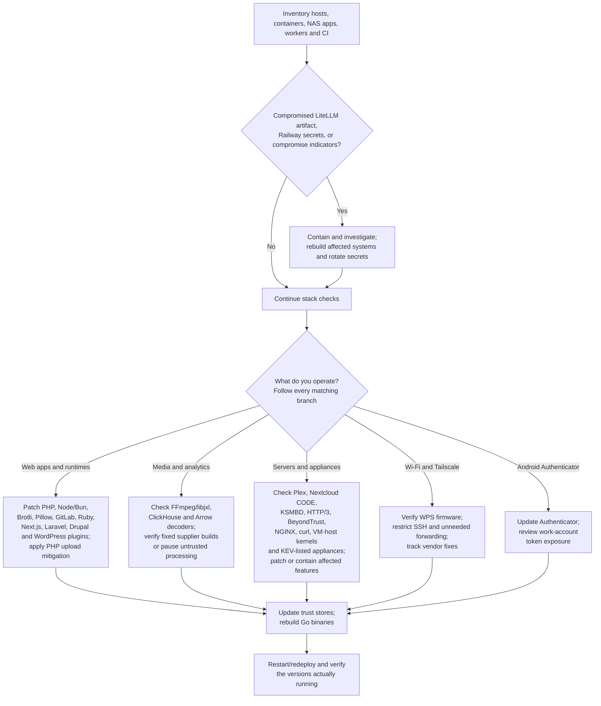

# Black October: What Broke, What’s Exposed, and What to Patch

**As of October 29, 2026**

[Security updates](../CHANGELOG.md) · [Maintenance process](MAINTENANCE.md)

“Black October” is an informal label for the unusually dense run of vulnerability disclosures and security incidents this month—particularly the October 19–23 cluster. It is **not one coordinated attack, one vulnerability family, or an official advisory list**.

The concern is justified: several flaws sit below application code, in runtimes, image decoders, and infrastructure components. Updating your application dependencies alone may leave the vulnerable runtime or bundled native library untouched.

This report covers the major disclosures most relevant to developers and operators of personal infrastructure, plus related incidents that require credential rotation rather than a patch. It is not an exhaustive catalog of October CVEs. Some vulnerabilities were fixed earlier but received public technical disclosures or exploitation reports this month.

## Table of contents

- [The short version](#the-short-version)
  - [How to use the impact checks](#how-to-use-the-impact-checks)
  - [What CISA KEV means](#what-cisa-kev-means)
- [Progress WS_FTP Server: Critical authentication and command-injection flaws](#progress-ws_ftp-server-critical-authentication-and-command-injection-flaws)
- [Linux kernel: IPv4 TCP options use-after-free](#linux-kernel-ipv4-tcp-options-use-after-free)
- [Jenkins: October core security fixes](#jenkins-october-core-security-fixes)
- [Cisco Secure Firewall ASA and FTD: exploited SSL VPN denial of service](#cisco-secure-firewall-asa-and-ftd-exploited-ssl-vpn-denial-of-service)
- [Cisco Catalyst SD-WAN: KeyDrift authentication bypass and key theft](#cisco-catalyst-sd-wan-keydrift-authentication-bypass-and-key-theft)
- [Ultralytics: parse_model code injection through an untrusted model file](#ultralytics-parse_model-code-injection-through-an-untrusted-model-file)
- [Tabularis: MCP SQLite read-only bypass through SQL injection](#tabularis-mcp-sqlite-read-only-bypass-through-sql-injection)
- [Adobe Campaign Classic: eight Critical code-execution and authorization flaws](#adobe-campaign-classic-eight-critical-code-execution-and-authorization-flaws)
- [Adobe Connect: Critical code injection in desktop and Android clients](#adobe-connect-critical-code-injection-in-desktop-and-android-clients)
- [Linux kernel: Fragnesia - ESP-in-TCP page-cache overwrite](#linux-kernel-fragnesia---esp-in-tcp-page-cache-overwrite)
- [Google Chrome 156: Critical browser security fixes](#google-chrome-156-critical-browser-security-fixes)
- [TianoCore EDK II: PXE pre-boot remote code execution](#tianocore-edk-ii-pxe-pre-boot-remote-code-execution)
- [Veeam Backup & Replication and Agent for Linux: authorization bypass and local privilege escalation](#veeam-backup--replication-and-agent-for-linux-authorization-bypass-and-local-privilege-escalation)
- [TeamViewer clients: crafted screen images can execute code](#teamviewer-clients-crafted-screen-images-can-execute-code)
- [EPICS Base: network request handling can corrupt memory](#epics-base-network-request-handling-can-corrupt-memory)
- [GoAhead embedded web server: TLS backend flaws bypass revocation or expose sessions](#goahead-embedded-web-server-tls-backend-flaws-bypass-revocation-or-expose-sessions)
- [Google MCP Toolbox for Databases: Cloud Storage file exfiltration and overwrite](#google-mcp-toolbox-for-databases-cloud-storage-tools-exfiltrate-host-files-and-overwrite-local-files)
- [Vertiv Avocent ACS8000 / ACS800: unauthenticated root command injection](#vertiv-avocent-acs8000-and-acs800-console-servers-unauthenticated-root-command-injection-via-the-wsserver-terminal-websocket)
- [Bandit (Elixir/Phoenix): unauthenticated denial of service](#bandit-elixir-and-phoenix-web-server-unauthenticated-denial-of-service-over-http2-http11-and-websocket)
- [WolfVision Cynap: unauthenticated command injection and shared SSH root key](#wolfvision-cynap-collaboration-systems-unauthenticated-wolfprot-command-injection-and-shared-vsolution-matrix-ssh-root-key)
- [Supermicro BMC firmware: IPMI/RMCP+ flaws to BMC administrator access](#supermicro-bmc-firmware-ipmi-and-rmcp-session-flaws-can-lead-to-bmc-administrator-access)
- [GitHub Actions: Gheist - stolen tokens plant secret-dumping workflows](#github-actions-gheist---stolen-tokens-plant-secret-dumping-workflows)
- [Apache Camel: camel-saxon XQuery XXE](#apache-camel-camel-saxon-xquery-xml-external-entity-processing)
- [Oracle October 2026 Critical Patch Update](#oracle-fusion-middleware-e-business-suite-database-and-mysql-october-2026-critical-patch-update)
- [ImageMagick: bzip2 image stack buffer overflow](#imagemagick-stack-buffer-overflow-when-reading-bzip2-compressed-images)
- [Electrum Bitcoin wallet: malicious server turns fee bumps into theft](#electrum-bitcoin-wallet-malicious-server-swaps-broadcast-transactions-so-a-fee-bump-pays-the-attacker)
- [Fortinet FortiOS, FortiManager, FortiAnalyzer, FortiMail and FortiAuthenticator: October 2026 hardening release and SQL injection fixes](#fortinet-fortios-fortimanager-fortianalyzer-fortimail-and-fortiauthenticator-october-2026-hardening-release-and-sql-injection-fixes)
- [Signal calling (RingRTC): hang-up may not end a flooded call](#signal-calling-ringrtc-hang-up-may-not-end-a-flooded-call)
- [OVHcloud CLI: hijacked release binaries steal secrets](#ovhcloud-cli-hijacked-github-release-binaries-steal-secrets)
- [Microsoft .NET Framework: App Control bypass via assembly search path](#microsoft-net-framework-app-control-bypass-through-an-untrusted-assembly-search-path)
- [SAP NetWeaver Visual Composer: low-privileged access to backend operations](#sap-netweaver-visual-composer-low-privileged-access-to-backend-operations-on-connected-systems)
- [Docker Hub: GhostPat - access-token reassignment](#docker-hub-ghostpat---access-token-reassignment-on-account-conversion)
- [Progress MarkLogic Server: 31 flaws including paths to administrator](#progress-marklogic-server-31-flaws-including-low-privilege-paths-to-administrator)
- [HPE Aruba Networking AOS: unauthenticated RCE and authentication bypass](#hpe-aruba-networking-aos-unauthenticated-rce-and-authentication-bypass-in-wireless-infrastructure)
- [Linux kernel: skb_zerocopy page-cache write gives local root despite the Dirty Frag fix](#linux-kernel-skb_zerocopy-page-cache-write-gives-local-root-despite-the-dirty-frag-fix)
- [Rank Math PRO for WordPress: malicious 3.0.123 builds](#rank-math-pro-for-wordpress-malicious-30123-builds-from-the-official-update-channel)
- [FortiSIEM: unauthenticated gRPC path traversal to RCE](#fortisiem-unauthenticated-grpc-path-traversal-to-remote-code-execution)
- [FortiSandbox: unauthenticated GUI authentication bypass](#fortisandbox-unauthenticated-gui-authentication-bypass)
- [Adobe Commerce / Magento Open Source: exploited dangerous-file upload](#adobe-commerce--magento-open-source-exploited-dangerous-file-upload)
- [Adobe Commerce / Magento Open Source: BlockStrap - unauthenticated template-injection RCE](#adobe-commerce--magento-open-source-blockstrap---unauthenticated-template-injection-rce)
- [SAP Cloud SDK for Python: OAuth2 SSRF leaks client credentials](#sap-cloud-sdk-for-python-oauth2-ssrf-leaking-multi-tenant-client-credentials)
- [Wasmtime: Cranelift sandbox escapes](#wasmtime-cranelift-sandbox-escapes-from-untrusted-wasm)
- [Laravel: TokenGuard API authentication bypass](#laravel-tokenguard-api-authentication-bypass-on-mysql-and-mariadb)
- [Next.js: unauthenticated RCE in use cache and Image Optimization](#nextjs-unauthenticated-rce-in-use-cache-and-image-optimization)
- [Drupal core: Field UI remote code execution](#drupal-core-field-ui-remote-code-execution)
- [NGINX: memory corruption and TLS session forgery](#nginx-configuration-dependent-memory-corruption-and-tls-session-forgery)
- [curl and libcurl: HTTP/2 upload use-after-free](#curl-and-libcurl-use-after-free-when-a-server-resets-an-upload)
- [Linux kernel: PwnEscape - guest-to-host escape](#linux-kernel-pwnescape---guest-to-host-escape-via-ipv4-checksum-metadata)
- [Bricksforge for WordPress: exploited file upload to RCE](#bricksforge-for-wordpress-exploited-unauthenticated-file-upload-to-rce)
- [Gitea: built-in SSH server authentication bypass](#gitea-built-in-ssh-server-authentication-bypass)
- [Langflow: MCP stdio RCE with honeypot exploitation attempts](#langflow-authenticated-rce-via-mcp-stdio-server-configuration)
- [VeloCloud Orchestrator: authenticated SQL injection](#velocloud-orchestrator-authenticated-sql-injection-to-superuser-operator)
- [Siemens Software Center: exploited DLL side-loading](#siemens-software-center-dll-side-loading-exploited-in-clickfix-campaign)
- [PAN-OS: authenticated management interface RCE](#pan-os-authenticated-management-interface-rce)
- [Cisco Secure Email Gateway: AMP attachment path traversal](#cisco-secure-email-gateway-amp-attachment-path-traversal)
- [SiteGuard Server Edition: root command injection](#siteguard-server-edition-root-command-injection-via-statistics-feature)
- [Windows Shell: Mark of the Web bypass](#windows-shell-mark-of-the-web-bypass-zero-day)
- [Ivanti Connect Secure: authentication bypass to command execution](#ivanti-connect-secure-authentication-bypass-to-command-execution)
- [Atlassian Data Center: unauthenticated web-root file read](#atlassian-data-center-unauthenticated-web-root-file-read)
- [AhsayCBS: authentication bypass and command injection chain](#ahsaycbs-authentication-bypass-and-command-injection-chain)
- [NetScaler: SAML memory overflow denial of service](#netscaler-saml-memory-overflow-denial-of-service)
- [FortiMail: unauthenticated file write](#fortimail-unauthenticated-file-write)
- [Zammad: session hijack RCE and root escalation chain](#zammad-session-hijack-rce-and-root-escalation-chain)
- [Tailscale / headscale: Tailworm - SSH findings under review](#tailscale--headscale-tailworm---ssh-and-related-findings-under-review)
- [Microsoft Authenticator for Android: AuthMask - token theft](#microsoft-authenticator-for-android-authmask---token-theft)
- [PHP: PHP2Shell - unauthenticated execution](#php-php2shell---unauthenticated-execution-below-your-application)
  - [The October 23 follow-up](#the-october-23-follow-up-matters)
- [Brotli consumers: HTTP2Shell / Node2Shell / Brotli2Shell - cross-stack decoder corruption](#brotli-consumers-nodejs-bun-python-net-ffmpeg-clickhouse-arrow-and-others-http2shell--node2shell--brotli2shell---cross-stack-decoder-corruption)
  - [Other high-severity Node.js fixes](#other-high-severity-nodejs-fixes-in-the-same-release)
- [GitLab and Ruby: regex compilation becomes code execution](#gitlab-and-ruby-regex-compilation-becomes-code-execution)
  - [GitLab identity vulnerabilities](#related-gitlab-identity-vulnerabilities)
  - [Ruby applications](#ruby-applications-need-their-own-update)
- [Pillow: image-processing memory corruption and command execution](#pillow-untrusted-images-reach-native-memory-corruption-and-command-execution)
- [Plex Media Server: Plex2Shell - exploited remote code execution chain](#plex-media-server-plex2shell---exploited-remote-code-execution-chain)
- [Nextcloud’s built-in Collabora CODE server: unauthenticated command injection](#nextclouds-built-in-collabora-code-server-unauthenticated-command-injection)
- [Linux KSMBD: kernel memory disclosure and denial of service](#linux-ksmbd-kernel-memory-disclosure-and-denial-of-service)
- [Broadcom legacy WPS: WPSplinter - nearby router compromise](#broadcom-legacy-wps-wpsplinter---nearby-router-compromise)
- [HTTP/3 stacks: Header Accordions - compression-driven resource exhaustion](#http3-stacks-header-accordions---compression-driven-resource-exhaustion)
- [BeyondTrust Remote Support: exploited unauthenticated file operations](#beyondtrust-remote-support-exploited-unauthenticated-file-operations)
- [TLS and code-signing trust stores: eMudhra / emSign - CA compromise](#tls-and-code-signing-trust-stores-emudhra--emsign---certificate-authority-compromise)
- [LiteLLM: malicious release and credential theft](#litellm-malicious-release-and-credential-theft)
- [Railway: environment secret exposure](#railway-environment-secret-exposure)
- [What should I patch? A stack-based decision guide](#what-should-i-patch-a-stack-based-decision-guide)

## The short version

- **New this update (CISA KEV):** Update Linux hosts for [Fragnesia](#linux-kernel-fragnesia---esp-in-tcp-page-cache-overwrite), CVE-2026-46300. CISA reports active exploitation and a chain with PHP2Shell; install a vendor-fixed kernel, reboot into it, and investigate suspected root compromise rather than treating patching as cleanup.
- **New this update:** Update affected Windows-based Veeam Backup & Replication and Veeam Software Appliance deployments to **13.1.2 / 13.0.3**. Also update managed Veeam Agent for Linux installations to **13.1.2**. Restrict backup-management service access to trusted administration networks while rolling out the Critical authorization-bypass fix.
- **New this update:** Update [TeamViewer clients](#teamviewer-clients-crafted-screen-images-can-execute-code) to 15.83 or the vendor's supported fixed legacy builds; do not open untrusted session recordings. Industrial-control operators using [EPICS Base](#epics-base-network-request-handling-can-corrupt-memory) should plan a validated update to 7.0.11 and preserve network segmentation until it is deployed.
- **New this update (none in CISA KEV yet):** update [Supermicro BMC firmware](#supermicro-bmc-firmware-ipmi-and-rmcp-session-flaws-can-lead-to-bmc-administrator-access) and keep UDP 623 off untrusted networks; confine [Vertiv Avocent ACS8000/ACS800](#vertiv-avocent-acs8000-and-acs800-console-servers-unauthenticated-root-command-injection-via-the-wsserver-terminal-websocket) console-server web access (no confirmed fix) and update [WolfVision Cynap](#wolfvision-cynap-collaboration-systems-unauthenticated-wolfprot-command-injection-and-shared-vsolution-matrix-ssh-root-key) devices; apply [Oracle's October CPU](#oracle-fusion-middleware-e-business-suite-database-and-mysql-october-2026-critical-patch-update) to WebLogic, SOA Suite, E-Business Suite and other exposed Oracle middleware; upgrade [Google MCP Toolbox for Databases](#google-mcp-toolbox-for-databases-cloud-storage-tools-exfiltrate-host-files-and-overwrite-local-files) to 1.10.0+ and set its bucket and path allowlists, [Bandit](#bandit-elixir-and-phoenix-web-server-unauthenticated-denial-of-service-over-http2-http11-and-websocket) to 1.14.1, [Apache Camel `camel-saxon`](#apache-camel-camel-saxon-xquery-xml-external-entity-processing) and [ImageMagick](#imagemagick-stack-buffer-overflow-when-reading-bzip2-compressed-images). GitHub organizations should hunt for [Gheist](#github-actions-gheist---stolen-tokens-plant-secret-dumping-workflows) `ci-sync-` branches that dump Actions secrets.
- **Added earlier on October 26 (none in CISA KEV yet):** patch [HPE Aruba AOS](#hpe-aruba-networking-aos-unauthenticated-rce-and-authentication-bypass-in-wireless-infrastructure) wireless infrastructure (eight CVSS 10.0 flaws), [FortiSIEM](#fortisiem-unauthenticated-grpc-path-traversal-to-remote-code-execution) (public exploit; Canada's Cyber Centre reports exploitation) and [FortiSandbox](#fortisandbox-unauthenticated-gui-authentication-bypass), [Magento / Adobe Commerce](#adobe-commerce--magento-open-source-blockstrap---unauthenticated-template-injection-rce) (CVSS 10.0 BlockStrap) and the [SAP Cloud SDK for Python](#sap-cloud-sdk-for-python-oauth2-ssrf-leaking-multi-tenant-client-credentials). [Rank Math PRO](#rank-math-pro-for-wordpress-malicious-30123-builds-from-the-official-update-channel) sites that pulled the malicious 3.0.123 build need cleanup and credential rotation, and Linux hosts running untrusted local code face a [public skb_zerocopy root exploit](#linux-kernel-skb_zerocopy-page-cache-write-gives-local-root-despite-the-dirty-frag-fix) with few vendor fixes yet.
- **Patch widely deployed developer and self-hosted stacks too, even without KEV listings:** Next.js, NGINX, curl/libcurl, Drupal, Laravel, Gitea, Langflow, Wasmtime, the Bricksforge WordPress plugin, and Linux VM/sandbox hosts (PwnEscape). Bricksforge and Langflow already face exploitation attempts.
- **Patch KEV-listed edge and enterprise software first.** CISA added FortiMail, Zammad, NetScaler, Ivanti Connect Secure, Windows Shell, PAN-OS, AhsayCBS, Cisco Secure Email Gateway, Atlassian Data Center, SiteGuard, Siemens Software Center and VeloCloud flaws to its Known Exploited Vulnerabilities catalog in October; several require forensic triage, not just patching.
- **Review Tailscale SSH authorization and forwarding.** Tailworm's principal SSH chains require existing authorized access; disable unnecessary forwarding and track official fixes, rather than treating every VPN node as remotely exploitable.
- **Update Microsoft Authenticator on Android**, especially devices with signed-in work accounts. AuthMask requires a malicious local app; patching does not revoke already stolen tokens.
- **Prioritize exposed PHP (including PAN-OS/Panorama management interfaces, which embed it), GitLab, Plex, and Nextcloud installations using the built-in Collabora CODE server.**
- **Inventory every Brotli decoder**, including Node.js, Bun, Python, .NET, proxies, FFmpeg/libjxl, ClickHouse and Arrow/pyarrow. Untrusted responses, media metadata and analytical files can reach separate bundled copies; a runtime or Python binding update does not patch them all.
- **Update Pillow wherever you process untrusted images**, including thumbnail workers and document pipelines.
- **Check Ruby separately from GitLab.** The underlying regex bugs affect other applications compiling attacker-controlled patterns.
- **Update certificate trust data and rebuild Go applications.** The eMudhra incident affects clients even if your own website uses another certificate authority.
- **If you ran the compromised LiteLLM release or stored secrets in Railway, patching alone is insufficient.**

Severity scores below are attributed where ratings differ. CVSS measures technical severity, not whether exploitation has been observed or whether your particular deployment is reachable.

### How to use the impact checks

The checks below are **read-only inventory checks, not exploit probes**. Run them against your own deployments, including each container, worker, virtual environment, and appliance. Replace example paths with actual deployment paths. A missing command, inaccessible configuration, or absent package in one environment means **unknown for the rest of your infrastructure**, not “safe.”

Interpret results in three steps: **is the component present; does its exact build include the fix; can untrusted input reach the affected feature?** Compare versions within the appropriate release branch and verify vendor backports. Installed files can differ from a still-running process. None of these checks establishes whether a system was previously compromised. If compromise is suspected, inspect a snapshot from a clean system rather than executing its interpreters or application tools.

**Companion files:** Download these alongside the Markdown report. The commands below assume you are in the download directory; use absolute script paths when running as another user. Review the scripts before executing them. They do not install packages, patch services, send exploit payloads, or require API credentials.

| File | Purpose | Requirements |
|---|---|---|
| [stack-inventory.sh](stack-inventory.sh) | PHP settings, Node/Bun/Ruby versions, GitLab information, Nextcloud app list, or Go binary build metadata | POSIX shell and the selected product's tool |
| [python-package-inventory.py](python-package-inventory.py) | Brotli, brotlicffi, Pillow, olefile, LiteLLM and SAP Cloud SDK for Python (`sap-cloud-sdk`) package metadata without importing them | Trusted Python 3.8+; no third-party dependencies |
| [linux-service-inventory.sh](linux-service-inventory.sh) | KSMBD presence, SMB/Plex listeners, and visible RDMA devices | Linux; `ss` for listener inspection |
| [check_brotli.py](check_brotli.py) | Response-header compression inventory; **not a vulnerability verdict**. [Usage and limits](details/brotli.md#response-header-inventory-script) | Python 3.9+; standard library; authorized HTTP(S) GET requests |
| [rankmath-ioc-check.sh](rankmath-ioc-check.sh) | Offline Rank Math PRO 3.0.123 incident indicators in a WordPress copy (fake core file, installed PRO version, vendor-named strings, `.cache`/`.htaccess` patterns) and in operator-supplied SQL/crontab exports (option names, `wpsupport_`/`@wp-mail.net` admins, `#ms6v46`). Exit 0 is **not** proof of a clean site. [Usage and limits](details/rankmath-pro.md#offline-indicator-script) | POSIX shell, `find`, `grep`, `sed`; read access only; does not run PHP, WordPress or WP-CLI |
| [gheist-branch-check.sh](gheist-branch-check.sh) | Read-only GitHub API check for Gheist `ci-sync-` branches across an organization's or user's repositories (or named repositories): pattern match, head-commit match, Wiz workflow blob SHAs and remaining runs. Exit 0 is **not** proof of no compromise; it uses your token for GET requests only. [Usage and limits](details/github-gheist.md#branch-check-script) | POSIX shell and an authenticated GitHub CLI (`gh`); token with read access to contents, metadata and Actions |

An exit status of zero means the requested inventory commands completed, **not that the system is patched**. Nonzero status means the check failed or its input/tool is unavailable. The Linux script may finish with explicitly marked `UNKNOWN` partial results; read its output. Shell checks inspect tools on the current user's PATH, so run inside the correct deployment or set PATH to the intended runtime. Do not run them against a suspected compromised installation; use clean-host snapshot inspection instead.

Each item links to a detailed operational guide. **Last updated** changes only when that item's content changes, not whenever a scheduled review runs. Unknown private-discovery or patch dates are marked explicitly; announcement, release, revocation and deployment are different events. Dates below are in 2026 unless stated otherwise; detailed timelines preserve source timezones.

**Reading the date tables:** `Time/TZ unknown` means the source date is known but its time and timezone have not been established; it does not mean midnight. UTC timestamps retain the precision recorded in the detailed timeline. **Last updated** is the guide's revision timestamp in America/New_York, not a new vulnerability event or a fresh research pass.

### What CISA KEV means

The U.S. Cybersecurity and Infrastructure Security Agency’s [Known Exploited Vulnerabilities catalog](https://www.cisa.gov/known-exploited-vulnerabilities-catalog) lists CVEs with reliable evidence of active exploitation. Each item states its KEV status. **Listed** means CISA has evidence of in-the-wild exploitation; the “added” date is when CISA listed it, not when attacks began, and the due date binds U.S. federal civilian agencies only, though it is a useful urgency signal for everyone. **Not listed** does not mean safe or unexploited: CISA may not have evidence yet, other sources may report exploitation, and issues without a CVE cannot be listed. Statuses reflect the catalog version noted on each item.

## Progress WS_FTP Server: Critical authentication and command-injection flaws

[Back to TOC](#table-of-contents) · **[Detailed guide](details/progress-wsftp.md):** [Detection](details/progress-wsftp.md#detection) · [Remediation](details/progress-wsftp.md#remediation) · [Verification](details/progress-wsftp.md#verification) · [Timeline](details/progress-wsftp.md#timeline)

**CVEs:** [CVE-2026-84295](https://www.cve.org/CVERecord?id=CVE-2026-84295), [CVE-2026-90868](https://www.cve.org/CVERecord?id=CVE-2026-90868)

**Progress CNA rates CVE-2026-84295 CVSS 3.1 10.0 Critical and CVE-2026-90868 CVSS 3.1 9.9 Critical.** The first permits unauthenticated access to sensitive information including administrator credentials; the second permits OS command execution under certain configurations on Windows WS_FTP Server.

**CISA KEV:** Not listed (catalog 2026.10.29, checked 2026-10-30). No active exploitation is reported by the Progress CNA records. Absence from KEV is not evidence that exploitation has not occurred. [What KEV means](#what-cisa-kev-means)

| Event | Date and time (timezone) | Notes |
|---|---|---|
| CVE records published | 2026-10-29; time/TZ unknown | Progress published both records. |
| Fixes | 2026-09-03 / 2026-10-01; time/TZ unknown | 2024.0.6/2025.0.3 fix CVE-2026-84295; 2024.0.7/2025.0.4 fix CVE-2026-90868. |
| **Last updated** | **2026-10-30 08:04 EDT (UTC−04:00)** | Added from Progress CNA records. |

**Patch:** Upgrade to **2024.0.7** or **2025.0.4** or a later supported release, which covers both CVEs. Restrict administrative and transfer-service exposure while upgrading, then review Windows and WS_FTP logs for unexpected administration or command execution.

Sources: [CVE-2026-84295](https://www.cve.org/CVERecord?id=CVE-2026-84295), [CVE-2026-90868](https://www.cve.org/CVERecord?id=CVE-2026-90868), [CISA KEV feed](https://www.cisa.gov/sites/default/files/feeds/known_exploited_vulnerabilities.json).

## Linux kernel: IPv4 TCP options use-after-free

[Back to TOC](#table-of-contents) · **[Detailed guide](details/linux-tcp-options.md):** [Detection](details/linux-tcp-options.md#detection) · [Remediation](details/linux-tcp-options.md#remediation) · [Verification](details/linux-tcp-options.md#verification) · [Timeline](details/linux-tcp-options.md#timeline)

**CVEs:** [CVE-2026-98432](https://www.cve.org/CVERecord?id=CVE-2026-98432)

**kernel.org rates CVE-2026-98432 CVSS 3.1 9.8 Critical; Red Hat rates its product impact 8.1 High.** The IPv4 TCP race can free socket options while they are in use during retransmitted SYN processing or request-socket migration.

**CISA KEV:** Not listed (catalog 2026.10.29, checked 2026-10-30). No primary source reviewed reports exploitation. Absence from KEV is not evidence that exploitation has not occurred. [What KEV means](#what-cisa-kev-means)

| Event | Date and time (timezone) | Notes |
|---|---|---|
| CVE publication | 2026-10-15; time/TZ unknown | kernel.org CNA record. |
| **Last updated** | **2026-10-30 08:04 EDT (UTC−04:00)** | Added after vendor status review. |

**Patch:** Install a distribution kernel package explicitly marked as fixing this CVE and reboot. At review, Red Hat lists no supported mitigation and Ubuntu lists supported generic kernels as vulnerable with fixes in progress; restrict unnecessary untrusted TCP exposure while awaiting a vendor update.

Sources: [kernel.org CNA record](https://www.cve.org/CVERecord?id=CVE-2026-98432), [Red Hat advisory](https://access.redhat.com/security/cve/CVE-2026-98432), [Ubuntu advisory](https://ubuntu.com/security/CVE-2026-98432), [CISA KEV feed](https://www.cisa.gov/sites/default/files/feeds/known_exploited_vulnerabilities.json).

## Jenkins: October core security fixes

[Back to TOC](#table-of-contents) · **[Detailed guide](details/jenkins-october.md):** [Detection](details/jenkins-october.md#detection) · [Remediation](details/jenkins-october.md#remediation) · [Verification](details/jenkins-october.md#verification) · [Timeline](details/jenkins-october.md#timeline)

**CVEs:** [CVE-2026-117612](https://www.cve.org/CVERecord?id=CVE-2026-117612) and related Jenkins October 28 core CVEs.

**Jenkins rates the advisory's tracked core issues High.** Affected Jenkins weekly 2.587 and earlier and LTS 2.580.1 and earlier include deserialization RCE, file read/write, privilege-escalation and stored-XSS paths with differing authorization prerequisites.

**CISA KEV:** Not listed (catalog 2026.10.29, checked 2026-10-30). Jenkins reports no active exploitation. Absence from KEV is not evidence that exploitation has not occurred. [What KEV means](#what-cisa-kev-means)

| Event | Date and time (timezone) | Notes |
|---|---|---|
| Public advisory and fixes | 2026-10-28; time/TZ unknown | Jenkins weekly 2.588 and LTS 2.580.2 contain the fixes. |
| **Last updated** | **2026-10-30 08:04 EDT (UTC−04:00)** | Added from Jenkins's advisory. |

**Patch:** Upgrade controllers to weekly **2.588** or LTS **2.580.2**, then validate trusted build, agent and configuration workflows. Restrict configuration and agent-management permissions until every controller is updated; do not use crafted XML or artifacts to test production instances.

Sources: [Jenkins advisory](https://www.jenkins.io/security/advisory/2026-10-28/), [CVE-2026-117612](https://www.cve.org/CVERecord?id=CVE-2026-117612), [CISA KEV feed](https://www.cisa.gov/sites/default/files/feeds/known_exploited_vulnerabilities.json).

## Cisco Secure Firewall ASA and FTD: exploited SSL VPN denial of service

[Back to TOC](#table-of-contents) · **[Detailed guide](details/cisco-secure-firewall-vpn.md):** [Detection](details/cisco-secure-firewall-vpn.md#detection) · [Remediation](details/cisco-secure-firewall-vpn.md#remediation) · [Verification](details/cisco-secure-firewall-vpn.md#verification) · [Timeline](details/cisco-secure-firewall-vpn.md#timeline)

**CVEs:** [CVE-2026-76418](https://www.cve.org/CVERecord?id=CVE-2026-76418)

**[CVE-2026-76418](https://www.cve.org/CVERecord?id=CVE-2026-76418) — Cisco CVSS 3.1 8.6 High; actively exploited**

**CISA KEV:** Listed — added 2026-10-29, federal due date 2026-11-01. Cisco reports active exploitation.

| Event | Date and time (timezone) | Notes |
|---|---|---|
| Cisco advisory and fixed releases | 2026-10-28 19:15 GMT | Cisco `cisco-sa-asaftd-tunnel-dos-s6mgkb75`. |
| Active exploitation known to Cisco | 2026-10 (exact day not established) | Cisco PSIRT statement. |
| **Last updated** | **2026-10-30 04:05 EDT (UTC−04:00)** | CISA KEV listing confirmed. |

An unauthenticated attacker can reload an affected ASA or FTD appliance by reaching its SSL VPN service with a crafted request. The vulnerable path requires reachable Remote Access SSL VPN plus secondary authentication in the applicable tunnel group; a successful VPN login is not needed.

**Patch:** upgrade ASA to 9.16.4.104, 9.18.4.96, 9.20.4.50, 9.22.3.200, 9.23.1.48 or the listed 9.24 fix; upgrade FTD to the first fixed build for its 7.0–10.1 train. Cisco's detailed table and the tested temporary secondary-authentication mitigation are in the [guide](details/cisco-secure-firewall-vpn.md#remediation).

Sources: [Cisco advisory](https://sec.cloudapps.cisco.com/security/center/content/CiscoSecurityAdvisory/cisco-sa-asaftd-tunnel-dos-s6mgkb75), [CVE record](https://www.cve.org/CVERecord?id=CVE-2026-76418), [CISA KEV feed](https://www.cisa.gov/sites/default/files/feeds/known_exploited_vulnerabilities.json).

## Cisco Catalyst SD-WAN: KeyDrift authentication bypass and key theft

[Back to TOC](#table-of-contents) · **[Detailed guide](details/cisco-sdwan-keydrift.md):** [Detection](details/cisco-sdwan-keydrift.md#detection) · [Remediation](details/cisco-sdwan-keydrift.md#remediation) · [Verification](details/cisco-sdwan-keydrift.md#verification) · [Timeline](details/cisco-sdwan-keydrift.md#timeline)

**CVEs:** [CVE-2026-20127](https://www.cve.org/CVERecord?id=CVE-2026-20127)

**[CVE-2026-20127](https://www.cve.org/CVERecord?id=CVE-2026-20127) — Cisco CVSS 3.1 10.0 Critical; limited exploitation**

**CISA KEV:** Listed — added 2026-02-25, federal due date 2026-02-27. Cisco reports limited exploitation.

| Event | Date and time (timezone) | Notes |
|---|---|---|
| Cisco advisory and initial fixes | 2026-02-25 16:00 GMT | `cisco-sa-sdwan-rpa-EHchtZk`. |
| KeyDrift report and advisory update | 2026-10-28; time/TZ not established | Talos disclosed historical UAT-11473 activity; Cisco linked it from revision 2.1. |
| **Last updated** | **2026-10-30 04:05 EDT (UTC−04:00)** | CISA KEV listing confirmed. |

The peering-authentication bypass affects Catalyst SD-WAN Controller, Manager and Validator, including on-prem and Cisco-hosted deployments. Cisco Talos reports KeyDrift malware installed after exploitation to persist, collect control-plane keying material and provide backdoor capabilities.

**Patch:** move 20.9 to 20.9.8.2; 20.11–20.12 to a listed 20.12 fixed release; 20.13–20.15 to 20.15.4.2; and 20.16–20.18 to 20.18.2.1. Restrict ports 22 and 830 to known control components while upgrades proceed, then follow the [detection and recovery guide](details/cisco-sdwan-keydrift.md).

Sources: [Cisco advisory](https://sec.cloudapps.cisco.com/security/center/content/CiscoSecurityAdvisory/cisco-sa-sdwan-rpa-EHchtZk), [Cisco Talos KeyDrift report](https://blog.talosintelligence.com/uat-11473-keydrift/), [CISA KEV feed](https://www.cisa.gov/sites/default/files/feeds/known_exploited_vulnerabilities.json).

## Ultralytics: parse_model code injection through an untrusted model file

[Back to TOC](#table-of-contents) · **[Detailed guide](details/ultralytics-parse-model.md):** [Detection](details/ultralytics-parse-model.md#detection) · [Remediation](details/ultralytics-parse-model.md#remediation) · [Verification](details/ultralytics-parse-model.md#verification) · [Timeline](details/ultralytics-parse-model.md#timeline)

**CVEs:** [CVE-2026-118618](https://www.cve.org/CVERecord?id=CVE-2026-118618)

**[CVE-2026-118618](https://www.cve.org/CVERecord?id=CVE-2026-118618) — ZDI CVSS 3.0 7.8 High**

**CISA KEV:** Not listed (catalog 2026.10.28, checked 2026-10-29). No active exploitation is reported by the reviewed sources. Absence from KEV is not evidence that exploitation has not occurred.

| Event | Date and time (timezone) | Notes |
|---|---|---|
| Report to vendor | 2026-06-18; time/TZ unknown | ZDI says it reported the issue through the vendor's GitHub account. |
| Public disclosure | 2026-10-28; time/TZ unknown | ZDI-26-817 / ZDI-CAN-30121. |
| **Last updated** | **2026-10-29 08:03 EDT (UTC−04:00)** | Added from ZDI and CNA records. |

Ultralytics `parse_model` can execute attacker-supplied Python code when a user visits a malicious page or opens a malicious model file. ZDI identifies 8.4.65 as affected and does not establish a fixed version.

**Remediate:** do not load untrusted model files; isolate externally supplied model processing without credentials or production mounts, and wait for an official fixed-version statement rather than assuming a later release is safe. See the [detailed guide](details/ultralytics-parse-model.md#remediation).

Sources: [ZDI-26-817](https://zerodayinitiative.com/advisories/ZDI-CAN-30121/), [CVE record](https://www.cve.org/CVERecord?id=CVE-2026-118618), [CISA KEV feed](https://www.cisa.gov/sites/default/files/feeds/known_exploited_vulnerabilities.json).

## Tabularis: MCP SQLite read-only bypass through SQL injection

[Back to TOC](#table-of-contents) · **[Detailed guide](details/tabularis.md):** [Detection](details/tabularis.md#detection) · [Remediation](details/tabularis.md#remediation) · [Verification](details/tabularis.md#verification) · [Timeline](details/tabularis.md#timeline)

**CVEs:** [CVE-2026-118378](https://www.cve.org/CVERecord?id=CVE-2026-118378)

**VulnCheck CNA rates CVE-2026-118378 CVSS 4.0 8.5 High; the vendor advisory rates it CVSS 3.1 7.8 High.** Tabularis's SQLite MCP `describe_table` path can execute stacked statements from an attacker-influenced table name, bypassing the product's MCP read-only mode and write-approval controls.

**CISA KEV:** Not listed (catalog 2026.10.28, checked 2026-10-29). The vendor advisory and CNA record do not report active exploitation. Absence from KEV is not evidence that exploitation has not occurred. [What KEV means](#what-cisa-kev-means)

| Event | Date and time (timezone) | Notes |
|---|---|---|
| Public advisory and CVE publication | 2026-10-28; time/TZ unknown | VulnCheck published CVE-2026-118378; the upstream GitHub advisory identifies the SQLite MCP path and fixed release. |
| Fixed release | 2026-10-28; time/TZ unknown | Tabularis 0.28.0 includes the vendor's patch. |
| **Last updated** | **2026-10-29 04:03 EDT (UTC−04:00)** | Added from the upstream advisory, release notes and CNA record. |

**Patch:** Upgrade Tabularis to **0.28.0 or later**. Until every SQLite MCP server is updated, do not expose databases whose contents or integrity matter to MCP clients processing untrusted content; remove or disable that MCP connection where the product supports it. Read-only mode and write approval are not effective compensating controls for this path.

Sources: [Tabularis GHSA-xrx3-j98v-67x9](https://github.com/TabularisDB/tabularis/security/advisories/GHSA-xrx3-j98v-67x9), [CVE-2026-118378](https://www.cve.org/CVERecord?id=CVE-2026-118378), [Tabularis 0.28.0 release](https://github.com/TabularisDB/tabularis/releases/tag/v0.28.0), [CISA KEV feed](https://www.cisa.gov/sites/default/files/feeds/known_exploited_vulnerabilities.json).

## Adobe Campaign Classic: eight Critical code-execution and authorization flaws

[Back to TOC](#table-of-contents) · **[Detailed guide](details/adobe-campaign-classic.md):** [Detection](details/adobe-campaign-classic.md#detection) · [Remediation](details/adobe-campaign-classic.md#remediation) · [Verification](details/adobe-campaign-classic.md#verification) · [Timeline](details/adobe-campaign-classic.md#timeline)

**CVEs:** [CVE-2026-104350](https://www.cve.org/CVERecord?id=CVE-2026-104350), [CVE-2026-104351](https://www.cve.org/CVERecord?id=CVE-2026-104351), [CVE-2026-104353](https://www.cve.org/CVERecord?id=CVE-2026-104353), [CVE-2026-104354](https://www.cve.org/CVERecord?id=CVE-2026-104354), [CVE-2026-105489](https://www.cve.org/CVERecord?id=CVE-2026-105489), [CVE-2026-105779](https://www.cve.org/CVERecord?id=CVE-2026-105779), [CVE-2026-105780](https://www.cve.org/CVERecord?id=CVE-2026-105780), [CVE-2026-105781](https://www.cve.org/CVERecord?id=CVE-2026-105781).

**Adobe rates all eight flaws Critical (CVSS 3.1 9.1–9.9).** The affected Campaign Classic v7 components can permit arbitrary code execution, security-feature bypass or privilege escalation. Adobe reports no known exploitation for APSB26-162.

**CISA KEV:** Not listed (catalog 2026.10.28, checked 2026-10-29). Adobe does not report exploitation in the wild. Absence from KEV is not evidence that exploitation has not occurred. [What KEV means](#what-cisa-kev-means)

| Event | Date and time (timezone) | Notes |
|---|---|---|
| Public bulletin and fixed build | 2026-10-27; time/TZ unknown | Adobe published APSB26-162 for Campaign Classic v7. |
| **Last updated** | **2026-10-29 00:03 EDT (UTC−04:00)** | Added from Adobe's bulletin and release guidance. |

**Patch:** Update fully on-premise Campaign Classic and on-premise hybrid components from **7.4.4 build 9402 or earlier** to **7.4.4 build 9403**, then restart the Adobe Campaign server (`nlserver`). Adobe-hosted instances have already been remediated. Restrict administration to trusted operators while deploying the update; that restriction does not replace patching.

Sources: [Adobe APSB26-162](https://www.adobe.com/trust/security/products/campaign/apsb26-162.html), [Adobe Campaign Classic release notes](https://experienceleague.adobe.com/en/docs/campaign-classic/using/release-notes/latest-release), [CISA KEV feed](https://www.cisa.gov/sites/default/files/feeds/known_exploited_vulnerabilities.json).

## Adobe Connect: Critical code injection in desktop and Android clients

[Back to TOC](#table-of-contents) · **[Detailed guide](details/adobe-connect.md):** [Detection](details/adobe-connect.md#detection) · [Remediation](details/adobe-connect.md#remediation) · [Verification](details/adobe-connect.md#verification) · [Timeline](details/adobe-connect.md#timeline)

**CVEs:** [CVE-2026-48360](https://www.cve.org/CVERecord?id=CVE-2026-48360).

**Adobe rates CVE-2026-48360 CVSS 3.1 9.6 Critical.** The code-injection flaw can result in arbitrary code execution in Adobe Connect Desktop and Android Mobile clients.

**CISA KEV:** Not listed (catalog 2026.10.28, checked 2026-10-29). Adobe reports no known exploitation. Absence from KEV is not evidence that exploitation has not occurred. [What KEV means](#what-cisa-kev-means)

| Event | Date and time (timezone) | Notes |
|---|---|---|
| Public bulletin and fixed releases | 2026-10-27; time/TZ unknown | Adobe published APSB26-182. |
| **Last updated** | **2026-10-29 00:03 EDT (UTC−04:00)** | Added from Adobe's bulletin. |

**Patch:** Update Desktop to **2026.9.61** (Windows), **2026.10.66** (Mac Silicon), or **2026.10.170** (Mac Intel), and Android Mobile to **4.5**. Relaunch Desktop after the supported update; the client version must match its platform-specific fixed target.

Sources: [Adobe APSB26-182](https://www.adobe.com/trust/security/products/connect/apsb26-182.html), [CISA KEV feed](https://www.cisa.gov/sites/default/files/feeds/known_exploited_vulnerabilities.json).

## Linux kernel: Fragnesia - ESP-in-TCP page-cache overwrite

[Back to TOC](#table-of-contents) · **[Detailed guide](details/linux-fragnesia.md):** [Detection](details/linux-fragnesia.md#detection) · [Remediation](details/linux-fragnesia.md#remediation) · [Verification](details/linux-fragnesia.md#verification) · [Timeline](details/linux-fragnesia.md#timeline)

**CVEs:** [CVE-2026-46300](https://www.cve.org/CVERecord?id=CVE-2026-46300)

**kernel.org CNA CVSS 3.1 7.8 High.** The local kernel flaw can lose a shared-fragment marker during TCP coalescing, then let ESP-in-TCP decrypt a shared page-cache fragment in place. Ubuntu rates it High and describes a trivial local privilege escalation or possible container escape.

**CISA KEV:** Listed — added 2026-10-28, federal due date 2026-10-31. CISA reports that it can be chained with PHP2Shell to implant web shells and run commands as root. [What KEV means](#what-cisa-kev-means)

| Event | Date and time (timezone) | Notes |
|---|---|---|
| CISA KEV addition | 2026-10-28; time/TZ unknown | CISA reports active exploitation and requires forensic triage for covered agencies. |
| **Last updated** | **2026-10-28 20:04 EDT (UTC−04:00)** | Added from kernel.org, Ubuntu and CISA sources. |

**Patch:** Install your distribution’s vendor-supported kernel build that explicitly fixes CVE-2026-46300, then reboot into it. Verify the exact vendor build, not only its upstream version; distributions backport independently. Restrict untrusted local code while waiting for a fix, but do not treat that as a replacement for the update.

Sources: [CVE record](https://www.cve.org/CVERecord?id=CVE-2026-46300), [Ubuntu tracker](https://ubuntu.com/security/CVE-2026-46300), [CISA KEV alert](https://www.cisa.gov/news-events/alerts/2026/10/28/cisa-adds-two-known-exploited-vulnerabilities-catalog), [CISA KEV feed](https://www.cisa.gov/sites/default/files/feeds/known_exploited_vulnerabilities.json).

## Google Chrome 156: Critical browser security fixes

[Back to TOC](#table-of-contents) · **[Detailed guide](details/chrome-156.md):** [Detection](details/chrome-156.md#detection) · [Remediation](details/chrome-156.md#remediation) · [Verification](details/chrome-156.md#verification) · [Timeline](details/chrome-156.md#timeline)

**CVEs:** [CVE-2026-118306](https://www.cve.org/CVERecord?id=CVE-2026-118306), [CVE-2026-118331](https://www.cve.org/CVERecord?id=CVE-2026-118331), [CVE-2026-118344](https://www.cve.org/CVERecord?id=CVE-2026-118344), [CVE-2026-118348](https://www.cve.org/CVERecord?id=CVE-2026-118348)

**Google rates these four Chrome 156 flaws Critical.** They affect FileSystem, FileAPI, Layout and Skia; Google restricts further details while users receive updates.

**CISA KEV:** Not listed (catalog 2026.10.28, checked 2026-10-28). Google does not report active exploitation. Absence from KEV is not evidence that exploitation has not occurred.

| Event | Date and time (timezone) | Notes |
|---|---|---|
| Stable release announcement | 2026-10-27; time/TZ unknown | Google announced Chrome 156.0.8078.73 for Linux and 156.0.8078.73/.74 for Windows and macOS. |
| **Last updated** | **2026-10-28 16:00 EDT (UTC−04:00)** | Added from Google's Chrome release post. |

**Patch:** Update Windows/macOS Chrome to **156.0.8078.73/.74+** and Linux Chrome to **156.0.8078.73+**, then relaunch. Use the supported update channel; Chrome 156 alone does not prove the security update is installed.

Sources: [Google Chrome 156 desktop stable release](https://chromereleases.googleblog.com/2026/10/stable-channel-update-for-desktop_0562499947.html), [CISA KEV feed](https://www.cisa.gov/sites/default/files/feeds/known_exploited_vulnerabilities.json).

## TianoCore EDK II: PXE pre-boot remote code execution

[Back to TOC](#table-of-contents) · **[Detailed guide](details/edk2-pxe.md):** [Detection](details/edk2-pxe.md#detection) · [Remediation](details/edk2-pxe.md#remediation) · [Verification](details/edk2-pxe.md#verification) · [Timeline](details/edk2-pxe.md#timeline)

**CVEs:** [CVE-2026-97631](https://www.cve.org/CVERecord?id=CVE-2026-97631)

**TianoCore rates CVE-2026-97631 CVSS 4.0 9.5 Critical.** An attacker able to deliver an ICMP error while a system PXE boots can corrupt DXE memory and potentially execute code before Secure Boot measures the operating system.

**CISA KEV:** Not listed (catalog 2026.10.28, checked 2026-10-28). The advisory does not report active exploitation. Absence from KEV is not evidence that exploitation has not occurred.

| Event | Date and time (timezone) | Notes |
|---|---|---|
| Public announcement | 2026-10-22; time/TZ unknown | TianoCore published GHSA-99cj-7hg9-mp4m. |
| **Last updated** | **2026-10-28 16:00 EDT (UTC−04:00)** | Added from TianoCore's advisory. |

**Patch:** Obtain an OEM firmware update incorporating TianoCore's source fix. The advisory still lists no patched EDK II release. Disable unneeded PXE and isolate provisioning networks while awaiting a vendor firmware update; do not flash arbitrary upstream firmware.

Sources: [TianoCore GHSA-99cj-7hg9-mp4m](https://github.com/tianocore/edk2/security/advisories/GHSA-99cj-7hg9-mp4m), [source-fix PR](https://github.com/tianocore/edk2/pull/13302), [CISA KEV feed](https://www.cisa.gov/sites/default/files/feeds/known_exploited_vulnerabilities.json).

## Veeam Backup & Replication and Agent for Linux: authorization bypass and local privilege escalation

[Back to TOC](#table-of-contents) · **[Detailed guide](details/veeam-backup.md):** [Detection](details/veeam-backup.md#detection) · [Remediation](details/veeam-backup.md#remediation) · [Verification](details/veeam-backup.md#verification) · [Timeline](details/veeam-backup.md#timeline)

**CVEs:** [CVE-2026-108142](https://www.cve.org/CVERecord?id=CVE-2026-108142), [CVE-2026-105477](https://www.cve.org/CVERecord?id=CVE-2026-105477). Veeam also fixed the related Medium path-traversal CVEs CVE-2026-108140 and CVE-2026-108141 in the same Backup & Replication builds.

**Veeam rates CVE-2026-108142 CVSS 4.0 9.1 Critical and CVE-2026-105477 CVSS 4.0 7.3 High.** The Critical issue lets an unauthenticated attacker bypass authorization on the CDP Coordinator Service in affected Windows-based Backup & Replication and Veeam Software Appliance deployments. The High issue is a local privilege escalation on managed Veeam Agent for Linux installations.

**CISA KEV:** Not listed (catalog 2026.10.27, checked 2026-10-28) for either CVE. Veeam's bulletin does not report active exploitation. Absence from KEV is not evidence that exploitation has not occurred.

| Event | Date and time (timezone) | Notes |
|---|---|---|
| Public bulletin and fixed releases | 2026-10-27; time/TZ unknown | Veeam published KB4948 and the fixed Backup & Replication and Agent builds. |
| **Last updated** | **2026-10-28 12:00 EDT (UTC−04:00)** | Added from Veeam's security bulletin. |

**Patch:** Update affected Backup & Replication deployments to **13.1.2 (build 13.1.2.57)** or **13.0.3 (build 13.0.3.63)**, and managed Veeam Agent for Linux to **13.1.2 (build 13.1.2.11)**. Limit backup-management access to trusted administrative networks until every affected instance is updated; network restriction is not a substitute for the patch.

Sources: [Veeam KB4948](https://www.veeam.com/kb4948), [CVE-2026-108142](https://www.cve.org/CVERecord?id=CVE-2026-108142), [CVE-2026-105477](https://www.cve.org/CVERecord?id=CVE-2026-105477), [CISA KEV feed](https://www.cisa.gov/sites/default/files/feeds/known_exploited_vulnerabilities.json).

## TeamViewer clients: crafted screen images can execute code

[Back to TOC](#table-of-contents) · **[Detailed guide](details/teamviewer.md):** [Detection](details/teamviewer.md#detection) · [Remediation](details/teamviewer.md#remediation) · [Verification](details/teamviewer.md#verification) · [Timeline](details/teamviewer.md#timeline)

**CVEs:** [CVE-2026-92372](https://www.cve.org/CVERecord?id=CVE-2026-92372), [CVE-2026-92374](https://www.cve.org/CVERecord?id=CVE-2026-92374), [CVE-2026-111585](https://www.cve.org/CVERecord?id=CVE-2026-111585)

**TeamViewer (CNA) scores CVE-2026-92372 and CVE-2026-111585 CVSS 3.1 8.8 High; CVE-2026-92374 is 7.8 High.** The two 8.8 flaws require users to start a remote-control session with an attacker-controlled or compromised host; CVE-2026-92372 can also be triggered by opening a crafted `.tvs` recording. The 7.8 macOS helper flaw is a local low-privilege escalation.

**CISA KEV:** Not listed (catalog 2026.10.27, checked 2026-10-28) for all three CVEs. TeamViewer reported no known active exploitation when it published its bulletin. Absence from KEV is not evidence that exploitation has not occurred.

| Event | Date and time (timezone) | Notes |
|---|---|---|
| Public bulletin and fixed releases | 2026-10-27; time/TZ unknown | TeamViewer published TV-2026-1011. |
| **Last updated** | **2026-10-28 08:01 EDT (UTC−04:00)** | Added from TeamViewer's bulletin and CNA records. |

**Patch:** Update Full Client, Host, Portable and Remote Control App to **15.83 or later**, or the supported fixed legacy builds in TeamViewer's bulletin. Do not open untrusted recordings or connect to unverified remote systems while remediation is pending; these are mitigations, not substitutes for the update.

Sources: [TeamViewer TV-2026-1011](https://www.teamviewer.com/en/resources/trust-center/security-bulletins/tv-2026-1011), [CVE-2026-92372](https://www.cve.org/CVERecord?id=CVE-2026-92372), [CVE-2026-92374](https://www.cve.org/CVERecord?id=CVE-2026-92374), [CVE-2026-111585](https://www.cve.org/CVERecord?id=CVE-2026-111585), [CISA KEV feed](https://www.cisa.gov/sites/default/files/feeds/known_exploited_vulnerabilities.json).

## EPICS Base: network request handling can corrupt memory

[Back to TOC](#table-of-contents) · **[Detailed guide](details/epics-base.md):** [Detection](details/epics-base.md#detection) · [Remediation](details/epics-base.md#remediation) · [Verification](details/epics-base.md#verification) · [Timeline](details/epics-base.md#timeline)

**CVEs:** [CVE-2026-114595](https://www.cve.org/CVERecord?id=CVE-2026-114595)

**CISA ICS-CERT (CNA) scores CVE-2026-114595 CVSS 3.1 9.8 Critical and CVSS 4.0 9.3 Critical.** EPICS Base 7.0.10 and earlier can allocate an incorrectly sized buffer while processing a network request, leading to memory corruption, denial of service, or potential remote code execution.

**CISA KEV:** Not listed (catalog 2026.10.27, checked 2026-10-28). CISA reported no known public exploitation specifically targeting these vulnerabilities at publication. Absence from KEV is not evidence that exploitation has not occurred.

| Event | Date and time (timezone) | Notes |
|---|---|---|
| Fixed release | 2026-10-27; time/TZ unknown | CISA and the CNA direct affected users to EPICS Base 7.0.11. |
| Public announcement | 2026-10-27; time/TZ unknown | CISA published ICSA-26-300-01. |
| **Last updated** | **2026-10-28 08:01 EDT (UTC−04:00)** | Added from CISA's ICS advisory and CNA record. |

**Patch:** Upgrade to **EPICS Base 7.0.11** using validated OT change management. Until deployment, restrict EPICS network services to their intended control network and do not test malformed requests against production systems.

Sources: [CISA ICSA-26-300-01](https://www.cisa.gov/news-events/ics-advisories/icsa-26-300-01), [CVE-2026-114595](https://www.cve.org/CVERecord?id=CVE-2026-114595), [CISA KEV feed](https://www.cisa.gov/sites/default/files/feeds/known_exploited_vulnerabilities.json).

## GoAhead embedded web server: TLS backend flaws bypass revocation or expose sessions

[Back to TOC](#table-of-contents) · **[Detailed guide](details/goahead-tls.md):** [Detection](details/goahead-tls.md#detection) · [Remediation](details/goahead-tls.md#remediation) · [Verification](details/goahead-tls.md#verification) · [Timeline](details/goahead-tls.md#timeline)

**CVEs:** [CVE-2026-115881](https://www.cve.org/CVERecord?id=CVE-2026-115881), [CVE-2026-115884](https://www.cve.org/CVERecord?id=CVE-2026-115884). The related Mbed TLS flaw, GOAHEAD-SA-2026-0005, has no public CVE record.

**EmbedThis (vendor) rates the OpenSSL-compatible CRL flaw CVSS 9.1 Critical and the LibreSSL legacy-verifier flaw CVSS 7.4 High. FoxIO rates the separate Mbed TLS DHE-parameter flaw 5.9 Medium.**

**CISA KEV:** Not listed (catalog 2026.10.27, checked 2026-10-27) for either CVE. FoxIO published proof-of-concept reproductions, but no in-the-wild exploitation was reported. Absence from KEV is not evidence that exploitation has not occurred.

| Event | Date and time (timezone) | Notes |
|---|---|---|
| Vendor fix release | 2026-08-02; time/TZ unknown | GoAhead 6.1.1 fixes the OpenSSL and Mbed TLS defects. |
| Vendor advisories published | 2026-10-12; time/TZ unknown | GOAHEAD-SA-2026-0004 through -0006. |
| Public technical disclosure | 2026-10-26 20:21 UTC | FoxIO published the backend-specific analysis. |
| **Last updated** | **2026-10-27 16:01 EDT (UTC−04:00)** | Added from primary vendor and researcher sources. |

GoAhead is an embedded device-management web server. Exposure depends on its compiled TLS backend and build-time verification settings, not simply its version. In OpenSSL-compatible builds 3.4.5–6.1.0 with a configured CRL, the server loads but does not enforce revocation, so a revoked client certificate can retain mTLS access. In Mbed TLS builds 4.0.2–6.1.0, an affected TLS 1.2 DHE_RSA connection to a permissive client can be passively decrypted. LibreSSL 3.2.x or 3.3.2–3.3.6 builds with peer verification on but issuer verification off can accept an over-depth client chain.

**Patch:** Upgrade affected OpenSSL-compatible or Mbed TLS builds to **6.1.1 or later**. For the LibreSSL legacy case, enable issuer verification with a trusted CA bundle, or use OpenSSL or LibreSSL 4.x. Until upgraded, do not treat a loaded CRL as enforced; remove revoked client access through the device's supported identity controls and restrict management interfaces to a dedicated network.

Sources: [EmbedThis advisories](https://github.com/embedthis/goahead/security/advisories), [FoxIO technical disclosure](https://foxio.io/blog/choose-your-backend-three-tls-bugs-in-goahead), [GoAhead TLS documentation](https://www.embedthis.com/goahead/doc/users/ssl.html), [CISA KEV feed](https://www.cisa.gov/sites/default/files/feeds/known_exploited_vulnerabilities.json).

## Google MCP Toolbox for Databases: Cloud Storage tools exfiltrate host files and overwrite local files

[Back to TOC](#table-of-contents) · **[Detailed guide](details/google-mcp-toolbox.md):** [Detection](details/google-mcp-toolbox.md#detection) · [Remediation](details/google-mcp-toolbox.md#remediation) · [Verification](details/google-mcp-toolbox.md#verification) · [Timeline](details/google-mcp-toolbox.md#timeline)

**CVEs:** [CVE-2026-93328](https://www.cve.org/CVERecord?id=CVE-2026-93328), [CVE-2026-102242](https://www.cve.org/CVERecord?id=CVE-2026-102242)

**CVE-2026-93328 — Google Cloud (CNA) CVSS 4.0: 9.3 Critical; NVD has not scored it. Related bypass CVE-2026-102242 — Google (CNA) CVSS 4.0: 8.6 High. The 1.5.0 fix is opt-in.**

**CISA KEV:** Not listed (catalog 2026.10.23, checked 2026-10-26), for either CVE. No exploitation or public exploit was reported in the reviewed sources through 2026-10-26. Absence from KEV is not evidence that exploitation has not occurred.

| Event | Date and time (timezone) | Notes |
|---|---|---|
| 1.2.0 released | 2026-05-07 19:18:34 UTC | First version with the Cloud Storage tools. |
| Private report | Unknown | Credited to He Wei (gikaku). |
| Fix merged (PR #3454) | 2026-06-18 01:38:50 UTC | Adds `allowedBuckets` and `allowedLocalRoots`; "Defaults to allow all." |
| 1.5.0 released | 2026-06-18 23:34:23 UTC | Fix available; no security notice in the release notes. |
| 1.10.0 released | 2026-08-27 23:37:54 UTC | Fixes the CVE-2026-102242 symlink bypass of `allowedLocalRoots`. |
| CVE-2026-102242 published | 2026-09-29 17:47:16 UTC | Affects 1.2.0–1.9.0. |
| Public announcement | 2026-10-26 14:24:09 UTC | CVE-2026-93328 published by the Google Cloud CNA; GHSA-2gc9-c85v-5vwr (unreviewed) followed at 15:34:48 UTC. |
| **Last updated** | **2026-10-26 12:30 EDT (UTC−04:00)** | Added from discovery review and primary sources. |

MCP Toolbox for Databases (`googleapis/mcp-toolbox`, formerly `genai-toolbox`) is Google's open-source MCP server for databases. In **1.2.0 through 1.4.0**, its Cloud Storage source let callers name any bucket and any absolute local path. `cloud-storage-upload-object` sends any file the server can read to any bucket, and `cloud-storage-download-object` writes over any file it can write. The CNA describes the attacker as unauthenticated and remote. Toolbox listens on `127.0.0.1:5000` by default, so exposure depends on how it is deployed and which agents can call it.

**Worst case:** service-account keys, database passwords and other host secrets copied to an attacker's bucket, then configuration, scripts or SSH keys overwritten for persistence. Running Toolbox as root makes every file reachable.

**Exploitation:** none reported. The fix shipped publicly in June, four months before the CVE.

**Am I impacted?** Check `toolbox --version` (or the image tag each client launches) and search configurations for `type: cloud-storage`, the upload and download tools, or `--prebuilt cloud-storage`. **Any version is unrestricted if `allowedBuckets` and `allowedLocalRoots` are not set**, including the prebuilt configuration. Versions 1.5.0–1.9.x that rely on `allowedLocalRoots` are still bypassable through symlinks.

**Patch:** Upgrade to **1.10.0 or later** (latest 1.15.0); the CNA names 1.5.0, but that predates the symlink fix. Then **set `allowedBuckets` and `allowedLocalRoots` on every Cloud Storage source**, or remove the upload and download tools. Run Toolbox as an unprivileged user with minimal Cloud Storage IAM, keep it on localhost or stdio unless remote access is needed, and restart every instance.

Sources: [CVE-2026-93328 record](https://cveawg.mitre.org/api/cve/CVE-2026-93328), [GHSA-2gc9-c85v-5vwr](https://github.com/advisories/GHSA-2gc9-c85v-5vwr), [PR #3454](https://github.com/googleapis/mcp-toolbox/pull/3454), [1.5.0 release](https://github.com/googleapis/mcp-toolbox/releases/tag/v1.5.0), [Cloud Storage source docs](https://github.com/googleapis/mcp-toolbox/blob/main/docs/en/integrations/cloud-storage/source.md), [CVE-2026-102242 record](https://cveawg.mitre.org/api/cve/CVE-2026-102242), [PR #3810](https://github.com/googleapis/mcp-toolbox/pull/3810), [NVD](https://nvd.nist.gov/vuln/detail/CVE-2026-93328), [CISA KEV feed](https://www.cisa.gov/sites/default/files/feeds/known_exploited_vulnerabilities.json).

## Vertiv Avocent ACS8000 and ACS800 console servers: unauthenticated root command injection via the wsserver terminal WebSocket

[Back to TOC](#table-of-contents) · **[Detailed guide](details/vertiv-avocent-acs.md):** [Detection](details/vertiv-avocent-acs.md#detection) · [Remediation](details/vertiv-avocent-acs.md#remediation) · [Verification](details/vertiv-avocent-acs.md#verification) · [Timeline](details/vertiv-avocent-acs.md#timeline)

**CVEs:** [CVE-2026-65184](https://www.cve.org/CVERecord?id=CVE-2026-65184)

**runZero (CNA) CVSS 3.1 9.8 Critical (AV:N/AC:L/PR:N/UI:N/S:U/C:H/I:H/A:H); no Vertiv advisory or score found; NVD has not scored it. Fixed version unconfirmed.**

**CISA KEV:** Not listed (catalog 2026.10.23, checked 2026-10-26). No exploitation or public exploit code was reported in reviewed sources; runZero has not yet validated the flaw on a live device. Absence from KEV is not evidence that exploitation has not occurred.

| Event | Date and time (timezone) | Notes |
|---|---|---|
| Private discovery | 2026-07-18; time/TZ unknown | HD Moore (runZero), through firmware analysis and a virtualized 2.32.4 target. |
| Vendor notified | 2026-08-27; time/TZ unknown | Vertiv acknowledged on 2026-09-02. |
| Firmware 2.32.6 released | 2026-09-15; time/TZ unknown | Lists "Security enhancements to the serial viewer subsystem"; not tied to this CVE by Vertiv or runZero. |
| Public announcement (runZero advisory and Lights Out blog) | 2026-10-26 14:00 UTC | CVE record `datePublic`. |
| CVE record published | 2026-10-26 14:07 UTC | runZero CNA; ACS8000 through 2.32.4. |
| **Last updated** | **2026-10-26 12:30 EDT (UTC−04:00)** | Added from discovery review and primary sources. |

The `wsserver` terminal-bridge daemon on Avocent ACS8000/ACS800 serial console servers runs as root and builds shell commands from client-supplied WebSocket fields without escaping them. Apache proxies it to the network at `/termviewer` with no authentication, and its public-key session path checks no appliance session. The CVE record lists ACS8000 through **2.32.4**; runZero's blog adds the **ACS800**, which runs the same firmware image.

**Worst case:** anyone who can reach the web interface runs commands as root, taking over the console server and every serial console and managed device behind it, typically the out-of-band path into network and server infrastructure.

**Exploitation:** None reported. runZero found the flaw by firmware analysis and emulation and says it is not yet confirmed on real hardware. No public exploit code was found.

**Am I impacted?** Check each ACS8000/ACS800's firmware under **Expert → System → Information**. Treat **2.32.5 and earlier** as affected (2.32.5 predates the vendor report) and **2.32.6** as unknown. Risk is highest where the web UI is reachable from outside a dedicated management network.

**Patch:** **Patch availability is unconfirmed.** No source names a fixed version. Restrict the web UI's HTTP/HTTPS ports to a management network now (firewall and the appliance's IP filter tables), or disable web access in the Security Profile if you do not need it. Moving to the latest firmware, 2.32.6, is reasonable, but do not relax those restrictions until Vertiv confirms a fix. Ask Vertiv support for the fixed version.

Sources: [runZero advisory](https://www.runzero.com/advisories/avocent-acs8000-wsserver-cmdinj-cve-2026-65184/), [runZero Lights Out blog](https://www.runzero.com/blog/lights-out-exposed/), [CVE record](https://cveawg.mitre.org/api/cve/CVE-2026-65184), [Vertiv 2.32.6 release notes](https://downloads2.vertivco.com/SerialACS/ACS8000/v2.32.6%20September%202026/ACS%208xxx%20Release%20Notes%20v2.32.6.pdf), [Vertiv ACS8000 downloads](https://www.vertiv.com/en-us/support/software-download/it-management/avocent-acs-8000-advanced-control-systems-software-downloads), [CISA KEV feed](https://www.cisa.gov/sites/default/files/feeds/known_exploited_vulnerabilities.json).

## Bandit (Elixir and Phoenix web server): unauthenticated denial of service over HTTP/2, HTTP/1.1 and WebSocket

[Back to TOC](#table-of-contents) · **[Detailed guide](details/elixir-bandit.md):** [Detection](details/elixir-bandit.md#detection) · [Remediation](details/elixir-bandit.md#remediation) · [Verification](details/elixir-bandit.md#verification) · [Timeline](details/elixir-bandit.md#timeline)

**CVEs:** [CVE-2026-116078](https://www.cve.org/CVERecord?id=CVE-2026-116078), [CVE-2026-108525](https://www.cve.org/CVERecord?id=CVE-2026-108525), [CVE-2026-108529](https://www.cve.org/CVERecord?id=CVE-2026-108529), [CVE-2026-109584](https://www.cve.org/CVERecord?id=CVE-2026-109584), [CVE-2026-110499](https://www.cve.org/CVERecord?id=CVE-2026-110499), [CVE-2026-111101](https://www.cve.org/CVERecord?id=CVE-2026-111101), [CVE-2026-111103](https://www.cve.org/CVERecord?id=CVE-2026-111103), [CVE-2026-113436](https://www.cve.org/CVERecord?id=CVE-2026-113436), [CVE-2026-114213](https://www.cve.org/CVERecord?id=CVE-2026-114213), [CVE-2026-115269](https://www.cve.org/CVERecord?id=CVE-2026-115269) (High); [CVE-2026-114216](https://www.cve.org/CVERecord?id=CVE-2026-114216), [CVE-2026-110314](https://www.cve.org/CVERecord?id=CVE-2026-110314) (Medium, same release). A tenth High advisory, [GHSA-fmr8-qrvr-4ww5](https://github.com/mtrudel/bandit/security/advisories/GHSA-fmr8-qrvr-4ww5), has no CVE.

**EEF (CNA) CVSS 4.0: 8.7 High for nine CVEs and 8.2 High for CVE-2026-111103; GHSA-fmr8-qrvr-4ww5 8.7 High (GitHub advisory); CVE-2026-114216 and CVE-2026-110314 6.3 Medium. NVD has not scored them.**

**CISA KEV:** Not listed (catalog 2026.10.23, checked 2026-10-26). CISA's SSVC enrichment marks exploitation "none"; several advisories include proof-of-concept code. Absence from KEV is not evidence that exploitation has not occurred.

| Event | Date and time (timezone) | Notes |
|---|---|---|
| Private discovery/reports | Unknown | Mostly reported by PJUllrich; also neilberkman and manus-pi. |
| Bandit 1.14.0 on Hex | 2026-10-26 13:12 UTC | Fixes all twelve advisories. |
| CVE records published | 2026-10-26 13:29–13:35 UTC | EEF CNA. |
| GitHub advisories (public announcement) | 2026-10-26 13:35 UTC | Twelve advisories. |
| Bandit 1.14.1 and CVE-2026-116078 advisory | 2026-10-28; time/TZ unknown | Fixes an additional HTTP/2 request-body memory-amplification flaw. |
| **Last updated** | **2026-10-28 20:04 EDT (UTC−04:00)** | Updated for CVE-2026-116078 and Bandit 1.14.1. |

[Bandit](https://github.com/mtrudel/bandit) is the HTTP server that new Phoenix applications use by default (since Phoenix 1.7.11). Its maintainers fixed a batch of resource-exhaustion flaws a remote client can trigger before authentication with little traffic:

- **HTTP/2:** 1-byte request-body DATA frames held as individual list elements; unenforced inbound flow control; quadratic work on SETTINGS and WINDOW_UPDATE frames; a 49 KB HPACK block expanding to a 183 MB cookie; an uncapped HPACK encoder table; stream-error rollback bypassing stream limits; body-read timeouts that never fire; and unlimited concurrent streams by default.
- **HTTP/1.1:** chunked bodies of 1-byte chunks holding about 48× their size, even when the route never reads them.
- **HTTP/1.1 and HTTP/2:** quadratic parsing of very long `content-length` and port values.
- **WebSocket:** 1-byte continuation frames holding about 150× the fragmented-message limit.

**Worst case:** One client exhausts the BEAM node's memory or CPU and takes down every application on it, including LiveView and Channels. The Medium CVEs add request smuggling behind certain proxies (CVE-2026-114216) and WebSocket handlers running after the server closed the session (CVE-2026-110314).

**Exploitation:** None reported. Public proofs of concept are in the advisories.

**Am I impacted?** You are if any deployed release includes Bandit **below 1.14.1**: check `mix.lock`, or `lib/bandit-<version>` in the release (read-only). CVE-2026-116078 needs HTTP/2 enabled and a route that reads request bodies (including `Plug.Parsers` for POST, PUT and PATCH). Phoenix apps on the Cowboy adapter are not affected. HTTP/2 is on by default, and the HTTP/1.1, header-parsing and WebSocket flaws also reach Bandit through most proxies.

**Patch:** Upgrade to **Bandit 1.14.1** (`{:bandit, "~> 1.14"}`, `mix deps.update bandit`), then rebuild and redeploy every node. There are no backports. Test the new HTTP/2 defaults: 500 concurrent streams and a 256 KiB header-list limit. Until then, set `http_2_options: [enabled: false]` in the endpoint's `http:`/`https:` options and lower `websocket_options: [max_fragmented_message_size: ...]`. The chunked-body and number-parsing flaws have no configuration workaround on HTTP/1.1.

Sources: [CVE-2026-116078 advisory](https://github.com/mtrudel/bandit/security/advisories/GHSA-pxjf-g536-7r93), [Bandit security advisories](https://github.com/mtrudel/bandit/security/advisories), [Bandit 1.14.0 changelog](https://github.com/mtrudel/bandit/blob/1.14.0/CHANGELOG.md), [CVE-2026-108525 record](https://cveawg.mitre.org/api/cve/CVE-2026-108525), [Hex release](https://hex.pm/packages/bandit/1.14.0), [Phoenix 1.7.11 changelog](https://github.com/phoenixframework/phoenix/blob/v1.7.11/CHANGELOG.md), [CISA KEV feed](https://www.cisa.gov/sites/default/files/feeds/known_exploited_vulnerabilities.json).

## WolfVision Cynap collaboration systems: unauthenticated WolfProt command injection and shared vSolution Matrix SSH root key

[Back to TOC](#table-of-contents) · **[Detailed guide](details/wolfvision-cynap.md):** [Detection](details/wolfvision-cynap.md#detection) · [Remediation](details/wolfvision-cynap.md#remediation) · [Verification](details/wolfvision-cynap.md#verification) · [Timeline](details/wolfvision-cynap.md#timeline)

**CVEs:** [CVE-2026-59106](https://www.cve.org/CVERecord?id=CVE-2026-59106), [CVE-2026-59107](https://www.cve.org/CVERecord?id=CVE-2026-59107)

**CVE-2026-59106: WolfVision / ENISA (CNA) CVSS 4.0 9.3 Critical, CVSS 3.1 9.8 Critical. CVE-2026-59107: CVSS 4.0 9.2 Critical (AT:P), CVSS 3.1 9.8 Critical. NVD has not scored either. Discontinued models get no fix.**

**CISA KEV:** Not listed (catalog 2026.10.23, checked 2026-10-26). WolfVision says it is not aware of active exploitation of either flaw, and CISA's ADP assessment for CVE-2026-59106 says exploitation "none". Absence from KEV is not evidence that exploitation has not occurred.

| Event | Date and time (timezone) | Notes |
|---|---|---|
| Private report | Unknown | Reported by the National Test Institute for Cybersecurity (NTC); CVEs reserved 2026-07-02. |
| v2.00c (Pure Next Gen, Bridge) | Build 2026-07-22; announced 2026-08-03; time/TZ unknown | Fixes CVE-2026-59106 on these models. |
| v1.72e (Videobar) | Build 2026-10-02; release date not published | Fixes CVE-2026-59106. |
| v1.78a (Pro, Core Pro, Receiver, Pure, Pure Mini, Pure Pro) | Build 2026-10-19; posted 2026-10-21 08:16 GMT | Fixes both CVEs where applicable. |
| WolfVision advisory pages | Page date "21 September 2026"; time/TZ unknown | Conflicts with the v1.78a build date, so not treated as the disclosure date. |
| CVE records published (earliest verified public announcement) | 2026-10-26 13:15 UTC (CVE-2026-59106); 13:33 UTC (CVE-2026-59107) | ENISA CNA. |
| **Last updated** | **2026-10-26 12:30 EDT (UTC−04:00)** | Added from discovery review and primary sources. |

**CVE-2026-59106** is an OS command injection in WolfProt, WolfVision's device-control protocol. An unauthenticated attacker who can reach TCP **50915, 50917, 80 or 443** runs commands with the WolfProt service's privileges. These services cannot be disabled. It affects nearly every Cynap model. **CVE-2026-59107** is a static SSH key shared across devices for vSolution Matrix file sharing. Anyone with the matching private key gets **root over SSH**, but only on a Cynap Pro, Core Pro, Cynap or Cynap Core configured as a **Matrix master station with file sharing enabled**.

**Worst case:** command execution or a root shell on a meeting-room or classroom device that displays, records and streams presentation content, and a foothold on the network it shares with presenters' laptops.

**Exploitation:** None reported. No public exploit code was found.

**Am I impacted?** Check each device's firmware. CVE-2026-59106 affects Cynap Pure (Next Gen) and Bridge below **v2.00c**; Pro, Core Pro, Receiver, Pure, Pure Mini and Pure Pro below **v1.78a**; Videobar below **v1.72e**; and **every version** of the discontinued Cynap, Cynap Core and Cynap Pure SDM. CVE-2026-59107 affects Matrix master stations with file sharing on Pro/Core Pro below **v1.78a** and all Cynap/Cynap Core.

**Patch:** Update to **v2.00c** (prefer v2.00d, which also fixes related Medium advisories), **v1.78a** or **v1.72e**. Update every station in a Matrix group together. There is **no fix** for Cynap, Cynap Core or Cynap Pure SDM: decommission them, or keep them on an isolated segment. Until patched, restrict TCP 50915/50917/80/443 (and 50930 on Matrix masters) to trusted hosts, and disable Matrix file sharing if you do not use it.

Sources: [WolfVision CVE-2026-59106](https://wolfvision.com/de/security/cve-2026-59106-2), [WolfVision CVE-2026-59107](https://wolfvision.com/de/security/cve-2026-59107-1), [CVE-2026-59106 record](https://cveawg.mitre.org/api/cve/CVE-2026-59106), [CVE-2026-59107 record](https://cveawg.mitre.org/api/cve/CVE-2026-59107), [Cynap firmware history](https://firmware.wolfvision.com/cbr_history.txt), [CISA KEV feed](https://www.cisa.gov/sites/default/files/feeds/known_exploited_vulnerabilities.json).

## Supermicro BMC firmware: IPMI and RMCP+ session flaws can lead to BMC administrator access

[Back to TOC](#table-of-contents) · **[Detailed guide](details/supermicro-bmc.md):** [Detection](details/supermicro-bmc.md#detection) · [Remediation](details/supermicro-bmc.md#remediation) · [Verification](details/supermicro-bmc.md#verification) · [Timeline](details/supermicro-bmc.md#timeline)

**CVEs:** [CVE-2026-18450](https://www.cve.org/CVERecord?id=CVE-2026-18450), [CVE-2026-65220](https://www.cve.org/CVERecord?id=CVE-2026-65220), [CVE-2026-18449](https://www.cve.org/CVERecord?id=CVE-2026-18449), [CVE-2026-65219](https://www.cve.org/CVERecord?id=CVE-2026-65219), [CVE-2026-65211](https://www.cve.org/CVERecord?id=CVE-2026-65211), [CVE-2026-65213](https://www.cve.org/CVERecord?id=CVE-2026-65213), [CVE-2026-65210](https://www.cve.org/CVERecord?id=CVE-2026-65210), [CVE-2026-18451](https://www.cve.org/CVERecord?id=CVE-2026-18451), [CVE-2026-16521](https://www.cve.org/CVERecord?id=CVE-2026-16521). The first eight CVE records were published on 2026-10-27; Supermicro's separate October 26 advisory names CVE-2026-16521.

**CVE-2026-18450 — Supermicro CVSS 3.1: 9.8 Critical (AC:L); runZero CVSS 3.1: 8.1 High (AC:H, a live session ID is needed). CVE-2026-65220 8.8, CVE-2026-18449 7.5, CVE-2026-65219 7.4, CVE-2026-65211 7.2 and CVE-2026-16521 7.2 are High; Supermicro and runZero agree on the first four. CVE-2026-65213 6.6, CVE-2026-65210 4.9 and CVE-2026-18451 3.1 are lower. NVD has not scored them.**

**CISA KEV:** Not listed (catalog 2026.10.28, checked 2026-10-29). Supermicro says it is "not aware of any malicious use of these vulnerabilities in the wild", and runZero reports no exploitation. Absence from KEV is not evidence that exploitation has not occurred.

| Event | Date and time (timezone) | Notes |
|---|---|---|
| runZero discovery | 2026-07-18 – 2026-08-22 (time/TZ unknown) | Dates vary by CVE. Unknown for CVE-2026-18449. |
| Supermicro notified | 2026-07-24 – 2026-08-27 (time/TZ unknown) | Per runZero advisory timelines |
| **Public announcement**: runZero "Lights Out" update and advisories | 2026-10-26 09:00 EDT (13:00 UTC) | Covers eight Supermicro CVEs. The Dell and Avocent issues in the same update are outside this entry. |
| Supermicro advisory v1.0 | 2026-10-26 (time/TZ unknown) | Fixed BMC firmware listed per board for 402 SKUs. Two SKUs are "TBD"; X9/X10 are not listed. |
| CVE records published | 2026-10-27; time/TZ unknown | All eight previously reserved records became public. |
| **Last updated** | **2026-10-29 08:03 EDT (UTC−04:00)** | Added Supermicro's separate High syslog command-injection advisory and its distinct firmware table. |

runZero found that Supermicro BMC firmware fails in several places in IPMI-over-LAN (RMCP+, UDP 623) session setup:

- **CVE-2026-18450:** BMCs before X14 run unsigned, unencrypted commands injected into any live session.
- **CVE-2026-65220:** any low-privilege IPMI account can raise its session to Administrator.
- **CVE-2026-18449:** the optional SMCRAKP mode, off by default, uses a hard-coded key, so no password is needed.
- **CVE-2026-65219:** an out-of-order handshake gives a passwordless restricted session with the host's serial console.

From Administrator, OEM commands read BMC files and stored credentials (CVE-2026-65210), write BMC physical memory even under System Lockdown (CVE-2026-65211, X13), or run root commands (CVE-2026-65213, X14).

**Worst case:** an attacker who can reach UDP 623 chains these into Administrator access and then persistent control of the BMC. That control covers power, boot, console, virtual media and stored credentials for the host, and it survives an OS reinstall.

**Exploitation:** none reported by Supermicro or runZero. runZero's advisories publish detailed packet-level reproduction steps, so treat UDP 623 exposure as urgent.

**Am I impacted?** Check each Supermicro board model (`dmidecode -t baseboard`) and its full BMC firmware version (web UI or Redfish), and compare them with both [Supermicro per-board tables](https://www.supermicro.com/en/support/security_BMC_IPMI_Oct_2026_1) and [the separate CVE-2026-16521 advisory](https://www.supermicro.com/en/support/security_BMC_IPMI_Oct_2026_2), summarized by family in the [detail guide](details/supermicro-bmc.md#fixed-firmware-by-board-family). Risk is highest where UDP 623 is reachable from user or production networks or the internet, including through the shared host NIC on the default "Failover" LAN setting. It is also higher where SMCRAKP is enabled or low-privilege IPMI accounts exist.

**Patch:** Update BMC firmware to the higher applicable version from Supermicro's two advisory tables for your exact board. This now includes CVE-2026-16521, a High syslog command injection that can execute an administrator-supplied payload when the related service restarts. Turn System Lockdown off for the update. **X12DGU and X13SEW-TF-OS1 are "TBD", and X9/X10 have no listed fix in the original advisory.** Whatever your patch status, put BMCs on an isolated management network, and disable the IPMI LAN port (UDP 623) where it is unused; that also disables Serial-over-LAN and LAN-based IPMI tools. Also disable SMCRAKP and remove unneeded IPMI accounts.

Sources: [Supermicro advisory 1](https://www.supermicro.com/en/support/security_BMC_IPMI_Oct_2026_1), [Supermicro advisory 2](https://www.supermicro.com/en/support/security_BMC_IPMI_Oct_2026_2), [runZero "Lights Out" blog](https://www.runzero.com/blog/lights-out-exposed/), [runZero advisory CVE-2026-18450](https://www.runzero.com/advisories/smc-ipmi-auth-bypass-cve-2026-18450/) (other CVEs linked from the [detail guide](details/supermicro-bmc.md#sources)), [CISA KEV feed](https://www.cisa.gov/sites/default/files/feeds/known_exploited_vulnerabilities.json).

## GitHub Actions: Gheist - stolen tokens plant secret-dumping workflows

[Back to TOC](#table-of-contents) · **[Detailed guide](details/github-gheist.md):** [Detection](details/github-gheist.md#detection) · [Remediation](details/github-gheist.md#remediation) · [Verification](details/github-gheist.md#verification) · [Timeline](details/github-gheist.md#timeline)

**CVEs:** None assigned. This is a campaign that abuses stolen GitHub tokens, not a GitHub vulnerability.

**No CVE or vendor rating; included as a related supply-chain incident.**

**CISA KEV:** Not applicable — no CVE is assigned, and KEV lists only CVEs. Wiz reports active abuse since 2026-09-15, with successful secret dumping in private repositories and GitHub Enterprise environments and follow-on cloud activity.

| Event | Date and time (timezone) | Notes |
|---|---|---|
| GitHub approval hold for suspicious runs | 2026-07-28; time/TZ unknown | Public github.com repositories only; not private repositories or GitHub Enterprise Server. |
| Wiz starts tracking | 2026-09-15; time/TZ unknown | Private discovery date; campaign start not established. |
| Self-hosted runner job added | 2026-10-19; time/TZ unknown | `sync-host` job searches runner hosts for credentials. |
| Status snapshot | 2026-10-24; time/TZ unknown | Ongoing and evolving; about two-thirds of implicated accounts gone from GitHub. |
| Public announcement | 2026-10-25 13:55:33 UTC−04:00 (17:55:33 UTC) | Wiz Research blog, with IOCs. |
| Patch | Not applicable | No software fix; contain tokens and secrets. |
| **Last updated** | **2026-10-26 17:27 EDT (UTC−04:00)** | Added privileged-workflow audit guidance from Wiz's October 26 research. |

An automated tool uses stolen GitHub tokens to push a branch named `ci-sync-` plus six characters to every repository each token can write to. The branch has one unsigned commit, `ci: sync config`, adding `.github/workflows/sync-check.yml`. The push runs the workflow, which prints the environment and every secret base32-encoded, defeating log masking. The tool downloads the log through the API and deletes the run seconds later, using the user agent `gheist`. Wiz recovered more than 13,500 planted branches from more than 850 compromised accounts.

**Worst case:** every repository, organization and environment secret available to the repository leaks, and OIDC-trusting cloud roles can be assumed from the attacker branch. On self-hosted runners, a later job also sweeps the host, its containers and cloud metadata for credentials. Wiz saw cloud credentials used to enumerate AWS Secrets Manager hours later.

**Exploitation:** ongoing. GitHub's hold stopped every public-repository run Wiz checked, but runs completed in private repositories and on GitHub Enterprise Server, where the hold does not apply.

**Am I impacted?** Look for `ci-sync-` branches whose only change is `sync-check.yml`, using the [read-only API queries or branch check script](details/github-gheist.md#planted-branches-read-only-api-queries). In audit logs, look for runs on `ci-sync-*` branches deleted within a minute of completing and for the `gheist` user agent. Cloud logs showing OIDC role assumptions from a `ci-sync-` branch also prove a run. Branches and runs may already be deleted, so no match is not proof.

**Patch:** Nothing to install. Do not approve held `sync-check` runs. Rotate every secret an affected repository could read, revoke the tokens that pushed the commits, check their owners' devices for infostealers, and treat any self-hosted runner that ran the job as compromised. Then scope OIDC trust to protected branches or environments, require reviewers on production environments and prefer GitHub Apps or short-lived fine-grained tokens. Separately [audit privileged Actions workflows](details/github-gheist.md#remediation) for unsafe untrusted-event checkouts, artifact execution, script interpolation and persistent runner state; those are distinct from Gheist but can expose the same secrets.

Sources: [Wiz Research](https://www.wiz.io/blog/gheist-attempted-scaled-abuse-of-stolen-github-tokens-stumbles), [GitHub changelog: workflow approval hold](https://github.blog/changelog/2026-07-28-github-actions-holds-potentially-malicious-workflows-for-approval/), [GitHub audit log events](https://docs.github.com/en/organizations/keeping-your-organization-secure/managing-security-settings-for-your-organization/audit-log-events-for-your-organization), [The Hacker News](https://thehackernews.com/2026/10/gheist-uses-stolen-github-tokens-to.html).

## Apache Camel: camel-saxon XQuery XML external entity processing

[Back to TOC](#table-of-contents) · **[Detailed guide](details/apache-camel-saxon.md):** [Detection](details/apache-camel-saxon.md#detection) · [Remediation](details/apache-camel-saxon.md#remediation) · [Verification](details/apache-camel-saxon.md#verification) · [Timeline](details/apache-camel-saxon.md#timeline)

**CVEs:** [CVE-2026-90885](https://www.cve.org/CVERecord?id=CVE-2026-90885)

**Apache (CNA) CVSS 3.1 7.5 High (AV:N/AC:L/PR:N/UI:N/S:U/C:H/I:N/A:N); Apache Camel advisory severity High; NVD has not scored it**

**CISA KEV:** Not listed (catalog 2026.10.23, checked 2026-10-26). CISA's SSVC enrichment on the CVE record marks exploitation "none". Absence from KEV is not evidence that exploitation has not occurred.

| Event | Date and time (timezone) | Notes |
|---|---|---|
| Private discovery/report | Unknown | Credited to Leon Zlobecki; JIRA CAMEL-24691 opened 2026-09-11 17:21 UTC. |
| Fixed releases | 4.18.5: 2026-10-06; 4.23.0: 2026-10-11; 4.22.2: 2026-10-17 (Maven Central file timestamps, GMT) | 4.22.1 is still affected. |
| Apache advisory (public announcement) | 2026-10-22; time/TZ unknown | oss-security post 2026-10-23 07:42 UTC. |
| CVE record published | 2026-10-26 14:47 UTC | Apache CNA. NVD status "Received". |
| **Last updated** | **2026-10-26 12:30 EDT (UTC−04:00)** | Added from discovery review and primary sources. |

The `camel-saxon` component's `XQueryBuilder`, behind the `xquery` language and `xquery:` endpoint, used a default Saxon configuration that accepts a DOCTYPE and resolves external entities. Camel hardens `String`, `byte[]` and `InputStream` bodies itself, so the flaw is reached only when the body is **already a stream-based `javax.xml.transform.Source`**, for example after `convertBodyTo(Source.class)` or when an upstream component sets such a body. No non-default option is needed.

**Worst case:** An external sender whose XML reaches that XQuery step reads files the Camel process can read, such as configuration secrets and keys, and makes the process send requests to hosts of its choosing (SSRF).

**Exploitation:** None reported. No public exploit was found.

**Am I impacted?** You are if a deployed artifact resolves `org.apache.camel:camel-saxon` **4.0.0–4.18.4** or **4.19.0–4.22.1** and a route runs XQuery over an untrusted body that is already a `Source`. Check with `mvn dependency:tree -Dincludes=org.apache.camel:camel-saxon` (read-only) or the JAR in the deployed image. Apache says the code path also exists in the end-of-life 2.x and 3.x lines, which the CVE record does not list.

**Patch:** Upgrade to **4.23.0**, **4.22.2** or **4.18.5**, rebuild and redeploy. Lines 4.19–4.21, 4.15–4.17 and 4.14 and earlier are end of life and get no fix. Afterwards, any already-built `Source` body with a DOCTYPE is rejected. A custom Saxon `Configuration` is not hardened by the fix. Until you upgrade, avoid XQuery over untrusted `Source` bodies, or set a `configuration` that refuses DOCTYPE declarations and disables external entities and external DTD loading. The related camel-xpath fix (CVE-2026-85250, in 4.22.1) does not cover this flaw.

Sources: [Apache Camel advisory](https://camel.apache.org/security/CVE-2026-90885.html), [CVE record](https://cveawg.mitre.org/api/cve/CVE-2026-90885), [CAMEL-24691](https://issues.apache.org/jira/browse/CAMEL-24691), [oss-security announcement](https://www.openwall.com/lists/oss-security/2026/10/23/6), [CISA KEV feed](https://www.cisa.gov/sites/default/files/feeds/known_exploited_vulnerabilities.json).

## Oracle Fusion Middleware, E-Business Suite, Database and MySQL: October 2026 Critical Patch Update

[Back to TOC](#table-of-contents) · **[Detailed guide](details/oracle-cpu-october.md):** [Detection](details/oracle-cpu-october.md#detection) · [Remediation](details/oracle-cpu-october.md#remediation) · [Verification](details/oracle-cpu-october.md#verification) · [Timeline](details/oracle-cpu-october.md#timeline)

**CVEs:** [CVE-2026-87337](https://www.cve.org/CVERecord?id=CVE-2026-87337), [CVE-2026-91231](https://www.cve.org/CVERecord?id=CVE-2026-91231), [CVE-2026-91216](https://www.cve.org/CVERecord?id=CVE-2026-91216), [CVE-2026-91221](https://www.cve.org/CVERecord?id=CVE-2026-91221), [CVE-2026-101809](https://www.cve.org/CVERecord?id=CVE-2026-101809), [CVE-2026-91299](https://www.cve.org/CVERecord?id=CVE-2026-91299), [CVE-2026-91323](https://www.cve.org/CVERecord?id=CVE-2026-91323), [CVE-2026-83399](https://www.cve.org/CVERecord?id=CVE-2026-83399), [CVE-2026-101767](https://www.cve.org/CVERecord?id=CVE-2026-101767), [CVE-2026-75803](https://www.cve.org/CVERecord?id=CVE-2026-75803), [CVE-2025-15467](https://www.cve.org/CVERecord?id=CVE-2025-15467), [CVE-2026-9547](https://www.cve.org/CVERecord?id=CVE-2026-9547), [CVE-2026-33466](https://www.cve.org/CVERecord?id=CVE-2026-33466). These are the top unauthenticated flaws only. The CPU covers 1,209 CVEs.

**Oracle CVSS 3.1, all remotely exploitable without authentication: 10.0 Critical for Access Manager, three SOA Suite flaws, the EBS Workflow Notification Mailer and the JD Edwards Orchestrator; 9.8 Critical for WebLogic (HTTP and T3/IIOP), the EBS Application Object Library SQL injection, and third-party components in Database (OpenSSL), MySQL (OpenSSL, curl) and PeopleTools (Logstash). Upstream scores for the third-party CVEs are lower: OpenSSL Low and CISA ADP 9.1 (CVE-2026-75803); OpenSSL High, CISA ADP 8.8 and Red Hat ADP 9.8 (CVE-2025-15467); curl Low and CISA ADP 7.4 (CVE-2026-9547); Elastic 8.1 and NVD 9.8 (CVE-2026-33466).**

**CISA KEV:** Not listed (catalog 2026.10.23, checked 2026-10-26). Waratek reported no known exploitation of any newly fixed CVE on 2026-10-21, Rescana said the same for CVE-2026-101767, and CISA ADP records "Exploitation: none" for five of the Oracle CVEs. Absence from KEV is not evidence that exploitation has not occurred. The older PeopleSoft flaw [CVE-2026-35273](https://www.cve.org/CVERecord?id=CVE-2026-35273), which this CPU does not fix, is Listed — added 2026-06-12, federal due date 2026-06-15.

| Event | Date and time (timezone) | Notes |
|---|---|---|
| Private discovery/report | Unknown for most; CVE-2026-101767 reported 2026-07-24 (time/TZ unknown) | Horizon3.ai reported the EBS flaw to Oracle. |
| ShinyHunters renews PeopleSoft CVE-2026-35273 attacks | Reported 2026-09-25 | Mandiant/GTIG: a WAF bypass using `/%50SEMHUB/`. The flaw was fixed by a June Security Alert. |
| CPU released (public announcement) | 2026-10-20; time not stated | Oracle Rev 1: 1,295 patches. MySQL 8.4.13 and 9.7.4 are dated the same day. |
| Oracle CPU Revision 2 | 2026-10-26; time/TZ unknown | Siebel CRM version information and credits changed; the reviewed CPU counts, impact, patch availability and KEV status did not. |
| CVE records published | 2026-10-20 21:22–21:25 UTC | Oracle CNA. |
| Horizon3.ai EBS write-up | 2026-10-20 (per Rescana) | Indicators: unauthenticated POSTs to `/OA_HTML/AppsTCFServer`. |
| Waratek, Rescana: no exploitation reported | 2026-10-21 | CISA ADP "Exploitation: none" recorded 2026-10-21 to 2026-10-24 for five CVEs. |
| Next security release | 2026-11-17 | Oracle now ships monthly CSPUs. |
| **Last updated** | **2026-10-27 09:27 EDT (UTC−04:00)** | Oracle CPU Revision 2 changed Siebel CRM version information and credits. |

Oracle's quarterly CPU fixes 1,295 issues, and 112 of its risk-matrix rows score 9.0 or higher. This entry covers only the most severe **unauthenticated** network flaws in widely deployed products. For everything else, use Oracle's [risk matrices](https://www.oracle.com/security-alerts/cpuoct2026.html). Oracle discloses no root causes. Horizon3.ai describes [CVE-2026-101767](https://horizon3.ai/attack-research/vulnerabilities/cve-2026-101767/) as SQL injection in the EBS Thin Client Framework servlet that runs SQL as `APPS` and then OS commands. The servlet is allowed by the default EBS URL firewall.

**Worst case:** Unauthenticated takeover of WebLogic, SOA Suite, EBS or JD Edwards, or full access to Access Manager data. Access Manager is the single sign-on layer for other applications.

**Exploitation:** No exploitation of the new CVEs has been reported. The active Oracle threat is still PeopleSoft CVE-2026-35273. ShinyHunters is deploying web shells and the SIDEEYE backdoor on servers that were mitigated with WAF rules but never patched.

**Am I impacted?** Use `opatch lspatches` and version queries (read-only, listed in the guide) to check each product:

- **Access Manager:** 12.2.1.4.0, 14.1.2.1.0.
- **SOA Suite:** 12.2.1.4.0, 14.1.2.0.0.
- **WebLogic:** 12.2.1.4.0, 14.1.1.0.0, 14.1.2.0.0, 15.1.1.0.0.
- **EBS:** 12.2.3–12.2.15.
- **JD Edwards Orchestrator:** 9.2.0.0–9.2.26.5.
- **Database:** 19.3–19.32 and 23.4.0–23.26.3, including client-only installations.
- **MySQL Server:** 8.4.0–8.4.12, 9.7.0–9.7.3, 26.7.0–26.7.1. MySQL Enterprise Backup is also affected.
- **PeopleTools:** 8.61–8.63.

Oracle says unsupported releases are likely affected too.

**Patch:** Apply the October 2026 CPU patches from Oracle's patch availability documents: CPU360 for Fusion Middleware, KA923 for EBS (plus its Database and Middleware layers), CPU417 for JD Edwards, CPU359 for Database, CPU378 for MySQL and CPU418 for PeopleSoft. Start with internet-facing Access Manager, SOA Suite, WebLogic and EBS. Until then:

- Use WebLogic connection filters to deny T3/IIOP from untrusted networks. T3 and IIOP share the HTTP port.
- Remove `/OA_HTML/AppsTCFServer` from the EBS URL firewall allowlist.
- Keep SOA, Orchestrator and admin consoles off the internet.

PeopleSoft: also confirm that the June CVE-2026-35273 patch is installed, because a WAF rule alone does not protect you.

Sources: [Oracle CPU October 2026](https://www.oracle.com/security-alerts/cpuoct2026.html), [text risk matrices](https://www.oracle.com/security-alerts/cpuoct2026verbose.html), [CVE-2026-101767 CNA record](https://cveawg.mitre.org/api/cve/CVE-2026-101767), [Horizon3.ai](https://horizon3.ai/attack-research/vulnerabilities/cve-2026-101767/), [Waratek](https://waratek.com/news/oracle-releases-the-october-2026-critical-patch-update/), [Rescana](https://www.rescana.com/post/oracle-e-business-suite-cve-2026-101767-prepare-now), [Oracle alert CVE-2026-35273](https://www.oracle.com/security-alerts/alert-cve-2026-35273.html), [Mandiant/GTIG](https://cloud.google.com/blog/topics/threat-intelligence/shinyhunters-renewed-mass-exploitation-campaign-targeting-oracle-peoplesoft), [OpenSSL advisory 2026-08-25](https://openssl-library.org/news/secadv/20260825.txt), [curl CVE-2026-9547](https://curl.se/docs/CVE-2026-9547.html), [CISA KEV feed](https://www.cisa.gov/sites/default/files/feeds/known_exploited_vulnerabilities.json).

## ImageMagick: stack buffer overflow when reading bzip2-compressed images

[Back to TOC](#table-of-contents) · **[Detailed guide](details/imagemagick.md):** [Detection](details/imagemagick.md#detection) · [Remediation](details/imagemagick.md#remediation) · [Verification](details/imagemagick.md#verification) · [Timeline](details/imagemagick.md#timeline)

**CVEs:** [CVE-2026-116149](https://www.cve.org/CVERecord?id=CVE-2026-116149)

**ImageMagick maintainers (GHSA) and VulnCheck (CNA) CVSS 3.1 8.1 High (AV:N/AC:L/PR:L/UI:N/S:U/C:N/I:H/A:H); VulnCheck CVSS 4.0 7.2 High; Red Hat Important, CVSS 3.1 7.8 (local, user interaction; draft); NVD has not scored it**

**CISA KEV:** Not listed (catalog 2026.10.23, checked 2026-10-26). Absence from KEV is not evidence that exploitation has not occurred.

| Event | Date and time (timezone) | Notes |
|---|---|---|
| Private discovery/report | Unknown | Credited to DavidKorczynski. |
| Fix committed | 2026-09-29 16:29 UTC | ImageMagick 7 `cf40ce9`; ImageMagick 6 `9b4d4e0` at 16:28 UTC. |
| Fixed releases 7.1.2-33 and 6.9.13-58 | 2026-10-10 13:49 UTC | GitHub releases. |
| GHSA-pwpf-8799-94cj (public announcement) | 2026-10-10 14:00 UTC | Severity High. |
| CVE record published | 2026-10-25 13:19 UTC | VulnCheck as CNA. |
| **Last updated** | **2026-10-26 12:30 EDT (UTC−04:00)** | Added from discovery review and primary sources. |

ImageMagick transparently decompresses any input file that starts with the bzip2 signature `BZh` when built with the bzlib delegate. A crafted bzip2-compressed image overwrites stack memory during that decoding. Any service that runs ImageMagick on untrusted files is exposed: uploads, thumbnails, fetched images and document conversion, including through PHP Imagick, Python Wand, Ruby RMagick/MiniMagick and bundled copies such as Magick.NET.

**Worst case:** Crashes or stack memory corruption in the image-processing process. No reviewed source demonstrates code execution, but treat memory corruption in an internet-facing pipeline as more than a crash.

**Exploitation:** None reported, and no public proof of concept was found.

**Am I impacted?** You are if any host, container or bundled copy runs ImageMagick 7 **before 7.1.2-33** or ImageMagick 6 **before 6.9.13-58** on untrusted input. `magick -version` (or `convert -version`) is read-only and shows the version and whether `bzlib` is among the built-in delegates. Distribution packages differ: when checked, Debian had fixed only unstable (bookworm, trixie and forky vulnerable), Red Hat listed RHEL 6 and 7 as affected, and Ubuntu had no record.

**Patch:** Upgrade to **7.1.2-33+** or **6.9.13-58+**, or a fixed distribution package once available. Rebuild images that bundle ImageMagick and restart PHP-FPM, app servers and workers. Until then, reject untrusted files that start with `BZh` before ImageMagick reads them and sandbox image workers. This is this guide's suggestion, not vendor guidance.

Sources: [GHSA-pwpf-8799-94cj](https://github.com/ImageMagick/ImageMagick/security/advisories/GHSA-pwpf-8799-94cj), [CVE record](https://cveawg.mitre.org/api/cve/CVE-2026-116149), [fix commit](https://github.com/ImageMagick/ImageMagick/commit/cf40ce974c3f780b7f6913bcff7bec27087c9104), [Debian tracker](https://security-tracker.debian.org/tracker/CVE-2026-116149), [Red Hat](https://access.redhat.com/security/cve/CVE-2026-116149), [CISA KEV feed](https://www.cisa.gov/sites/default/files/feeds/known_exploited_vulnerabilities.json).

## Electrum Bitcoin wallet: malicious server swaps broadcast transactions so a fee bump pays the attacker

[Back to TOC](#table-of-contents) · **[Detailed guide](details/electrum.md):** [Detection](details/electrum.md#detection) · [Remediation](details/electrum.md#remediation) · [Verification](details/electrum.md#verification) · [Timeline](details/electrum.md#timeline)

**CVEs:** [CVE-2026-117601](https://www.cve.org/CVERecord?id=CVE-2026-117601).

**High (Electrum maintainers); CVE issuer VulnCheck scores CVE-2026-117601 CVSS 4.0 9.3; exploited in the wild**

**CISA KEV:** Not listed (catalog 2026.10.28, checked 2026-10-28). The maintainers say malicious servers are exploiting it in the wild, and one reporter lost funds. Absence from KEV is not evidence that exploitation has not occurred.

| Event | Date and time (timezone) | Notes |
|---|---|---|
| Private reports | 2026-10-11 and 2026-10-18; time/TZ unknown | The second reporter lost money after an RBF fee bump. |
| Fix tagged (4.8.3) | 2026-10-23 17:19 UTC | Fix merged 13:33 UTC (`90fe308`). |
| Binaries released | 2026-10-24; time/TZ unknown | Per the advisory. |
| Advisory published (public announcement) | 2026-10-24 12:52 UTC | GitHub security advisory. |
| CVE published | 2026-10-27; time/TZ unknown | VulnCheck assigned CVE-2026-117601 (CVSS 4.0 9.3) for Electrum <4.8.3. |
| **Last updated** | **2026-10-28 16:00 EDT (UTC−04:00)** | Added published CVE and its issuer's severity attribution. |

Electrum trusts its server for unconfirmed transactions. A malicious server can swallow the payment you broadcast and show a conflicting, invalidly signed transaction instead. The fake pays an attacker address whose last four characters match your recipient's.

**Worst case:** You fee-bump (RBF) the stuck-looking transaction, and Electrum signs a valid version that sends your funds to the attacker.

**Exploitation:** Confirmed by the maintainers: "some servers are performing this attack in the wild", with one reported loss.

**Am I impacted?** You are if you run Electrum **below 4.8.3** on desktop or Android and connect to public servers. Wallets connected only to a server you trust, such as your own, are not affected. Even after the fix, Electrum validates only your own inputs on pending transactions.

**Patch:** Upgrade to **4.8.3** and verify the download's signatures. Before signing **any** transaction, including fee bumps, check the full address and amount.

Sources: [GHSA-6jp4-8v48-cc5v](https://github.com/spesmilo/electrum/security/advisories/GHSA-6jp4-8v48-cc5v), [CVE-2026-117601](https://www.cve.org/CVERecord?id=CVE-2026-117601), [fix commit](https://github.com/spesmilo/electrum/commit/90fe30822561e515a9d2d6e5a352cc07780999eb), [4.8.3 release notes](https://github.com/spesmilo/electrum/blob/4.8.3/RELEASE-NOTES).

## Fortinet FortiOS, FortiManager, FortiAnalyzer, FortiMail and FortiAuthenticator: October 2026 hardening release and SQL injection fixes

[Back to TOC](#table-of-contents) · **[Detailed guide](details/fortinet-october.md):** [Detection](details/fortinet-october.md#detection) · [Remediation](details/fortinet-october.md#remediation) · [Verification](details/fortinet-october.md#verification) · [Timeline](details/fortinet-october.md#timeline)

**CVEs:** [CVE-2025-46773](https://www.cve.org/CVERecord?id=CVE-2025-46773), [CVE-2026-23705](https://www.cve.org/CVERecord?id=CVE-2026-23705), [CVE-2026-23706](https://www.cve.org/CVERecord?id=CVE-2026-23706), [CVE-2026-23707](https://www.cve.org/CVERecord?id=CVE-2026-23707), [CVE-2025-57739](https://www.cve.org/CVERecord?id=CVE-2025-57739). The hardening-release fixes have no CVEs yet.

**Hardening release: Fortinet says it contains critical and high-severity fixes (no per-issue scores); ASD's ACSC alert status Critical. FG-IR-26-178 (FortiAnalyzer/FortiManager SQLi): Fortinet High, CVSSv3 7.9; per-CVE Fortinet CNA CVSS 3.1 7.9 High (CVE-2025-46773), 6.5, 5.9 and 6.5 Medium (CVE-2026-23705/23706/23707), with Fortinet base scores of 8.8, 7.2, 6.5 and 7.2 shown by NVD. FG-IR-26-184 (FortiMail webmail SQLi, CVE-2025-57739): Fortinet High, CVSS 3.1 7.7 (base 8.8 shown by NVD).**

**CISA KEV:** Not listed (catalog 2026.10.23, checked 2026-10-26). The hardening-release fixes have no CVE yet, so KEV cannot list them. Absence from KEV is not evidence that exploitation has not occurred.

| Event | Date and time (timezone) | Notes |
|---|---|---|
| Private discovery/report | Unknown | Found internally; the hardening fixes came from Fortinet's AI-assisted testing. |
| FG-IR-26-178 and FG-IR-26-184 | 2026-10-13; time/TZ unknown | CVE records published 17:37 UTC. "Known Exploited: No". |
| Hardening release announced; FortiMail and FortiAuthenticator builds | 2026-10-21; time/TZ unknown | Fortinet CISO blog marks them available "Today". |
| FortiOS, FortiManager and FortiAnalyzer builds | 2026-10-22; time/TZ unknown | FortiOS 7.6.8 release notes dated 2026-10-22. |
| ACSC alert (Critical) and Cyber Centre AV26-1081 | 2026-10-23 | ACSC not aware of exploitation in Australia. |
| Hardening advisories and CVEs | Planned 2026-11-10 | Fortinet Patch Tuesday. |
| **Last updated** | **2026-10-26 11:45 EDT (UTC−04:00)** | Added from discovery review and primary sources. |

Fortinet shipped a coordinated **security hardening release** for FortiOS, FortiManager, FortiAnalyzer, FortiMail and FortiAuthenticator but is withholding advisories until 2026-11-10, warning that attackers can diff the patches within days. Separately, its 2026-10-13 advisories fixed SQL injection flaws that let a **low-privileged FortiAnalyzer or FortiManager user** run commands and read or write files (FG-IR-26-178), and let an **authenticated FortiMail webmail user** run code or commands (FG-IR-26-184). FortiSandbox ([details/fortisandbox.md](details/fortisandbox.md)), FortiSIEM ([details/fortisiem.md](details/fortisiem.md)) and the exploited FortiMail file write ([details/fortimail.md](details/fortimail.md)) are tracked separately.

**Worst case:** Compromise of firewalls, central management or logging systems holding device credentials, or the mail gateway. The hardening flaws' impact is undisclosed.

**Exploitation:** None reported for these fixes. The unrelated FortiOS path traversal [CVE-2025-61624](https://www.cve.org/CVERecord?id=CVE-2025-61624) (Fortinet 5.4/6.0, NVD 6.5 Medium) was added to KEV on 2026-10-16 after Unit 42 tied it to PEERSTITCH intrusions; it is below this guide's High threshold but should be patched too.

**Am I impacted?** Run `get system status` (read-only) on each unit. Affected by the hardening release: FortiOS below 8.0.2/7.6.8/7.4.13/7.2.14; FortiManager and FortiAnalyzer below 8.0.2/7.6.8/7.4.12/7.2.13; FortiMail below 8.0.2/7.6.7/7.4.9 and all 7.2; FortiAuthenticator below 8.0.4/6.6.11. FG-IR-26-178 affects FortiAnalyzer/FortiManager 7.6.0–7.6.4, 7.4 (FAZ to 7.4.7, FMG to 7.4.6) and all 7.2; 8.0 is not affected. FG-IR-26-184 affects FortiMail 7.6.0–7.6.3, 7.4.0–7.4.5 and 7.2.0–7.2.8.

**Patch:** Install the hardening builds above; they also cover FG-IR-26-178 and FG-IR-26-184 on 7.4 and later. FortiManager and FortiAnalyzer 7.2 have no FG-IR-26-178 fix, so move to 7.4.12+ or 7.6.8+; move FortiMail 7.2 to 7.4.9+. Until then, restrict HTTPS/SSH admin access to trusted IPs, keep FortiManager off the internet, enforce MFA and review low-privileged admin accounts.

Sources: [Fortinet hardening release blog](https://www.fortinet.com/blog/ciso-collective/fortinet-releases-security-hardening-release-for-multiple-products), [FG-IR-26-178](https://fortiguard.fortinet.com/psirt/FG-IR-26-178), [FG-IR-26-184](https://fortiguard.fortinet.com/psirt/FG-IR-26-184), [FortiOS 7.6.8 release notes](https://docs.fortinet.com/document/fortigate/7.6.8/fortios-release-notes/4/change-log), [ASD's ACSC alert](https://www.cyber.gov.au/alert/critical-vulnerabilities-in-fortinet-products), [Cyber Centre AV26-1081](https://www.cyber.gc.ca/en/alerts-advisories/fortinet-security-advisory-av26-1081), [CVE-2025-46773 CNA record](https://cveawg.mitre.org/api/cve/CVE-2025-46773), [CISA KEV feed](https://www.cisa.gov/sites/default/files/feeds/known_exploited_vulnerabilities.json).

## Signal calling (RingRTC): hang-up may not end a flooded call

[Back to TOC](#table-of-contents) · **[Detailed guide](details/signal.md):** [Detection](details/signal.md#detection) · [Remediation](details/signal.md#remediation) · [Verification](details/signal.md#verification) · [Timeline](details/signal.md#timeline)

**CVEs:** [CVE-2026-113380](https://www.cve.org/CVERecord?id=CVE-2026-113380)

**MITRE (CNA) CVSS 4.0 9.3 Critical; no NVD or Signal score**

**CISA KEV:** Not listed (catalog 2026.10.23, checked 2026-10-26). Absence from KEV is not evidence that exploitation has not occurred.

| Event | Date and time (timezone) | Notes |
|---|---|---|
| Private discovery/report | Unknown | Not established. |
| Fix committed; RingRTC 2.72.0 tagged | 2026-09-04 20:15 / 22:55 UTC | Public commit, not labeled as a security fix. |
| Fixed clients | Android 8.27.0 tag 2026-09-10 00:17 UTC; iOS 8.30.0.1882 tag 2026-09-22 18:57 UTC; Desktop 8.29.0 release 2026-10-01 21:20 UTC | Store rollout dates not established. |
| CVE published (public announcement) | 2026-10-20 04:25 UTC | MITRE as CNA. |
| **Last updated** | **2026-10-26 11:45 EDT (UTC−04:00)** | Added from discovery review and primary sources. |

RingRTC is the calling library inside every Signal app. Before 2.72.0, the other party on a call could flood the call's event queue so that the victim's hang-up never tears the call down.

**Worst case:** After the victim hangs up, their microphone audio, and possibly camera video, keeps flowing to the attacker. Encryption and message storage are not affected.

**Exploitation:** No reports found. CISA's SSVC enrichment on the CVE record marks exploitation "none".

**Am I impacted?** You are if any device runs Signal Android below **8.27.0**, iOS below **8.30.0**, or Desktop below **8.29.0**, or an app that embeds RingRTC below 2.72.0. These are the first builds bundling the fix, confirmed from each client's dependency manifest.

**Patch:** Update Signal on every device and restart it. Until then, avoid calls with untrusted contacts. After hanging up, check that the OS microphone and camera indicators have turned off.

Sources: [CVE record](https://cveawg.mitre.org/api/cve/CVE-2026-113380), [RingRTC fix commit](https://github.com/signalapp/ringrtc/commit/4b1b6fa53c9f30c87c8ea78e44675d4a13e1e4d3), [Signal Desktop v8.29.0](https://github.com/signalapp/Signal-Desktop/releases/tag/v8.29.0), [researcher notes](https://github.com/Imahian/Notes/tree/main/docs/CVEs/CVE-2026-113380).

## OVHcloud CLI: hijacked GitHub release binaries steal secrets

[Back to TOC](#table-of-contents) · **[Detailed guide](details/ovhcloud-cli.md):** [Detection](details/ovhcloud-cli.md#detection) · [Remediation](details/ovhcloud-cli.md#remediation) · [Verification](details/ovhcloud-cli.md#verification) · [Timeline](details/ovhcloud-cli.md#timeline)

**CVEs:** None assigned. Tracked as GitHub advisory GHSA-862f-55f5-vmvw.

**Malicious-release incident: severity High, set by OVHcloud on GHSA-862f-55f5-vmvw. No CVSS vector or CVE.**

**CISA KEV:** Not applicable — no CVE is assigned, and KEV lists only CVEs. OVHcloud confirmed that malicious binaries were served for about 1 h 33 min and downloaded about 250 times.

| Event | Date and time (timezone) | Notes |
|---|---|---|
| Developer machine infected | 2025-10-20; time/TZ unknown | Extension `color-picker-universal 2.8.91`, linked by OVHcloud to GlassWorm. |
| Release binaries replaced | 2026-10-19 14:47–15:30 UTC+2 (12:47–13:30 UTC) | v0.15.0 first, then v0.11.0–v0.14.0. |
| Customer report (issue #300) | 2026-10-19 13:50 UTC | Public GitHub issue. |
| Malicious binaries removed | 2026-10-19 16:21 UTC+2 (14:21 UTC) | Window closes. |
| Public announcement | 2026-10-19 18:52 UTC+2 (16:52 UTC) | OVHcloud post on X, as stated in its advisory. |
| Clean v0.16.0 | 2026-10-19 19:16 UTC+2 (17:16 UTC) | Signed tag; immutable GitHub release. |
| GHSA published | 2026-10-20 12:49 UTC | Severity High. |
| **Last updated** | **2026-10-26 11:45 EDT (UTC−04:00)** | Added from discovery review and primary sources. |

An attacker used a compromised OVHcloud developer's GitHub account to replace the `ovhcloud-cli` release binaries for v0.11.0–v0.15.0 with the real CLI recompiled with a secret stealer. Affected platforms were macOS, Linux arm64 and x86_64, and Windows x86_64. Only copies downloaded during the window are affected. Source code and the build pipeline were not.

**Worst case:** each run steals cloud credentials (AWS, Google Cloud, Azure, DigitalOcean), SSH keys, kubeconfig, Docker, npm and Terraform credentials, `.netrc`, Git configuration, and AI-assistant and editor histories. It sends them out via `45.32.148[.]174` and Solana RPC endpoints.

**Exploitation:** confirmed malicious distribution, with about 250 downloads. OVHcloud does not say how many copies were run.

**Am I impacted?** Did any machine or CI runner download the CLI on 2026-10-19 between 12:47 and 14:21 UTC? **Do not run the binary to check.** Compare its MD5 with the hashes in the advisory's appendix, and look for `envchecker-*` folders in the temp directory. Each run of the malware leaves one.

**Patch:** If affected, rotate or deactivate every secret on that machine at its issuer, delete the binary, and install **v0.16.0** or later. Everyone else should still move to v0.16.0 or later, and pin CLI downloads by checksum.

Sources: [OVHcloud advisory GHSA-862f-55f5-vmvw](https://github.com/ovh/ovhcloud-cli/security/advisories/GHSA-862f-55f5-vmvw), [issue #300](https://github.com/ovh/ovhcloud-cli/issues/300), [v0.16.0 release](https://github.com/ovh/ovhcloud-cli/releases/tag/v0.16.0).

## Microsoft .NET Framework: App Control bypass through an untrusted assembly search path

[Back to TOC](#table-of-contents) · **[Detailed guide](details/dotnet-framework.md):** [Detection](details/dotnet-framework.md#detection) · [Remediation](details/dotnet-framework.md#remediation) · [Verification](details/dotnet-framework.md#verification) · [Timeline](details/dotnet-framework.md#timeline)

**CVEs:** [CVE-2026-108398](https://www.cve.org/CVERecord?id=CVE-2026-108398)

**Microsoft CVSS 3.1 8.8 High; Microsoft severity Important; publicly disclosed before the patch**

**CISA KEV:** Not listed (catalog 2026.10.23, checked 2026-10-26). Absence from KEV is not evidence that exploitation has not occurred.

| Event | Date and time (timezone) | Notes |
|---|---|---|
| Private report | Unknown | Credited to James Forshaw (Google Project Zero). |
| Public disclosure before patch | Unknown | Microsoft: "Publicly disclosed: Yes"; no date given. |
| Patch Tuesday updates and MSRC entry (public announcement) | 2026-10-13; time/TZ unknown | CVE record published 18:59 UTC. |
| **Last updated** | **2026-10-26 11:45 EDT (UTC−04:00)** | Added from discovery review and primary sources. |

This is an untrusted-search-path flaw in the Windows **.NET Framework** (3.5 and 4.6.2–4.8.1), not modern .NET. A local, low-privileged attacker can register a crafted assembly for loading by a protected process, which bypasses **Windows Defender Application Control (App Control for Business)**.

**Worst case:** Unapproved code runs inside a protected process on a device whose security model depends on application control.

**Exploitation:** Microsoft says "Exploited: No" and "Exploitation Less Likely". No public exploit code was found.

**Am I impacted?** You are if any supported Windows client or server lacks the October 13 .NET Framework update. The fixed builds are 4.8.9363.0 (4.8.1), 4.8.4811.0 (4.8) and 4.7.4150.0 (4.6.2–4.7.2); MSRC lists 4.8.10008.0 for Windows 11 26H2. Devices that enforce WDAC/App Control matter most.

**Patch:** Install the October 2026 .NET Framework update for your OS (KB list in the guide) through Windows Update, WSUS or Intune, then confirm compliance.

Sources: [MSRC CVE-2026-108398](https://msrc.microsoft.com/update-guide/vulnerability/CVE-2026-108398), [CVE record](https://cveawg.mitre.org/api/cve/CVE-2026-108398).

## SAP NetWeaver Visual Composer: low-privileged access to backend operations on connected systems

[Back to TOC](#table-of-contents) · **[Detailed guide](details/sap-netweaver-visual-composer.md):** [Detection](details/sap-netweaver-visual-composer.md#detection) · [Remediation](details/sap-netweaver-visual-composer.md#remediation) · [Verification](details/sap-netweaver-visual-composer.md#verification) · [Timeline](details/sap-netweaver-visual-composer.md#timeline)

**CVEs:** [CVE-2026-89110](https://www.cve.org/CVERecord?id=CVE-2026-89110)

**SAP (CNA) CVSS 3.1 9.9 Critical; SAP Patch Day priority HotNews (SAP Note 3797111). NVD has added no score of its own.**

**CISA KEV:** Not listed (catalog 2026.10.23, checked 2026-10-26). Absence from KEV is not evidence that exploitation has not occurred.

| Event | Date and time (timezone) | Notes |
|---|---|---|
| Private discovery/report | Unknown | Found by Onapsis Research Labs; no report date published. |
| CVE record published | 2026-10-13 00:24 UTC | SAP CNA. |
| SAP Security Patch Day and Note 3797111 | 2026-10-13; time/TZ unknown | Fix for VC70RUNTIME 7.50; Secure Mode documented as workaround. |
| CISA ADP SSVC | 2026-10-14 | Exploitation: none. |
| **Last updated** | **2026-10-26 11:45 EDT (UTC−04:00)** | Added from discovery review and primary sources. |

SAP NetWeaver Visual Composer (VC70RUNTIME 7.50) does not check authorization sufficiently in some portal functionality. A **low-privileged authenticated user** can invoke internal operations, such as RFC, BAPI or data-service calls, on a **preconfigured remote system** through Visual Composer's backend connections. Onapsis says the allowlist that should prevent this ("Secure Mode") existed but was off by default; the patch turns it on.

**Worst case:** Depending on the destination's backend user and rights, SAP says the remote system could be fully compromised. The portal is the entry point; the connected backends carry the risk.

**Exploitation:** None reported. CISA's SSVC assessment says "none". A different Visual Composer flaw, [CVE-2025-31324](https://www.cve.org/CVERecord?id=CVE-2025-31324), was widely exploited in 2025, so Visual Composer is a known target.

**Am I impacted?** Check whether any SAP NetWeaver AS Java / Enterprise Portal system deploys Visual Composer, and whether its VC70RUNTIME 7.50 support-package patch level is below the Note 3797111 patch table (secondary reading: SP30–SP36 at PL1, SP32 at PL2, SP37/SP38 PL0) with Secure Mode off. List who has portal accounts and which backend destinations and users Visual Composer models use.

**Patch:** Apply SAP Note 3797111 and read FAQ note 3797831. Until then, enable Secure Mode and restart `com.sap.visualcomposer` in NetWeaver Administrator. Test business models first, because calls missing from a model's allowlist will be blocked. Also reduce the backend rights of Visual Composer destination users.

The same Patch Day's SAP Cloud SDK for Python flaw, [CVE-2026-89111](https://www.cve.org/CVERecord?id=CVE-2026-89111), is tracked separately in [details/sap-cloud-sdk-python.md](details/sap-cloud-sdk-python.md).

Sources: [SAP Security Patch Day – October 2026](https://support.sap.com/en/my-support/knowledge-base/security-notes-news/october-2026.html), [SAP Note 3797111](https://me.sap.com/notes/3797111) (login required), [CVE record](https://cveawg.mitre.org/api/cve/CVE-2026-89110), [Onapsis analysis](https://onapsis.com/blog/sap-security-patch-day-october-2026), [RedRays note analysis](https://redrays.io/blog/sap-note-3797111-visual-composer-access-control-cve-2026-89110/), [CISA KEV feed](https://www.cisa.gov/sites/default/files/feeds/known_exploited_vulnerabilities.json).

## Docker Hub: GhostPat - access-token reassignment on account conversion

[Back to TOC](#table-of-contents) · **[Detailed guide](details/docker-hub-ghostpat.md):** [Detection](details/docker-hub-ghostpat.md#detection) · [Remediation](details/docker-hub-ghostpat.md#remediation) · [Verification](details/docker-hub-ghostpat.md#verification) · [Timeline](details/docker-hub-ghostpat.md#timeline) · Vulnerability Info Site: [ghostpat.com](https://ghostpat.com/)

**CVEs:** [CVE-2026-105445](https://www.cve.org/CVERecord?id=CVE-2026-105445)

**CVE-2026-105445: Docker (CNA) CVSS 4.0 9.4 Critical; no NVD score. Fixed service-side; nothing to install.**

**CISA KEV:** Not listed (catalog 2026.10.23, checked 2026-10-26). Docker reports no evidence of exploitation after reviewing about 304,000 pushes made with transferred tokens. Absence from KEV is not evidence that exploitation has not occurred.

| Event | Date and time (timezone) | Notes |
|---|---|---|
| Flaw introduced | 2024-08-26 20:33 UTC | Start of the exposure window. |
| Private report to Docker | 2026-09-30 11:40 U.S. Eastern | From researchers at mptrdev.com. |
| Service-side fix | 2026-09-30 ~15:10 U.S. Eastern (~19:10 UTC) | Conversion no longer transfers tokens. |
| Affected users emailed | 2026-10-02 17:30 U.S. Eastern | Subject "Docker Hub Vulnerability Identified & Resolved". |
| Transferred tokens deactivated | 2026-10-08 15:45 U.S. Eastern | Except where the holder opted out. |
| Public announcement | 2026-10-12 16:00 UTC | Docker advisory. |
| CVE published | 2026-10-13 17:35 UTC | Docker CNA. |
| **Last updated** | **2026-10-26 11:45 EDT (UTC−04:00)** | Added from discovery review and primary sources. |

When a Docker Hub user converted their personal account into an organization, they named an existing account as its owner. Their personal access tokens (PATs) then moved to that owner without rotation, consent or notice. An attacker could create a token on a throwaway account, convert it, and name any user as owner. The token then authenticated to the registry as that user. This was a flaw in Docker Hub itself: there is no Docker Engine or Desktop update to install.

**Worst case:** pulling, pushing or deleting images, within the token's scopes, in the target's repositories and organizations, including private ones. That means malicious images could be published under a trusted name. The flaw gave no access to the Hub web interface or to account settings.

**Exploitation:** Docker found none in its review. It warns that a transferred token that was never used leaves no trace in registry logs.

**Am I impacted?** Docker says only users it emailed on 2026-10-02 were exposed. Check every account that owns or administers organizations for that email. Then review **Account settings → Personal access tokens** and the account switcher for organizations you do not recognize. An attacker chooses the token name, so a familiar name proves nothing.

**Patch:** None needed; Docker fixed it on 2026-09-30. If you were emailed, revoke any listed or unrecognized PATs, including any you opted to keep. Use organization access tokens for organization automation. Check that published image digests match your CI build records.

Sources: [Docker advisory](https://www.docker.com/blog/docker-hub-security-advisory-cve-2026-105445/), [CVE record](https://cveawg.mitre.org/api/cve/CVE-2026-105445), [GhostPat researcher site](https://ghostpat.com/), [CISA KEV feed](https://www.cisa.gov/sites/default/files/feeds/known_exploited_vulnerabilities.json).

## Progress MarkLogic Server: 31 flaws including low-privilege paths to administrator

[Back to TOC](#table-of-contents) · **[Detailed guide](details/marklogic.md):** [Detection](details/marklogic.md#detection) · [Remediation](details/marklogic.md#remediation) · [Verification](details/marklogic.md#verification) · [Timeline](details/marklogic.md#timeline)

**CVEs:** [CVE-2026-85947](https://www.cve.org/CVERecord?id=CVE-2026-85947), [CVE-2026-85948](https://www.cve.org/CVERecord?id=CVE-2026-85948), [CVE-2026-85955](https://www.cve.org/CVERecord?id=CVE-2026-85955), [CVE-2026-85956](https://www.cve.org/CVERecord?id=CVE-2026-85956), [CVE-2026-9191](https://www.cve.org/CVERecord?id=CVE-2026-9191) (Critical). The other 26 CVEs (24 High, 2 Medium) are listed in the [Progress bulletin](https://community.progress.com/s/article/Marklogic-Critical-Security-Alert-Bulletin-October-2026).

**Progress (CNA) CVSS 3.1: 9.9 Critical for CVE-2026-85947, -85948 and -85955; 9.6 Critical for CVE-2026-85956 and -9191. No NVD scores.**

**CISA KEV:** Not listed (catalog 2026.10.23, checked 2026-10-26). Absence from KEV is not evidence that exploitation has not occurred.

| Event | Date and time (timezone) | Notes |
|---|---|---|
| Private discovery/report | Unknown | Several reported via Bugcrowd; dates not established. |
| Fixed releases 11.3.7 and 12.1.0 | 2026-09-10; time/TZ unknown | Per Progress release notes. |
| Progress bulletin (public announcement) | 2026-10-12; time/TZ unknown | 31 CVEs; records published 15:32–16:56 UTC. |
| **Last updated** | **2026-10-26 11:45 EDT (UTC−04:00)** | Added from discovery review and primary sources. |

MarkLogic Server is Progress's enterprise NoSQL/XML database. Most Critical flaws let an account holding *some* delegated privilege become a full administrator:

- forest management → a persistent admin account;
- `manage-user` → XQuery injection in a deprecated Management API path;
- query access → `xdmp:eval-in` without the eval privilege;
- delegated DBA → out-of-scope backup or restore.

CVE-2026-9191 breaks isolation between user code run through REST/XDBC eval and HTTP session state.

**Worst case:** Code execution and persistent administrator control of the cluster and all its data.

**Exploitation:** Progress reports none, and CISA's SSVC enrichment says "none". Progress warns that not every flaw leaves reliable log evidence.

**Am I impacted?** You are if you run self-managed MarkLogic **11.0–11.3.6** or **12.0–12.0.3**. Retired **10.x and earlier** are unassessed and get no fixes. **Progress Data Cloud** is already patched.

**Patch:** Upgrade to **11.3.7** (LTS) or **12.1.0**. Read the incompatibility notes first, because legacy APIs, privileges and eval isolation change. Also upgrade mlcp. Until then, cut back delegated management and eval privileges and restrict ports 8000–8002.

Sources: [Progress bulletin](https://community.progress.com/s/article/Marklogic-Critical-Security-Alert-Bulletin-October-2026), [MarkLogic 11 release notes](https://docs.progress.com/bundle/marklogic-server-whats-new-11/page/topics/release-notes.html), [MarkLogic 12 release notes](https://docs.progress.com/bundle/marklogic-server-whats-new-12/page/topics/release-notes.html), [CVE-2026-85947 record](https://cveawg.mitre.org/api/cve/CVE-2026-85947), [The Hacker News](https://thehackernews.com/2026/10/two-critical-marklogic-flaws-could-give.html).

## HPE Aruba Networking AOS: unauthenticated RCE and authentication bypass in wireless infrastructure

[Back to TOC](#table-of-contents) · **[Detailed guide](details/aruba-aos.md):** [Detection](details/aruba-aos.md#detection) · [Remediation](details/aruba-aos.md#remediation) · [Verification](details/aruba-aos.md#verification) · [Timeline](details/aruba-aos.md#timeline)

**CVEs:** [CVE-2026-79844](https://www.cve.org/CVERecord?id=CVE-2026-79844), [CVE-2026-79845](https://www.cve.org/CVERecord?id=CVE-2026-79845), [CVE-2026-79846](https://www.cve.org/CVERecord?id=CVE-2026-79846), [CVE-2026-79847](https://www.cve.org/CVERecord?id=CVE-2026-79847), [CVE-2026-79848](https://www.cve.org/CVERecord?id=CVE-2026-79848), [CVE-2026-79849](https://www.cve.org/CVERecord?id=CVE-2026-79849), [CVE-2026-79850](https://www.cve.org/CVERecord?id=CVE-2026-79850), [CVE-2026-79851](https://www.cve.org/CVERecord?id=CVE-2026-79851), [CVE-2026-79852](https://www.cve.org/CVERecord?id=CVE-2026-79852), [CVE-2026-79853](https://www.cve.org/CVERecord?id=CVE-2026-79853), [CVE-2026-79854](https://www.cve.org/CVERecord?id=CVE-2026-79854), [CVE-2026-79855](https://www.cve.org/CVERecord?id=CVE-2026-79855), [CVE-2026-79856](https://www.cve.org/CVERecord?id=CVE-2026-79856), [CVE-2026-79857](https://www.cve.org/CVERecord?id=CVE-2026-79857), [CVE-2026-79858](https://www.cve.org/CVERecord?id=CVE-2026-79858), [CVE-2026-79859](https://www.cve.org/CVERecord?id=CVE-2026-79859), [CVE-2026-79860](https://www.cve.org/CVERecord?id=CVE-2026-79860), [CVE-2026-79861](https://www.cve.org/CVERecord?id=CVE-2026-79861), [CVE-2026-79862](https://www.cve.org/CVERecord?id=CVE-2026-79862), [CVE-2026-79863](https://www.cve.org/CVERecord?id=CVE-2026-79863), [CVE-2026-79864](https://www.cve.org/CVERecord?id=CVE-2026-79864), [CVE-2026-79865](https://www.cve.org/CVERecord?id=CVE-2026-79865), [CVE-2026-79866](https://www.cve.org/CVERecord?id=CVE-2026-79866), [CVE-2026-79867](https://www.cve.org/CVERecord?id=CVE-2026-79867), [CVE-2026-79868](https://www.cve.org/CVERecord?id=CVE-2026-79868), [CVE-2026-79869](https://www.cve.org/CVERecord?id=CVE-2026-79869), [CVE-2026-79870](https://www.cve.org/CVERecord?id=CVE-2026-79870), [CVE-2026-79871](https://www.cve.org/CVERecord?id=CVE-2026-79871), [CVE-2026-79872](https://www.cve.org/CVERecord?id=CVE-2026-79872), [CVE-2026-79873](https://www.cve.org/CVERecord?id=CVE-2026-79873), [CVE-2026-79874](https://www.cve.org/CVERecord?id=CVE-2026-79874), [CVE-2026-79875](https://www.cve.org/CVERecord?id=CVE-2026-79875), [CVE-2026-79876](https://www.cve.org/CVERecord?id=CVE-2026-79876), [CVE-2026-79877](https://www.cve.org/CVERecord?id=CVE-2026-79877), [CVE-2026-79878](https://www.cve.org/CVERecord?id=CVE-2026-79878), [CVE-2026-79879](https://www.cve.org/CVERecord?id=CVE-2026-79879), [CVE-2026-79880](https://www.cve.org/CVERecord?id=CVE-2026-79880), [CVE-2026-79881](https://www.cve.org/CVERecord?id=CVE-2026-79881), [CVE-2026-79882](https://www.cve.org/CVERecord?id=CVE-2026-79882), [CVE-2026-79883](https://www.cve.org/CVERecord?id=CVE-2026-79883), [CVE-2026-79884](https://www.cve.org/CVERecord?id=CVE-2026-79884), [CVE-2026-79885](https://www.cve.org/CVERecord?id=CVE-2026-79885), [CVE-2026-79886](https://www.cve.org/CVERecord?id=CVE-2026-79886), [CVE-2026-79887](https://www.cve.org/CVERecord?id=CVE-2026-79887), [CVE-2026-79888](https://www.cve.org/CVERecord?id=CVE-2026-79888), [CVE-2026-79889](https://www.cve.org/CVERecord?id=CVE-2026-79889), [CVE-2026-79890](https://www.cve.org/CVERecord?id=CVE-2026-79890), [CVE-2026-79891](https://www.cve.org/CVERecord?id=CVE-2026-79891), [CVE-2026-79892](https://www.cve.org/CVERecord?id=CVE-2026-79892), [CVE-2026-79893](https://www.cve.org/CVERecord?id=CVE-2026-79893), [CVE-2026-79894](https://www.cve.org/CVERecord?id=CVE-2026-79894), [CVE-2026-79895](https://www.cve.org/CVERecord?id=CVE-2026-79895), [CVE-2026-79955](https://www.cve.org/CVERecord?id=CVE-2026-79955), [CVE-2026-79956](https://www.cve.org/CVERecord?id=CVE-2026-79956), [CVE-2026-95704](https://www.cve.org/CVERecord?id=CVE-2026-95704), [CVE-2026-95705](https://www.cve.org/CVERecord?id=CVE-2026-95705), [CVE-2026-95706](https://www.cve.org/CVERecord?id=CVE-2026-95706), [CVE-2026-95707](https://www.cve.org/CVERecord?id=CVE-2026-95707), [CVE-2026-95708](https://www.cve.org/CVERecord?id=CVE-2026-95708), [CVE-2026-95709](https://www.cve.org/CVERecord?id=CVE-2026-95709), [CVE-2026-95710](https://www.cve.org/CVERecord?id=CVE-2026-95710), [CVE-2026-95711](https://www.cve.org/CVERecord?id=CVE-2026-95711), [CVE-2026-95712](https://www.cve.org/CVERecord?id=CVE-2026-95712), [CVE-2026-95713](https://www.cve.org/CVERecord?id=CVE-2026-95713), [CVE-2026-95714](https://www.cve.org/CVERecord?id=CVE-2026-95714), [CVE-2026-95715](https://www.cve.org/CVERecord?id=CVE-2026-95715), [CVE-2026-95716](https://www.cve.org/CVERecord?id=CVE-2026-95716), [CVE-2026-95717](https://www.cve.org/CVERecord?id=CVE-2026-95717), [CVE-2026-95718](https://www.cve.org/CVERecord?id=CVE-2026-95718), [CVE-2026-95719](https://www.cve.org/CVERecord?id=CVE-2026-95719), [CVE-2026-95720](https://www.cve.org/CVERecord?id=CVE-2026-95720), [CVE-2026-95721](https://www.cve.org/CVERecord?id=CVE-2026-95721)

**HPE CVSS 3.1: eight CVEs at 10.0 Critical ([CVE-2026-79844](https://www.cve.org/CVERecord?id=CVE-2026-79844) through [CVE-2026-79851](https://www.cve.org/CVERecord?id=CVE-2026-79851)); 33 of 72 Critical, 31 High, 7 Medium, 1 Low; HPE bulletin severity: Critical; NVD has not scored them**

**CISA KEV:** Not listed (catalog 2026.10.23, checked 2026-10-26). HPE knows of no public exploit code or exploitation, CISA's SSVC entries record "Exploitation: none", and no exploitation reports were found through 2026-10-26. Absence from KEV is not evidence that exploitation has not occurred.

| Event | Date and time (timezone) | Notes |
|---|---|---|
| Private discovery/report | Unknown | Mostly HPE internal research, plus bug bounty and Siemens Energy reporters; no dates given. |
| CVE IDs reserved | 2026-08-25 and 2026-09-22 (UTC) | Not disclosure. CVE-2026-79845 was reserved and published by VulDB for an unrelated product. |
| HPE bulletin HPESBNW05162 rev.1 and fixed releases | 2026-10-22 16:00:00 UTC (CSAF release time) | Fixes 10.8.1.2, 10.7.2.7, 10.4.1.14, 8.13.3.1 and 8.10.0.24 announced as released. |
| CVE records published | 2026-10-22 19:04:44–19:07:12 UTC | 71 HPE records; none for CVE-2026-79845. |
| **Last updated** | **2026-10-26 11:30 EDT (UTC−04:00)** | Added from discovery review and primary sources. |

HPE's bulletin fixes 72 flaws in the AOS-8 and AOS-10 wireless operating systems that run Mobility Conductors, Mobility Controllers, Central-managed Mobility Gateways, AOS-10 APs and AOS-8 Instant APs, including virtual controllers. Nineteen Critical flaws are reachable over the network without authentication, through the web-based management interface, the CLI and SSH daemon (**[CVE-2026-79855](https://www.cve.org/CVERecord?id=CVE-2026-79855)**, AOS-8 SSH authentication bypass, 9.8), and **PAPI**, Aruba's access point management protocol on **UDP 8211**. Another 14 Critical flaws (9.6 and 9.3) need only adjacent-network access, one of them through AOS-10 Wi-Fi frame processing. The rest are High-rated denial-of-service, higher-complexity and authenticated flaws, plus eight Medium/Low issues fixed in the same releases. HPE says four of the flaws need "certain preconditions outside of the attacker's control".

**CVE ID conflict:** HPE lists **CVE-2026-79845** as an AOS-10 PAPI authentication bypass (10.0), but the CVE.org and NVD records for that ID describe an unrelated VulDB issue. Track that flaw by HPE's bulletin until the ID is corrected.

**Worst case:** An unauthenticated attacker runs commands as a privileged user or root on a controller, gateway or AP. From there they can change network and authentication configuration, read secrets and intercept client traffic.

**Exploitation status:** None reported. HPE says it knew of no public discussion or exploit code at release on 2026-10-22, and BleepingComputer's 2026-10-23 report repeats this. HPE published no indicators of compromise.

**Am I impacted?** Check the running version of every conductor, controller, gateway and AP (`show version` on AOS-8 controllers, read-only; Central's firmware view for AOS-10). Affected: **AOS-10.8 ≤ 10.8.1.1, 10.7 ≤ 10.7.2.6, 10.4 ≤ 10.4.1.13, AOS-8.13 ≤ 8.13.3.0, AOS-8.10 ≤ 8.10.0.23**. HPE presumes branches past End of Maintenance are affected and does not cover them. Devices are most at risk when SSH, WebUI/API or UDP 8211 is reachable from user, guest or external networks, but the adjacent-network flaws mean a firewall alone does not clear a device.

**Patch:** Upgrade to **AOS-10.8.1.2+, 10.7.2.7+, 10.4.1.14+, AOS-8.13.3.1+ or 8.10.0.24+**, or move unsupported branches to a fixed supported branch. Expect reboots. Until upgraded, apply HPE's workaround: restrict the CLI and web management interfaces to a dedicated management VLAN or firewall policy and enable accounting. Also limit UDP 8211 to your own APs and controllers. Neither measure covers adjacent or Wi-Fi attackers.

Sources: [HPE bulletin HPESBNW05162](https://support.hpe.com/hpesc/public/docDisplay?docId=hpesbnw05162en_us&docLocale=en_US), [HPE CSAF](https://csaf.arubanetworking.hpe.com/2026/hpe_networking_-_hpesbnw05162.json), [HPE CNA record (CVE-2026-79844)](https://cveawg.mitre.org/api/cve/CVE-2026-79844), [CVE-2026-79845 record](https://cveawg.mitre.org/api/cve/CVE-2026-79845), [NVD](https://nvd.nist.gov/vuln/detail/CVE-2026-79844), [BleepingComputer](https://www.bleepingcomputer.com/news/security/hpe-patches-eight-max-severity-rce-and-auth-bypass-aos-flaws), [CISA KEV feed](https://www.cisa.gov/sites/default/files/feeds/known_exploited_vulnerabilities.json).

## Linux kernel: skb_zerocopy page-cache write gives local root despite the Dirty Frag fix

[Back to TOC](#table-of-contents) · **[Detailed guide](details/skb-zerocopy-lpe.md):** [Detection](details/skb-zerocopy-lpe.md#detection) · [Remediation](details/skb-zerocopy-lpe.md#remediation) · [Verification](details/skb-zerocopy-lpe.md#verification) · [Timeline](details/skb-zerocopy-lpe.md#timeline)

**CVEs:** None assigned as of 2026-10-26; tracked as ZDI-CAN-33367. [CVE-2026-43284](https://www.cve.org/CVERecord?id=CVE-2026-43284) ("Dirty Frag") is the related earlier fix that this flaw bypasses, not this flaw.

**ZDI-CAN-33367 — ZDI (reporter, not a CNA): CVSS 3.0 7.8 High (AV:L/AC:L/PR:L/UI:N/S:U/C:H/I:H/A:H). Red Hat: Important, "Potentially Affected" (RHSB-2026-014).**

**CISA KEV:** Not applicable — no CVE is assigned, and KEV lists only CVEs. A working public proof of concept exists; no in-the-wild exploitation had been reported as of Sysdig's October 24 analysis.

| Event | Date and time (timezone) | Notes |
|---|---|---|
| Private discovery | Unknown | ZDI reported to the kernel on 2026-10-21; another source reported the same bug with a patch about a week earlier. |
| Public announcement | 2026-10-21 21:46 UTC | ZDI report with PoC source posted to LKML and netdev. |
| Fix posted to netdev | 2026-10-22 10:42 UTC | v2 patch, copied to stable. |
| KernelCare live patch (EL10) | 2026-10-23 14:59 UTC | AlmaLinux, CloudLinux, RHEL, Oracle Linux, Rocky Linux 10; EL9/EL8 pending. |
| AlmaLinux testing kernels | 2026-10-23; time/TZ unknown | AlmaLinux 8, 9, 10 in `almalinux-testing`. |
| AlmaLinux production kernels | 2026-10-28; time/TZ unknown | The fix reached regular production repositories: `4.18.0-553.178.1.el8_10` (8), `5.14.0-687.60.1.el9_8` (9), and `6.12.0-211.69.1.el10_2` (10). |
| Fix in netdev `net` tree | 2026-10-23 19:41 UTC | Commit 79dc34beb1fd, marked for stable; not in mainline. |
| CloudLinux 7h/8 beta kernels | 2026-10-26 09:11 UTC | Beta, rolling out. |
| Mainline/stable releases, RHEL fix | None established (as of 2026-10-26) | Newest kernel.org releases predate the fix; Red Hat has no fix. |
| **Last updated** | **2026-10-29 04:03 EDT (UTC−04:00)** | AlmaLinux 9 and 10 production kernels joined the existing AlmaLinux 8 fix. |

A bug in the kernel networking helper `skb_zerocopy()` lets an **unprivileged local user rewrite the in-memory (page-cache) copy of any file they can read**, such as a setuid binary or PAM module, and so become root. The Dirty Frag fix taught IPsec ESP to copy, not decrypt in place, when packet pages belong to a file; `skb_zerocopy()` drops the marker that check relies on. **Kernels that carry the Dirty Frag fix are still exposed**, and so are kernels fixed for the other follow-up CVEs in this family. The on-disk file is not changed; the tampering disappears on reboot or cache eviction.

**Worst case:** any shell account, CI job, compromised web application or suitably privileged container becomes root on the host; on shared hosting, that reaches every tenant.

**Exploitation status:** the ZDI report was posted to public mailing lists with working PoC source. CloudLinux and TuxCare obtained root with it on AlmaLinux 8, 9 and 10, CloudLinux 9 and 10, Debian 12 and 13, and Ubuntu 24.04 and 26.04, bypassing Ubuntu's AppArmor user-namespace restriction. CentOS 6 and 7 kernels are not affected. No in-the-wild exploitation was reported as of October 23 (TuxCare) or October 24 (Sysdig).

**Action:** Prioritize hosts where untrusted users, CI jobs or containers run code. Boot a vendor kernel that includes the fix, or apply a vendor live patch. Until then, set `user.max_user_namespaces = 0` where nothing needs unprivileged user namespaces, and block the `esp4`/`esp6` modules where IPsec is unused. Neither mitigation has been tested by its source against every path.

**Am I impacted?** Run these read-only checks on the host, not only inside a container:

```sh
uname -r
sysctl user.max_user_namespaces
lsmod | grep -E '^(esp4|esp6|nlmon|act_pedit) '
for m in esp4 esp6 nlmon act_pedit; do modprobe -n -v "$m"; done
```

A non-zero `user.max_user_namespaces` means ordinary users can take the exploit's first step. Ubuntu's `kernel.apparmor_restrict_unprivileged_userns` does not stop the public PoC. An empty `lsmod` result does not mean the modules are unavailable: they load on demand. A process that already holds network-admin rights, such as root in a privileged container, does not need user namespaces. Vulnerability scanners keyed on CVE IDs will not flag this issue. See [exposure checks](details/skb-zerocopy-lpe.md#read-only-exposure-checks) and [indicators and evidence limits](details/skb-zerocopy-lpe.md#indicators-and-evidence-limits).

**Patch:** No mainline, stable or RHEL kernel contains the fix yet. AlmaLinux production builds are `kernel-4.18.0-553.178.1.el8_10` (8), `kernel-5.14.0-687.60.1.el9_8` (9), and `kernel-6.12.0-211.69.1.el10_2` (10); CloudLinux beta builds and the KernelCare EL10 live patch remain additional options. Reboot into the fixed kernel. No Debian or Ubuntu fix was found. See the [fixed-build table](details/skb-zerocopy-lpe.md#fixed-kernels-and-live-patches).

Sources: [ZDI report](https://lore.kernel.org/lkml/BYAPR01MB3830CECF5D0871064C59BA0280662@BYAPR01MB3830.prod.exchangelabs.com/), [fix commit](https://github.com/kernelorg-mirror/linux_kernel_git_netdev_net/commit/79dc34beb1fdb3da79753e51e15c68591a2561fe), [AlmaLinux](https://almalinux.org/blog/2026-10-23-zdi-can-33367/), [CloudLinux](https://blog.cloudlinux.com/zdi-can-33367), [TuxCare](https://tuxcare.com/blog/zdi-ksmbd-bugs-cve/), [Sysdig](https://www.sysdig.com/blog/detecting-and-mitigating-zdi-can-33367-and-five-other-linux-flaws), [Red Hat RHSB-2026-014](https://access.redhat.com/security/vulnerabilities/RHSB-2026-014).

## Rank Math PRO for WordPress: malicious 3.0.123 builds from the official update channel

[Back to TOC](#table-of-contents) · **[Detailed guide](details/rankmath-pro.md):** [Detection](details/rankmath-pro.md#detection) · [Remediation](details/rankmath-pro.md#remediation) · [Verification](details/rankmath-pro.md#verification) · [Timeline](details/rankmath-pro.md#timeline)

**CVEs:** [CVE-2026-111862](https://www.cve.org/CVERecord?id=CVE-2026-111862)

**[CVE-2026-111862](https://www.cve.org/CVERecord?id=CVE-2026-111862) — Wordfence (CNA) CVSS 3.1: 9.8 Critical (CWE-506 Embedded Malicious Code); Patchstack: 9.8, "High" priority; NVD has not scored it. A malicious-release incident, not a coding flaw.**

**CISA KEV:** Not listed (catalog 2026.10.23, checked 2026-10-26). Rank Math confirmed that copies of 3.0.123 distributed through its official download and update channel during the affected window contained malware. Absence from KEV is not evidence that exploitation has not occurred.

| Event | Date and time (timezone) | Notes |
|---|---|---|
| Private discovery | 2026-10-15; time unknown | CNA timeline "Discovered"; discoverer unknown. |
| 3.0.123 first released (clean) | 2026-10-07; time/TZ unknown | Same version number later served with malware. |
| Affected download/update window | 2026-10-15 20:02 UTC – 2026-10-16 07:12 UTC | Only copies obtained in this window are claimed as affected. |
| Clean release 3.0.124 | 2026-10-16; time/TZ unknown | Replaces plugin files only. |
| Public announcement (Rank Math notice) | 2026-10-16 20:32:21 UTC | Page publication metadata. Wordfence PSA also dated 2026-10-16. |
| CVE record published | 2026-10-19 16:35:59 UTC | Wordfence CNA. |
| Vendor: "several hundred customers" affected | 2026-10-20 (article date) | Statement to The Repository; root cause not disclosed. |
| **Last updated** | **2026-10-26 11:30 EDT (UTC−04:00)** | Added from discovery review and primary sources. |

Attackers got malware into Rank Math PRO 3.0.123 packages served by rankmath.com's own download and update system. Copies downloaded or installed through an update between 2026-10-15 20:02 UTC and 2026-10-16 07:12 UTC were affected. 3.0.123 itself was released clean on 2026-10-07, so **the version number alone does not identify an affected copy**. The free Rank Math SEO plugin from WordPress.org is not affected. Rank Math has not said how its systems were breached.

**Worst case:** once an affected copy is activated, a persistent backdoor that rebuilds itself on page visits, rogue administrators, server-level persistence (cron jobs, SSH keys), and exposure of every credential and API key the web server can read.

**Exploitation status:** the malicious code shipped through the vendor's official channel; Rank Math told The Repository that "several hundred customers" received it. How many sites activated it and were compromised has not been published. CISA's ADP SSVC entry (2026-10-20) said "Exploitation: none", a point-in-time assessment that predates any published count of compromised sites.

**Am I impacted?** Only if a site downloaded or updated to Rank Math PRO **3.0.123** inside the window. If it was then **activated**, treat the site as compromised, even if it now runs 3.0.124. Establish when the copy was obtained from Rank Math's notification email, update or management-tool logs, or backups; file times are not reliable. Look for `wp-includes/class-wp-cache-util.php`, the `wp_options` names `_uf6qdn2hmm`, `t8krdk990phb` and `_np5pvf754c`, administrators named `wpsupport_*` or using `@wp-mail[.]net`, crontab entries tagged `#ms6v46`, and connections to `rank1cdn[.]com`. From a clean host, run `sh rankmath-ioc-check.sh /mnt/snapshot/WP_ROOT site-db.sql` against a read-only copy and saved database export. A negative result does not prove the site is clean.

**Patch:** **3.0.124** is the clean release, but **updating does not remove the malware's persistence**. If an affected copy was activated, restore the site and database from a backup made before 2026-10-15 20:02 UTC, or follow the vendor's ordered manual cleanup (delete the plugin folder, delete the three options and block `rank1cdn.com` *before* anything else). Then rotate every credential the site could reach, even after a restore, and install 3.0.124 last, downloaded by signing in at rankmath.com. If it was installed but never activated, delete it, install 3.0.124 and scan. No firewall rule can mitigate this (Patchstack).

Sources: [Rank Math security notice](https://rankmath.com/kb/pro-3-0-123-security-incident/), [Rank Math PRO changelog](https://rankmath.com/changelog/pro/), [Wordfence CNA record](https://cveawg.mitre.org/api/cve/CVE-2026-111862), [Wordfence PSA](https://www.wordfence.com/blog/2026/10/rank-math-seo-pro-3-0-123-malware/), [Patchstack](https://patchstack.com/database/wordpress/plugin/seo-by-rank-math-pro/vulnerability/wordpress-rank-math-seo-pro-plugin-3-0-123-unauthenticated-embedded-malicious-code-vulnerability), [The Hacker News](https://thehackernews.com/2026/10/popular-wordpress-seo-plugin-rank-math.html), [The Repository](https://www.therepository.email/rank-math-confirms-system-breach-delivered-malware-to-several-hundred-pro-customers).

## FortiSIEM: unauthenticated gRPC path traversal to remote code execution

[Back to TOC](#table-of-contents) · **[Detailed guide](details/fortisiem.md):** [Detection](details/fortisiem.md#detection) · [Remediation](details/fortisiem.md#remediation) · [Verification](details/fortisiem.md#verification) · [Timeline](details/fortisiem.md#timeline)

**CVEs:** [CVE-2026-106173](https://www.cve.org/CVERecord?id=CVE-2026-106173)

**[CVE-2026-106173](https://www.cve.org/CVERecord?id=CVE-2026-106173) — Fortinet CVSS 3.1: 9.4 Critical (vector includes temporal metrics `E:H/RL:O/RC:C`; the base metrics alone score 9.8, which NVD shows as Fortinet's secondary score); Fortinet severity: Critical; public PoC; exploitation reported by Canada's Cyber Centre**

**CISA KEV:** Not listed (catalog 2026.10.23, checked 2026-10-26). Canada's Cyber Centre said on 2026-10-23 that open-source reporting indicates the flaw is being exploited in the wild, while Fortinet's advisory still shows "Known Exploited: No". Absence from KEV is not evidence that exploitation has not occurred.

| Event | Date and time (timezone) | Notes |
|---|---|---|
| Private discovery/report | Unknown | Found internally by Fortinet's Product Security team; no date given. |
| Fortinet advisory FG-IR-26-180 | 2026-10-13; time/TZ unknown | Names 7.5.1 as the fix and restricting TCP 27918 as the workaround. The 7.5.1 release date was not established. |
| CVE record published | 2026-10-13 17:37:09 UTC | CNA metadata. |
| Horizon3.ai analysis and public PoC | 2026-10-20 (date only) | Exploitation chain overwrites a script that cron runs every 60 seconds. |
| Canada Cyber Centre AV26-1037 Update 1 | 2026-10-23 (date only) | Cites open-source reporting of in-the-wild exploitation. Not the exploitation start date, which is unknown. |
| **Last updated** | **2026-10-26 11:30 EDT (UTC−04:00)** | Added from discovery review and primary sources. |

FortiSIEM's phQueryMaster service runs a gRPC server on TCP 27918 that accepts any client without a client certificate. Its `SendQueryResult` method builds a file path from attacker-supplied metadata without validation, so an unauthenticated attacker can write files outside the intended directory. Horizon3 showed that a NUL byte in the same field gives full control of the file name.

**Worst case:** Unauthenticated command execution on the SIEM. Horizon3's PoC overwrites `/opt/charting/redishb.sh`, which cron runs every 60 seconds. An attacker in control of the SIEM can read collected security data and the credentials FortiSIEM uses for monitored devices, and can hide activity from defenders.

**Exploitation status:** A working public PoC has been available since 2026-10-20. Canada's Cyber Centre reported in-the-wild exploitation on 2026-10-23, citing unnamed open-source reporting. Fortinet's advisory still says "Known Exploited: No", and no Fortinet, honeypot or scanning-service report of attacks was found through 2026-10-26. Horizon3 found no application logs that reveal exploitation, so check file timestamps instead (see the [detail guide](details/fortisiem.md#compromise-indicators)).

**Am I impacted?** Check the version of every FortiSIEM node. Fortinet's advisory lists only **7.5.0** as affected, says 7.6 and FortiSIEM Cloud are not affected, and does not mention other branches. The Fortinet-assigned CVE record also lists **7.0.0–7.4.2** as affected, so treat those branches as unknown, not cleared. The record also names FortiSIEMCloud and FortiSOC fix versions, which conflicts with the advisory's Cloud statement. Nodes are at risk when TCP 27918 is reachable from untrusted networks.

**Patch:** Upgrade 7.5.0 to **7.5.1 or later** (or 7.6). For 7.0–7.4, restrict the port and ask Fortinet about a supported upgrade path to a fixed release. Until patched, allow TCP 27918 only from the FortiSIEM nodes that need it, which Fortinet says "prevents the issue". Patching does not undo overwritten files, so check them first.

Sources: [Fortinet FG-IR-26-180](https://fortiguard.fortinet.com/psirt/FG-IR-26-180), [Fortinet CNA record](https://cveawg.mitre.org/api/cve/CVE-2026-106173), [NVD](https://nvd.nist.gov/vuln/detail/CVE-2026-106173), [Horizon3.ai analysis](https://horizon3.ai/attack-research/cve-2026-106173-deep-dive-fortisiem-grpc-path-traversal-file-write-rce/), [Canada Cyber Centre AV26-1037](https://www.cyber.gc.ca/en/alerts-advisories/fortinet-security-advisory-av26-1037), [The Hacker News](https://thehackernews.com/2026/10/critical-fortisiem-flaw-gets-public.html), [CISA KEV feed](https://www.cisa.gov/sites/default/files/feeds/known_exploited_vulnerabilities.json).

## FortiSandbox: unauthenticated GUI authentication bypass

[Back to TOC](#table-of-contents) · **[Detailed guide](details/fortisandbox.md):** [Detection](details/fortisandbox.md#detection) · [Remediation](details/fortisandbox.md#remediation) · [Verification](details/fortisandbox.md#verification) · [Timeline](details/fortisandbox.md#timeline)

**CVEs:** [CVE-2026-107656](https://www.cve.org/CVERecord?id=CVE-2026-107656)

**[CVE-2026-107656](https://www.cve.org/CVERecord?id=CVE-2026-107656) — Fortinet CVSS 3.1: 9.6 Critical (vector includes temporal E:F/RL:O/RC:C); Fortinet severity: Critical; ZDI CVSS 3.0: 7.3 High; NVD has not scored it**

**CISA KEV:** Not listed (catalog 2026.10.23, checked 2026-10-26). Fortinet's advisory says "Known Exploited: No" and no exploitation was reported in reviewed sources through 2026-10-26, though an unvetted GitHub repository created 2026-10-25 claims exploit code. Absence from KEV is not evidence that exploitation has not occurred.

| Event | Date and time (timezone) | Notes |
|---|---|---|
| Private discovery/report | Fortinet date unknown; ZDI report 2026-06-19 (time/TZ unknown) | Fortinet lists the discovery as internal and also credits TrendAI Research through ZDI. |
| FortiSandbox 5.0.7 released | 2026-08-10 (time/TZ unknown) | Release-notes change log. The notes do not name the CVE. |
| FortiSandbox 4.4.10 released | 2026-08-26 (time/TZ unknown) | Release-notes change log. The notes do not name the CVE. |
| Fortinet advisory FG-IR-26-185 | 2026-10-13 (time/TZ unknown) | Public announcement. "Known Exploited: No"; no workaround or virtual patch. |
| ZDI-26-771 | 2026-10-15 (time/TZ unknown) | Coordinated release. ZDI attributes the flaw to hard-coded credentials in `login_user_profile`. |
| Unvetted exploit claim on GitHub | 2026-10-25 18:34:17 UTC | Repository creation time. Not reviewed or run; not evidence of attacks. |
| CVE record published | 2026-10-26 13:45:03 UTC | CNA (Fortinet) metadata. NVD status "Received". |
| **Last updated** | **2026-10-26 11:30 EDT (UTC−04:00)** | Added from discovery review and primary sources. |

An authentication bypass (CWE-288) in the FortiSandbox web GUI lets a remote, unauthenticated attacker get past login with crafted HTTP requests. Fortinet classifies the impact as unauthorized code or command execution. ZDI, through which the researcher reported the flaw, attributes it to hard-coded credentials and rates it lower, at 7.3 (C:L/I:L/A:L).

**Worst case:** Unauthenticated administrative access to the sandbox and, per Fortinet, code or command execution on it. That could let an attacker hide or alter malware verdicts for the FortiGate, FortiMail and other devices that submit files to it.

**Exploitation status:** Fortinet says "Known Exploited: No", CISA's ADP assessment says exploitation "none", and the CVE is not in KEV. Fortinet's CVSS vector carries `E:F` (functional exploit code exists) without saying whose. An unvetted GitHub repository published on 2026-10-25 claims PoC and exploit code. It was not reviewed, and its description does not match ZDI's root cause. Fortinet published no IoCs. See the [detail guide](details/fortisandbox.md#log-review) for what to review.

**Am I impacted?** Check the firmware of each FortiSandbox unit and PaaS instance (`status` in the CLI, read-only, or the dashboard). Fortinet lists **5.0.0–5.0.6 and 4.4.0–4.4.9** (and **PaaS 5.0.0–5.0.6 and all PaaS 4.4**) as affected; **5.2 is not affected**. Fortinet's own CNA record also lists **4.2** ("all versions"; machine-readable 4.2.1–4.2.8), which the advisory does not mention, and names no 4.2 fix. Treat 4.2 as affected. Risk is highest where the administrative GUI is reachable from the internet or from untrusted networks.

**Patch:** Upgrade to **5.0.7+ or 4.4.10+**, or move to **5.2**. PaaS 5.0 → 5.0.7+; PaaS 4.4 → migrate to a fixed release. **4.2 has no fix, so move to 4.4.10+, 5.0.7+ or 5.2.** No vendor workaround exists. Until you upgrade, restrict GUI access to a management network at the network level. Patching does not remove an attacker's foothold, so preserve logs and review administrator accounts first.

Sources: [Fortinet FG-IR-26-185](https://fortiguard.fortinet.com/psirt/FG-IR-26-185), [Fortinet CNA record](https://cveawg.mitre.org/api/cve/CVE-2026-107656), [NVD](https://nvd.nist.gov/vuln/detail/CVE-2026-107656), [ZDI-26-771](https://www.zerodayinitiative.com/advisories/ZDI-26-771), [FortiSandbox 5.0.7 release notes](https://docs.fortinet.com/document/fortisandbox/5.0.7/release-notes/860266/change-log), [FortiSandbox 4.4.10 release notes](https://docs.fortinet.com/document/fortisandbox/4.4.10/release-notes/860266/change-log), [CISA KEV feed](https://www.cisa.gov/sites/default/files/feeds/known_exploited_vulnerabilities.json).

## Adobe Commerce / Magento Open Source: exploited dangerous-file upload

[Back to TOC](#table-of-contents) · **[Detailed guide](details/adobe-commerce-upload.md):** [Detection](details/adobe-commerce-upload.md#detection) · [Remediation](details/adobe-commerce-upload.md#remediation) · [Verification](details/adobe-commerce-upload.md#verification) · [Timeline](details/adobe-commerce-upload.md#timeline)

**CVEs:** [CVE-2026-48356](https://www.cve.org/CVERecord?id=CVE-2026-48356)

**Adobe (CNA) CVSS 3.1: 9.3 Critical (AV:N/AC:L/PR:N/UI:R/S:C/C:H/I:H/A:N). Adobe's July bulletin rates the issue Critical with a 9.6 score under a different vector; retain the attribution disagreement.**

**CISA KEV:** Listed — added 2026-10-27, federal due date 2026-11-10. CISA's listing establishes in-the-wild exploitation; Adobe's August bulletin revision stated it was not aware of exploits for the issues it addressed. This chronology is unresolved by the public sources.

| Event | Date and time (timezone) | Notes |
|---|---|---|
| Public announcement and fixed updates | 2026-07-14; time/TZ unknown | Adobe APSB26-73. |
| Bulletin last updated | 2026-08-11; time/TZ unknown | Adobe still stated no known exploitation for the bulletin. |
| CISA KEV addition | 2026-10-27; time/TZ unknown | Federal civilian due date 2026-11-10. |
| **Last updated** | **2026-10-28 16:01 EDT (UTC−04:00)** | Separated from the unrelated BlockStrap entry. |

The flaw permits dangerous-file upload that can lead to arbitrary code execution in the current user's context. The CNA says an unauthenticated attacker must cause a victim to visit a malicious URL or interact with a compromised page; this is not the same mechanism or patch as October's BlockStrap template-injection vulnerability.

**Patch:** Install Adobe's July 2026 update for the deployed product line: Commerce 2.4.9/2.4.8/2.4.7/2.4.6/2.4.5/2.4.4 `-2026-jul`; Commerce B2B 1.5.3/1.5.2/1.4.2/1.3.4/1.3.3 `-2026-jul`; Magento Open Source 2.4.9/2.4.8/2.4.7/2.4.6 `-2026-jul`; or Adobe Commerce Events 1.21.0. Apply the separate October BlockStrap patch sequence where applicable. Preserve logs and investigate before cleanup because the KEV listing means patching alone cannot establish that the flaw was not used.

Sources: [Adobe APSB26-73](https://www.adobe.com/trust/security/products/commerce/apsb26-73.html), [Adobe CNA record](https://www.cve.org/CVERecord?id=CVE-2026-48356), [CISA KEV feed](https://www.cisa.gov/sites/default/files/feeds/known_exploited_vulnerabilities.json).

## Adobe Commerce / Magento Open Source: BlockStrap - unauthenticated template-injection RCE

[Back to TOC](#table-of-contents) · **[Detailed guide](details/magento-blockstrap.md):** [Detection](details/magento-blockstrap.md#detection) · [Remediation](details/magento-blockstrap.md#remediation) · [Verification](details/magento-blockstrap.md#verification) · [Timeline](details/magento-blockstrap.md#timeline)

**CVEs:** [CVE-2026-103849](https://www.cve.org/CVERecord?id=CVE-2026-103849), [CVE-2026-92909](https://www.cve.org/CVERecord?id=CVE-2026-92909), [CVE-2026-91013](https://www.cve.org/CVERecord?id=CVE-2026-91013), [CVE-2026-100133](https://www.cve.org/CVERecord?id=CVE-2026-100133), [CVE-2026-92464](https://www.cve.org/CVERecord?id=CVE-2026-92464)

**[CVE-2026-103849](https://www.cve.org/CVERecord?id=CVE-2026-103849) (BlockStrap) — Adobe (CNA) CVSS 3.1: 10.0 Critical, unauthenticated; NVD has not scored it. Same bulletin: CVE-2026-92909 9.8 (B2B), CVE-2026-91013 and CVE-2026-100133 9.3, CVE-2026-92464 9.1 (admin privileges required), all Adobe CVSS 3.1 Critical**

**CISA KEV:** Not listed (catalog 2026.10.27, checked 2026-10-28). Adobe and Sansec reported no exploitation of the October BlockStrap CVEs as of 2026-10-13 and 2026-10-15, and CISA's ADP assessment records a proof of concept. Absence from KEV is not evidence that exploitation has not occurred.

| Event | Date and time (timezone) | Notes |
|---|---|---|
| Private discovery/report | Unknown | Adobe credits researcher "vozec"; CVE ID reserved 2026-10-01 11:27:51 UTC. |
| Public announcement (Adobe APSB26-153) and isolated patches | 2026-10-13; CNA `datePublic` 17:00:00 UTC | Priority 2; "not aware of any exploits in the wild". |
| CVE records published | 2026-10-13 18:15:47–18:15:53 UTC | Adobe CNA, all five CVEs. |
| Mage-OS 3.6.0 (fixed) | 2026-10-14 (release notes); GitHub release 2026-10-15 14:26:31 UTC | Ports Adobe's October patch. |
| Sansec analysis | 2026-10-15; time/TZ unknown | Four RCE routes reproduced, not published; no attacks seen on live stores. |
| Public validation lab | 2026-10-18 08:12:41 UTC | Third-party; proves the injection primitive, not stock full RCE. |
| **Last updated** | **2026-10-28 16:01 EDT (UTC−04:00)** | Separated the unrelated July CVE into its own entry. |

BlockStrap is a second-pass directive injection in Magento's email template engine. The September StyleSmuggler hotfix signs trusted deferred directives, but attacker-controlled text in a child template can still be signed and rescanned at the root level, where a smuggled `{{block}}` directive runs. Adobe's October patch replaces that rescan with registered placeholders. The same patch fixes four more Critical flaws: CVE-2026-92909 (incorrect authorization to code execution, no login; the bulletin marks it B2B), CVE-2026-91013 and CVE-2026-100133 (stored XSS to privilege escalation; a victim must view the content), and CVE-2026-92464 (code execution needing high privileges).

**Worst case:** an unauthenticated attacker runs PHP on the store server, then steals customer and order data and `env.php` secrets or plants card skimmers.

**Exploitation status:** No attacks reported (Adobe 2026-10-13, Sansec 2026-10-15; nothing newer found through 2026-10-26). Sansec rebuilt four code-execution routes within 24 hours and expects attacks; the previous flaw in the same engine, StyleSmuggler ([CVE-2026-75650](https://www.cve.org/CVERecord?id=CVE-2026-75650)), was exploited and is in KEV (added 2026-09-08).

**Am I impacted?** Adobe Commerce 2.4.4–2.4.9 and B2B 1.3.3–1.5.3 at "-2026-sep" or earlier, Magento Open Source 2.4.6–2.4.9 (the CVE record lists 2.4.7–2.4.9), and Mage-OS up to 3.5.0. The fix ships as an isolated patch, so check code, not the version: in the Magento root, `grep -c resolveDeferredDirectives vendor/magento/framework/Filter/Template.php` prints `0` when the fix is missing (Mage-OS: `vendor/mage-os/framework/...`). Adobe's Commerce Version Tool (`php vendor/bin/patch-status`) reports per-CVE status where installed.

**Patch:** Apply the StyleSmuggler hotfix (`VULN-39341`) first if missing, then Adobe's October isolated patch for the BlockStrap CVEs; Cloud uses the latest `magento-cloud-patches`; Mage-OS uses 3.6.0. A plain `composer install` stays vulnerable to the October issues, so bake the patches into builds and restart PHP-FPM. Open Source 2.4.6 and older have no public October Adobe patch: upgrade to 2.4.7-p10+. On 2.4.8-p5, also confirm the corrected patch (`248p5-2026-10-002-CE`). See the [separate July CVE entry](#adobe-commerce--magento-open-source-exploited-dangerous-file-upload) for CVE-2026-48356.

Sources: [Adobe APSB26-153](https://www.adobe.com/trust/security/products/commerce/apsb26-153.html), [Adobe KB ka-49323](https://experienceleague.adobe.com/en/docs/experience-cloud-kcs/kbarticles/ka-49323), [Sansec analysis](https://sansec.io/research/blockstrap-magento-rce), [Mage-OS 3.6.0](https://mage-os.org/releases/2026-10-14-mage-os-3-6-0-release), [CISA KEV feed](https://www.cisa.gov/sites/default/files/feeds/known_exploited_vulnerabilities.json), [BleepingComputer](https://www.bleepingcomputer.com/news/security/critical-blockstrap-flaw-lets-hackers-run-code-on-magento-servers/).

## SAP Cloud SDK for Python: OAuth2 SSRF leaking multi-tenant client credentials

[Back to TOC](#table-of-contents) · **[Detailed guide](details/sap-cloud-sdk-python.md):** [Detection](details/sap-cloud-sdk-python.md#detection) · [Remediation](details/sap-cloud-sdk-python.md#remediation) · [Verification](details/sap-cloud-sdk-python.md#verification) · [Timeline](details/sap-cloud-sdk-python.md#timeline)

**CVEs:** [CVE-2026-89111](https://www.cve.org/CVERecord?id=CVE-2026-89111)

**[CVE-2026-89111](https://www.cve.org/CVERecord?id=CVE-2026-89111) — SAP CNA CVSS 3.1: 10.0 Critical (same in SAP's GitHub advisory); NVD has not scored it**

**CISA KEV:** Not listed (catalog 2026.10.23, checked 2026-10-26). CISA's ADP SSVC entry in the CVE record records "Exploitation: none", and the reviewed sources report no in-the-wild exploitation. Absence from KEV is not evidence that exploitation has not occurred.

| Event | Date and time (timezone) | Notes |
|---|---|---|
| Private report | Unknown | SAP's advisory credits reporter SunandM and gives no date. |
| Fixed release 0.45.2 | 2026-08-21 14:04:49 UTC | GitHub release time. The release notes describe tenant validation as a bug fix, not a security fix. |
| Public announcement (SAP Security Patch Day, CVE record) | 2026-10-13; CVE record 00:24:28 UTC | The Patch Day page gives only a date. SAP's repository advisory GHSA-4mv3-jxxm-9cx2 was published at 07:33:01 UTC. |
| GitHub global advisory (unreviewed) | 2026-10-13 03:30:30 UTC | GHSA-m3j7-wp2j-mhc3 lists no package or version range, so Dependabot may not alert. |
| **Last updated** | **2026-10-26 11:30 EDT (UTC−04:00)** | Added from discovery review and primary sources. |

`sap-cloud-sdk` before 0.45.2 inserts a caller-supplied tenant subdomain into the service binding's OAuth2 token URL without validating it. In a multi-tenant SAP BTP application, an attacker who controls that value can redirect the token request, which carries the binding's client ID and secret, to a server they control.

**Worst case:** theft of the OAuth client credentials of the Destination, Document Management or other service bindings the SDK uses. The attacker can then obtain tokens as the application until the credentials are rotated.

**Exploitation status:** The reviewed sources report no in-the-wild exploitation. CISA's SSVC entry (2026-10-14) records "Exploitation: none" and "Automatable: yes".

**Am I impacted?** Only if the application passes a tenant value that callers can influence (request host, header, query or body) to the SDK. The affected calls are the Destination, Fragment and Certificate clients' `tenant=` argument, the DMS client's `tenant=` argument, and `agentgateway.create_client(tenant_subdomain=...)`. In each deployed environment, run `ls -d SITE_PACKAGES/sap_cloud_sdk-*.dist-info` (or `pip show sap-cloud-sdk`) and `grep -rnE 'tenant_subdomain|tenant[[:space:]]*=' --include='*.py' APP_ROOT`. Affected: all versions below 0.45.2.

**Patch:** Upgrade `sap-cloud-sdk` to **0.45.2+** (current 0.62.0; requires Python 3.11+), rebuild, and restage or redeploy every instance. Version 0.45.2 raises `ValueError` for invalid tenant values, so handle that error. Vendor workaround: validate the tenant value against an allowlist of registered tenant subdomains before every SDK call. If abuse is suspected, rotate the affected service-binding credentials by recreating the binding or service key.

Sources: [SAP advisory GHSA-4mv3-jxxm-9cx2](https://github.com/SAP/cloud-sdk-python/security/advisories/GHSA-4mv3-jxxm-9cx2), [SAP CNA record](https://cveawg.mitre.org/api/cve/CVE-2026-89111), [SAP Security Patch Day – October 2026](https://support.sap.com/en/my-support/knowledge-base/security-notes-news/october-2026.html), [v0.45.2 release](https://github.com/SAP/cloud-sdk-python/releases/tag/v0.45.2), [BleepingComputer](https://www.bleepingcomputer.com/news/security/sap-warns-of-maximum-severity-oauth2-ssrf-security-flaw/), [CISA KEV feed](https://www.cisa.gov/sites/default/files/feeds/known_exploited_vulnerabilities.json).

<a name="wasmtime-cranelift-sandbox-escapes-from-untrusted-wasm-cve-2026-115889-and-cve-2026-115893"></a>

## Wasmtime: Cranelift sandbox escapes from untrusted Wasm

[Back to TOC](#table-of-contents) · **[Detailed guide](details/wasmtime.md):** [Detection](details/wasmtime.md#detection) · [Remediation](details/wasmtime.md#remediation) · [Verification](details/wasmtime.md#verification) · [Timeline](details/wasmtime.md#timeline)

**CVEs:** [CVE-2026-115889](https://www.cve.org/CVERecord?id=CVE-2026-115889), [CVE-2026-115893](https://www.cve.org/CVERecord?id=CVE-2026-115893)

**[CVE-2026-115889](https://www.cve.org/CVERecord?id=CVE-2026-115889) and [CVE-2026-115893](https://www.cve.org/CVERecord?id=CVE-2026-115893) — GitHub CNA (Bytecode Alliance) CVSS 3.1: 9.9 Critical each; NVD has not scored them**

**CISA KEV:** Not listed (catalog 2026.10.29, checked 2026-10-30). Microsoft’s October 29 VEX marks listed Azure Linux 3.0 Rust packages known affected by CVE-2026-115889 with no fix available. Absence from KEV is not evidence that exploitation has not occurred.

| Event | Date and time (timezone) | Notes |
|---|---|---|
| Private discovery/report | Unknown | Advisories credit external reporters without dates. |
| Non-security fix for CVE-2026-115889 on main | 2026-03-20 06:44:27 UTC | Shipped in Wasmtime 43.0.0 (PR merged 2026-02-18), not described as a security fix. |
| Fixed releases 36.0.19, 48.0.7, 49.0.4 | 2026-10-19 19:09:53–19:20:37 UTC | 36.0.19 fixes both; 48.0.7 and 49.0.4 fix CVE-2026-115893. |
| Public announcement (GHSA-mghf-wjfp-p5xm, GHSA-897f-g5gm-fmxm) | 2026-10-19 19:21:02 and 19:21:24 UTC | Repository advisory publication times. |
| Wasmtime 50.0.0 | 2026-10-20 16:22:46 UTC | Outside both affected ranges; includes the aarch64 backport. |
| CVE records published | 2026-10-23 21:23:27 / 21:29:33 UTC | GitHub CNA. |
| Microsoft Azure Linux VEX | 2026-10-29; time/TZ unknown | Azure Linux 3.0 listed Rust packages are known affected by CVE-2026-115889; no fix is available. |
| **Last updated** | **2026-10-26 10:18 EDT (UTC−04:00)** | Added from discovery review and primary sources. |

Both bugs are in Cranelift, Wasmtime's default compiler. **CVE-2026-115889** (any architecture): SSA value indices silently overflow when compiling a huge or crafted function, causing miscompilation and type confusion. **CVE-2026-115893** (aarch64/ARM64 only): a `br_table` with more than ~256,000 targets gets an out-of-range branch that jumps to an attacker-chosen offset.

**Worst case:** a malicious Wasm module escapes the sandbox and runs code in the host process with its privileges and secrets.

**Exploitation status:** No attacks reported by the maintainers or in reviewed sources. The attacker must be able to get a module compiled (CVSS PR:L).

**Am I impacted?** Only services that compile Wasm from parties they do not fully trust (plugin hosts, multi-tenant function platforms, build or CI services running user modules). In each Rust workspace run `cargo tree -i wasmtime --locked` or check `Cargo.lock`; check `wasmtime --version`, `uname -m` on runtime hosts, and bundled copies in language bindings and products. Affected for CVE-2026-115889: before 36.0.19 and 37.0.0 to before 43.0.0. Affected for CVE-2026-115893: before 36.0.19, 37.0.0 to before 48.0.7, and 49.0.0 to before 49.0.4.

**Patch:** Move to **36.0.19+**, **48.0.7+**, **49.0.4+** or **50.0.0+**; lines 37–47 and 24.x get no fix. Rebuild, redeploy, restart hosts and recompile cached precompiled modules. No workarounds are published; until patched, stop compiling untrusted modules or isolate the process. GitHub's global advisory database had no entry for the aarch64 flaw on 2026-10-26, so Dependabot may stay silent.

Sources: [GHSA-897f-g5gm-fmxm](https://github.com/bytecodealliance/wasmtime/security/advisories/GHSA-897f-g5gm-fmxm), [GHSA-mghf-wjfp-p5xm](https://github.com/bytecodealliance/wasmtime/security/advisories/GHSA-mghf-wjfp-p5xm), [CNA record CVE-2026-115889](https://cveawg.mitre.org/api/cve/CVE-2026-115889), [CNA record CVE-2026-115893](https://cveawg.mitre.org/api/cve/CVE-2026-115893), [Wasmtime 36.0.19 release](https://github.com/bytecodealliance/wasmtime/releases/tag/v36.0.19), [The Hacker News](https://thehackernews.com/2026/10/two-critical-wasmtime-flaws-could-let.html).

<a name="laravel-tokenguard-api-authentication-bypass-on-mysql-and-mariadb-cve-2026-114509"></a>

## Laravel: TokenGuard API authentication bypass on MySQL and MariaDB

[Back to TOC](#table-of-contents) · **[Detailed guide](details/laravel.md):** [Detection](details/laravel.md#detection) · [Remediation](details/laravel.md#remediation) · [Verification](details/laravel.md#verification) · [Timeline](details/laravel.md#timeline)

**CVEs:** [CVE-2026-114509](https://www.cve.org/CVERecord?id=CVE-2026-114509)

**[CVE-2026-114509](https://www.cve.org/CVERecord?id=CVE-2026-114509) — GitHub CNA CVSS 4.0: 9.2 Critical; NVD has not scored it**

**CISA KEV:** Not listed (catalog 2026.10.23, checked 2026-10-26). Absence from KEV is not evidence that exploitation has not occurred.

| Event | Date and time (timezone) | Notes |
|---|---|---|
| Private report | Unknown | Reported via GitHub's advisory process before the August fixes. |
| Fixed releases | 2026-08-25 14:19:59 UTC (12.68.0); 20:58:51 UTC (13.29.0) | Fixes shipped two months before disclosure; v13.27.0 already contains the fix commit, but the advisory designates 13.29.0. |
| Public announcement (Laravel advisory GHSA-f9x3-7vq9-cph6) | 2026-10-19 13:32:50 UTC | Repository advisory publication time. |
| Public PoC (Hakai Security) | 2026-10-20; time/TZ unknown | Technical analysis with Docker lab. |
| CVE record published | 2026-10-21 21:49:29 UTC | GitHub CNA. |
| **Last updated** | **2026-10-26 10:18 EDT (UTC−04:00)** | Added from discovery review and primary sources. |

Laravel's built-in `TokenGuard`, used by any guard with `'driver' => 'token'` (default `api_token` request key and column), accepts a non-string credential. On a MySQL or MariaDB user store, a crafted value makes the lookup match an existing user, so an **unauthenticated** attacker is logged in as that user on token-guarded routes.

**Worst case:** API account takeover of the matched user, which researchers say is the first user whose stored token does not start with a digit. Impact depends on that account's privileges.

**Exploitation status:** A public proof of concept exists. The reviewed sources report no in-the-wild exploitation, and access logs usually cannot show it because the payload travels in a JSON body.

**Am I impacted?** Only if the app defines a `token` driver guard **and** stores users in MySQL/MariaDB. The default Laravel 13 skeleton has only a session guard. Sanctum (`sanctum` driver) and Passport (`passport` driver) use their own guards and are not named in the advisory. In each deployed app root, run `composer show laravel/framework` (or read `vendor/composer/installed.json`) and `grep -rn "'driver' => 'token'" config/`. Affected: below 12.68.0 (including 11.x and older) and 13.0.0 to below 13.29.0.

**Patch:** Update `laravel/framework` to **12.68.0+** or **13.29.0+**, redeploy, and restart PHP-FPM/OPcache, Octane and queue workers. Laravel 11 is past security support; a v11.56.1 tag contains the fix but is not designated by the advisory. No vendor workaround is published. If abuse is suspected, rotate all `api_token` values.

Sources: [Laravel advisory](https://github.com/laravel/framework/security/advisories/GHSA-f9x3-7vq9-cph6), [GitHub CNA record](https://cveawg.mitre.org/api/cve/CVE-2026-114509), [Hakai Security analysis](https://yokai.hakaisecurity.io/en-ghsa-f9x3-7vq9-cph6-authentication-bypass-in-laravel-tokenguard), [v12.68.0](https://github.com/laravel/framework/releases/tag/v12.68.0), [v13.29.0](https://github.com/laravel/framework/releases/tag/v13.29.0), [CISA KEV feed](https://www.cisa.gov/sites/default/files/feeds/known_exploited_vulnerabilities.json).

<a name="nextjs-unauthenticated-rce-in-use-cache-and-image-optimization-ghsa-673q-mjm6-r5xr-and-cve-2026-96889"></a>

## Next.js: unauthenticated RCE in use cache and Image Optimization

[Back to TOC](#table-of-contents) · **[Detailed guide](details/nextjs.md):** [Detection](details/nextjs.md#detection) · [Remediation](details/nextjs.md#remediation) · [Verification](details/nextjs.md#verification) · [Timeline](details/nextjs.md#timeline)

**CVEs:** [CVE-2026-96889](https://www.cve.org/CVERecord?id=CVE-2026-96889), [CVE-2026-94482](https://www.cve.org/CVERecord?id=CVE-2026-94482). The `use cache` RCE (GHSA-673q-mjm6-r5xr) has no CVE assigned.

**GHSA-673q-mjm6-r5xr and GHSA-2464-fhr4-w9xw ([CVE-2026-96889](https://www.cve.org/CVERecord?id=CVE-2026-96889)): Vercel Critical, CVSS 4.0 9.5 each. Red Hat, the CNA for the librsvg CVE, scores CVE-2026-96889 CVSS 3.1 7.8 High. The same release fixes a High DoS, [CVE-2026-94482](https://www.cve.org/CVERecord?id=CVE-2026-94482) (CVSS 4.0 8.2).**

**CISA KEV:** Not listed (catalog 2026.10.23, checked 2026-10-26). Absence from KEV is not evidence that exploitation has not occurred.

| Event | Date and time (timezone) | Notes |
|---|---|---|
| Discovery | Unknown | The finders are not named. The librsvg flaw was reported to Red Hat 2026-09-23 and made public the same day. |
| `sharp` 0.35.5 (fixed librsvg) | 2026-09-27 13:46 UTC | Workaround for the SVG issue. |
| Advance notice | 2026-10-08; time/TZ unknown | "Two Critical and one High" announced, with no details. |
| Advisories and fixed releases | 2026-10-14 17:46–17:47 UTC | `next` 15.5.28 and 16.4.1 on npm by 17:44 UTC. |
| **Last updated** | **2026-10-26 10:18 EDT (UTC−04:00)** | Added from discovery review and primary sources. |

There are two separate RCE paths:

- In 16.x App Router apps that use Cache Components, a `use cache` function that returns multiple typed arrays can be exploited. The flaw comes from React Server Components, and there is no workaround.
- The Image Optimization API passes SVG to `sharp`'s bundled librsvg, which has a use-after-free. Vercel says this is exploitable "when Next.js runs on glibc-based Linux".

Vercel's sources do not say whether apps hosted on Vercel are protected.

**Worst case:** Unauthenticated code execution in the Next.js server process, and theft of its secrets.

**Exploitation:** No in-the-wild reports were found. CISA's SSVC entry for the librsvg CVE records a proof of concept.

**Am I impacted?**

- `use cache` RCE: `next` 16.0.0–16.4.0 with Cache Components.
- SVG RCE: `next` 10.0.0–15.5.27 or 16.0.0–16.4.0 with `sharp` below 0.35.5 on glibc Linux. `images.dangerouslyAllowSVG: true` makes it more likely to be reachable.
- DoS: 13.0.0–15.5.27 or 16.0.0–16.4.0 App Router apps with Server Actions.

Check the deployed `node_modules`, not just the lockfile.

**Patch:** Upgrade to **16.4.1** or **15.5.28**, confirm that the resolved `sharp` is **0.35.5+**, then rebuild and redeploy. Lines before 15.5 have no listed fix. Until you can upgrade, pin `sharp` 0.35.5+ or block sharp's SVG loader. There is no stopgap for `use cache`.

Sources: [GHSA-673q-mjm6-r5xr](https://github.com/vercel/next.js/security/advisories/GHSA-673q-mjm6-r5xr), [GHSA-2464-fhr4-w9xw](https://github.com/vercel/next.js/security/advisories/GHSA-2464-fhr4-w9xw), [Next.js blog](https://nextjs.org/blog/nextjs-security-update-october-14-2026), [CVE-2026-96889 record](https://cveawg.mitre.org/api/cve/CVE-2026-96889), [sharp GHSA-wq5f-xc86-pv6w](https://github.com/advisories/GHSA-wq5f-xc86-pv6w), [React GHSA-xqc2-xf4c-x3h3](https://github.com/facebook/react/security/advisories/GHSA-xqc2-xf4c-x3h3).

<a name="drupal-core-field-ui-remote-code-execution-cve-2026-108097"></a>

## Drupal core: Field UI remote code execution

[Back to TOC](#table-of-contents) · **[Detailed guide](details/drupal.md):** [Detection](details/drupal.md#detection) · [Remediation](details/drupal.md#remediation) · [Verification](details/drupal.md#verification) · [Timeline](details/drupal.md#timeline)

**CVEs:** [CVE-2026-108097](https://www.cve.org/CVERecord?id=CVE-2026-108097), [CVE-2026-108099](https://www.cve.org/CVERecord?id=CVE-2026-108099). Both records were not yet published when checked; the links are generated from Drupal-assigned IDs.

**SA-CORE-2026-014 / [CVE-2026-108097](https://www.cve.org/CVERecord?id=CVE-2026-108097): Drupal Security Team Critical 19/25. No CVE record has been published yet and NVD has no entry, so there is no CNA or NVD score. A related advisory, SA-CONTRIB-2026-218 for Entity List ([CVE-2026-108099](https://www.cve.org/CVERecord?id=CVE-2026-108099)), is also Critical 19/25.**

**CISA KEV:** Not listed (catalog 2026.10.23, checked 2026-10-26). Absence from KEV is not evidence that exploitation has not occurred.

| Event | Date and time (timezone) | Notes |
|---|---|---|
| Discovery | Unknown | Reported by Drew Webber (Drupal Security Team) and Octavio Galland. |
| PSA-2026-10-12 | 2026-10-12 | Announced a release window of 2026-10-14 16:00–21:00 UTC. |
| SA-CORE-2026-014 and core fixes | 2026-10-14 (RSS 16:10 UTC) | 11.4.10 at 16:16 UTC, 10.6.19 at 16:42 UTC, 11.3.19 at 17:10 UTC, 12.0.0-beta2 at 21:57 UTC. |
| SA-CONTRIB-2026-218 (Entity List 3.0.10) | 2026-10-14 (RSS 17:26 UTC) | Release published 15:59 UTC. |
| **Last updated** | **2026-10-26 10:18 EDT (UTC−04:00)** | Added from discovery review and primary sources. |

The flaw is in core's Field UI module. Drupal says core alone cannot be exploited, but "multiple serious exploit paths exist with contributed modules", and at least one of them needs no login. Custom code may also expose it. The contributed modules are not named. Entity List has its own separate RCE with the same pattern.

**Worst case:** Unauthenticated code execution, with all site data readable and modifiable.

**Exploitation:** Drupal rates it "Theoretical", meaning there is no public exploit. No exploitation has been reported. The PSA warned exploits could appear "within hours or days".

**Am I impacted?** Drupal core 8.9.0 up to but not including 10.6.19, 11.0.0 up to 11.3.19, 11.4.0 up to 11.4.10, and 12.0.0-alpha1 up to 12.0.0-beta2 are affected. Entity List below 3.0.10 is affected separately. End-of-life branches (11.2 and older, 10.5 and older, Drupal 8 and 9) have **no fix**.

**Patch:** Update core to **11.4.10**, **11.3.19** or **10.6.19** (or later), or **12.0.0-beta2**. Update Entity List to **3.0.10**, then run `drush updatedb`. Until then, uninstall `field_ui`. Drupal Steward covers only some attack vectors.

Sources: [SA-CORE-2026-014](https://www.drupal.org/sa-core-2026-014), [SA-CONTRIB-2026-218](https://www.drupal.org/sa-contrib-2026-218), [PSA-2026-10-12](https://www.drupal.org/psa-2026-10-12), [Drupal release history](https://updates.drupal.org/release-history/drupal/current).

<a name="nginx-configuration-dependent-memory-corruption-and-tls-session-forgery-cve-2026-15176-cve-2026-93479-cve-2026-97205-and-cve-2026-97629"></a>

## NGINX: configuration-dependent memory corruption and TLS session forgery

[Back to TOC](#table-of-contents) · **[Detailed guide](details/nginx.md):** [Detection](details/nginx.md#detection) · [Remediation](details/nginx.md#remediation) · [Verification](details/nginx.md#verification) · [Timeline](details/nginx.md#timeline)

**CVEs:** [CVE-2026-15176](https://www.cve.org/CVERecord?id=CVE-2026-15176), [CVE-2026-93479](https://www.cve.org/CVERecord?id=CVE-2026-93479), [CVE-2026-97205](https://www.cve.org/CVERecord?id=CVE-2026-97205), [CVE-2026-97629](https://www.cve.org/CVERecord?id=CVE-2026-97629)

**[CVE-2026-15176](https://www.cve.org/CVERecord?id=CVE-2026-15176), [CVE-2026-93479](https://www.cve.org/CVERecord?id=CVE-2026-93479), [CVE-2026-97205](https://www.cve.org/CVERecord?id=CVE-2026-97205): F5 (CNA) CVSS 4.0 9.2 Critical, CVSS 3.1 8.1 High. [CVE-2026-97629](https://www.cve.org/CVERecord?id=CVE-2026-97629): F5 CVSS 4.0 8.3 High, CVSS 3.1 6.5 Medium. nginx.org rates all four "medium".**

**CISA KEV:** Not listed (catalog 2026.10.23, checked 2026-10-26). Absence from KEV is not evidence that exploitation has not occurred.

| Event | Date and time (timezone) | Notes |
|---|---|---|
| Discovery | Unknown | CVE-2026-15176 was found internally by F5. The other three were reported by external researchers. |
| CVE records published | 2026-10-14 14:40 UTC | F5 CNA. |
| nginx 1.30.6 and 1.31.7, NGINX Plus fixes, F5 K articles | 2026-10-14; time/TZ unknown | Plus 37.0.5.1 and 37.1.0.1. |
| Debian DSA-6575-1 | 2026-10-21 15:28 UTC | trixie 1.26.3-3+deb13u10. |
| **Last updated** | **2026-10-26 10:18 EDT (UTC−04:00)** | Added from discovery review and primary sources. |

Each flaw needs a specific configuration:

- **CVE-2026-15176:** `alias` + `rewrite` + `$request_filename` in `set` or `return`, or `$request_filename` in a `log_format`.
- **CVE-2026-93479:** a regex `map` whose captures are used by `root` or log formats, plus a broader trigger F5 does not fully describe.
- **CVE-2026-97205:** `aio` + SSI `include virtual`.
- **CVE-2026-97629:** `ssl_session_cache shared:` without `ssl_session_ticket_key`, which can bypass client-certificate checks.

**Worst case:** For the three memory bugs, a worker crash (DoS), or code execution where ASLR is disabled or bypassed. For CVE-2026-97629, forged TLS sessions that get past mTLS.

**Exploitation:** No reports were found. CISA's SSVC entries say "none".

**Am I impacted?** These upstream versions are vulnerable:

- 0.1.29–1.31.6 (CVE-2026-15176)
- 1.30.0–1.30.5 and 1.31.2–1.31.6 (CVE-2026-93479)
- 0.8.11–1.31.6 (CVE-2026-97205)
- 1.23.2–1.31.6 (CVE-2026-97629)

Then check the running configuration with `nginx -T`, piped to `grep` because the dump can contain secrets. Distribution backports change the picture: Debian found CVE-2026-93479 in its 1.26.3 package. F5 products such as Ingress Controller, Gateway Fabric, Instance Manager and F5 WAF for NGINX are also affected.

**Patch:** Upgrade to **1.30.6** or **1.31.7+**, NGINX Plus **37.0.5.1** or **37.1.0.1** (R33–R36 have no fix), or your vendor's fixed package, then restart. F5's per-CVE configuration mitigations are a stopgap only.

Sources: [nginx.org advisories](https://nginx.org/en/security_advisories.html), [F5 K000162416](https://my.f5.com/manage/s/article/K000162416), [K000162607](https://my.f5.com/manage/s/article/K000162607), [K000162608](https://my.f5.com/manage/s/article/K000162608), [K000162606](https://my.f5.com/manage/s/article/K000162606), [Debian DSA-6575-1](https://lists.debian.org/debian-security-announce/2026/msg00490.html).

<a name="curl-and-libcurl-use-after-free-when-a-server-resets-an-upload-cve-2026-92392"></a>

## curl and libcurl: use-after-free when a server resets an upload

[Back to TOC](#table-of-contents) · **[Detailed guide](details/curl.md):** [Detection](details/curl.md#detection) · [Remediation](details/curl.md#remediation) · [Verification](details/curl.md#verification) · [Timeline](details/curl.md#timeline)

**CVEs:** [CVE-2026-92392](https://www.cve.org/CVERecord?id=CVE-2026-92392)

**[CVE-2026-92392](https://www.cve.org/CVERecord?id=CVE-2026-92392): curl project severity High. CISA ADP CVSS 3.1 8.1 High. The curl CNA record has no CVSS score.**

**CISA KEV:** Not listed (catalog 2026.10.23, checked 2026-10-26). The researcher's public report includes a remote code execution PoC; no in-the-wild exploitation has been reported. Absence from KEV is not evidence that exploitation has not occurred.

| Event | Date and time (timezone) | Notes |
|---|---|---|
| Private report to curl | 2026-09-15 (HackerOne, 18:30 UTC) | "Luna with Claude, Anthropic". |
| Debian DSA-6558-1 | 2026-10-14 06:14 UTC | trixie 8.14.1-2+deb13u7. |
| Advisory and curl 8.23.0 | 2026-10-14 08:00 UTC (advisory JSON) | The HackerOne report, with its PoC, was made public 06:40 UTC. CVE published 07:46 UTC. |
| Rock-solid curl 8.20.2, 8.16.2 and 8.14.3 | 2026-10-14; time/TZ unknown | Commercial support customers only. |
| **Last updated** | **2026-10-26 10:18 EDT (UTC−04:00)** | Added from discovery review and primary sources. |

During an HTTP/2 upload, a server reply that resets the stream (`RST_STREAM` with `HTTP_1_1_REQUIRED` or `REFUSED_STREAM`) leaves curl using freed memory. Both the curl tool and libcurl are affected. The attacker must be, or be able to impersonate, the server that receives the upload.

**Worst case:** Code execution in the uploading process, for example a CI job, backup agent or application. curl says this "has been proven", but only when a malicious server knows the exact build, architecture and heap layout, and with a payload of about 23 bytes.

**Exploitation:** A public PoC exists. No exploitation has been reported. CISA's SSVC entry says "poc".

**Am I impacted?** Check for curl or libcurl **8.12.0–8.22.0** that uploads over HTTP/2, which is the default for HTTPS when libcurl is built with HTTP/2 support. Inventory bundled and static copies too, such as Python wheels, language bindings, container base images and vendor agents, because a system package update does not reach them.

**Patch:** Upgrade to **8.23.0** or your distribution's fixed package, rebuild the images and binaries that bundle libcurl, and restart. Until then, force HTTP/1.1 for uploads (`--http1.1` or `CURL_HTTP_VERSION_1_1`), which is curl's option C.

Sources: [curl advisory](https://curl.se/docs/CVE-2026-92392.html), [CVE record](https://cveawg.mitre.org/api/cve/CVE-2026-92392), [HackerOne #4030333](https://hackerone.com/reports/4030333), [Debian DSA-6558-1](https://lists.debian.org/debian-security-announce/2026/msg00472.html), [Rock-solid curl](https://rock-solid.curl.dev/download.html).

<a name="linux-kernel-pwnescape-guest-to-host-escape-via-ipv4-checksum-metadata-cve-2026-99999"></a>
<a name="linux-kernel-pwnescape---guest-to-host-escape-via-ipv4-checksum-metadata"></a>

## Linux kernel: PwnEscape - guest-to-host escape via IPv4 checksum metadata

[Back to TOC](#table-of-contents) · **[Detailed guide](details/pwnescape.md):** [Detection](details/pwnescape.md#detection) · [Remediation](details/pwnescape.md#remediation) · [Verification](details/pwnescape.md#verification) · [Timeline](details/pwnescape.md#timeline) · Vulnerability Info Site: [pwn.ai](https://pwn.ai/blog/pwnescape)

**CVEs:** [CVE-2026-99999](https://www.cve.org/CVERecord?id=CVE-2026-99999), [CVE-2026-74580](https://www.cve.org/CVERecord?id=CVE-2026-74580). CVE-2026-74580 is the related Vghost vhost flaw.

**[CVE-2026-99999](https://www.cve.org/CVERecord?id=CVE-2026-99999) — kernel.org CNA CVSS 3.1: 9.3 Critical; Red Hat and Amazon Linux CVSS 3.1: 8.8 Important (PR:L); Ubuntu priority: Medium. Companion [CVE-2026-74580](https://www.cve.org/CVERecord?id=CVE-2026-74580) "Vghost" — kernel.org CNA CVSS 3.1: 8.8 High.**

**CISA KEV:** Not listed (catalog 2026.10.23, checked 2026-10-26). Absence from KEV is not evidence that exploitation has not occurred.

| Event | Date and time (timezone) | Notes |
|---|---|---|
| Private discovery/report | 2026-08-20 (to Vercel); 2026-09-04 (to kernel security); time/TZ unknown | Researcher-stated dates. |
| Public netdev patch series | 2026-09-19 to 2026-09-22; time/TZ unknown | Patches were public before the vulnerability was announced. |
| Public announcement | 2026-10-14; time/TZ unknown | Vercel findings post. An earlier X/Twitter mention reported on oss-security was not verified. |
| Upstream stable fixes | 2026-10-15; time/TZ unknown | 5.10.272, 5.15.223, 6.1.190, 6.6.159, 6.12.113, 6.18.57, 7.2.11. Mainline 7.3 released 2026-10-18. |
| CVE published | 2026-10-15 12:19 UTC | kernel.org CNA. |
| Vghost CVE published / write-up | 2026-08-21 16:31 UTC / 2026-10-12, time/TZ unknown | Fixed in 5.10.265, 5.15.216, 6.1.183, 6.6.152, 6.12.104, 6.18.45, 7.1.9 and 7.2. |
| Debian and Oracle Linux fixes | 2026-10-16; time/TZ unknown | DSA-6568-1, DLA-4841-1; Oracle UEK ELSA-2026-500397/8/9. |
| Red Hat fixed kernels | 2026-10-19 to 2026-10-24; time/TZ unknown | RHEL 10, 9, 7 ELS, then RHEL 8 (RHSA-2026:89083) on 2026-10-24. |
| Red Hat real-time fixed kernels | 2026-10-22 to 2026-10-24; time/TZ unknown | RHEL 7 ELS, RHEL 9.2 SAP Solutions and RHEL 8 now have fixed `kernel-rt` builds; general RHEL 9 `kernel-rt` remains affected. |
| AlmaLinux production kernels | 2026-10-23 17:16 UTC | Moved from testing to production. |
| **Last updated** | **2026-10-27 07:01 EDT (UTC−04:00)** | Red Hat real-time kernel fixed-build availability. |

The flaw is in the host kernel's **IPv4 networking stack**, not in KVM. A guest sends crafted virtio-net checksum metadata, and the VMM writes it to a host TAP device. The host then corrupts an already-validated IPv4 header and reads beyond the packet data when it fragments the packet. Red Hat says local attackers can trigger it too.

**Worst case:** the guest escapes to the host. Vercel says the **host-memory leak was demonstrated on its production sandboxes**. The host crash and root command execution were shown **only on the researcher's own KVM and Firecracker machines**.

**Vghost** is a separate vhost bug:

- A user who can open `/dev/vhost-net` or `/dev/vhost-vsock` can become root. Several distributions ship those nodes world-writable (`0666`).
- In device-IOTLB setups (vIOMMU with `iommu_platform`), a guest can write out of bounds into the host's QEMU heap.

**Exploitation status:** No in-the-wild exploitation reported. CISA's SSVC entry records exploitation as "none". Red Hat's page mentions a "KEV active-exploit case", which the KEV feed does not support. A public PoC exists for Vghost.

**Am I impacted?** Highest priority: KVM/QEMU, Firecracker and other virtio-net hosts that run untrusted guests (cloud and VPS hosts, CI VMs, code-execution and AI sandboxes), then multi-user Linux. If a provider runs the host, only the provider can patch it. Distribution kernels keep older base versions (for example RHEL `5.14.0-*`), so **`uname -r` alone does not prove the backport**. Check the vendor's advisory or package changelog and confirm the host has rebooted. Fixed vendor kernels now include RHEL 10 `kernel-6.12.0-211.67.1.el10_2`, RHEL 9 `kernel-5.14.0-687.59.1.el9_8`, RHEL 8 `kernel-4.18.0-553.178.1.el8_10`, plus RHEL 7 ELS, RHEL 9.2 SAP Solutions and RHEL 8 fixed `kernel-rt` builds (Red Hat); the matching AlmaLinux production kernels (AlmaLinux 8: `553.177.1`), Debian bookworm `6.1.190-1` / trixie `6.12.113-1`, Oracle UEK and Amazon Linux. Ubuntu, general RHEL 9 `kernel-rt` and OpenShift RHCOS had not shipped fixes when reviewed. On AlmaLinux 9, `kernel-5.14.0-687.58.1.el9_8` is newer than the old testing kernel but lacks the fix.

**Patch:** Boot a kernel that contains the fix: an upstream release listed above or a vendor backport. Drain guests first. Upstream lists no fix for the 5.4, 7.0 or 7.1 series. No workaround has been published. For Vghost, also remove world access to `/dev/vhost-*`, treat the `kvm` group as privileged, and do not give untrusted guests vIOMMU with `iommu_platform`.

Sources: [kernel.org CNA record](https://cveawg.mitre.org/api/cve/CVE-2026-99999), [pwn.ai write-up](https://pwn.ai/blog/pwnescape), [Vercel findings](https://vercel.com/blog/findings-from-the-1-million-dollar-vercel-sandbox-challenge), [Red Hat](https://access.redhat.com/security/cve/cve-2026-99999), [AlmaLinux](https://almalinux.org/blog/2026-10-16-pwnescape-cve-2026-99999), [Red Hat security data](https://access.redhat.com/hydra/rest/securitydata/cve/CVE-2026-99999.json), [Debian tracker](https://security-tracker.debian.org/tracker/CVE-2026-99999), [Vghost CNA record](https://cveawg.mitre.org/api/cve/CVE-2026-74580), [Tencent Vghost write-up](https://matrix.tencent.com/en/2026/10/12/vghost-cve-2026-74580), [CISA KEV feed](https://www.cisa.gov/sites/default/files/feeds/known_exploited_vulnerabilities.json).

<a name="bricksforge-exploited-unauthenticated-file-upload-to-rce-cve-2026-85097"></a>

## Bricksforge for WordPress: exploited unauthenticated file upload to RCE

[Back to TOC](#table-of-contents) · **[Detailed guide](details/bricksforge.md):** [Detection](details/bricksforge.md#detection) · [Remediation](details/bricksforge.md#remediation) · [Verification](details/bricksforge.md#verification) · [Timeline](details/bricksforge.md#timeline)

**CVEs:** [CVE-2026-85097](https://www.cve.org/CVERecord?id=CVE-2026-85097)

**[CVE-2026-85097](https://www.cve.org/CVERecord?id=CVE-2026-85097) — Wordfence (CNA) CVSS 3.1: 9.8 Critical; Patchstack CVSS: 10.0 (figure repeated by The Hacker News); NVD has not scored it**

**CISA KEV:** Not listed (catalog 2026.10.23, checked 2026-10-26). Patchstack has observed exploitation attempts since 2026-10-07 21:47:17 UTC. Absence from KEV is not evidence that exploitation has not occurred.

| Event | Date and time (timezone) | Notes |
|---|---|---|
| Private discovery/report | Unknown; vendor notified 2026-09-03 02:05:26 UTC | Wordfence CNA timeline. |
| Fixed release 3.1.8.10 | Unknown; on or before 2026-10-07 | Vendor says 4.0.0 (2026-09-17) also contains the fix. |
| Public announcement (Wordfence and Patchstack entries) | 2026-10-07; time/TZ unknown | Date-level publication. |
| First observed exploitation attempts | 2026-10-07 21:47:17 UTC | Patchstack telemetry. |
| CVE record published | 2026-10-08 06:42:09 UTC | Wordfence CNA. |
| Further upload fix (4.0.1) and hardening (4.0.2) | 2026-10-08 and 2026-10-13; time/TZ unknown | Vendor changelog; no CVE named for the 4.0.1 issue. |
| **Last updated** | **2026-10-26 10:18 EDT (UTC−04:00)** | Added from discovery review and primary sources. |

Bricksforge, a WordPress plugin that extends the Bricks Builder site builder, validates a Pro Forms upload's MIME type but later trusts the client-supplied `url` in `temporaryFileUploads`. An unauthenticated attacker fetches a nonce, uploads a GIF/PHP polyglot, and has it written to a `.php` path.

**Worst case:** unauthenticated remote code execution as the web server user, leading to web shells, site takeover and data theft.

**Exploitation status:** Patchstack reports automated attempts from 63 IPs against `/wp-json/bricksforge/v1/form_submit` (and once via `admin-ajax.php`), cycling PHP extensions, case and encodings. Attempts are confirmed; the number of successful compromises is not published.

**Am I impacted?** Any WordPress site with Bricksforge **3.1.8.9 or earlier**. On a trusted host run `wp plugin list --name=bricksforge --fields=name,status,version --skip-plugins --skip-themes` from the WordPress root, or read the plugin header from the files. On every site, look for PHP files under `wp-content/uploads`, especially `bricksforge/tmp/` and `login_admin_*.php`.

**Patch:** Update to **3.1.8.10 or later**; prefer the current 4.0.x (4.0.2 at review) because 4.0.1 fixed a further upload issue. If you cannot update, deactivate the plugin or block its form-submission endpoint and AJAX actions. Updating does not remove planted web shells: investigate, remove persistence and rotate WordPress secrets.

Sources: [Wordfence record](https://www.wordfence.com/threat-intel/vulnerabilities/wordpress-plugins/bricksforge/bricksforge-3189-unauthenticated-arbitrary-file-upload-via-temporaryfileuploads-parameter), [Wordfence CNA record](https://cveawg.mitre.org/api/cve/CVE-2026-85097), [Patchstack exploitation report](https://patchstack.com/articles/critical-unauthenticated-arbitrary-file-upload-vulnerability-exploited-in-bricksforge-plugin/), [Bricksforge changelog](https://bricksforge.io/version-changelog/), [The Hacker News](https://thehackernews.com/2026/10/attackers-exploit-cvss-100-bricksforge.html).

<a name="gitea-built-in-ssh-server-authentication-bypass-cve-2026-103059"></a>

## Gitea: built-in SSH server authentication bypass

[Back to TOC](#table-of-contents) · **[Detailed guide](details/gitea.md):** [Detection](details/gitea.md#detection) · [Remediation](details/gitea.md#remediation) · [Verification](details/gitea.md#verification) · [Timeline](details/gitea.md#timeline)

**CVEs:** [CVE-2026-103059](https://www.cve.org/CVERecord?id=CVE-2026-103059)

**[CVE-2026-103059](https://www.cve.org/CVERecord?id=CVE-2026-103059) — CISA ADP CVSS 3.1: 9.1 Critical; Gitea advisory: 9.1 Critical (its text says "high rather than critical"); no score in the Gitea CNA record; NVD has added no score of its own**

**CISA KEV:** Not listed (catalog 2026.10.23, checked 2026-10-26). Absence from KEV is not evidence that exploitation has not occurred.

| Event | Date and time (timezone) | Notes |
|---|---|---|
| Private discovery/report | Unknown | Reporter credited; no date published. |
| Fix merged to `main` (PR #39423) | 2026-09-25 13:22 UTC | Public in the repository before the advisory. |
| Gitea 28.0.0 released | 2026-09-29 23:25 UTC (GitHub tag); blog dated 2026-09-30 | The release after 1.27.3. Gitea dropped the `1.` prefix. |
| Public announcement (GHSA-8pwg-hcgm-54cp) | 2026-10-06 19:16 UTC | First publication of vulnerability details. |
| CVE published | 2026-10-06 19:22 UTC | Gitea CNA. CISA ADP score added 2026-10-07. |
| **Last updated** | **2026-10-26 10:18 EDT (UTC−04:00)** | Added from discovery review and primary sources. |

Gitea's **built-in Go SSH server** looked up the presented key with SQL `LIKE`, which ignores letter case on SQLite. An attacker downloads a victim's public RSA key from `/{username}.keys` and flips letter case until the altered key is usable. They can then forge a private key that Gitea accepts as the victim's.

**Worst case:** an unauthenticated attacker gets git-over-SSH **read and write access as any user with an RSA key**: private repositories, pushes and LFS tokens. The log shows an ordinary key login. Pushing to repositories can also change CI workflows that hold secrets.

**Exploitation status:** No exploitation reported. CISA's SSVC entry rates it Exploitation "none", Automatable "yes".

**Am I impacted?** You are affected if you run **1.27.3 or earlier** with `START_SSH_SERVER = true` and **SQLite**. The **official rootless container image** is affected with no configuration changes.

- MySQL/MariaDB and MSSQL are not addressed by the advisory; treat them as possibly affected.
- **Not affected:** PostgreSQL, **OpenSSH front-ends** (system `sshd` or the `AuthorizedKeysCommand`), SSH certificate login and HTTP signature auth.

Check `gitea --version`, `START_SSH_SERVER` and `DB_TYPE` in `app.ini`, and the image tag.

**Patch:** Upgrade to **28.0.0 or later**; no 1.27.x fix exists. Read the 28.0 breaking changes first (Git 2.25+, new egress proxy). Until you upgrade, disable the built-in server and use OpenSSH, or disable SSH. Review pushes and workflow changes made over SSH during the exposure window.

Sources: [Gitea advisory GHSA-8pwg-hcgm-54cp](https://github.com/go-gitea/gitea/security/advisories/GHSA-8pwg-hcgm-54cp), [Gitea CNA record](https://cveawg.mitre.org/api/cve/CVE-2026-103059), [NVD](https://nvd.nist.gov/vuln/detail/CVE-2026-103059), [Gitea 28.0.0 release](https://blog.gitea.com/release-of-28.0.0/), [CISA KEV feed](https://www.cisa.gov/sites/default/files/feeds/known_exploited_vulnerabilities.json).

<a name="langflow-authenticated-rce-via-mcp-stdio-server-configuration-cve-2026-105740-and-cve-2026-105697"></a>

## Langflow: authenticated RCE via MCP stdio server configuration

[Back to TOC](#table-of-contents) · **[Detailed guide](details/langflow.md):** [Detection](details/langflow.md#detection) · [Remediation](details/langflow.md#remediation) · [Verification](details/langflow.md#verification) · [Timeline](details/langflow.md#timeline)

**CVEs:** [CVE-2026-105740](https://www.cve.org/CVERecord?id=CVE-2026-105740), [CVE-2026-105697](https://www.cve.org/CVERecord?id=CVE-2026-105697)

**[CVE-2026-105740](https://www.cve.org/CVERecord?id=CVE-2026-105740) and [CVE-2026-105697](https://www.cve.org/CVERecord?id=CVE-2026-105697) — GitHub CNA CVSS 3.1: 9.9 Critical each; NVD: not yet scored**

**CISA KEV:** Not listed (catalog 2026.10.23, checked 2026-10-26). Previdian honeypot sensors report exploitation attempts against CVE-2026-105740 since 2026-09-19. Absence from KEV is not evidence that exploitation has not occurred.

| Event | Date and time (timezone) | Notes |
|---|---|---|
| Private discovery/report | Unknown | Reporters credited; no dates published. |
| Langflow 1.9.0 (partial fix) | 2026-04-14 22:39 UTC | Blocks the REST "Add MCP Server" route only. |
| Langflow 1.10.3 (full fix) | 2026-07-23 16:08 UTC | Fixes the execution sink for both CVEs. |
| Public announcement (GHSA-7w94-79vh-5mr2) | 2026-09-10 15:38 UTC | CVE-2026-105740 advisory, with PoC. |
| First exploitation attempts (Previdian) | 2026-09-19 03:14 UTC | Third-party honeypot. Activity ramped up from 2026-10-11. |
| GHSA-w794-rj3p-xv45 | 2026-09-28 17:26 UTC | CVE-2026-105697 advisory. |
| CVEs published | 2026-10-05 20:16 UTC (105697); 20:46 UTC (105740) | GitHub CNA. |
| **Last updated** | **2026-10-27 09:27 EDT (UTC−04:00)** | Updated third-party honeypot attempt count; success remains unconfirmed. |

Any Langflow user, including a non-admin, can save an MCP server with the **stdio** transport. Langflow runs its command through `bash -c` without validation. The stored command runs again whenever anyone lists the MCP servers.

**1.9.0 blocked only the REST route.** Through 1.10.2, MCP stdio configurations embedded in flows or passed as tweaks still executed (CVE-2026-105697).

**Worst case:** OS command execution as the Langflow process user. Attackers can steal environment secrets such as LLM keys and `LANGFLOW_SECRET_KEY`, and leave a persistent backdoor in MCP settings. With **`LANGFLOW_AUTO_LOGIN=true`**, which the advisory calls the default for affected releases, `/api/v1/auto_login` hands out a token without credentials. In that case the attack needs no account at all.

**Exploitation status:** The evidence comes only from **Previdian's single honeypot sensor**: 4,924 attempts from 34 IPs as of 2026-10-27. Attackers logged in with a **common username and password** and then called `/api/v2/mcp/servers`. Attempts do not show successful compromise. Langflow has not reported exploitation.

**Am I impacted?** Check the installed `langflow`, `langflow-base` and `lfx` versions in every environment and container. Any version **below 1.10.3** is affected. Exposure is highest when auto-login is on, the superuser password is weak or the legacy `langflow`, untrusted users have accounts, or the instance is reachable from the internet. Do not open the MCP Servers page on an unpatched instance to check for stored commands, because loading it re-runs them.

**Patch:** Upgrade to **1.10.3 or later**, preferably the current release. Set `LANGFLOW_AUTO_LOGIN=false` with a strong `LANGFLOW_SUPERUSER_PASSWORD`. Restrict network access and accounts. 1.13 turns auto-login off by default, so prepare the existing superuser account before upgrading to keep access to your flows. If the instance was exposed, review MCP server configurations after upgrading, and rotate secrets, keys and sessions.

Sources: [GHSA-7w94-79vh-5mr2](https://github.com/langflow-ai/langflow/security/advisories/GHSA-7w94-79vh-5mr2), [GHSA-w794-rj3p-xv45](https://github.com/langflow-ai/langflow/security/advisories/GHSA-w794-rj3p-xv45), [GitHub CNA record 105740](https://cveawg.mitre.org/api/cve/CVE-2026-105740), [GitHub CNA record 105697](https://cveawg.mitre.org/api/cve/CVE-2026-105697), [Previdian telemetry](https://previdian.com/CVE-2026-105740), [The Hacker News (secondary)](https://thehackernews.com/2026/10/langflows-critical-authenticated-rce.html), [CISA KEV feed](https://www.cisa.gov/sites/default/files/feeds/known_exploited_vulnerabilities.json).

<a name="velocloud-orchestrator-authenticated-sql-injection-to-superuser-operator-cve-2026-114625"></a>

## VeloCloud Orchestrator: authenticated SQL injection to superuser operator

[Back to TOC](#table-of-contents) · **[Detailed guide](details/velocloud.md):** [Detection](details/velocloud.md#detection) · [Remediation](details/velocloud.md#remediation) · [Verification](details/velocloud.md#verification) · [Timeline](details/velocloud.md#timeline)

**CVEs:** [CVE-2026-114625](https://www.cve.org/CVERecord?id=CVE-2026-114625)

**[CVE-2026-114625](https://www.cve.org/CVERecord?id=CVE-2026-114625): Arista CVSS 3.1 9.9 Critical; Arista CVSS 4.0 9.4 Critical; in CISA KEV**

**CISA KEV:** Listed — added 2026-10-23, federal due date 2026-10-26.

| Event | Date and time (timezone) | Notes |
|---|---|---|
| Discovery | Unknown date | Detected by Arista itself. |
| Hosted and Dedicated VCO patched | Unknown; on or before 2026-10-22 | Arista gives no date. |
| Arista Security Advisory 0199 and on-prem fixes | 2026-10-22; time/TZ unknown | Already known to be exploited. CVE published 20:47 UTC. |
| CISA KEV addition | 2026-10-23 (date only) | Due **2026-10-26**; forensic triage required. |
| **Last updated** | **2026-10-26 09:28 EDT (UTC−04:00)** | Added from CISA KEV backlog review and primary sources. |

This is a SQL injection flaw in **on-premises** VeloCloud Orchestrator (VCO). Any authenticated user, down to the *Enterprise Read Only* role, can pose as a local "superuser operator" and reach internal-only functions. Arista says no configuration prevents the exposure. Hosted VCO, including Dedicated, has been patched by Arista. VeloCloud Edge and Gateway are not affected.

**Worst case:** Full compromise of the orchestrator host and its data, and through it the SD-WAN edges and gateways it manages.

**Exploitation:** Confirmed by Arista. The observed attacking IPs are 74.82.197.86 and 38.54.50.151. This is the third exploited VCO flaw in CISA KEV in 2026. The Hacker News reports that releases fixing the July and September flaws are still affected by this one.

**Am I impacted?** Check whether you run on-prem VCO on one of these trains below the fixed build:

- 5.2 before **5.2.3.18**
- 6.1 before **6.1.3.10**
- 6.4 before **6.4.2.12**

Arista has not assessed end-of-support releases. Review web access logs for the two IPs, encoded or internal-service path components and high request rates, and look for operator-level actions by low-privilege users.

**Patch:** Upgrade to the fixed build on your train, or contact Arista TAC if your train is unsupported. Until then, restrict the UI to trusted admin networks, block the IPs, and monitor outbound traffic, webshells and admin changes. Preserve VCO, database and system logs before you upgrade if you suspect compromise.

Sources: [Arista Security Advisory 0199](https://www.arista.com/en/support/advisories-notices/security-advisory/24838-security-advisory-0199), [CVE record](https://cveawg.mitre.org/api/cve/CVE-2026-114625), [CISA KEV](https://www.cisa.gov/known-exploited-vulnerabilities-catalog?field_cve=CVE-2026-114625), [The Hacker News](https://thehackernews.com/2026/10/arista-warns-of-critical-velocloud-sql.html).

<a name="siemens-software-center-dll-side-loading-exploited-in-clickfix-campaign-cve-2026-110936"></a>

## Siemens Software Center: DLL side-loading exploited in ClickFix campaign

[Back to TOC](#table-of-contents) · **[Detailed guide](details/siemens-software-center.md):** [Detection](details/siemens-software-center.md#detection) · [Remediation](details/siemens-software-center.md#remediation) · [Verification](details/siemens-software-center.md#verification) · [Timeline](details/siemens-software-center.md#timeline)

**CVEs:** [CVE-2026-110936](https://www.cve.org/CVERecord?id=CVE-2026-110936)

**[CVE-2026-110936](https://www.cve.org/CVERecord?id=CVE-2026-110936): Siemens CVSS 4.0 8.4 High, but Siemens CVSS 3.1 6.7 Medium (both local, high privilege); in CISA KEV**

**CISA KEV:** Listed — added 2026-10-20, federal due date 2026-11-03.

| Event | Date and time (timezone) | Notes |
|---|---|---|
| Private report | Unknown | Credited to Jose Oregon (Huntress Labs); no date given. |
| Siemens advisory SSA-580366 | 2026-10-15; time/TZ unknown | CVE published 14:01 UTC. |
| Fix V4.0.9.8 added to advisory | 2026-10-17; time/TZ unknown | SSA V1.1. The release date of the build itself is not established. |
| Active exploitation and IOCs | 2026-10-19; time/TZ unknown | Siemens ProductCERT blog post. Exploitation start date unknown. |
| CISA KEV addition | 2026-10-20 (date only) | Due 2026-11-03; no forensic triage required. |
| **Last updated** | **2026-10-26 09:28 EDT (UTC−04:00)** | Added from CISA KEV backlog review and primary sources. |

Siemens Software Center versions before V4.0.9.8 load DLLs from an uncontrolled search path. Attackers bundled a **genuine, signed** copy (version 3.5.8.7) with malicious DLLs and delivered it as `AllMyBasic.msi` through the "Romulus" ClickFix campaign.

**Worst case:** Malware runs under a trusted Siemens-signed process on Windows PCs, including PCs that never had Siemens software. Siemens does not describe the payload's full capabilities.

**Exploitation:** Confirmed by Siemens. Siemens says no Siemens system or update channel was breached.

**Am I impacted?** You have two separate things to check:

- **Your own installations:** any Siemens Software Center older than 4.0.9.8.
- **The campaign:** `SiemensSoftwareCenter.exe` running from `AppData\Local\Programs`, started by `msiexec`. Other signs are an `SM Software Provisioning Service` folder, `activate.bak` or `statinfosta.DB` next to the executable, `AppData\Local\FTSuite\ftc.uml`, or connections to `96.62.218[.]59` or `wizardexpensive[.]com`.

A valid Siemens signature does **not** clear a file. The [detail guide](details/siemens-software-center.md#read-only-host-check-powershell) has read-only PowerShell checks.

**Patch:** Update to **V4.0.9.8 or later**. Starting the application installs the update automatically. Download Siemens software only from official sources, and block the published IOCs. Patching your own copy does not stop attackers from dropping an old signed copy, so keep hunting by folder and behaviour. If you find an infection, isolate the PC, stop the process, remove the start-up entry and task, and reset passwords.

Sources: [Siemens SSA-580366](https://cert-portal.siemens.com/productcert/html/ssa-580366.html), [Siemens exploitation blog](https://productcert.siemens.com/news/2026/10/19/active-exploitation-of-cve-2026-110936-in-siemens-software-center/), [CVE record](https://cveawg.mitre.org/api/cve/CVE-2026-110936), [CISA KEV](https://www.cisa.gov/known-exploited-vulnerabilities-catalog?field_cve=CVE-2026-110936).

<a name="pan-os-authenticated-management-interface-rce-cve-2026-0322"></a>

## PAN-OS: authenticated management interface RCE

[Back to TOC](#table-of-contents) · **[Detailed guide](details/pan-os.md):** [Detection](details/pan-os.md#detection) · [Remediation](details/pan-os.md#remediation) · [Verification](details/pan-os.md#verification) · [Timeline](details/pan-os.md#timeline)

**CVEs:** [CVE-2026-0322](https://www.cve.org/CVERecord?id=CVE-2026-0322)

**[CVE-2026-0322](https://www.cve.org/CVERecord?id=CVE-2026-0322) — Palo Alto Networks CVSS 4.0: 8.6 High (8.5 if management is limited to a jump box); NVD CVSS 3.1: 7.2 High; CISA KEV**

**CISA KEV:** Listed — added 2026-10-14, federal due date 2026-10-17.

| Event | Date and time (timezone) | Notes |
|---|---|---|
| Private discovery | Unknown | Found internally by Palo Alto Networks. |
| Vendor disclosure and most fixes | 2026-10-14 16:00 UTC | Hotfix builds listed for 10.2 through 12.2. |
| CISA KEV addition | 2026-10-14; time/TZ unknown | Federal due date 2026-10-17. |
| PAN-OS 11.2.16 published | 2026-10-15 18:30 UTC | The only fix for 11.2.14–11.2.15. |
| **Last updated** | **2026-10-26 09:28 EDT (UTC−04:00)** | Added from CISA KEV backlog review and primary sources. |

A code-injection flaw in the PAN-OS management interface lets an **authenticated** administrator-level attacker run code as **root**. It affects PA-Series and VM-Series firewalls and **Panorama**. Cloud NGFW and Prisma Access are not affected.

**Worst case:** someone who already holds management credentials, or reaches the interface with stolen ones, takes full control of the firewall or Panorama, including its secrets and policy. The vendor does not claim unauthenticated exploitation.

**Exploitation:** Palo Alto Networks reports "very limited exploitation" and lists three source IPs in its advisory FAQ.

**Am I impacted?** Run `show system info` on each firewall and Panorama and compare `sw-version` with the [fixed-build table](details/pan-os.md#inventory-and-version). Then check whether the management interface, or any dataplane interface with a management profile, can be reached from untrusted networks. Exposure to the internet is the highest-risk case.

**Patch:** Upgrade to the fixed build for your branch, for example 12.2.4, 12.1.10-h2, 11.2.16, 11.1.16-h3, 10.2.18-h12, or the listed intermediate hotfixes. There is no workaround. Restrict management access to trusted IPs or a jump box now. Threat IDs 510046/510047 give only limited coverage, and only with management traffic decrypted.

Sources: [Palo Alto Networks advisory](https://security.paloaltonetworks.com/CVE-2026-0322), [CNA record](https://cveawg.mitre.org/api/cve/CVE-2026-0322), [NVD](https://services.nvd.nist.gov/rest/json/cves/2.0?cveId=CVE-2026-0322), [CISA KEV feed](https://www.cisa.gov/sites/default/files/feeds/known_exploited_vulnerabilities.json).

<a name="cisco-secure-email-gateway-amp-attachment-path-traversal-cve-2026-76519"></a>

## Cisco Secure Email Gateway: AMP attachment path traversal

[Back to TOC](#table-of-contents) · **[Detailed guide](details/cisco-seg.md):** [Detection](details/cisco-seg.md#detection) · [Remediation](details/cisco-seg.md#remediation) · [Verification](details/cisco-seg.md#verification) · [Timeline](details/cisco-seg.md#timeline)

**CVEs:** [CVE-2026-76519](https://www.cve.org/CVERecord?id=CVE-2026-76519)

**[CVE-2026-76519](https://www.cve.org/CVERecord?id=CVE-2026-76519) — Cisco CVSS 3.1: 9.8 Critical; Cisco SIR: Critical; CISA KEV**

**CISA KEV:** Listed — added 2026-10-14, federal due date 2026-10-17.

| Event | Date and time (timezone) | Notes |
|---|---|---|
| Private discovery | Unknown | Found by Cisco during internal security scanning. |
| Fixed AsyncOS builds first listed | 2026-09-14 16:00 GMT | September hardening release; it did not name this CVE until 2026-10-14. |
| Cisco learns of exploitation | 2026-10 (exact day not established) | Per Cisco PSIRT. |
| Cisco advisory | 2026-10-14 16:00 GMT | `cisco-sa-esa-afw-zqYJkjxp`. |
| CISA KEV addition | 2026-10-14; time/TZ unknown | Federal due date 2026-10-17. |
| **Last updated** | **2026-10-26 09:28 EDT (UTC−04:00)** | Added from CISA KEV backlog review and primary sources. |

A path traversal in how the gateway's AMP **File Reputation** feature handles attachments lets an unauthenticated attacker write files and run commands as **root**, simply by sending an email through the gateway. No recipient needs to click anything.

**Worst case:** root on the mail gateway, with access to mail flow, credentials and cluster SSH keys, which can lead to compromise of other cluster members.

**Exploitation:** Cisco confirms active exploitation. Cisco contacted Secure Email Cloud customers where it found malicious activity.

**Am I impacted?** A physical or virtual Secure Email Gateway is affected only if **File Reputation is enabled on a mail policy** *and* **Content Scanner Tools is older than 25.3.0.5525** (check with `contentscannerstatus`). **Secure Email and Web Manager and Secure Web Appliance are not affected**, though SEWM has separate CVEs in the September hardening release. Run Cisco's `grep "System Security" system_logs` check on every cluster member.

**Patch:** Update Content Scanner Tools to **25.3.0.5525+**, which needs no reboot, or upgrade AsyncOS to **15.5.5-014** or **16.5.0-780**; 16.0 must migrate to a fixed release. There are no workarounds. Secure Email Cloud has already been fixed by Cisco. If the appliance may be compromised, preserve evidence before upgrading and rebuild as Cisco directs.

Sources: [Cisco advisory](https://sec.cloudapps.cisco.com/security/center/content/CiscoSecurityAdvisory/cisco-sa-esa-afw-zqYJkjxp), [Cisco hardening release](https://sec.cloudapps.cisco.com/security/center/content/CiscoSecurityAdvisory/cisco-sa-hardening-esa-dfCrfXkm), [Cisco CNA record](https://cveawg.mitre.org/api/cve/CVE-2026-76519), [CISA KEV feed](https://www.cisa.gov/sites/default/files/feeds/known_exploited_vulnerabilities.json).

<a name="siteguard-server-edition-root-command-injection-via-statistics-feature-cve-2026-106931"></a>

## SiteGuard Server Edition: root command injection via statistics feature

[Back to TOC](#table-of-contents) · **[Detailed guide](details/siteguard.md):** [Detection](details/siteguard.md#detection) · [Remediation](details/siteguard.md#remediation) · [Verification](details/siteguard.md#verification) · [Timeline](details/siteguard.md#timeline)

**CVEs:** [CVE-2026-106931](https://www.cve.org/CVERecord?id=CVE-2026-106931)

**[CVE-2026-106931](https://www.cve.org/CVERecord?id=CVE-2026-106931): JPCERT/CC (CNA) and vendor CVSS 4.0 8.5 High and CVSS 3.0 7.8 High; vendor label 緊急 (urgent) and JVN label "Critical"; in CISA KEV**

**CISA KEV:** Listed — added 2026-10-20, federal due date 2026-10-23.

| Event | Date and time (timezone) | Notes |
|---|---|---|
| Private discovery/report | Unknown | The developer reported the flaw to IPA; no date given. |
| Vendor notice to support-contract customers | 2026-09-29; time/TZ unknown | Customers with direct support contracts were told about the flaw and the upgrade or patch. |
| Public vendor advisory, JVN and JPCERT/CC alert | 2026-10-14; time/TZ unknown | Exploitation already confirmed by the vendor. CVE published 04:45 UTC. |
| CISA KEV addition | 2026-10-20 (date only) | Due 2026-10-23; forensic triage required. |
| **Last updated** | **2026-10-26 09:28 EDT (UTC−04:00)** | Added from CISA KEV backlog review and primary sources. |

SiteGuard Server Edition is EG Secure Solutions' host-based web application firewall (WAF) for Apache httpd, Nginx and IIS, and is widely used in Japan. Its **statistics feature**, enabled by default, has an OS command injection flaw. The published CVSS vectors are **local, low-privilege** (AV:L/PR:L). The reviewed sources do not explain how attackers in the wild reached the feature.

**Worst case:** Arbitrary OS commands run as **root or SYSTEM** on the web server.

**Exploitation:** The vendor and JVN say exploitation has been confirmed. They publish no IOCs, start date or attribution.

**Am I impacted?** You are affected if you run Ver2.20 or later with statistics enabled and your version is below:

- **Ver8.00 Update 5** for Apache, Nginx and IIS
- **Ver7.00 Update 6** for Apache and Nginx on FreeBSD

IIS Ver3.10 through Ver4.00 Update 4 are not affected. Check the version and the statistics setting in the SiteGuard web administration console.

**Patch:** First, download the diagnostic information (診断情報) from the console and store it elsewhere, because updating may erase attack traces. Then update to the fixed version. If you cannot upgrade, apply the vendor's statistics-file patch, which is also available for end-of-life versions, or disable the statistics feature (JPCERT/CC workaround). Treat affected hosts as possibly compromised.

Sources: [EG Secure Solutions advisory (Japanese)](https://www.eg-secure.co.jp/siteguard/news/alert-202610-1), [JVN#88474777](https://jvn.jp/en/jp/JVN88474777/), [JPCERT-AT-2026-0032](https://www.jpcert.or.jp/at/2026/at260032.html), [CVE record](https://cveawg.mitre.org/api/cve/CVE-2026-106931), [CISA KEV](https://www.cisa.gov/known-exploited-vulnerabilities-catalog?field_cve=CVE-2026-106931).

<a name="windows-shell-mark-of-the-web-bypass-zero-day-cve-2026-96951"></a>

## Windows Shell: Mark of the Web bypass zero-day

[Back to TOC](#table-of-contents) · **[Detailed guide](details/windows-shell.md):** [Detection](details/windows-shell.md#detection) · [Remediation](details/windows-shell.md#remediation) · [Verification](details/windows-shell.md#verification) · [Timeline](details/windows-shell.md#timeline)

**CVEs:** [CVE-2026-96951](https://www.cve.org/CVERecord?id=CVE-2026-96951)

**[CVE-2026-96951](https://www.cve.org/CVERecord?id=CVE-2026-96951) — Microsoft CVSS 3.1: 8.8 High; vendor severity: Important; Microsoft: Exploited: Yes; CISA KEV**

**CISA KEV:** Listed — added 2026-10-13, federal due date 2026-10-16.

| Event | Date and time (timezone) | Notes |
|---|---|---|
| Private discovery/report | Unknown | MSRC credits external researchers but gives no report dates. |
| Microsoft disclosure and Windows updates | 2026-10-13 07:00 PDT (UTC−07:00) | October 2026 Patch Tuesday; exploited as a zero-day. |
| CVE record published | 2026-10-13 19:01:26 UTC | Microsoft CNA record. |
| CISA KEV addition | 2026-10-13; time/TZ unknown | Federal due date 2026-10-16. Not the date exploitation started. |
| **Last updated** | **2026-10-26 09:28 EDT (UTC−04:00)** | Added from CISA KEV backlog review and primary sources. |

A command-injection flaw in Windows Shell lets a crafted file or link evade **Mark of the Web (MOTW)** protections. The user must open the file or click the link, for example from email or instant messaging. Microsoft also lists Outlook.com, which it fixed on the service side.

**Worst case:** a malicious download or attachment runs without the usual SmartScreen or Protected View warnings, as the signed-in user. It is a bypass that enables a follow-on payload, not user-free remote code execution.

**Exploitation:** Microsoft reports exploitation detected but has published no actor, campaign or IOCs.

**Am I impacted?** Every supported Windows 10, Windows 11 and Windows Server 2012 R2–2025 branch below the October fixed build. Examples: 24H2 `26100.9711`, 25H2 `26200.9711`, 23H2 `22631.7652`, 22H2 `19045.7807`, Server 2022 `20348.5761`, Server 2025 `26100.33650`. Read `CurrentBuild` and `UBR` from the registry as shown in the [detail guide](details/windows-shell.md#establish-exposure). A device that has not reported recently counts as unknown.

**Patch:** Install the October 2026 cumulative update for each branch and reboot. KBs: 24H2/25H2/26H2 KB5127648; 26H1 KB5127646; 23H2 KB5126653; Windows 10 21H2/22H2 KB5126657; 1809/Server 2019 KB5126651; 1607/Server 2016 KB5126868; Server 2022 KB5126655; Server 2025 KB5126646; Server 2012 R2 KB5126836. Attachment filtering and ASR rules reduce risk but do not replace the update.

Sources: [Microsoft advisory](https://msrc.microsoft.com/update-guide/vulnerability/CVE-2026-96951), [Microsoft CNA record](https://cveawg.mitre.org/api/cve/CVE-2026-96951), [CISA KEV feed](https://www.cisa.gov/sites/default/files/feeds/known_exploited_vulnerabilities.json), [Rapid7 analysis](https://www.rapid7.com/blog/post/em-patch-tuesday-october-2026/).

<a name="ivanti-connect-secure-authentication-bypass-to-command-execution-cve-2026-104935"></a>

## Ivanti Connect Secure: authentication bypass to command execution

[Back to TOC](#table-of-contents) · **[Detailed guide](details/ivanti-connect-secure.md):** [Detection](details/ivanti-connect-secure.md#detection) · [Remediation](details/ivanti-connect-secure.md#remediation) · [Verification](details/ivanti-connect-secure.md#verification) · [Timeline](details/ivanti-connect-secure.md#timeline)

**CVEs:** [CVE-2026-104935](https://www.cve.org/CVERecord?id=CVE-2026-104935), [CVE-2026-111357](https://www.cve.org/CVERecord?id=CVE-2026-111357)

**[CVE-2026-104935](https://www.cve.org/CVERecord?id=CVE-2026-104935) — Ivanti (CNA) CVSS 3.1: 8.6 High (the advisory labels the vector CVSS 3.0); no NVD score of its own; CISA KEV (forensic triage required)**

**CISA KEV:** Listed — added 2026-10-13, federal due date 2026-10-16. The chained root escalation [CVE-2026-111357](https://www.cve.org/CVERecord?id=CVE-2026-111357) is not listed (catalog 2026.10.23).

| Event | Date and time (timezone) | Notes |
|---|---|---|
| Partial internal discovery and fix | 2026-07 (exact day not established) | Ivanti fixed "a portion" in 25.1.3.0 and was backporting it. |
| Exploitation start | 2026-10-03; time/TZ unknown | Earliest exploitation observed by Volexity (UTA0576) against 22.8R2.4. |
| Fixed releases 25.1.1.2 / 22.8R2.5 | 2026-10-05 / 2026-10-12; time/TZ unknown | Release dates from Ivanti's advisory. Volexity says the patches were released October 13. |
| Ivanti public advisory | 2026-10-13; time/TZ not shown | Discloses limited exploitation. |
| CVE record published | 2026-10-13 15:31:07 UTC | CNA metadata. |
| CISA KEV addition | 2026-10-13 (date only) | Due 2026-10-16. |
| Chained privilege escalation [CVE-2026-111357](https://www.cve.org/CVERecord?id=CVE-2026-111357) | 2026-10-15 20:56:58 UTC | Assigned by the MITRE CNA (CVSS 3.1: 7.0); fix not confirmed in reviewed sources. |
| **Last updated** | **2026-10-26 09:28 EDT (UTC−04:00)** | Added from CISA KEV backlog review and primary sources. |

A spoofed internal-routing header (`X-DSCGI-PATH`) sent to the public `welcome.cgi` login script reaches a protected CGI. Combined with a file-write race in `wu.cgi`, this lets an unauthenticated attacker execute commands on the Connect Secure VPN appliance.

**Worst case:** Unauthenticated command execution on the VPN edge. In the wild, it was chained with a separate root escalation, and attackers stole LDAP credentials, searched for LAPS passwords and BitLocker keys, sniffed traffic, and exfiltrated data.

**Exploitation status:** Ivanti, CISA and Volexity confirm zero-day exploitation. The chain runs largely in memory and erases log entries, so Ivanti's Integrity Checker Tool **may not detect it**. Confirming compromise requires memory and network forensics.

**Am I impacted?** Check each appliance's running version. Affected versions are **25.1.1.1 and prior, 25.1.2.2 and prior, and 22.8R2.4 and prior**. **22.7R2.14 and prior are not affected.** The CNA description's "before 25.1.3.0" is shorthand; 25.1.1.2 and 22.8R2.5 also fix the issue. Hunt for `welcome.cgi` requests carrying `X-DSCGI-PATH` headers and for Volexity's indicators.

**Patch:** Update to **25.1.1.2**, **25.1.3.0/25.1.3.1** (requires the ISA4500/6500/8500 platform), or **22.8R2.5**. Ivanti recommends that 22.8 customers move to 25.1, because 22.7 and 22.8 reach end of life on 2027-01-31. If compromise is suspected, follow Ivanti's recovery steps (factory reset or rebuild, then reset all passwords, certificates and API keys) and investigate Active Directory.

Sources: [Ivanti advisory](https://hub.ivanti.com/s/article/Security-Advisory-Ivanti-Connect-Secure-CVE-2026-104935?language=en_US), [Ivanti CNA record](https://cveawg.mitre.org/api/cve/CVE-2026-104935), [CISA alert](https://www.cisa.gov/news-events/alerts/2026/10/13/cisa-urges-patching-newly-exploited-vulnerability-ivanti-connect-secure), [Volexity analysis](https://www.volexity.com/blog/2026/10/13/a-series-of-unauthenticated-events-chained-exploitation-of-ivanti-connect-secure-zero-days/), [CVE-2026-111357 record](https://cveawg.mitre.org/api/cve/CVE-2026-111357), [CISA KEV feed](https://www.cisa.gov/sites/default/files/feeds/known_exploited_vulnerabilities.json).

<a name="atlassian-data-center-unauthenticated-web-root-file-read-cve-2026-21589"></a>

## Atlassian Data Center: unauthenticated web-root file read

[Back to TOC](#table-of-contents) · **[Detailed guide](details/atlassian-dc.md):** [Detection](details/atlassian-dc.md#detection) · [Remediation](details/atlassian-dc.md#remediation) · [Verification](details/atlassian-dc.md#verification) · [Timeline](details/atlassian-dc.md#timeline)

**CVEs:** [CVE-2026-21589](https://www.cve.org/CVERecord?id=CVE-2026-21589)

**[CVE-2026-21589](https://www.cve.org/CVERecord?id=CVE-2026-21589): Atlassian CVSS 4.0 9.3 Critical; NVD CVSS 3.1 7.5 High; in CISA KEV**

**CISA KEV:** Listed — added 2026-10-15, federal due date 2026-10-18.

| Event | Date and time (timezone) | Notes |
|---|---|---|
| Private discovery/report | Unknown | Not stated in the reviewed sources. |
| Atlassian advisory and fixed releases | 2026-10-05; time/TZ unknown | Out-of-band advisory. CVE published 2026-10-05 21:30 UTC. |
| watchTowr technical analysis | 2026-10-06; time/TZ unknown | Root cause, PoC URLs and a Crowd credential chain. |
| First exploitation attempts | 2026-10-06 (per SANS ISC) | Honeypots saw the published PoC URLs. |
| CISA KEV addition | 2026-10-15 (date only) | Due 2026-10-18; forensic triage required. |
| **Last updated** | **2026-10-26 09:28 EDT (UTC−04:00)** | Added from CISA KEV backlog review and primary sources. |

A shared Atlassian web-resource library turns `::` back into `/`. That lets an unauthenticated attacker read any file inside the application's web root, as long as they know its exact path. It cannot list directories or read files outside the Tomcat context. The affected products are Bitbucket, Confluence, Jira Software, Jira Service Management, Bamboo and Crowd Data Center, plus Crucible and Fisheye. Atlassian has patched its Cloud products; no Cloud customer action is required.

**Worst case:** It depends on configuration. watchTowr read the plaintext Crowd application password from Jira's `WEB-INF/classes/crowd.properties`, used it to call Crowd's API, and added a user to `jira-administrators`.

**Exploitation:** Scanning with the published PoC URLs began within about a day of the advisory, and CISA lists the flaw in KEV. A KEV listing does not tell you whether your own instance was read.

**Am I impacted?** Check the exact version of every node, mirror and Crowd server against Atlassian's per-branch fixes. A lower version on a different release line is not fixed. End-of-life Server editions get no fix. Search access, proxy and WAF logs with Atlassian's regex using the [read-only log search](details/atlassian-dc.md#access-log-search-read-only).

**Patch:** Fixed versions by product:

- Bitbucket: 9.4.26, 10.2.8, 10.5.1
- Confluence: 9.2.26, 10.2.19
- Jira Software: 9.12.40, 10.3.26, 11.3.12
- Jira Service Management: 5.12.40, 10.3.26, 11.3.12
- Bamboo: 10.2.24, 12.1.12
- Crowd: 6.3.7, 7.0.3, 7.1.7, 7.2.4
- Crucible and Fisheye: 4.9.15

Until you can upgrade, take the instance off the internet and apply Atlassian's WAF, `RewriteValve` or `urlrewrite.xml` mitigation on every node. If you may have been exposed, rotate secrets stored in the web root.

Sources: [Atlassian advisory](https://confluence.atlassian.com/security/cve-2026-21589-arbitrary-file-access-vulnerability-impacts-multiple-products-1870495748.html), [CVE record](https://cveawg.mitre.org/api/cve/CVE-2026-21589), [NVD](https://services.nvd.nist.gov/rest/json/cves/2.0?cveId=CVE-2026-21589), [CISA KEV](https://www.cisa.gov/known-exploited-vulnerabilities-catalog?field_cve=CVE-2026-21589), [watchTowr analysis](https://labs.watchtowr.com/you-wont-hear-about-these-even-in-myths-atlassian-jira-confluence-and-more-pre-auth-arbitrary-file-read-cve-2026-21589), [SANS ISC](https://isc.sans.edu/diary/Scans+for+Atlassian+vulnerablity+CVE202621589/33406/).

<a name="ahsaycbs-authentication-bypass-and-command-injection-chain-cve-2026-105133-and-cve-2026-105134"></a>

## AhsayCBS: authentication bypass and command injection chain

[Back to TOC](#table-of-contents) · **[Detailed guide](details/ahsaycbs.md):** [Detection](details/ahsaycbs.md#detection) · [Remediation](details/ahsaycbs.md#remediation) · [Verification](details/ahsaycbs.md#verification) · [Timeline](details/ahsaycbs.md#timeline)

**CVEs:** [CVE-2026-105133](https://www.cve.org/CVERecord?id=CVE-2026-105133), [CVE-2026-105134](https://www.cve.org/CVERecord?id=CVE-2026-105134)

**[CVE-2026-105133](https://www.cve.org/CVERecord?id=CVE-2026-105133) — VulDB CVSS 3.1: 7.3 High; VulDB CVSS 4.0: 6.9 Medium (`E:A`; NVD now displays the same). [CVE-2026-105134](https://www.cve.org/CVERecord?id=CVE-2026-105134) — VulDB CVSS 3.1: 10.0 Critical; CVSS 4.0: 10.0 Critical (CNA and NVD display). Both in CISA KEV.**

**CISA KEV:** Listed — both CVEs added 2026-10-14, federal due date 2026-10-17.

| Event | Date and time (timezone) | Notes |
|---|---|---|
| CVE records published | 2026-10-04 05:15–05:30 UTC | VulDB CNA; dated its own advisory 2026-10-03. Public exploit stated. |
| Exploitation observed | 2026-10-07 23:20:15 UTC | Huntress; webshells and XMRig miners. |
| v10 hotfix 10.3.4.45 | 2026-10-10 per Ahsay (Huntress: 2026-10-12) | Sources disagree on the date. |
| v7–v9 hotfix 9.15.2.70 | 2026-10-12; time/TZ unknown | v7/v8 first upgrade to 9.15.0.0. |
| CISA KEV addition | 2026-10-14; time/TZ unknown | Federal due date 2026-10-17. |
| CVE records corrected | 2026-10-26 14:31 UTC | Affected range now "up to 9.15.2.69/10.3.4.44"; fixed 9.15.2.70 / 10.3.4.45. |
| **Last updated** | **2026-10-26 12:30 EDT (UTC−04:00)** | NVD now displays VulDB's updated CVSS 4.0 scores. |

AhsayCBS is a backup server used mainly by MSPs. Attackers chain the two flaws: an authentication bypass in `checkSysPwd`, then OS command injection via `/rps/api/json/UpdateReceivers.do`. Together they give unauthenticated remote code execution (SYSTEM on the Windows hosts Huntress investigated).

**Worst case:** an attacker fully controls the backup server and can reach customers' backups, add malicious replication receivers, and plant webshells.

**Exploitation:** Huntress observed attacks from October 7, against five organizations by October 8. Ahsay began receiving partner reports on October 9.

**Am I impacted?** VulDB corrected the CVE records on 2026-10-26: affected is now **up to 9.15.2.69 / 10.3.4.44**, replacing the earlier wrong "up to 10.3.2; 10.3.4 unaffected" range (scanners using the old record may miss 10.3.4 builds). Huntress showed 10.3.4 is affected, and Ahsay says the earlier 10.3.4.0 and 9.15.2.59 patches did not fully fix the flaws. Treat any v7–v10 server without the hotfix as affected, especially if its console is reachable from the internet. Check for the [Ahsay and Huntress IOCs](details/ahsaycbs.md#indicators-to-check-read-only).

**Patch:** v10: apply hotfix **10.3.4.45** or later. v7–v9: apply **9.15.2.70** (v7/v8 first upgrade to 9.15.0.0). Reboot after either. Ahsay says these fully address both CVEs. A later hardening hotfix (Oct 22) and v10.3.6 are additional hardening. If the server shows indicators, rebuild it as Ahsay describes rather than patching in place.

Sources: [Ahsay status and IOCs](https://www.ahsay.com/en/company/announcements/ahsaycbs-vulnerability-status-update), [Ahsay hotfix alert](https://www.ahsay.com/en/company/announcements/patch-cve-105133-105134-update), [VulDB CNA record 105133](https://cveawg.mitre.org/api/cve/CVE-2026-105133), [VulDB CNA record 105134](https://cveawg.mitre.org/api/cve/CVE-2026-105134), [Huntress research](https://www.huntress.com/blog/ahsaycbs-flaws-exploit), [CISA KEV feed](https://www.cisa.gov/sites/default/files/feeds/known_exploited_vulnerabilities.json).

<a name="netscaler-saml-memory-overflow-denial-of-service-cve-2026-88779"></a>

## NetScaler: SAML memory overflow denial of service

[Back to TOC](#table-of-contents) · **[Detailed guide](details/netscaler.md):** [Detection](details/netscaler.md#detection) · [Remediation](details/netscaler.md#remediation) · [Verification](details/netscaler.md#verification) · [Timeline](details/netscaler.md#timeline)

**CVEs:** [CVE-2026-88779](https://www.cve.org/CVERecord?id=CVE-2026-88779), [CVE-2026-88771](https://www.cve.org/CVERecord?id=CVE-2026-88771)

**[CVE-2026-88779](https://www.cve.org/CVERecord?id=CVE-2026-88779) — NetScaler (CNA) CVSS 4.0: 8.7 High; NVD CVSS 3.1: 7.5 High; Citrix severity: High; CISA KEV**

**CISA KEV:** Listed — added 2026-10-04, federal due date 2026-10-07. The companion code-injection flaw [CVE-2026-88771](https://www.cve.org/CVERecord?id=CVE-2026-88771) was listed earlier (added 2026-09-27, due 2026-09-30).

| Event | Date and time (timezone) | Notes |
|---|---|---|
| Private discovery/report | Unknown | Citrix credits JPMorgan Chase, Bishop Fox and watchTowr; no report date. |
| Citrix bulletin CTX697174 and fixed builds | 2026-10-03 (Citrix labels it "PST") | Initial publication with fixed builds for all supported branches. |
| CVE record published | 2026-10-04 02:35:35 UTC | CNA `datePublic` 2026-10-04 02:19 UTC. |
| CISA KEV addition | 2026-10-04 (date only) | Due 2026-10-07. Not the exploitation start date. |
| CISA alert links it to [CVE-2026-88771](https://www.cve.org/CVERecord?id=CVE-2026-88771) | 2026-10-09; time/TZ unknown | CISA says it "may" be used to force a reboot that runs code injected through CVE-2026-88771. |
| Rapid7 chained-intrusion analysis | 2026-10-19; time/TZ unknown | Describes an early-October root compromise using both CVEs. |
| **Last updated** | **2026-10-26 09:28 EDT (UTC−04:00)** | Added from CISA KEV backlog review and primary sources. |

A memory-bounds flaw lets an unauthenticated network attacker crash NetScaler ADC or Gateway authentication when the appliance acts as a **SAML Service Provider or Identity Provider**. Appliances without SAML configured do not meet Citrix's precondition.

**Worst case:** On its own, an authentication outage (denial of service) with no data-integrity impact, according to Citrix. In unpatched deployments, attackers have used the crash and reboot to execute commands injected through **CVE-2026-88771**, leading to root, web shells, and configuration and key theft (Rapid7).

**Exploitation status:** CISA lists the CVE in KEV and its ADP SSVC entry shows active exploitation. Rapid7 documents chained use in the wild. The exploitation start date is unknown.

**Am I impacted?** Check `show ns version` (read-only) on every node, including HA pairs and FIPS/NDcPP builds. Affected builds are those **before 14.1-73.41, 13.1-64.28, 14.1-73.41 FIPS, or 13.1-37.282 (FIPS/NDcPP)**. Then search the configuration for `add authentication samlAction` or `add authentication samlIdPProfile`. End-of-life branches are not covered by the bulletin. Customer-managed appliances only; Citrix-managed cloud services are updated by Cloud Software Group.

**Patch:** Upgrade to the fixed build for your branch. This update is separate from the CTX697096 fixes for CVE-2026-88771 through [CVE-2026-88778](https://www.cve.org/CVERecord?id=CVE-2026-88778), and both are needed. If compromise is suspected, preserve evidence before updating, run Citrix's IoC script, and rotate secrets after restoring a known-good backup.

Sources: [Citrix CTX697174](https://support.citrix.com/support-home/kbsearch/article?articleNumber=CTX697174), [NetScaler CNA record](https://cveawg.mitre.org/api/cve/CVE-2026-88779), [NVD](https://nvd.nist.gov/vuln/detail/CVE-2026-88779), [CISA alert](https://www.cisa.gov/news-events/alerts/2026/09/27/critical-zero-day-vulnerabilities-exploited-citrix-netscaler-adc-gateway), [Rapid7 analysis](https://www.rapid7.com/blog/post/ra-netscaler-intrusions-chaining-cve-2026-88771-and-cve-2026-88779/), [CISA KEV feed](https://www.cisa.gov/sites/default/files/feeds/known_exploited_vulnerabilities.json).

<a name="fortimail-unauthenticated-file-write-cve-2026-104286"></a>

## FortiMail: unauthenticated file write

[Back to TOC](#table-of-contents) · **[Detailed guide](details/fortimail.md):** [Detection](details/fortimail.md#detection) · [Remediation](details/fortimail.md#remediation) · [Verification](details/fortimail.md#verification) · [Timeline](details/fortimail.md#timeline)

**CVEs:** [CVE-2026-104286](https://www.cve.org/CVERecord?id=CVE-2026-104286)

**[CVE-2026-104286](https://www.cve.org/CVERecord?id=CVE-2026-104286) — Fortinet CVSS 3.1: 9.8 Critical; Fortinet severity: Critical; CISA KEV (forensic triage required)**

**CISA KEV:** Listed — added 2026-10-01, federal due date 2026-10-04.

| Event | Date and time (timezone) | Notes |
|---|---|---|
| Private discovery/report | Unknown | Found internally by Fortinet's Product Security team; no date given. |
| Exploitation start | Unknown; by 2026-10-01 | Fortinet reported exploitation in the wild at first publication. |
| Fortinet advisory FG-IR-26-175 | 2026-10-01; time/TZ unknown | Published with workarounds and IoCs; fixes then described as upcoming. |
| CVE record published | 2026-10-01 19:17:38 UTC | CNA metadata. |
| CISA KEV addition | 2026-10-01 (date only) | Due 2026-10-04. Not the exploitation start date. |
| Fixed releases / solution update | 2026-10-05; time/TZ unknown | Advisory "Solution update"; FortiMail Cloud moved to 7.6.7/8.0.2 GA that day. The release date of 7.4.9 was not established. |
| **Last updated** | **2026-10-26 09:28 EDT (UTC−04:00)** | Added from CISA KEV backlog review and primary sources. |

A path traversal with NULL-byte mishandling in FortiMail's web interface lets an unauthenticated attacker write arbitrary files on the appliance through crafted HTTP/HTTPS requests. Fortinet's workaround targets the IBE (Identity-Based Encryption) service exposed through webmail.

**Worst case:** Arbitrary file write that Fortinet classifies as unauthorized code or command execution on the mail gateway. Fortinet's IoCs include a root cron command and a rogue remote **archive account**, which suggests a route for persistence and mail exfiltration.

**Exploitation status:** Fortinet confirms exploitation in the wild, and CISA lists the CVE in KEV. Fortinet's IoCs include two IP addresses and specific system-event and encryption-log entries (see the [detail guide](details/fortimail.md#indicators-published-by-fortinet)). Absence of these indicators does not establish that a unit is clean.

**Am I impacted?** Check the firmware of each FortiMail unit (`get system status`, read-only). Fortinet lists **8.0.0–8.0.1, 7.6.0–7.6.6, 7.4.0–7.4.8 and 7.2.0–7.2.9** as affected. The CNA record's machine-readable data conflicts with this and also names 7.0.x; treat 7.0 as unknown. Units are most at risk when IBE is enabled and webmail is reachable from the internet. FortiMail Cloud customers need no action, according to Fortinet.

**Patch:** Upgrade to **8.0.2+, 7.6.7+ or 7.4.9+**. 7.2 has no fix, so move to 7.4 or later. Until you can upgrade, disable IBE or restrict webmail to trusted networks. Patching does not remove attacker persistence. Preserve logs and hunt for the IoCs first.

Sources: [Fortinet FG-IR-26-175](https://fortiguard.fortinet.com/psirt/FG-IR-26-175), [Fortinet CNA record](https://cveawg.mitre.org/api/cve/CVE-2026-104286), [NVD](https://nvd.nist.gov/vuln/detail/CVE-2026-104286), [CISA KEV feed](https://www.cisa.gov/sites/default/files/feeds/known_exploited_vulnerabilities.json).

<a name="zammad-session-hijack-rce-and-root-escalation-chain-cve-2026-102489-and-cve-2026-102490"></a>

## Zammad: session hijack RCE and root escalation chain

[Back to TOC](#table-of-contents) · **[Detailed guide](details/zammad.md):** [Detection](details/zammad.md#detection) · [Remediation](details/zammad.md#remediation) · [Verification](details/zammad.md#verification) · [Timeline](details/zammad.md#timeline)

**CVEs:** [CVE-2026-102489](https://www.cve.org/CVERecord?id=CVE-2026-102489), [CVE-2026-102490](https://www.cve.org/CVERecord?id=CVE-2026-102490)

**[CVE-2026-102489](https://www.cve.org/CVERecord?id=CVE-2026-102489) — DIVD CVSS 4.0: 8.7 High (9.4 Critical when chained); NVD CVSS 3.1: 9.8 Critical. [CVE-2026-102490](https://www.cve.org/CVERecord?id=CVE-2026-102490) — DIVD CVSS 4.0: 8.5 High (9.4 Critical when chained); Zammad GHSA CVSS 4.0: 8.5 High; NVD CVSS 3.1: 7.8 High. Both in CISA KEV.**

**CISA KEV:** Listed — both CVEs added 2026-10-02, federal due date 2026-10-05.

| Event | Date and time (timezone) | Notes |
|---|---|---|
| CVE-2026-102489 first reported to Zammad | 2026-08 (exact day not established) | According to Zammad. |
| Exploited against DIVD | 2026-09-21; time/TZ unknown | DIVD says the chain was used to breach its network. |
| DIVD report to Zammad | 2026-09-24; time/TZ unknown | Zammad says it received the LPE technical details only on 2026-10-01. |
| Public announcement | 2026-09-26; time/TZ unknown | DIVD limited disclosure, scanning and owner notification. |
| CVE records published | 2026-09-30 16:21 UTC | CNA `datePublic` 2026-09-29 20:00 UTC. |
| CISA KEV addition (both) | 2026-10-02 (date only) | Due 2026-10-05. Not the exploitation start date. |
| Zammad 7.2.2 (fixes CVE-2026-102490) | 2026-10-08 10:01 UTC (tag) | DEB/RPM local-root fix; GHSA published 10:19 UTC. |
| Zammad 6.5.5 (CVE-2026-102489 stopgap) | 2026-10-15; time/TZ unknown | Emergency fix for the unsupported 6.5 series; requires the new package repository. |
| **Last updated** | **2026-10-26 09:28 EDT (UTC−04:00)** | Added from CISA KEV backlog review and primary sources. |

**CVE-2026-102489** is a session hijack in Zammad that leads to remote code execution as the `zammad` user. It is exploitable on **6.3.0–6.5.4**. The bug is present in 7.0–7.1, but DIVD and Zammad say it cannot be exploited there, and 7.2.0 hardens the code. **CVE-2026-102490** affects only **DEB/RPM (packager.io) installs**: packaged services ran as root and executed files the `zammad` account could write. It affects every packaged version from 1.5.0 up to, but not including, 7.2.2. Source installs and official container images are not affected.

**Worst case:** Chained, the two flaws give an unauthenticated attacker root on the host, plus access to ticket data and stored integration credentials.

**Exploitation status:** DIVD reports the chain was used against its own network on 2026-09-21. CISA lists both CVEs in KEV. On its own, CVE-2026-102490 requires an existing foothold as the `zammad` user.

**Am I impacted?** Check the installed version and install method (`dpkg-query -W zammad`, `rpm -q zammad`, or container image tags; all read-only). Internet-exposed 6.3–6.5 instances are at highest risk. Any packaged install older than 7.2.2 is exposed to the root escalation. Run DIVD's log check for leaked session cookies in error logs. A clean result does not prove the instance was not compromised.

**Patch:** Upgrade self-hosted installs to **7.2.2 or later**. **6.5.5** closes only CVE-2026-102489 and requires switching package repositories. Zammad SaaS needs no action. After suspected compromise, rebuild the host, invalidate sessions, and rotate credentials.

Sources: [DIVD case](https://csirt.divd.nl/DIVD-2026-00015), [CNA record CVE-2026-102489](https://cveawg.mitre.org/api/cve/CVE-2026-102489), [CNA record CVE-2026-102490](https://cveawg.mitre.org/api/cve/CVE-2026-102490), [Zammad GHSA](https://github.com/zammad/zammad/security/advisories/GHSA-p97w-927q-8vxq), [Zammad statement](https://community.zammad.org/t/take-care-local-privilege-escalation-cve-2026-102490-is-reported-as-being-actively-exploited/21297/2), [Zammad 6.5.5](https://zammad.com/en/product/releases/6-5-5), [CISA KEV feed](https://www.cisa.gov/sites/default/files/feeds/known_exploited_vulnerabilities.json).

<a name="tailworm-tailscale-ssh-and-related-findings-under-review"></a>

## Tailscale / headscale: Tailworm - SSH and related findings under review

[Back to TOC](#table-of-contents) · **[Detailed guide](details/tailworm.md):** [Detection](details/tailworm.md#detection) · [Remediation](details/tailworm.md#remediation) · [Verification](details/tailworm.md#verification) · [Timeline](details/tailworm.md#timeline) · Vulnerability Info Site: [tailworm.com](https://tailworm.com/)

**CVEs:** No Tailworm-specific identifiers established in the reviewed sources.

**Tailscale v1.104.4 addresses confirmed SSH vulnerabilities and three Serve/Funnel bugs; no Tailworm-specific CVE or vendor CVSS rating established**

**CISA KEV:** Not applicable — no CVE is assigned, and KEV lists only CVEs. No in-the-wild campaign was established in the reviewed sources.

| Event | Date and time (timezone) | Notes |
|---|---|---|
| Initial discovery/private reporting | Unknown | Exact dates and coordinated-reporting history not established. |
| Research testing | 2026-10-22–24; time/TZ unknown | Tailscale 1.104.2 and headscale 0.29.5; not complete affected ranges. |
| Serve correction merged | 2026-10-25 00:39:53 UTC | PR 21931 addresses cross-mount capability leakage. |
| Public circulation/vendor response | 2026-10-25; time/TZ unknown | Exact first-publication time unknown; original X headline needs qualification. |
| SSH forwarding correction merged | 2026-10-26 03:08:59 UTC | PR 21942; source merge is not a stable release. |
| More SSH hardening merged; headscale fix proposed | 2026-10-25 18:31 UTC to 2026-10-26 14:49 UTC | Tailscale PRs 21930, 21945, 21943 merged; headscale PR #3586 open. Source changes, not releases. |
| Connection-level SSH policy enforcement merged | 2026-10-26 15:48 UTC | PR 21944 closes connections, including forwarding, when SSH policy grants are revoked or narrowed. Not yet in a release (latest v1.104.2). |
| Further upstream fixes merged | 2026-10-27; time/TZ unknown | PRs 21959/21963 complete Unix-forward privilege dropping; 21966 blocks LocalAPI TCP forwarding; 21980 makes Serve capability handling per request. No numbered release yet. |
| Vendor investigation update | 2026-10-26; time/TZ unknown | Tailscale confirms that most identified SSH issues are serious privilege escalations under configuration- and authorization-dependent conditions. It says it has fixes for most issues and targets a patched client release by the end of 2026-10-27, subject to testing; no version is published. |
| Fixed stable release | Not established at 2026-10-27; time/TZ unknown | Latest Tailscale stable found was 1.104.2 and headscale 0.29.6; do not mark either fixed for this report. |
| Tailscale v1.104.4 released | 2026-10-28; time/TZ unknown | Tailscale says this release addresses its confirmed SSH vulnerabilities and three Serve/Funnel bugs, with four security bulletins; two other Serve/Funnel behaviors work as designed. This does not establish a complete fix matrix for all Tailworm findings or headscale. [Vendor release](https://tailscale.com/blog/tailscale-ssh-findings-fixes) |
| **Last updated** | **2026-10-28 04:03 EDT (UTC−04:00)** | Added Tailscale v1.104.4 vendor fix status and retained the unresolved Tailworm/headscale scope. |

Erica Windisch reports **11 findings across SSH, Serve/Funnel, an experimental connector and headscale/DERP**. This is not 11 confirmed unauthenticated Tailscale SSH vulnerabilities. The principal SSH escalation chains require **an already-authorized source, permitted target access and applicable forwarding**. Ordinary OpenSSH carried over Tailscale is distinct. This developing report is included at the owner's request, with its severity attribution visible.

**Worst case claimed/demonstrated in the lab:** Root-level execution on permitted SSH targets, privileged socket/file operations, credential interception and rogue-node enrollment in the tested configuration. Other findings concern SSRF-like destination access, resource exhaustion or capability-header leakage with different prerequisites. Claimed automated spread remains bounded by access policy; it is not unrestricted access to every tailnet device. No in-the-wild campaign was established in the reviewed primary material.

**Am I impacted?** Inventory the deployed Tailscale/headscale version, whether **embedded Tailscale SSH** is enabled, who can reach which target/local user, and whether forwarding is allowed. Separately inspect Serve/Funnel, experimental connectors and custom DERP/headscale exposure. `tailscale version` is an inventory clue, not a complete vulnerability check. See the [per-finding prerequisites](details/tailworm.md#interpret-the-eleven-findings-separately); some reported paths fail closed or require non-default configuration.

**Action now:** Update Tailscale to **v1.104.4 or later**. Tailscale says it addresses confirmed SSH vulnerabilities and three Serve/Funnel bugs; it characterizes two other Serve/Funnel behaviors as working as designed. Preserve another administrative path first. Continue to use **`TS_SSH_DISABLE_FORWARDING=1` in the `tailscaled` service environment** when forwarding is unnecessary, tighten SSH scope and remove dangerous Serve socket mappings. These actions do not establish that every Tailworm finding or headscale issue is resolved; follow official release notes rather than deploying arbitrary development builds.

Sources: [researcher report](https://tailworm.com/), [Tailscale investigation and remediation update](https://tailscale.com/ssh-investigation-update), [Tailscale v1.104.4 release](https://tailscale.com/blog/tailscale-ssh-findings-fixes), [SSH correction](https://github.com/tailscale/tailscale/pull/21942), [Serve correction](https://github.com/tailscale/tailscale/pull/21931), [user-provided X lead](https://x.com/IntCyberDigest/status/2114291878720151623).

<a name="authmask-microsoft-authenticator-for-android-token-theft"></a>

## Microsoft Authenticator for Android: AuthMask - token theft

[Back to TOC](#table-of-contents) · **[Detailed guide](details/authmask.md):** [Detection](details/authmask.md#detection) · [Remediation](details/authmask.md#remediation) · [Verification](details/authmask.md#verification) · [Timeline](details/authmask.md#timeline) · Vulnerability Info Site: [enclave.ai](https://enclave.ai/blog/authmask-we-made-microsoft-authenticator-hand-over-tokens)

**CVEs:** [CVE-2026-80097](https://www.cve.org/CVERecord?id=CVE-2026-80097)

**[CVE-2026-80097](https://www.cve.org/CVERecord?id=CVE-2026-80097) — Microsoft CVSS 3.1: 8.6 High; vendor severity: Important**

**CISA KEV:** Not listed (catalog 2026.10.23, checked 2026-10-26). No exploitation reported in the reviewed sources. Absence from KEV is not evidence that exploitation has not occurred.

| Event | Date and time (timezone) | Notes |
|---|---|---|
| Private discovery/report | Unknown | Researcher confirms coordinated reporting, without exact dates. |
| Fixed Android build | 2026-07; day/time/TZ unknown | July availability reported by Cyber Security News; precise rollout date not established in reviewed primary sources. |
| Microsoft public disclosure | 2026-09-08 14:00 UTC | CNA public-disclosure timestamp; not an October zero-day. |
| Fixed-build correction | 2026-09-15; time/TZ unknown | MSRC corrected the fix build number. |
| AuthMask technical research | 2026-10-23; time/TZ unknown | Detailed Enclave disclosure; news lead published October 26. |
| **Last updated** | **2026-10-26 08:43 EDT (UTC−04:00)** | Added from the user-supplied lead and verified primary sources. |

An untrusted app on the same Android device can impersonate an installed Microsoft first-party app when requesting tokens from Authenticator's broker. The demonstrated setup has a signed-in work account. **Zero declared Android permissions does not mean remote exploitation without an installed malicious app.**

**Worst case:** Account-token disclosure and unauthorized delegated access to Microsoft 365 mail, files and calendars, with researcher-demonstrated scopes for changing authentication methods/passkeys. This can enable account persistence; it is not established device-root RCE or extraction of every user's TOTP secrets.

**Am I impacted?** Check the installed **Microsoft Authenticator for Android** version in Android App info or current EMM/Intune inventory, including work/personal profiles. Microsoft lists **6.0.0 through versions before 6.2606.4246** as affected. Check for signed-in work accounts and untrusted local apps; a benign-looking permission list is not clearance. Existing repository inventory scripts do not inspect Android apps; the [detail guide](details/authmask.md#establish-the-affected-device-and-app-profile) includes an optional read-only ADB version query.

**Patch:** Install **6.2606.4246 or a later supported release** through the official app channel and verify the installed build. For suspected abuse, preserve evidence, remove the malicious app, and coordinate Entra token/session revocation and authentication-method review from a clean device. Updating Authenticator alone does not end all existing access.

**Important source disagreement:** Microsoft's FAQ and CVSS **UI:R** require a user authentication flow; Enclave reports no further approval once the work account is signed in. Both require a malicious local app. MSRC's “Exploited: No” is its original-publication assessment, not a current guarantee.

Sources: [Microsoft advisory](https://msrc.microsoft.com/update-guide/vulnerability/CVE-2026-80097), [Microsoft CNA record](https://cveawg.mitre.org/api/cve/CVE-2026-80097), [Enclave research](https://enclave.ai/blog/authmask-we-made-microsoft-authenticator-hand-over-tokens), [user-provided X lead](https://x.com/The_Cyber_News/status/2114630691896127947).

<a name="1-php2shell-unauthenticated-execution-below-your-application"></a>
<a name="php2shell-unauthenticated-execution-below-your-application"></a>

## PHP: PHP2Shell - unauthenticated execution below your application

[Back to TOC](#table-of-contents) · **[Detailed guide](details/php2shell.md):** [Detection](details/php2shell.md#detection) · [Remediation](details/php2shell.md#remediation) · [Verification](details/php2shell.md#verification) · [Timeline](details/php2shell.md#timeline) · Vulnerability Info Site: [php2shell.com](https://php2shell.com/)

**CVEs:** [CVE-2026-109618](https://www.cve.org/CVERecord?id=CVE-2026-109618), [CVE-2026-109619](https://www.cve.org/CVERecord?id=CVE-2026-109619), [CVE-2026-115560](https://www.cve.org/CVERecord?id=CVE-2026-115560)

**[CVE-2026-109618](https://www.cve.org/CVERecord?id=CVE-2026-109618) and [CVE-2026-109619](https://www.cve.org/CVERecord?id=CVE-2026-109619) — PHP (GitHub advisories) Critical, CVSS 4.0: 9.2 each; NVD CVSS 3.1: 9.8 Critical (CVE-2026-109618) and 8.1 High (CVE-2026-109619, AC:H)**

**CISA KEV:** Listed — added 2026-10-26, federal due date 2026-10-29 for both [CVE-2026-109618](https://www.cve.org/CVERecord?id=CVE-2026-109618) and [CVE-2026-109619](https://www.cve.org/CVERecord?id=CVE-2026-109619). CISA flags forensic triage as required for both. [CVE-2026-115560](https://www.cve.org/CVERecord?id=CVE-2026-115560) is not listed.

| Event | Date and time (timezone) | Notes |
|---|---|---|
| Private discovery/report | Unknown | Not established in the public notices. |
| Advance notice | 2026-10-20; time/TZ unknown | Upcoming emergency release. |
| Public advisories and patches | 2026-10-21; time/TZ unknown | Both emergency PHP fixes released. |
| Earliest reported exploitation attempt | 2026-10-17; time/TZ unknown | Amazon honeypot telemetry, before disclosure; success not established. |
| Exploitation attempts using proofs of concept | 2026-10-21 ~02:00–08:00 UTC | Amazon; before public disclosure. |
| Upload-progress mitigation | 2026-10-23; time/TZ unknown | Separate follow-up issue; full patch not established in the reviewed notice. |
| Confirmed RCE against honeypots | 2026-10-24 15:35 UTC (first shell) | Researcher honeypots running PHP 8.4.26 Apache `mod_php`; consistent with CVE-2026-109618. |
| Palo Alto Networks PAN-OS / Panorama advisory | 2026-10-21 16:00 UTC | Management web interface affected; hotfixes released 2026-10-25 through 2026-10-27, including 12.2.4-h1, 12.1.7-h11, 10.2.13-h27 and 10.2.16-h12. |
| Public end-to-end PoC (“Steal My Bitcoin” challenge) | 2026-10-25 15:47:38 UTC (challenge solved) | Authorized challenge server; exploit tuned to one Alpine PHP 8.4.26 `cli-server` build. |
| NVD scores added | By 2026-10-26 10:10 (NVD `lastModified`, zone not stated) | 9.8 and 8.1 (CVSS 3.1). |
| CISA KEV listing | 2026-10-26; time/TZ unknown | CISA added CVE-2026-109618 and CVE-2026-109619, requires forensic triage, and sets a federal civilian due date of 2026-10-29. |
| **Last updated** | **2026-10-27 09:27 EDT (UTC−04:00)** | Palo Alto released additional PHP2Shell hotfixes. |

These are PHP runtime flaws, not WordPress plugins or Laravel application bugs.

| Vulnerability | What fails | Worst-case result |
|---|---|---|
| **CVE-2026-109618** | Out-of-memory handling interrupts initialization; cleanup subsequently treats partially initialized request data as valid. | **Unauthenticated remote code execution**, with access to the PHP process’s files, credentials, and databases. |
| **CVE-2026-109619** | Request-owned global state survives after its backing memory is freed and can be reused by a later request in the same worker. | **Unauthenticated remote code execution** through stale memory. |

**Affected technology:** PHP serving web requests through Apache `mod_php`, PHP-FPM, CGI, FrankenPHP, or LiteSpeed. Think WordPress, Drupal, Joomla, Nextcloud, Laravel, and custom PHP applications—but inventory the actual runtime. **Appliances that embed PHP are affected too:** Palo Alto Networks says PAN-OS on PA-Series and VM-Series firewalls and Panorama are affected through the management web interface (HTTPS UI and XML API) and through dataplane interfaces with a management profile, with no special configuration required.

PHP identifies **`mod_php` as the highest-risk configuration**, with demonstrated exploitation before application code runs. Application authentication therefore cannot be assumed to protect the vulnerable path.

**Patch:** PHP **8.5.12, 8.4.27, 8.3.36, or 8.2.35**, or a distribution package explicitly backporting both fixes. Restart all affected workers. Older upstream branches need a verified vendor backport or migration. **PAN-OS / Panorama:** install the per-branch hotfix from [Palo Alto's advisory](https://security.paloaltonetworks.com/CVE-2026-109618), including newly released **12.2.4-h1, 12.1.7-h11, 10.2.13-h27 and 10.2.16-h12**; use the vendor's matrix for other branches rather than an earlier ETA. Until then, restrict management access to trusted internal IPs and enable Threat Prevention IDs 543004, 97622 and the related IDs the advisory lists. Palo Alto says CVE-2026-115560 does not affect PAN-OS.

**Exploitation status:** Amazon reported exploitation attempts from 2026-10-17, before disclosure. On 2026-10-24 a researcher documented successful RCE against PHP 8.4.26 `mod_php` honeypots. CISA’s earlier no-observed-success statement predates this evidence, and CISA added both emergency CVEs to KEV on 2026-10-26. A [public end-to-end exploit](https://github.com/KillaBoi/StealMyBitcoin-PoC) was published after a researcher solved an authorized “Steal My Bitcoin” challenge on 2026-10-25; its author says it is tuned to an Alpine PHP 8.4.26 `cli-server` build and will not match a Debian `php-fpm` build, but adapting it lowers the bar for attackers. On 2026-10-29, Palo Alto confirmed exploitation against internet-exposed PAN-OS management interfaces and independently verified the reported PHP2Shell-to-root chain. [Investigate exposed systems from at least 2026-10-17](details/php2shell.md#exploitation-status).

### The October 23 follow-up matters

**[CVE-2026-115560](https://www.cve.org/CVERecord?id=CVE-2026-115560)** is an additional, narrowly conditional RCE risk involving session upload progress. It requires an unusual combination: configuring `php_binary` or `php_serialize`, switching to `php` at runtime, and then starting a session while upload progress remains enabled.

PHP recommends:

```ini
session.upload_progress.enabled=0
```

Apply it in the effective server/PHP configuration and restart workers. **Keep this mitigation even after installing the October 21 emergency releases** until the follow-up fix is available. As of 2026-10-26, PHP had not released a fix, full advisory or severity score for this issue, and its CVE record was not yet published; PHP says the advisory will accompany the next regular release.

**Am I impacted?** Inventory the PHP version and server integration used by each website. If it serves requests with an affected, unpatched PHP build, treat it as a patch candidate even when the application requires login. For a first local inventory:

```sh
sh stack-inventory.sh php
```

**These commands inspect CLI PHP only.** Confirm the web runtime separately using your hosting panel, FPM binary/package, Apache module package, or container build. Inspect its loaded INI files, FPM pool overrides, and per-site configuration; do not publish a `phpinfo()` endpoint. For CVE-2026-115560, check whether upload progress is enabled and whether application code changes `session.serialize_handler` from `php_binary`/`php_serialize` to `php` before `session_start()`. A CLI value alone cannot rule this out. If you cannot establish the effective settings, apply PHP's upload-progress mitigation.

Sources: [PHP advisories, including the October 23 update](https://www.php.net/archive/2026.php), [CISA alert](https://www.cisa.gov/news-events/alerts/2026/10/21/critical-vulnerabilities-php-require-immediate-patching), [Amazon pre-disclosure exploitation report](https://aws.amazon.com/blogs/security/amazon-threat-intelligence-identifies-php2shell-exploitation-prior-to-public-disclosure-in-madpot), [confirmed honeypot RCE](https://github.com/0x4D31/honeypot-data/blob/main/reports/php2shell/2026-10-24-confirmed-rce.md).

<a name="2-http2shell--node2shell-a-cross-stack-brotli-decoder-vulnerability"></a>
<a name="http2shell--node2shell-a-cross-stack-brotli-decoder-vulnerability"></a>

## Brotli consumers (Node.js, Bun, Python, .NET, FFmpeg, ClickHouse, Arrow and others): HTTP2Shell / Node2Shell / Brotli2Shell - cross-stack decoder corruption

[Back to TOC](#table-of-contents) · **[Detailed guide](details/brotli.md):** [Detection](details/brotli.md#detection) · [Remediation](details/brotli.md#remediation) · [Verification](details/brotli.md#verification) · [Timeline](details/brotli.md#timeline) · Vulnerability Info Site: [patchtheplanet.org](https://patchtheplanet.org/brotli), [research.jfrog.com](https://research.jfrog.com/post/brotli2shell-beyond-node2shell-and-http2shell/)

**CVEs:** [CVE-2026-111497](https://www.cve.org/CVERecord?id=CVE-2026-111497), [CVE-2026-105482](https://www.cve.org/CVERecord?id=CVE-2026-105482), [CVE-2026-105483](https://www.cve.org/CVERecord?id=CVE-2026-105483), [CVE-2026-106069](https://www.cve.org/CVERecord?id=CVE-2026-106069)

**[CVE-2026-111497](https://www.cve.org/CVERecord?id=CVE-2026-111497) — Node.js: High; Google’s CVSS 4.0 rating: 9.2 Critical; Red Hat: Important, CVSS 3.1 8.1 (AC:H)**

**CISA KEV:** [CVE-2026-111497](https://www.cve.org/CVERecord?id=CVE-2026-111497) Listed — added 2026-10-27, federal due date 2026-11-10. The related Node.js CVEs ([CVE-2026-105482](https://www.cve.org/CVERecord?id=CVE-2026-105482), [CVE-2026-105483](https://www.cve.org/CVERecord?id=CVE-2026-105483) and [CVE-2026-106069](https://www.cve.org/CVERecord?id=CVE-2026-106069)) are not listed. CISA's listing establishes reliable evidence of in-the-wild exploitation; the due date binds U.S. federal civilian agencies and is an urgency signal for other organizations.

| Event | Date and time (timezone) | Notes |
|---|---|---|
| Private discovery/report | Unknown | Not established in the public advisory. |
| Node announcement and patches | 2026-10-21; time/TZ unknown | Node security releases; Google Brotli library fixes also released this day. |
| Bun patch | 2026-10-22; time/TZ unknown | Bun 1.4.4. |
| Python Brotli patch | 2026-10-22 13:57 UTC | First PyPI upload of Brotli 1.2.1. |
| Python brotlicffi patch | 2026-10-22 16:19 UTC | First PyPI upload of brotlicffi 1.2.1.0. |
| Proxy fixes | Varies by component | Separate Envoy/Istio release dates in the detailed timeline; do not infer from Node's date. |
| Java / Ruby binding updates | 2026-10-24; time/TZ unknown | Brotli4j advisory identifies 1.24.0; Ruby maintainer confirms gem 0.9.1 fix. |
| PHP extension patch | 2026-10-24 23:49 UTC | php-ext-brotli 0.21.1 bundles fixed Brotli 1.2.1. |
| PHP Windows package rebuilds | 2026-10-23; time/TZ unknown | Official packages **8.2.35-1 / 8.3.36-1 / 8.4.27-1 / 8.5.12-1** bundle Brotli 1.2.1. The `-1` suffix identifies the rebuilt dependency package; the PHP runtime version is unchanged. |
| .NET advisory | 2026-10-25 19:06:12 UTC | Identifies fixed runtime/SDK builds; publication time is not first artifact availability. |
| JFrog downstream research | 2026-10-25; time/TZ unknown | FFmpeg/libjxl pointer corruption/crash, ClickHouse crash, Arrow/pyarrow loop and .NET native crash. |
| Debian system `brotli` fixes | 2026-10-23 19:09–21:09 UTC | DLA-4855-1 (bookworm `1.0.9-2+deb12u1`), DSA-6582-1 (trixie `1.1.0-2+deb13u1`). |
| Amazon Linux 2023 fix | 2026-10-24; time/TZ unknown | ALAS2023-2026-3334, `1.1.0-1.amzn2023.0.2` backport. |
| ClickHouse backports merged | 2026-10-25 14:10 to 2026-10-26 09:02 UTC | All four branches (26.10, 26.9, 26.8, 26.3); no release containing them yet. |
| Downstream fix-status check | 2026-10-26 | libjxl and ClickHouse source fixes merged; published fixed artifacts unconfirmed. Arrow dependency-update PR approved but still open. |
| MSRC advisory | 2026-10-25 14:00 UTC | Critical (CVSS 3.1 8.1); fixed .NET SDKs, Visual Studio and PowerShell builds. |
| Palo Alto Networks advisory | 2026-10-26; updated 2026-10-27 | PAN-OS 11.2, 12.1 and 12.2 fixes/ETAs; only Brotli inspection with TLS/SSL decryption is exposed. |
| CISA KEV addition | 2026-10-27; time/TZ unknown | CISA added CVE-2026-111497 based on evidence of active exploitation; the federal civilian due date is 2026-11-10. |
| **Last updated** | **2026-10-28 00:03 EDT (UTC−04:00)** | Added the CISA KEV status and urgency guidance for CVE-2026-111497. |

**HTTP2Shell, Node2Shell and Brotli2Shell are names for the same vulnerability, not separate CVEs.** The flaw resides in Google's native Brotli decoder and can affect any application embedding a vulnerable copy. Despite the names, it is **not specific to HTTP/2 or even HTTP**; exposure depends on decoding attacker-controlled Brotli data, including embedded file metadata and analytical buffers.

Malformed Brotli input can overflow an internal buffer in Google’s native decoder.

**Worst case:** **RCE, process-memory disclosure, or denial of service.** Researchers demonstrated RCE on a specific official Node.js Linux ARM64 build; that does not establish universal exploit reliability across every consumer.

**New downstream evidence:** [JFrog's research](https://research.jfrog.com/post/brotli2shell-beyond-node2shell-and-http2shell/) demonstrates pointer corruption and a cleanup crash in **FFmpeg through libjxl's JPEG XL metadata decoding**, a server crash from a **23 MB ClickHouse HTTP body**, an indefinite CPU loop from a **534-byte Arrow/pyarrow input**, and a native **.NET crash**. These are not complete RCE demonstrations for those products. Small inputs can still exhaust workers; HTTP body-size limits do not address every path.

**Affected technology:** Node.js, Bun, Python `Brotli` and `brotlicffi`, modern .NET, native Java/Scala/PHP/Ruby bindings, FFmpeg builds using affected libjxl, ClickHouse, Arrow/pyarrow, and other applications embedding the vulnerable C library. Envoy and Istio are relevant when configured to decompress Brotli. Language presence alone is not exposure: identify the actual decoder and input path. Pure-Go/Java/Rust implementations do not automatically inherit the C exploit.

The important exposure distinction:

- A server can be vulnerable when middleware decodes a request with `Content-Encoding: br`.
- A client or backend worker can be vulnerable when it fetches and automatically decompresses an attacker-controlled response.
- A media/data worker can reach Brotli inside JPEG XL metadata, `.br` files or Parquet, even without an HTTP encoding header. Arrow's bundled decoder is separate from Python's `Brotli` package.
- A plain Node HTTP server does not automatically decompress incoming bodies merely because it uses Node.

**Patch targets:**

| Component | Fixed release |
|---|---|
| Node.js | **22.23.4 / 24.22.1 / 26.12.1** |
| Bun | **1.4.4** |
| Python `Brotli` | **1.2.1** |
| Python `brotlicffi` | **1.2.1.0** |
| Google Brotli C library | **1.0.10 / 1.1.1 / 1.2.1**, depending on branch |
| Envoy | **1.36.12 / 1.37.8 / 1.38.6 / 1.39.3 / 1.40.0** |
| Istio | **1.29.9 / 1.30.6 / 1.31.2** |
| .NET runtime | **8.0.33 / 9.0.22 / 10.0.14**; preview **11.0.0-rc.3.26522.148** |
| Java / Scala `Brotli4j` and `native-*` artifacts | **1.24.0**; update the BOM/wrapper and native artifacts together |
| PHP `php-ext-brotli` | **0.21.1**; assess libcurl's decoder separately |
| Official PHP Windows packages | **8.2.35-1 / 8.3.36-1 / 8.4.27-1 / 8.5.12-1**; the `-1` package suffix, not `php -v`, identifies the rebuilt Brotli dependency |
| Ruby `brotli` gem | **0.9.1+**; **0.9.0 is not fixed** |

**Fixed downstream artifacts not yet established:** [libjxl PR #5062](https://github.com/libjxl/libjxl/pull/5062) and [ClickHouse PR #127419](https://github.com/ClickHouse/ClickHouse/pull/127419) merge Brotli 1.2.1, but a source merge or listed backport number is not proof of a published package. [Arrow PR #55167](https://github.com/apache/arrow/pull/55167) remains open. Require supplier evidence that the deployed build includes fixed Brotli; otherwise pause affected untrusted processing or reject it before decoding. See [per-product inventory and release qualifications](details/brotli.md#inventory-by-language-and-deployment).

**Detection tools:** Use the [JFrog contextual scanner and Trail of Bits Brotli Checker guidance](details/brotli.md#official-researcher-detection-tools) for supported source/binary inspection. Matches identify candidate usage or code copies, not confirmed exploitation; empty results do not prove safety. Neither tool was run for this report.

Microsoft's [MSRC entry](https://msrc.microsoft.com/update-guide/vulnerability/CVE-2026-111497) rates it **Critical (CVSS 3.1 8.1)** and also lists fixed **Visual Studio** (2019 16.11.61, 2022 17.14.43, 2026 18.11.2) and **PowerShell** (7.4.22, 7.5.13, 7.6.9) builds; .NET Framework is excluded. DuckDB also bundles its own Brotli copy; its [fix PR](https://github.com/duckdb/duckdb/pull/27791) merged, but no fixed DuckDB release is established. Default ASP.NET Core/HttpClient configurations do not enable automatic Brotli decompression. Upgrade shared runtimes and restart; **rebuild/redeploy self-contained and NativeAOT apps**, which retain their own decoders. See the [language-by-language inventory and remediation](details/brotli.md#inventory-by-language-and-deployment), including Go/Rust and vendor-backport caveats.

**PHP on Windows needs a separate package check:** PHP's October 21 source releases address PHP2Shell, but its [October 23 Windows rebuilds](https://www.php.net/archive/2026.php) add the fixed Brotli 1.2.1 dependency. Install **8.2.35-1 / 8.3.36-1 / 8.4.27-1 / 8.5.12-1** and restart every SAPI and worker. Because the PHP runtime version did not change, `php -v` alone cannot distinguish a rebuilt package; verify the `-1` filename or the official download hash. This does not patch separately bundled `php-ext-brotli`, libcurl or other native decoders.

**PAN-OS is conditionally affected:** Palo Alto Networks rates this **Critical (CVSS 4.0 9.2)** but says exposure requires **both** TLS/SSL decryption and Brotli inspection on the dataplane; the management interface and PAN-OS 11.1/10.2 are not affected. On 11.2.4+, check `show system setting brotli`; only `Enabled: yes` is exposed. Upgrade to the applicable fixed hotfix: **12.2.4-h1**, **12.1.4-h13 / 12.1.7-h11 / 12.1.10-h3**, or **11.2.4-h23 / 11.2.7-h23 / 11.2.10-h17 / 11.2.13-h4 / 11.2.16-h1** when released for the branch. Until then, disable Brotli inspection (`set system setting brotli-encoding disable`) and verify `Enabled: no`; this changes inspection behavior, so test policy impact. Palo Alto is not aware of malicious exploitation. See the [PAN-OS applicability and rollout detail](details/brotli.md#pan-os).

**Envoy 1.36 and Istio 1.29 are unsupported branches**; a fix for this CVE does not restore general security support. Prefer a supported branch. See the [cross-stack guidance](https://patchtheplanet.org/brotli) for embedded clients and temporary decoding controls.

**Do not rely solely on a WAF or removing `br` from `Accept-Encoding`.** A malicious server can still return Brotli data, and an inbound WAF does not protect outbound response decoding.

### Other high-severity Node.js fixes in the same release

| CVE | Impacted behavior | Worst-case result |
|---|---|---|
| **[CVE-2026-105482](https://www.cve.org/CVERecord?id=CVE-2026-105482)** | DNS resolution silently truncates hostnames containing NUL bytes. | Hostname-allowlist bypass; potentially **SSRF or unintended connections**, depending on application logic. |
| **[CVE-2026-105483](https://www.cve.org/CVERecord?id=CVE-2026-105483)** | TLS hostname validation mishandles IP addresses written with fullwidth digits. | **Server impersonation / traffic interception** under the required certificate and connection conditions. Affects 24.x and 26.x. |
| **[CVE-2026-106069](https://www.cve.org/CVERecord?id=CVE-2026-106069)** | TLS validation and the platform resolver interpret noncanonical IPv4 addresses differently. | A connection can authenticate against the wrong IP identity, enabling **server impersonation**. |

The Node.js versions above fix all four high-severity issues.

**Am I impacted?** Check the runtime inside each deployed service, not just its lockfile:

```sh
sh stack-inventory.sh node
sh stack-inventory.sh bun
```

Run only the commands for runtimes you use. Compare with the patch table; for custom builds, confirm the embedded library or vendor backport. Trace incoming decompression middleware, direct Brotli calls, and outbound HTTP clients that automatically decompress responses. An affected decoder that receives attacker-controlled bytes is exposed; compression-only use does not establish exposure to this decoder bug. For Envoy/Istio, inspect the deployed proxy image/SBOM and effective decompressor configuration, including response decompression. An application-level Node update does not update the proxy.

For Python, **`python-package-inventory.py` reads distribution metadata without importing Brotli or Pillow**. Run it with a trusted Python 3.8+ interpreter and the actual deployed `site-packages` directory. `-I -S` avoids ordinary Python startup hooks and environment-based import paths. Supply every relevant package directory as an additional argument; it does not discover them automatically.

```sh
python3 -I -S python-package-inventory.py /path/to/venv/lib/python3.12/site-packages
```

Compare `Brotli` and `brotlicffi` with their fixed releases above. Missing metadata does not rule out vendored libraries, zip imports, system packages, or another virtual environment. Metadata is inventory evidence, not proof of binary integrity.

For optional response-compression inventory, run `python3 check_brotli.py https://example.com/` with your authorized URL. It sends two GET header probes without reading/decompressing bodies. **`BR_ADVERTISED` is not evidence of a vulnerable server, and `NOT_OBSERVED` is not clearance.** See [script usage, JSONL results and operating limits](details/brotli.md#response-header-inventory-script). Establish exposure through deployed versions and decoding paths, then [contain before the first decoder](details/brotli.md#contain-before-the-first-decoder).

For the **three additional Node.js vulnerabilities**, review whether user-controlled URLs/hostnames reach DNS resolution, hostname allowlists, or TLS clients. The NUL-truncation issue concerns DNS/allowlist handling; the two IP-format issues concern TLS identity validation. Even if Brotli is unused, these are independent reasons to install the Node security release.

Sources: [Node.js security release](https://nodejs.org/en/blog/vulnerability/october-2026-security-releases), [Python advisory](https://github.com/advisories/GHSA-9v8h-qqgm-4m35), [HTTP2Shell naming and cross-stack scope](https://www.aikido.dev/blog/python-packages-vulnerable-node2shell-brotli-cve-2026-111497), [cross-ecosystem impact and patch matrix](https://thehackernews.com/2026/10/brotli-decoder-flaw-behind-nodejs-rce.html).

Additional patch sources: [Microsoft .NET advisory](https://github.com/dotnet/announcements/issues/494), [Brotli4j advisory](https://github.com/hyperxpro/Brotli4j/security/advisories/GHSA-x524-jrqf-vwq6), [PHP extension release](https://github.com/kjdev/php-ext-brotli/releases/tag/0.21.1), [Ruby maintainer confirmation](https://github.com/miyucy/brotli/issues/64).

<a name="3-gitlab-and-ruby-regex-compilation-becomes-code-execution"></a>

## GitLab and Ruby: regex compilation becomes code execution

[Back to TOC](#table-of-contents) · **[Detailed guide](details/gitlab-ruby.md):** [Detection](details/gitlab-ruby.md#detection) · [Remediation](details/gitlab-ruby.md#remediation) · [Verification](details/gitlab-ruby.md#verification) · [Timeline](details/gitlab-ruby.md#timeline)

**CVEs:** [CVE-2026-97229](https://www.cve.org/CVERecord?id=CVE-2026-97229), [CVE-2026-110264](https://www.cve.org/CVERecord?id=CVE-2026-110264), [CVE-2026-15723](https://www.cve.org/CVERecord?id=CVE-2026-15723), [CVE-2026-112212](https://www.cve.org/CVERecord?id=CVE-2026-112212)

**[CVE-2026-97229](https://www.cve.org/CVERecord?id=CVE-2026-97229) and [CVE-2026-110264](https://www.cve.org/CVERecord?id=CVE-2026-110264) — Critical, CVSS 3.1: 10.0 each**

**CISA KEV:** [CVE-2026-97229](https://www.cve.org/CVERecord?id=CVE-2026-97229) is listed — added 2026-10-29, federal due date 2026-11-01. The other tracked GitLab CVEs are not listed; CISA’s listing establishes active exploitation of CVE-2026-97229.

| Event | Date and time (timezone) | Notes |
|---|---|---|
| Private discovery/reports | Unknown | Exact dates not established. |
| First GitLab announcement/patches | 2026-10-12; time/TZ unknown | CVE-2026-97229. |
| Second GitLab announcement/patches | 2026-10-21; time/TZ unknown | CVE-2026-110264 and the identity flaws. |
| Partial upstream Ruby fix | 2026-10-22; time/TZ unknown | Ruby 4.0.8 is insufficient for the complete set. |
| Complete upstream Ruby fixes | 2026-10-23; time/TZ unknown | Ruby 4.0.9 / 3.4.12 / 3.3.13. |
| CISA KEV addition for CVE-2026-97229 | 2026-10-29; time/TZ unknown | CISA reports active exploitation; federal due date 2026-11-01. |
| **Last updated** | **2026-10-30 04:05 EDT (UTC−04:00)** | CISA KEV listing confirmed. |

Both vulnerabilities involve memory corruption while compiling specially crafted regular expressions.

| CVE | Scope | Worst-case result |
|---|---|---|
| **CVE-2026-97229** | GitLab CE/EE 19.2–19.4 before the October 12 fixes; attacker-controlled patterns in CI/CD configuration. | **Unauthenticated RCE** under the conditions described by GitLab. |
| **CVE-2026-110264** | Much broader: affected GitLab versions extend back to **7.0**. | **Unauthenticated RCE** through an integer overflow in regex compilation. |

A compromised GitLab server can expose source code and accessible CI/CD secrets and enable tampering with builds or deployments. The downstream reach depends on the credentials and permissions available to that installation.

**If you patched on October 12, patch again.** The first release does not cover the October 21 issue.

**GitLab fixes:** **19.5.1, 19.4.3, 19.3.6, 19.2.9, 19.1.9, 19.0.10, or 18.11.13** for the latest RCE. Prefer a currently supported branch; the older backports are not equivalent to receiving every other security fix. Follow GitLab’s required upgrade stops and migration guidance.

GitLab.com was patched by the vendor. GitLab Dedicated customers should verify the vendor’s listed internal release status.

### Related GitLab identity vulnerabilities

The October 21 supported-branch releases also address:

- **[CVE-2026-15723](https://www.cve.org/CVERecord?id=CVE-2026-15723) — High, 8.2:** an authenticated attacker can take over an LDAP-backed account when **OmniAuth SAML and LDAP auto-linking are both enabled**.
- **[CVE-2026-112212](https://www.cve.org/CVERecord?id=CVE-2026-112212) — High, 7.5:** OAuth/OIDC discovery cache poisoning can redirect authentication flows to attacker-controlled infrastructure, risking **credential or authentication-data disclosure**.

For these fixes, use **19.3.6, 19.4.3, or 19.5.1**, or later supported releases.

### Ruby applications need their own update

The underlying Onigmo bugs are not exclusive to GitLab. Ruby applications are exposed when they compile **attacker-controlled regex patterns**, rather than merely matching attacker-controlled text against developer-written patterns.

**Patch:** Ruby **4.0.9, 3.4.12, or 3.3.13**. Ruby 4.0.8 is insufficient for the complete set. Neither regex timeouts nor pattern-length limits reliably mitigate compilation bugs.

**Am I impacted?** For self-managed GitLab, obtain the deployed CE/EE version from the instance's Help page or, on a Linux-package installation:

```sh
sudo sh /path/to/stack-inventory.sh gitlab
# Separately deployed Ruby applications: use their actual runtime/container.
sh stack-inventory.sh ruby
```

Compare GitLab against the October 21 fixed release for its branch; do not stop after checking the narrower October 12 affected range. For other Ruby applications, trace user-supplied patterns into `Regexp.new`/`Regexp.compile` or interpolated regex construction. Matching untrusted text with a fixed developer-supplied pattern is a different condition. A shell's `ruby -v` does not establish GitLab's bundled Ruby version.

For **CVE-2026-15723**, inspect the effective identity configuration for both OmniAuth SAML and LDAP auto-linking; both must be enabled for the described takeover path. For **CVE-2026-112212**, inspect GitLab's discovery endpoints and reverse-proxy/shared-cache behavior; this is not limited to GitLab acting as an external OIDC client. Do not infer safety for either identity issue merely from the RCE patch status of an older backport branch; use a supported release covering all listed fixes.

GitLab now links threat-detection rules from both release notices. Use the [detailed detection guidance](details/gitlab-ruby.md#use-gitlabs-threat-detections) to correlate native worker crashes and suspicious CI/render requests; no alert does not prove no compromise.

Sources: [October 12 GitLab advisory](https://docs.gitlab.com/releases/patches/patch-release-gitlab-19-4-2-released/), [October 21 GitLab advisory](https://docs.gitlab.com/releases/patches/patch-release-gitlab-19-5-1-released/), [Ruby advisory](https://www.ruby-lang.org/en/news/2026/10/23/regexp-fixes-for-gitlab-cves/).

<a name="4-pillow-untrusted-images-reach-native-memory-corruption-and-command-execution"></a>

## Pillow: untrusted images reach native memory corruption and command execution

[Back to TOC](#table-of-contents) · **[Detailed guide](details/pillow.md):** [Detection and affected ranges](details/pillow.md#detection) · [Remediation](details/pillow.md#remediation) · [Verification](details/pillow.md#verification) · [Timeline](details/pillow.md#timeline)

**CVEs:** [CVE-2026-96639](https://www.cve.org/CVERecord?id=CVE-2026-96639), [CVE-2026-112398](https://www.cve.org/CVERecord?id=CVE-2026-112398), [CVE-2026-112900](https://www.cve.org/CVERecord?id=CVE-2026-112900), [CVE-2026-112393](https://www.cve.org/CVERecord?id=CVE-2026-112393), [CVE-2026-112403](https://www.cve.org/CVERecord?id=CVE-2026-112403)

**Multiple vulnerabilities; ratings range from Moderate to Critical**

**CISA KEV:** Not listed (catalog 2026.10.23, checked 2026-10-26). Covers all five CVEs below; no exploitation reported in the reviewed sources. Absence from KEV is not evidence that exploitation has not occurred.

| Event | Date and time (timezone) | Notes |
|---|---|---|
| Private discovery/reports | Unknown | Exact dates not established. |
| Fixed release and release notes | 2026-10-16; time/TZ unknown | Pillow 13.0.0. |
| Individual advisories published | 2026-10-17 UTC; time unknown | Five highlighted advisories, published after the release. |
| Advisory revisions | 2026-10-19 UTC; time unknown | Several advisory records revised, including [CVE-2026-112403](https://www.cve.org/CVERecord?id=CVE-2026-112403) to maintainer High; not another package release. |
| **Last updated** | **2026-10-26 09:27 EDT (UTC−04:00)** | Corrected CVE-2026-112403 maintainer severity. |

Pillow is common in Python upload handlers, thumbnail services, document conversion, and machine-learning pipelines. Several independent paths matter:

| Vulnerability | Trigger / condition | Severity and worst case |
|---|---|---|
| **[CVE-2026-96639](https://www.cve.org/CVERecord?id=CVE-2026-96639)** | Processing successive image frames with different modes reuses incompatible native storage. | **Critical, 9.8:** memory disclosure, crashes, and demonstrated **RCE in specific runtime profiles**. |
| **[CVE-2026-112398](https://www.cve.org/CVERecord?id=CVE-2026-112398)** | Crafted FlashPix images reach JPEG decoding when optional `olefile` support is installed. | **Critical:** heap corruption and potential **RCE**. The published command-execution reproduction uses a constrained, ASLR-disabled environment. |
| **[CVE-2026-112900](https://www.cve.org/CVERecord?id=CVE-2026-112900)** | Attacker-controlled EPS filename passed to installed Ghostscript. | Maintainer **Moderate**, CVE score **9.2**: **command execution**. Filename control—not just malicious image contents—is the important prerequisite. |
| **[CVE-2026-112393](https://www.cve.org/CVERecord?id=CVE-2026-112393)** | Saving compressed TIFF output to an in-memory file object. | Maintainer **High**, CVE score **9.2**: heap corruption; **RCE demonstrated with a separate address-disclosure flaw**. |
| **CVE-2026-112403** | Thumbnailing/draft decoding of crafted lossless JPEGs. | Maintainer **High** (revised), CVE score **9.2** Critical: heap overflow and demonstrated **crash/DoS**; do not treat RCE as established for this specific path. |

**Patch:** **Pillow 13.0.0**, which also fixes additional memory-disclosure and resource-exhaustion bugs. It requires **Python 3.11 or newer**.

Extension filtering alone is insufficient: Pillow recognizes formats from content. Update the actual processing workers and their images, not just the frontend accepting uploads.

**Am I impacted?** Run `python3 -I -S python-package-inventory.py /path/to/worker/site-packages` against every image-processing worker's package directories. If Pillow is present and you cannot verify the 13.0.0 fixes or vendor backports, inspect these paths and prioritize an upgrade:

| Check your application for… | Relevant issue |
|---|---|
| Iterating/seeking through untrusted multi-frame images | CVE-2026-96639 |
| Opening untrusted FlashPix files with `olefile` installed | CVE-2026-112398 |
| Opening EPS with attacker-influenced filenames and Ghostscript available | CVE-2026-112900 |
| Saving compressed TIFF to `BytesIO` or another in-memory file object | CVE-2026-112393 |
| Thumbnail/draft processing of untrusted lossless JPEGs | CVE-2026-112403 |

The metadata script also lists `olefile`. On Linux/macOS, `command -v gs` checks whether Ghostscript is on the worker user's PATH; also inspect configured absolute executable paths. A missing optional dependency only addresses that particular path, not the other Pillow flaws. Do not upload malicious test images to production to establish exposure.

Sources: [Pillow release notes](https://pillow.readthedocs.io/en/stable/releasenotes/13.0.0.html), [multi-frame advisory](https://github.com/python-pillow/Pillow/security/advisories/GHSA-v9pv-5gc8-w2m6), [FlashPix advisory](https://github.com/python-pillow/Pillow/security/advisories/GHSA-5x8w-8jj5-q52h), [additional vulnerability details](https://thehackernews.com/2026/10/critical-flaw-in-pythons-popular-pillow.html).

<a name="5-plex2shell-a-home-server-compromise-chain-is-being-exploited"></a>
<a name="plex2shell-a-home-server-compromise-chain-is-being-exploited"></a>

## Plex Media Server: Plex2Shell - exploited remote code execution chain

[Back to TOC](#table-of-contents) · **[Detailed guide](details/plex2shell.md):** [Detection](details/plex2shell.md#detection) · [Remediation](details/plex2shell.md#remediation) · [Verification](details/plex2shell.md#verification) · [Timeline](details/plex2shell.md#timeline) · Vulnerability Info Site: [zmain.info](https://zmain.info/blog/plex2shell)

**CVEs:** [CVE-2026-96652](https://www.cve.org/CVERecord?id=CVE-2026-96652), [CVE-2026-96654](https://www.cve.org/CVERecord?id=CVE-2026-96654), [CVE-2026-96655](https://www.cve.org/CVERecord?id=CVE-2026-96655), [CVE-2026-96656](https://www.cve.org/CVERecord?id=CVE-2026-96656)

**Researcher’s combined-chain rating: Critical, CVSS 3.1: 9.8**

**CISA KEV:** Listed — all four CVEs added 2026-10-20; federal due date 2026-10-23 for -96654 and -96656, 2026-11-03 for -96652 and -96655.

**Individual CNA (CISA) CVSS 3.1 ratings:** -96652 4.3, -96654 6.5, -96655 4.3 (Medium); -96656 7.2 (High).

| Event | Date and time (timezone) | Notes |
|---|---|---|
| Initial discovery | Unknown | Researcher does not date discovery. |
| Private report | 2026-07-27; time/TZ unknown | All four vulnerabilities. |
| Fixed beta released | 2026-08-03; time/TZ unknown | PMS 1.43.3.10861; Plex Pass beta. |
| Fixed general release | 2026-08-04; time/TZ unknown | Available to everyone; NAS packaging can lag. |
| Vendor security notice | 2026-09-01 18:30 UTC | Plex urges updating to 1.43.3; CVEs not yet published. |
| CISA advisory and CVE records | 2026-09-23 15:39 UTC | VA-26-266-01; CVE records 16:06–16:07 UTC. |
| Public chain disclosure | 2026-10-16; time/TZ unknown | Researcher's technical publication. |
| Exploitation attempts reported | From 2026-10-17; time/TZ unknown | One day after the public proof of concept. |
| Vendor confirms active exploitation | 2026-10-19 20:17 UTC | Plex: “actively and widely exploited.” |
| CISA KEV addition (all four) | 2026-10-20; date only | Due 2026-10-23 for -96654/-96656 and 2026-11-03 for -96652/-96655; forensic triage required for -96656. |
| **Last updated** | **2026-10-26 09:27 EDT (UTC−04:00)** | Vendor-confirmed exploitation, CISA KEV addition and per-CVE ratings. |

The chain combines:

1. **CVE-2026-96652:** unauthenticated SSRF.
2. **[CVE-2026-96654](https://www.cve.org/CVERecord?id=CVE-2026-96654):** plugin-function abuse to obtain the owner’s administrator token.
3. **[CVE-2026-96655](https://www.cve.org/CVERecord?id=CVE-2026-96655):** authenticated SSRF for payload retrieval.
4. **[CVE-2026-96656](https://www.cve.org/CVERecord?id=CVE-2026-96656):** attacker-controlled file placement and execution through the codec path.

**Worst case:** **Unauthenticated RCE** on Plex Media Server, exposing whatever media, mounts, credentials, and network access its service account holds.

**Exploitation status:** Plex confirmed on 2026-10-19 that the chain is being actively and widely exploited, including miners and Linux proxy/backdoor payloads. CISA added all four CVEs to KEV on 2026-10-20. Plex says any server below 1.43.3.10861 that was reachable from the internet may be compromised; see [vendor indicators](details/plex2shell.md#detection).

**Patch:** **Plex Media Server 1.43.3.10861 or later**; use the latest supported release. Check NAS-packaged installations and containers, which may lag upstream. Remove unnecessary public exposure on port 32400.

If an exposed installation remained vulnerable, investigate for compromise. **Installing the update does not remove an existing backdoor.**

**Am I impacted?** In Plex Web, select the actual server and check **Settings → General** for the **Media Server** version—not the web, desktop, or mobile client version. Compare it with **1.43.3.10861**. Repeat for each NAS package/container and verify the running server after updating.

Inspect Plex's Remote Access settings, router port forwards/UPnP mappings, reverse proxies, and VPN access. On a Linux host, run `sh linux-service-inventory.sh` and inspect the TCP 32400 output. It shows local listeners, **not** internet reachability, and a container may live in another network namespace. An unpatched server reachable by an attacker is a priority, including on a LAN. Use deployment history to establish whether it was exposed before patching; a clean-looking current version cannot rule out earlier compromise.

Sources: [researcher disclosure](https://zmain.info/blog/plex2shell), [exploitation reporting and fixed version](https://thehackernews.com/2026/10/hackers-exploit-plex2shell-flaws-to.html), [Plex security notice and exploitation update](https://forums.plex.tv/t/important-security-update-for-plex-media-server-v1-43-2-and-earlier/942319), [CISA KEV](https://www.cisa.gov/known-exploited-vulnerabilities-catalog).

<a name="6-nextclouds-built-in-collabora-code-server-unauthenticated-command-injection"></a>

## Nextcloud’s built-in Collabora CODE server: unauthenticated command injection

[Back to TOC](#table-of-contents) · **[Detailed guide](details/nextcloud-code.md):** [Detection](details/nextcloud-code.md#detection) · [Remediation](details/nextcloud-code.md#remediation) · [Verification](details/nextcloud-code.md#verification) · [Timeline](details/nextcloud-code.md#timeline)

**CVEs:** [CVE-2026-110447](https://www.cve.org/CVERecord?id=CVE-2026-110447)

**[CVE-2026-110447](https://www.cve.org/CVERecord?id=CVE-2026-110447) — Critical, CVSS 4.0: 9.2**

**CISA KEV:** Listed — added 2026-10-23, federal due date 2026-10-26.

| Event | Date and time (timezone) | Notes |
|---|---|---|
| Discovery | 2026-09; day/time/TZ unknown | Month established; initial private-report date unknown. |
| Fixed app released | 2026-09-11; time/TZ unknown | richdocumentscode 26.4.303; exact date attributed to reporting. |
| Community warning | 2026-10-03; time/TZ unknown | Predates the formal advisory. |
| Formal advisory | 2026-10-14; time/TZ unknown | Public vendor/CVE disclosure. |
| CISA KEV addition | 2026-10-23; date only | Due 2026-10-26; apply vendor mitigations per BOD 26-04 or discontinue use. Not the exploitation start date. |
| **Last updated** | **2026-10-26 09:27 EDT (UTC−04:00)** | CISA KEV addition. |

This affects the optional **Collabora Online – Built-in CODE Server** app, `richdocumentscode`, rather than every Collabora deployment.

An unauthenticated request to its proxy can execute an OS command **when the bundled CODE server is stopped**—for example, after a restart, crash, or upgrade.

**Worst case:** **RCE as the web-server user**, with potential access to Nextcloud data and credentials. Attacks planting webshells have been reported, and CISA added the flaw to its Known Exploited Vulnerabilities catalog on 2026-10-23 (due 2026-10-26).

**Patch:** `richdocumentscode` **26.4.303 or later**, or **remove the app**. The vendor explicitly warns that **disabling it is insufficient**.

**“Latest compatible” can still be vulnerable:** the app store lists 26.4.104 for Nextcloud 25–29, below the fix threshold. Upgrade EOL Nextcloud or remove the app; do not force an incompatible package. See [supported migration guidance](details/nextcloud-code.md#patch-or-migrate).

Standalone Collabora servers are not affected by this particular flaw. Nextcloud’s PHP runtime still needs the separate PHP2Shell fixes.

**Am I impacted?** Review Nextcloud's Apps administration page for **Collabora Online – Built-in CODE Server**, including disabled apps. From a typical Linux installation, adjusting the account and path:

```sh
sudo -u www-data sh /path/to/stack-inventory.sh nextcloud /var/www/nextcloud/occ
```

Find `richdocumentscode` and its version in both the enabled and disabled lists. Also inspect configured app directories for leftover copies containing its proxy even if the app is not registered. A copy older than **26.4.303** without a verified backport needs updating or removal. Confirm whether your reverse proxy can serve that app's PHP files. Do not stop CODE as a test: the stopped state is the dangerous condition, and an otherwise running server can enter it later. A standalone Collabora deployment without this app does not meet this flaw's component prerequisite.

Sources: [vendor advisory](https://github.com/CollaboraOnline/online/security/advisories/GHSA-g3vx-3m76-fghh), [exploitation reporting](https://www.bleepingcomputer.com/news/security/hackers-exploit-collabora-rce-flaw-to-backdoor-nextcloud-servers/), [CISA KEV](https://www.cisa.gov/known-exploited-vulnerabilities-catalog).

<a name="7-linux-ksmbd-serious-kernel-level-reports-but-not-every-linux-server"></a>
<a name="linux-ksmbd-serious-kernel-level-reports-but-not-every-linux-server"></a>

## Linux KSMBD: kernel memory disclosure and denial of service

[Back to TOC](#table-of-contents) · **[Detailed guide](details/ksmbd.md):** [Detection](details/ksmbd.md#detection) · [Remediation](details/ksmbd.md#remediation) · [Verification](details/ksmbd.md#verification) · [Timeline](details/ksmbd.md#timeline)

**CVEs:** No identifiers established in the reviewed sources; tracked as ZDI-CAN-33774 and ZDI-CAN-33549.

**ZDI-CAN-33774 and ZDI-CAN-33549 — ZDI rating: Critical, 9.0 each**

**CISA KEV:** Not applicable — no CVE is assigned, and KEV lists only CVEs. No exploitation reported in the reviewed sources.

| Event | Date and time (timezone) | Notes |
|---|---|---|
| Private discovery/reports | Unknown | Exact dates not established. |
| Public reports | 2026-10-21; time/TZ unknown | Both KSMBD findings. |
| Dispatch fix queued | 2026-10-21; time/TZ unknown | Maintainer branch; not a released distribution patch. |
| SMB Direct patch posted | 2026-10-23 10:36 UTC | Concrete patch sent to the mailing list. |
| SMB Direct patch reviewed | 2026-10-23 11:02 UTC | Positive review; not proof of delivery to your kernel. |
| Dispatch fix in mainline Git | 2026-10-26 01:47 UTC | Commit 68f410faedaf merged for 7.4-rc1; not yet in a tagged kernel. |
| SMB Direct fix committed | 2026-10-26 10:15 UTC | Maintainer branch (ksmbd-for-next), marked for stable; not yet in mainline. |
| Red Hat bulletin RHSB-2026-014 | 2026-10-24 18:31; TZ not stated | Supported RHEL is not affected: the module is not built or the features are not enabled. |
| Released kernel/NAS fixes | None established (as of 2026-10-26) | Newest kernel.org releases predate both fixes; no CVE yet. |
| **Last updated** | **2026-10-26 11:30 EDT (UTC−04:00)** | Distribution applicability statements added. |

These affect **KSMBD, the in-kernel SMB server**. They do not imply that ordinary Samba installations or all Linux machines are vulnerable.

| Report | Exposure | Worst-case reported impact |
|---|---|---|
| **ZDI-CAN-33774** | Protocol-dispatch race reachable before authentication; stronger write paths involve share access. | Kernel memory corruption, potentially **RCE**. |
| **ZDI-CAN-33549** | SMB Direct with an RDMA-capable interface and a writable share. | Integer underflow leading to kernel buffer corruption and potentially **RCE**. |

Public demonstrations establish disclosure/crashes, **not successful RCE**. As of October 26, the dispatch-race fix is in mainline Git for 7.4-rc1 and the SMB Direct fix is in the maintainer branch marked for stable backport, but no released mainline, stable, distribution or NAS kernel containing either fix, and no CVE, was established; **a committed fix is not the same as a deployed distribution update**. Software RXE can supply RDMA even without a physical RDMA card. See [prerequisites and fix tracking](details/ksmbd.md#evaluate-the-two-prerequisites-independently).

**Distribution applicability:** Red Hat says no supported RHEL version is affected because the module is not built or the vulnerable features are not enabled. TuxCare reports AlmaLinux and CloudLinux 9/10 do not build KSMBD, while Debian and Ubuntu build it as opt-in (it runs only after `ksmbd-tools` is installed and the service started). Sysdig reports Ubuntu builds SMB Direct support and Debian does not. Custom and NAS kernels still need a vendor statement.

**Action:** Identify whether you actually use KSMBD. Disable it if unnecessary, restrict access to trusted networks, and obtain an explicit remediation status from your kernel/NAS vendor. Never expose SMB directly to the internet.

**Am I impacted?** Run these read-only checks on the Linux/NAS host, not just inside an application container:

```sh
sh linux-service-inventory.sh
```

A port 445 listener alone does not identify KSMBD; Samba can use it too. Check kernel `CONFIG_SMB_SERVER`, KSMBD service/share configuration, and vendor documentation. An empty RDMA device listing does not settle the first report; RDMA/SMB Direct and a writable share are specific prerequisites for **ZDI-CAN-33549**. For **ZDI-CAN-33774**, assess KSMBD protocol access independently. Ask the vendor to map your exact kernel/firmware build to **both** reports; kernel version strings alone cannot confirm a fix.

Sources: [disclosure overview](https://thehackernews.com/2026/10/two-cvss-90-linux-ksmbd-rce-flaws.html), [Red Hat RHSB-2026-014](https://access.redhat.com/security/vulnerabilities/RHSB-2026-014), [TuxCare](https://tuxcare.com/blog/zdi-ksmbd-bugs-cve/), [October 23 maintainer discussion](https://lists.samba.org/archive/samba-technical/2026-October/141179.html).

<a name="8-wpsplinter-nearby-attackers-can-compromise-vulnerable-routers"></a>
<a name="wpsplinter-nearby-attackers-can-compromise-vulnerable-routers"></a>

## Broadcom legacy WPS: WPSplinter - nearby router compromise

[Back to TOC](#table-of-contents) · **[Detailed guide](details/wpsplinter.md):** [Detection](details/wpsplinter.md#detection) · [Remediation](details/wpsplinter.md#remediation) · [Verification](details/wpsplinter.md#verification) · [Timeline](details/wpsplinter.md#timeline) · Vulnerability Info Site: [qkaiser.github.io](https://qkaiser.github.io/broadcom-wps/)

**CVEs:** No identifiers established in the reviewed sources.

**Broadcom legacy WPS implementation — no CVE or standardized score published**

**CISA KEV:** Not applicable — no CVE is assigned, and KEV lists only CVEs. No exploitation reported in the reviewed sources.

| Event | Date and time (timezone) | Notes |
|---|---|---|
| Initial discovery | Unknown | Exact day not published. |
| First private report | 2026-07-18; time/TZ unknown | First Broadcom platform report. |
| Second private report | 2026-07-27; time/TZ unknown | Second platform report. |
| Public disclosure | 2026-10-16; time/TZ unknown | Technical research and conference presentation. |
| ISP mitigation update | 2026-10-20; time/TZ unknown | Provider-specific findings, not universal firmware clearance. |
| Fixed firmware releases | Not established | Obtain exact OEM/ISP build confirmation. |
| 2018 patch analysis | 2026-10-23 20:00 UTC | Researcher argues Broadcom's 2018 patch remains exploitable on some libc builds. |
| **Last updated** | **2026-10-26 11:30 EDT (UTC−04:00)** | 2018 patch insufficiency research. |

A Wi-Fi attacker within radio range can exploit fragmented WPS message handling **without the network password or completing WPS enrollment**.

**Worst case:** **Memory disclosure and arbitrary code execution**, including root-level execution on demonstrated devices, Wi-Fi password theft, and access to the local network.

The affected component appears across numerous vendors and ISP gateways. **A Broadcom chipset alone does not establish vulnerability**; firmware and hardware revision matter.

**Action:** Check the researcher’s device list and ask the vendor/ISP about this specific issue. Install a confirmed fixed firmware or replace unsupported equipment. Do not assume the ordinary “disable WPS” toggle removes the vulnerable parser. Do not accept “includes Broadcom's 2018 patch” as a fix: the researcher's [October 23 analysis](https://quentinkaiser.be/security/2026/10/23/broadcom-patch/) argues that patch remains exploitable on some libc builds and recommends the hostapd-based SDK.

There is no universal firmware version to recommend. Older eCos-based devices may have no practical migration path.

The researcher's October 20 update reports Telenet unaffected, Proximus fleet-wide WPS mitigation with full patching pending, and Orange Belgium investigating. These are provider-specific findings, not clearance for every device or ordinary WPS toggle; see [temporary mitigation](details/wpsplinter.md#temporary-mitigation-must-remove-the-radio-attack-path).

**Am I impacted?** Record the router/access point's **manufacturer, exact model, hardware revision, firmware build, and ISP customization** from its label and management interface. Compare that tuple with the researcher's device guidance and your vendor's advisory. Include mesh nodes, extenders, and ISP-supplied gateways, not just your primary router.

A listed vulnerable model/build is actionable; an unlisted model is **unknown**, not cleared. Ask the vendor whether its firmware contains the vulnerable Broadcom WPS parser and which build fixes or removes it. Neither a MAC-address vendor lookup nor a “WPS disabled” screen proves remediation. There is no dependable generic read-only Python check for this firmware-level condition; avoid crash/exploit probes against your access point.

Source: [researcher’s WPSplinter advisory and device guidance](https://qkaiser.github.io/broadcom-wps/).

<a name="9-header-accordions-http3-compression-becomes-resource-exhaustion"></a>
<a name="header-accordions-http3-compression-becomes-resource-exhaustion"></a>

## HTTP/3 stacks: Header Accordions - compression-driven resource exhaustion

[Back to TOC](#table-of-contents) · **[Detailed guide](details/header-accordions.md):** [Detection](details/header-accordions.md#detection) · [Remediation](details/header-accordions.md#remediation) · [Verification](details/header-accordions.md#verification) · [Per-component timeline](details/header-accordions.md#timeline) · Vulnerability Info Site: [foxio.io](https://foxio.io/blog/header-accordions-qpack-amplification-attacks-against-http-3-servers)

**CVEs:** [CVE-2025-64702](https://www.cve.org/CVERecord?id=CVE-2025-64702), [CVE-2026-12523](https://www.cve.org/CVERecord?id=CVE-2026-12523), [CVE-2025-13945](https://www.cve.org/CVERecord?id=CVE-2025-13945)

**Multiple implementations; includes [CVE-2025-64702](https://www.cve.org/CVERecord?id=CVE-2025-64702), [CVE-2026-12523](https://www.cve.org/CVERecord?id=CVE-2026-12523), and [CVE-2025-13945](https://www.cve.org/CVERecord?id=CVE-2025-13945)**

**CISA KEV:** Not listed (catalog 2026.10.23, checked 2026-10-26). Covers the listed CVEs; component issues without CVEs cannot be listed. No exploitation reported in the reviewed sources. Absence from KEV is not evidence that exploitation has not occurred.

| Event | Date and time (timezone) | Notes |
|---|---|---|
| Initial discovery | Unknown | Project-report dates are not necessarily discovery dates. |
| Project reports | 2025-11-09–2026-07-13; time/TZ unknown | Multiple implementations; see per-project timeline. |
| quic-go fix | 2025-11-21; time/TZ unknown | 0.57.0. |
| Wireshark fixes listed | By 2025-12-03; time/TZ unknown | 4.6.2 / 4.4.12 in the advisory. |
| quiche fix | 2026-07-14; time/TZ unknown | 0.29.3. |
| lsquic fix | 2026-07-15; time/TZ unknown | 4.9.0. |
| Combined public research | 2026-10-20; time/TZ unknown | Later than several component fixes. |
| Bun fix | 2026-10-22 10:11 UTC | Bun 1.4.4 (GitHub release). |
| Bun advisory | 2026-10-24 00:13 UTC | GHSA-cf8x-9m69-3gg3, vendor-rated High, no CVE; HTTP/3 server and opt-in HTTP/3 fetch client. |
| h3, aioquic/mitmproxy fixes | Not established (as of 2026-10-26) | No fixed releases found; h3 fix PRs still open. |
| **Last updated** | **2026-10-26 09:27 EDT (UTC−04:00)** | Bun HTTP/3 fix and remaining unfixed stacks. |

Small QPACK-compressed header blocks expand into disproportionate memory usage. Affected implementations enforce decoded-header limits too late, incompletely, or not at all.

**Worst case:** **Denial of service** through memory exhaustion, crashes, or CPU pinning—not established RCE or data theft.

Relevant software includes HTTP/3 deployments built on **quic-go, Cloudflare quiche, lsquic, Bun, aioquic/mitmproxy, and Rust’s `h3`**. Include quic-go **clients**, not only servers. Wireshark has a related crash during HTTP/3 capture decryption/dissection with keylog or embedded secrets, rather than a public-server attack surface.

**Fixed versions:** quic-go **0.57.0**, Cloudflare quiche **0.29.3**, lsquic **4.9.0**, Bun **1.4.4** (rebuild `bun build --compile` executables); Wireshark **4.6.2 / 4.4.12**. Several fixes predate October.

For affected stacks without a verified fix, disable HTTP/3 or apply the researcher’s stack-specific mitigation. Bun 1.4.4 fixes this HTTP/3 issue under [its own advisory](https://github.com/oven-sh/bun/security/advisories/GHSA-cf8x-9m69-3gg3), separate from Bun's Brotli advisory; include Bun's opt-in HTTP/3 `fetch` client.

**Am I impacted?** First identify **where HTTP/3 terminates**: CDN, load balancer, reverse proxy, or application. A CDN offering HTTP/3 does not prove that the origin uses it. Check each terminator's HTTP/3 configuration and its deployed library version against the researcher's implementation matrix. For a Go-based server, inspect the deployed executable without running it:

```sh
sh stack-inventory.sh go /path/to/deployed-server
```

Look for `github.com/quic-go/quic-go`, its version, and any replacement module. Missing build metadata is inconclusive; use the product's SBOM/build provenance or vendor advisory. For quiche, lsquic, Bun, Rust `h3`, or Python-based servers, check their corresponding build/lock metadata and actual deployed artifacts. A UDP 443 listener or an `Alt-Svc: h3` header is only a clue, not proof of this vulnerability. Wireshark users should check **Help → About** (or `tshark --version` if installed); its exposure comes from decoding captures, even without running an HTTP/3 server.

Source: [FoxIO research and implementation matrix](https://foxio.io/blog/header-accordions-qpack-amplification-attacks-against-http-3-servers).

<a name="10-beyondtrust-remote-support-an-already-exploited-appliance-vulnerability"></a>
<a name="beyondtrust-remote-support-an-already-exploited-appliance-vulnerability"></a>

## BeyondTrust Remote Support: exploited unauthenticated file operations

[Back to TOC](#table-of-contents) · **[Detailed guide](details/beyondtrust.md):** [Detection](details/beyondtrust.md#detection) · [Remediation](details/beyondtrust.md#remediation) · [Verification](details/beyondtrust.md#verification) · [Timeline](details/beyondtrust.md#timeline)

**CVEs:** [CVE-2026-102764](https://www.cve.org/CVERecord?id=CVE-2026-102764)

**[CVE-2026-102764](https://www.cve.org/CVERecord?id=CVE-2026-102764) — Critical: vendor CVSS 4.0 9.3; NVD CVSS 3.1 9.8**

**CISA KEV:** Listed — added 2026-10-16, federal due date 2026-10-19.

| Event | Date and time (timezone) | Notes |
|---|---|---|
| Attacker discovery | Unknown | Not established. |
| Confirmed exploitation | 2026-08-29; time/TZ unknown | Earliest vendor-confirmed activity, not proof of the first-ever attack. |
| Private alert | 2026-09-27; time/TZ unknown | Mandiant's initial note. |
| Vendor detection/reproduction | 2026-09-28; time/TZ unknown | Vendor identified incident and entry vector. |
| Patches released | 2026-10-08; time/TZ unknown | Self-hosted RS and precautionary PRA updates. |
| RS SaaS patching complete | By 2026-10-09; time/TZ unknown | Formal advisory's completion statement. |
| Public disclosure | 2026-10-15; time/TZ unknown | Coordinated advisory and research. |
| CISA KEV addition | 2026-10-16; date only | Due 2026-10-19; apply vendor mitigations per BOD 26-04 or discontinue use. Not the exploitation start date. |
| **Last updated** | **2026-10-26 09:27 EDT (UTC−04:00)** | CISA KEV addition and NVD severity attribution. |

Improper origin validation in internal messaging permits an unauthenticated remote attacker to perform file operations on affected Remote Support appliances.

**Affected:** Remote Support **26.2.3 and earlier**.

**Worst case:** The observed attack chain progressed to **root-level appliance compromise, credential theft, and lateral movement**. These are campaign outcomes, not merely the vendor’s narrow description of the initial file-operation primitive.

**Exploitation status:** Vendor-confirmed exploitation since 2026-08-29; CISA added it to the Known Exploited Vulnerabilities catalog on 2026-10-16 (due 2026-10-19).

**Patch:** Apply **BT26-05-RS**. Versions older than **24.3.1** must first upgrade to a version that can receive the patch. SaaS was patched by BeyondTrust. Privileged Remote Access operators should also follow the vendor’s precautionary guidance for shared code.

**Am I impacted?** In the appliance's administrative interface, record the **Remote Support product version and installed security-patch history**. If it is **26.2.3 or earlier**, verify installation of **BT26-05-RS** rather than assuming a base-version string reflects a hotfix. Check every appliance, including standby/failover nodes. For SaaS, confirm remediation with the vendor; for Privileged Remote Access, follow its separate precautionary guidance.

Review exposure and appliance/security logs back through the reported exploitation period beginning in August, using vendor investigation guidance. Do not run arbitrary scripts on a support appliance or treat a successful login/version query as a compromise check. If patch history is unavailable, ask BeyondTrust to verify the exact appliance build and remediation state.

Sources: [vendor advisory](https://www.beyondtrust.com/trust-center/security-advisories/bt26-05), [observed attack reporting](https://www.bleepingcomputer.com/news/security/beyondtrust-patches-zero-day-exploited-in-attacks-since-august/).

<a name="related-incidents-these-need-more-than-vulnerability-patching"></a>
<a name="am-i-impacted-by-the-related-incidents"></a>
<a name="emudhra--emsign"></a>

## TLS and code-signing trust stores: eMudhra / emSign - certificate-authority compromise

[Back to TOC](#table-of-contents) · **[Detailed guide](details/emudhra.md):** [Detection](details/emudhra.md#detection) · [Remediation](details/emudhra.md#remediation) · [Verification](details/emudhra.md#verification) · [Timeline and corrections](details/emudhra.md#timeline)

**CVEs:** [CVE-2026-111943](https://www.cve.org/CVERecord?id=CVE-2026-111943), [CVE-2026-91403](https://www.cve.org/CVERecord?id=CVE-2026-91403), [CVE-2026-114820](https://www.cve.org/CVERecord?id=CVE-2026-114820), [CVE-2026-115557](https://www.cve.org/CVERecord?id=CVE-2026-115557)

**Certificate-authority compromise — TLS impersonation and fraudulent code-signing trust.** This incident has no single incident-wide CVSS score; client-specific fixes have their own advisories, including Go **[CVE-2026-111943](https://www.cve.org/CVERecord?id=CVE-2026-111943)**.

**CISA KEV:** Not listed (catalog 2026.10.23, checked 2026-10-26). The CA compromise itself has no CVE; the related Go [CVE-2026-111943](https://www.cve.org/CVERecord?id=CVE-2026-111943), Java [CVE-2026-91403](https://www.cve.org/CVERecord?id=CVE-2026-91403) and [CVE-2026-114820](https://www.cve.org/CVERecord?id=CVE-2026-114820), and Python [CVE-2026-115557](https://www.cve.org/CVERecord?id=CVE-2026-115557) fixes are not listed. Absence from KEV is not evidence that exploitation has not occurred.

Eight intermediate CA private keys were trivially recoverable because of defective key generation. Attackers could issue fraudulent certificates accepted by clients that still trust the affected chains. **Worst case:** intercepted or modified TLS traffic and malicious code accepted under fraudulent signatures, depending on verifier policy and attacker positioning. This is not a general break of TLS cryptography.

**Affected technology:** OS/browser trust stores, Java and Python application bundles, containers, Go binaries, appliances and custom verifiers—not just sites using emSign certificates. Your own use of another certificate authority does not stop your clients from trusting a forged remote certificate.

| Event | Date and time (timezone) | Notes |
|---|---|---|
| Private discovery | 2026-10-17 16:27 UTC | Researcher recovered affected CA keys. |
| Private report | 2026-10-17 18:05 UTC | Notification to eMudhra and root programs. |
| OneCRL distribution complete | 2026-10-17 22:59 UTC | Firefox standard configurations; not every relying client. |
| Original intermediates revoked | 2026-10-18 09:24:32–09:38:46 UTC | CA revocation, not universal client enforcement. |
| Public incident record | 2026-10-18 12:06 UTC | Bugzilla incident opened. |
| Cross-certificate revocation | 2026-10-19 14:55 UTC | Sectigo reported completion. |
| Go patches released | 2026-10-19; time/TZ unknown | Go 1.27.3 / 1.26.10; rebuild deployed binaries. |
| Firefox/ESR releases | 2026-10-20; time/TZ unknown | Separate from earlier OneCRL delivery. |
| Android follow-up | 2026-10-21 08:29 UTC | Firefox Android 158.0.2. |
| Java intermediate distrust | 2026-10-21; time/TZ unknown | [CVE-2026-91403](https://www.cve.org/CVERecord?id=CVE-2026-91403), Oracle CVSS 3.1 9.1 Critical. |
| CERT-In advisory CIAD-2026-0050 | 2026-10-21; time/TZ unknown | No confirmed malicious use of the keys established as of October 21. |
| Bun fix | 2026-10-23 02:02 UTC | Bun 1.4.4; rebuild compiled executables. |
| Java follow-up alert | 2026-10-24; time/TZ unknown | [CVE-2026-114820](https://www.cve.org/CVERecord?id=CVE-2026-114820), Oracle CVSS 3.1 9.1 Critical; earlier emergency builds require further action. |
| Python CVE published | 2026-10-24 14:15 UTC; updated 2026-10-27 00:36 UTC | CVE-2026-115557, PSF CVSS 4.0 9.4 Critical; the updated record gives branch-specific affected ranges ending before the fixed releases. |
| CPython key-blocking releases | 2026-10-26; time/TZ unknown | [CVE-2026-115557](https://www.cve.org/CVERecord?id=CVE-2026-115557); runtime protection in `ssl`, separate from CA-bundle updates. |
| Chrome root removal | **Expected** 2026-10-27 morning PDT (UTC−07:00) | Google forecast for Chrome Root Store users; not completed rollout as of this update. |
| Microsoft Windows and Edge response | 2026-10-26 / 2026-10-27; time/TZ unknown | Microsoft's out-of-band Windows update removes seven affected certificates; Edge followed with a Certificate Trust List update. This does not establish protection for other platforms or independently bundled stores. |
| eMudhra Update 6 | 2026-10-28; time/TZ unknown | eMudhra says about 30,800 affected G3 certificates belong to one U.S. client ecosystem, G1 remains active, and Sectigo replacements are available. |
| **Last updated** | **2026-10-29 00:03 EDT (UTC−04:00)** | Added Microsoft and eMudhra follow-up status. |

Inventory client trust stores as well as your server certificates: operating-system stores, browsers, Java truststores, Python/application CA bundles, containers, and embedded clients can update independently. Match certificate fingerprints/serials and affected issuer chains against the incident record; a name containing “emSign” is not a precise affected-certificate test. Inspect Go build versions with `sh stack-inventory.sh go /path/to/deployed-binary` and compare with the fixed branches above. Updating the installed Go compiler does not repair existing binaries. For third-party appliances or opaque applications, obtain the vendor's trust-update status. A successful TLS connection is not proof that fraudulent chains are rejected.

The affected keys comprise **six TLS and two code-signing intermediates**, plus cross-signs. Include certificates affected by resulting root distrust, not just compromised issuers. Firefox Android needs **158.0.2 or later** for the follow-up. **CA revocation is not proof that a client enforces the block**; test the effective verifier. Microsoft reports its out-of-band Windows update removes seven affected certificates and Edge received a Certificate Trust List update, but that does not cover Linux, custom or bundled trust stores. eMudhra's October 28 Update 6 says G1 remains active and Sectigo replacements are available; its promised full root-cause review remains incomplete.

**Remediation:** Update each independently managed trust store and replace certificates chaining through distrusted issuers. Rebuild/redeploy Go binaries with **1.27.3 / 1.26.10 or later supported fixes**; updating only the installed compiler leaves old binaries untouched. Review historical certificate and connection evidence when impersonation is suspected; trust updates cannot undo disclosed credentials or data.

**Do not stop at the first emergency update:**

- **Java / Scala:** require vendor release notes covering **JDK-8395690 / CVE-2026-114820**. The October 24 Oracle alert lists earlier emergency builds as affected. Follow the current [Java update/root-removal guidance](details/emudhra.md#java-and-scala), including the **Debian/Ubuntu Java keystore rebuild**. The [official offline checker](details/emudhra.md#java-use-the-official-offline-checker-with-its-actual-limits) locates named roots; it does not prove application-wide protection.
- **Python:** **3.15.2 / 3.14.10 / 3.13.18 / 3.12.16 / 3.11.18** add key blocking in `ssl`; the last three are source-only upstream releases. Independently update **certifi 2026.10.19**, **pip 26.2.2**, and other bundled tools. See [effective-store inventory and packaging limits](details/emudhra.md#python); native extensions can bypass Python's verifier.
- **Alternate chains:** removing `emSign ECC Root CA - G3` alone does not block Sectigo cross-signs under **AAA Certificate Services**. Check direct anchors and the vendor's current policy, not only root names. [Trust-path guidance](details/emudhra.md#trust-paths-and-what-each-mitigation-changes) distinguishes intermediate blocks, root removal and revocation.
- **Certificate owners:** prepare replacement chains before Google's **expected October 27 morning PDT** root removal. Legitimate certificates under the removed root may fail too. [Central controls and CT](details/emudhra.md#central-controls-ct-and-egress-limits) have coverage limits: a WAF, hostname allowlist or absence of CT evidence does not prove outbound TLS safety.

Sources: [Mozilla incident record](https://bugzilla.mozilla.org/show_bug.cgi?id=2083449), [Go security announcement](https://groups.google.com/g/golang-announce/c/66pojueaQek), [Microsoft response](https://www.microsoft.com/en-us/msrc/blog/2026/10/microsoft-response-to-compromised-emudhra-certificate-authority-keys), and [eMudhra Update 6](https://emudhra.com/en/post/certificate-security-incident). See the detailed guide for per-runtime checks and vendor trust-distribution guidance.

<a name="litellm"></a>

## LiteLLM: malicious release and credential theft

[Back to TOC](#table-of-contents) · **[Detailed guide](details/litellm.md):** [Detection](details/litellm.md#detection) · [Remediation](details/litellm.md#remediation) · [Verification](details/litellm.md#verification) · [Registry timeline](details/litellm.md#timeline)

**CVEs:** No incident-specific identifiers established in the reviewed sources.

**Supply-chain compromise — credential theft and arbitrary code execution.** This is a malicious release incident, not a software bug with one incident-wide CVSS score.

**CISA KEV:** Not applicable — no CVE is assigned, and KEV lists only CVEs. This is a malicious-release incident; the vendor confirmed the compromise.

**Affected technology:** all seven **LiteLLM 1.107.0 PyPI wheels** and affected public container images, including floating tags during the incident. The payload included a credential stealer and remote-code loader. **Worst case:** execution as the workload account, stolen cloud/AI/database/CI secrets, and downstream compromise permitted by those credentials and mounts.

The corrected postmortem identifies an **exposed, unrevoked master key**, followed by theft of overprivileged GitHub tokens, as the entry point. Earlier root-cause speculation should not supersede that finding.

| Event | Date and time (timezone) | Notes |
|---|---|---|
| Master key exposed | 2026-05-27 18:53:14 UTC | Committed publicly and not revoked. |
| Attacker token extraction | 2026-10-10 21:27:10 UTC | Organization owner's GitHub OAuth token returned. |
| Malicious wheels published | 2026-10-21 11:39:51–11:40:13 UTC | Seven PyPI wheels. |
| Malicious images published | 2026-10-21 11:46:56 UTC | Public container releases. |
| Public discovery | 2026-10-21 12:06:41 UTC | Researcher issue opened. |
| PyPI quarantine | By 2026-10-21 13:23 UTC | Removal does not neutralize cached artifacts. |
| GHCR tags unavailable | By 2026-10-21 13:51 UTC | Different registry containment window. |
| Docker Hub containment | 2026-10-21 14:20 UTC | Affected tags removed or repointed. |
| Corrected postmortem | 2026-10-23 21:00 UTC | Supersedes earlier entry-point theories. |
| Vendor clarifications | 2026-10-24 UTC; time unknown | Clean-artifact and entry-point clarification. |
| Image-signing key changed | 2026-10-24 09:34:13 UTC (1.106.3 release) | New cosign key from commit `e82a3c6`; verifying with the old key fails. Backported to 1.103.8 / 1.104.6 / 1.105.4. |
| Later releases | 2026-10-25 09:32:43 UTC (1.106.4); 2026-10-27 (1.106.5) | 1.106.5 with 1.105.6, 1.104.8 and 1.103.10 backports is later than 1.106.4; no release is designated as a malware-cleanup patch. |
| Cleanup patch | Not applicable | 1.106.2 is a clean rollback target, not host recovery. |
| Microsoft detection content | 2026-10-23; time/TZ unknown | Defender signatures, TVM-2026-0003 and hunting queries. |
| **Last updated** | **2026-10-28 08:01 EDT (UTC−04:00)** | Corrected the latest-release status; this does not change incident recovery requirements. |

Microsoft publishes [Defender detections, hunting queries and file hashes](https://www.microsoft.com/en-us/security/blog/2026/10/23/inside-the-litellm-1-107-0-supply-chain-compromise-credential-theft-through-python-startup-hooks/) for this incident. Inspect **historical** dependency manifests, CI install logs, registry digests, and deployment records for **1.107.0** and the malicious image digests in the incident guidance. A floating tag or today's package version cannot establish what ran during the incident. On a clean analysis host, run `python3 -I -S python-package-inventory.py /mnt/snapshot/path/to/site-packages` against a read-only mounted snapshot; use the clean host's interpreter, not the snapshot's. Do not run ordinary `python`, `pip`, or the LiteLLM CLI inside a suspected infected environment. Metadata/version matches identify candidates, not trustworthy integrity; compare artifact hashes with the vendor's indicators. If a malicious artifact executed, treat reachable secrets as exposed even when logs show no obvious exfiltration.

PyPI, GHCR and Docker Hub have different removal windows, and **cached artifacts remain dangerous after removal**. The vendor excludes its private enterprise release, not every public image used by an enterprise. The attacker used a signed official pipeline: signing alone did not establish trustworthy source or content. From 1.106.3 (and its backports), [verify images with the vendor's **new cosign key**](details/litellm.md#verification) from commit `e82a3c6` and update pinned keys in admission policies.

**Remediation:** Isolate affected environments and preserve evidence, then rebuild from verified clean artifacts and revoke reachable secrets at their issuers from a clean system. **Do not start with ordinary Python or `pip` in the suspected environment:** startup hooks can rerun malware. **1.106.2** was identified as a clean rollback target, **not a malware cleanup patch**; recovery must also cover detached loaders, poisoned caches, host/shared-mount access and already issued sessions.

Sources: [canonical attack-chain postmortem](https://docs.litellm.ai/blog/security-incident-oct-21-2026-attack-chain), [vendor incident response](https://docs.litellm.ai/blog/security-incident-oct-21-2026), [researcher evidence and vendor follow-up](https://github.com/BerriAI/litellm/issues/47826), [Microsoft detections and hunting queries](https://www.microsoft.com/en-us/security/blog/2026/10/23/inside-the-litellm-1-107-0-supply-chain-compromise-credential-theft-through-python-startup-hooks/).

<a name="railway"></a>

## Railway: environment secret exposure

[Back to TOC](#table-of-contents) · **[Detailed guide](details/railway.md):** [Detection](details/railway.md#detection) · [Remediation](details/railway.md#remediation) · [Verification](details/railway.md#verification) · [Timeline and limits](details/railway.md#timeline)

**CVEs:** No incident-specific identifiers established in the reviewed sources.

**Platform-side secret exposure — credential abuse and downstream data/system compromise.** No single incident-wide CVSS score or local package patch describes this incident.

**CISA KEV:** Not applicable — no CVE is assigned, and KEV lists only CVEs. This is a platform-side incident; the vendor confirmed the exposure.

**Affected technology:** Railway-hosted environment variables and integrations, plus the cloud, database, source-control, registry and API services authorized by those secrets. Attackers accessed internal systems and decrypted a subset of stored variables. **Worst case:** data disclosure, destructive changes or code execution in downstream systems, bounded by credential permissions—not only the Railway workload.

| Event | Date and time (timezone) | Notes |
|---|---|---|
| First reported internal detection | 2026-10-20 13:58 UTC | Not proof of the attacker's first access. |
| Public security disclosure | 2026-10-21 20:44:02 UTC | Page publication metadata/RSS. |
| Confirmed attacker eviction | 2026-10-22 03:32 UTC | Vendor containment claim, not customer credential recovery. |
| Provider recovery guides | 2026-10-22 00:43–00:47 UTC | Blog RSS. |
| Preliminary report | 2026-10-22 23:31:37 UTC | Page metadata/RSS; scope and forensic findings remain preliminary. |
| Deployment/login recovery guides | 2026-10-23 16:30 UTC | Blog RSS. |
| Higher-risk notifications completed | 2026-10-23 18:57:54 UTC | Does not establish that other workspaces were unaffected. |
| Replacement-key clarification | 2026-10-24; time/TZ unknown | OpenAI/Anthropic may have revoked replacement keys because Railway could not filter a later key batch by creation date; the notice does not establish replacement-key compromise. |
| Recovery status | 2026-10-28 15:27 UTC | Recovery remained in monitoring; new signups were still paused while Railway prioritized reliability for existing customers. |
| Local software patch | Not applicable | Issuer-side revocation and replacement of exposed credentials required. |
| **Last updated** | **2026-10-29 04:03 EDT (UTC−04:00)** | Recovery still in monitoring; new signups remain paused. |

From a clean browser/session, review your projects, shared variables, environment-specific variables, deployment history, and Railway's incident notices. Identify credentials stored before October 21 and the external services they authorize. Do not export or print secret values to perform this inventory; variable names, owners, creation/history records, and provider key IDs are sufficient. If you cannot establish whether a still-valid credential was present during the window, include it in the vendor-recommended rotation. Audit the credential's provider for unexpected use; absence of suspicious logs does not prove it was not disclosed. There is no local package-version script that can rule out this server-side exposure.

The vendor's **preliminary** estimate is at most **1.85% of workspaces (approximately 100,000)**; precautionary provider revocations do not prove individual exposure. Railway says higher-risk-workspace notifications are complete, but that does not clear other workspaces. Include private registry credentials and existing authenticated sessions in recovery. Commits pushed during the deployment pause **were not queued**: explicitly deploy the intended reviewed revision. Source-code-access findings remain unresolved.

**Remediation:** Follow the precautionary recommendation to revoke and replace sensitive variables stored before October 21. Rotate at the **issuing provider**, update every consumer and redeploy, then verify old credentials and sessions no longer work. A provider-revoked replacement OpenAI/Anthropic key must be replaced, but the October 24 notice does not require another rotation of a working replacement key. Editing `DATABASE_URL` or a dashboard variable alone does not change the actual database password. Preserve logs and investigate misuse; rotation cannot recover already exfiltrated data.

Sources: [initial disclosure](https://blog.railway.com/p/security-disclosure-wednesday-october-21st), [preliminary report](https://blog.railway.com/p/preliminary-report-october-security-incident), [deployment recovery guidance](https://blog.railway.com/p/security-disclosure-recommendation-recover-failing-deploys).

---

## What should I patch? A stack-based decision guide

**Apply every matching branch.** Most personal infrastructure uses more than one of these components.



| Your stack | Minimum action |
|---|---|
| **Google MCP Toolbox for Databases with the Cloud Storage source** | Upgrade to 1.10.0+ (latest 1.15.0) and set `allowedBuckets` and `allowedLocalRoots` on every `cloud-storage` source (upgrading alone keeps allow-all defaults; the prebuilt config sets neither), or remove the upload/download tools; run as an unprivileged user on localhost or stdio and restart. [Guide](details/google-mcp-toolbox.md#remediation). |
| **Veeam Backup & Replication / Veeam Software Appliance / managed Veeam Agent for Linux** | Update affected Backup & Replication installations to 13.1.2 (build 13.1.2.57) or 13.0.3 (build 13.0.3.63), and managed Linux agents to 13.1.2 (build 13.1.2.11). Restrict backup-management services to trusted administrative networks while rolling out the update. [Guide](details/veeam-backup.md#remediation). |
| **Vertiv Avocent ACS8000 / ACS800 console servers** | Restrict the web UI (HTTP/HTTPS) to a management network now, or disable web access in the Security Profile; no fixed version is confirmed, so treat 2.32.5 and earlier as affected and 2.32.6 as unknown until Vertiv confirms a fix, and review appliance accounts and configuration. [Guide](details/vertiv-avocent-acs.md#remediation). |
| **Elixir/Phoenix apps served by Bandit (Phoenix 1.7.11+ default adapter)** | Upgrade `bandit` to 1.14.1+ (no backports), rebuild and redeploy every node, and test the new HTTP/2 stream and header-size defaults; until then disable HTTP/2 (`http_2_options: [enabled: false]`) and lower `max_fragmented_message_size`. [Guide](details/elixir-bandit.md#remediation). |
| **WolfVision Cynap collaboration devices** | Update to v2.00c/v2.00d (Pure Next Gen, Bridge), v1.78a (Pro, Core Pro, Receiver, Pure, Pure Mini, Pure Pro) or v1.72e (Videobar), updating all Matrix stations together; restrict TCP 50915/50917/80/443 and 50930 to trusted hosts; decommission or isolate the unfixed Cynap, Cynap Core and Cynap Pure SDM. [Guide](details/wolfvision-cynap.md#remediation). |
| **Supermicro servers, blades, switches and CMMs (BMC firmware X11–X14, H11–H14 and others)** | Update BMC firmware to the version in Supermicro's per-board table (System Lockdown off for the update); X12DGU and X13SEW-TF-OS1 are TBD and X9/X10 have no listed fix. Keep BMCs on an isolated management network, block UDP 623 elsewhere (IPv4 and IPv6), disable the IPMI LAN port where unused, disable SMCRAKP and remove unneeded IPMI accounts. [Guide](details/supermicro-bmc.md#remediation). |
| **GitHub organizations and repositories (Actions secrets, OIDC cloud roles, self-hosted runners)** | Look for `ci-sync-` branches adding `sync-check.yml`, runs deleted right after completing and the `gheist` user agent (read-only [branch check script](gheist-branch-check.sh)). If found, rotate every secret the repository could read, revoke the pushing tokens and rebuild self-hosted runners that ran it; never approve held `sync-check` runs. Scope OIDC trust to protected branches. [Guide](details/github-gheist.md#remediation). |
| **Apache Camel with `camel-saxon` (XQuery), including Spring Boot and Quarkus apps** | Upgrade `camel-saxon` to 4.23.0, 4.22.2 or 4.18.5 (4.22.1 is still affected; 4.19–4.21 and 4.17 and older get no fix), rebuild and redeploy; until then avoid XQuery over untrusted bodies that are already a `Source`, or supply a Saxon `Configuration` that refuses DOCTYPE and external entities. [Guide](details/apache-camel-saxon.md#remediation). |
| **Oracle WebLogic, SOA Suite, Access Manager, E-Business Suite 12.2, JD Edwards, Database 19c/23ai, MySQL 8.4/9.7/26.7 and PeopleTools 8.61–8.63** | Apply the October 2026 CPU patches from Oracle's patch availability documents (CPU360, KA923, CPU417, CPU359, CPU378, CPU418), internet-facing middleware and EBS first; until then deny T3/IIOP from untrusted networks with WebLogic connection filters and remove `/OA_HTML/AppsTCFServer` from the EBS URL firewall allowlist. On PeopleSoft, also confirm that the June CVE-2026-35273 patch is installed, not just a WAF rule. [Guide](details/oracle-cpu-october.md#remediation). |
| **ImageMagick (CLI, PHP Imagick, Python Wand, Ruby RMagick/MiniMagick, bundled copies such as Magick.NET)** | Upgrade to 7.1.2-33+ or 6.9.13-58+ or a fixed distro package (Debian stable and RHEL 6/7 were unfixed when checked), rebuild bundling images and restart workers; until then reject untrusted files starting with `BZh` and sandbox image processing. [Guide](details/imagemagick.md#remediation). |
| **Electrum Bitcoin wallet (desktop and Android)** | Upgrade to 4.8.3 (verify signatures), check output address and amount before signing any fee bump, and prefer a server you run. [Guide](details/electrum.md#remediation). |
| **Fortinet FortiOS, FortiManager, FortiAnalyzer, FortiMail and FortiAuthenticator** | Upgrade FortiOS to 8.0.2/7.6.8/7.4.13/7.2.14, FortiManager and FortiAnalyzer to 8.0.2/7.6.8/7.4.12 (move 7.2 to 7.4.12+ because FG-IR-26-178 has no 7.2 fix), FortiMail to 8.0.2/7.6.7/7.4.9 (7.2 to 7.4+) and FortiAuthenticator to 8.0.4/6.6.11; until then restrict admin interfaces to trusted IPs. [Guide](details/fortinet-october.md#remediation). |
| **Signal (Android, iOS, Desktop) and RingRTC embedders** | Update to Android 8.27.0+, iOS 8.30.0+ or Desktop 8.29.0+ (RingRTC 2.72.0+) and restart the app; until then avoid calls with untrusted contacts. [Guide](details/signal.md#remediation). |
| **OVHcloud CLI (ovhcloud) installed 2026-10-19** | Do not run it. Check the binary's MD5 against the advisory and look for envchecker-* temp folders. If affected, rotate every secret on that machine, delete the binary and install v0.16.0+. [Guide](details/ovhcloud-cli.md#remediation). |
| **Windows with .NET Framework 3.5/4.x, especially WDAC/App Control-managed devices** | Install the October 2026 .NET Framework update for your OS (e.g. KB5127690 for Windows 11 24H2/25H2 and Server 2025) and confirm it is installed. [Guide](details/dotnet-framework.md#remediation). |
| **SAP NetWeaver Visual Composer (VC70RUNTIME 7.50)** | Apply SAP Note 3797111 for your support package, or enable Visual Composer Secure Mode and restart com.sap.visualcomposer as the interim workaround, then review the backend destinations Visual Composer can reach. [Guide](details/sap-netweaver-visual-composer.md#remediation). |
| **Docker Hub accounts and organizations** | No software to install (fixed service-side). If Docker emailed you on 2026-10-02, revoke unrecognized PATs, prefer organization access tokens, and check published image digests against CI records. [Guide](details/docker-hub-ghostpat.md#remediation). |
| **Progress MarkLogic Server (self-managed)** | Upgrade to 11.3.7 or 12.1.0 (no fixed 12.0.x; retired 10.x and earlier unfixed) after reading the incompatibility notes, upgrade mlcp, and review admin accounts; Progress Data Cloud is already patched. [Guide](details/marklogic.md#remediation). |
| **HPE Aruba Networking AOS-8 / AOS-10 (controllers, conductors, gateways, APs)** | Upgrade to AOS-10.8.1.2+, 10.7.2.7+, 10.4.1.14+, 8.13.3.1+ or 8.10.0.24+ (other branches: move to a fixed supported branch); until then confine SSH/WebUI/API to a management VLAN and UDP 8211 (PAPI) to your own APs and controllers. [Guide](details/aruba-aos.md#remediation). |
| **Linux hosts running untrusted local code (shared hosting, CI runners, container nodes)** | Boot a vendor kernel with the ZDI-CAN-33367 `skb_zerocopy()` fix (AlmaLinux 8 production 4.18.0-553.178.1.el8_10, AlmaLinux testing 5.14.0-687.59.2.el9_8 / 6.12.0-211.68.2.el10_2, CloudLinux beta, or KernelCare EL10 live patch); no mainline, stable, RHEL, Debian or Ubuntu fix yet. The Dirty Frag fix does not cover it. Meanwhile set `user.max_user_namespaces = 0` or block `esp4`/`esp6` where IPsec is unused. [Guide](details/skb-zerocopy-lpe.md#remediation). |
| **WordPress sites with Rank Math PRO** | If 3.0.123 was downloaded or updated 2026-10-15 20:02 – 2026-10-16 07:12 UTC and activated, treat the site as compromised: restore a pre-incident backup or follow the vendor's ordered cleanup, rotate every credential the site could reach, then install 3.0.124. Otherwise update to 3.0.124. Updating alone removes no persistence. [Guide](details/rankmath-pro.md#remediation). |
| **FortiSIEM (on-premises)** | Upgrade 7.5.0 to 7.5.1+ (7.6 not affected); restrict TCP 27918 to FortiSIEM nodes; treat 7.0–7.4 as unknown (listed in the CVE record, not the advisory) and ask Fortinet; check `/opt/charting/redishb.sh` and `/opt/phoenix/bin/phLicenseTool` for unexpected changes. [Guide](details/fortisiem.md#remediation). |
| **FortiSandbox / FortiSandbox PaaS** | Upgrade to 5.0.7+ or 4.4.10+ or move to 5.2 (PaaS 4.4 and all 4.2 units: migrate to a fixed release); until then restrict GUI access to a management network and review admin accounts and logins. [Guide](details/fortisandbox.md#remediation). |
| **Adobe Commerce, Magento Open Source and Mage-OS** | Keep the StyleSmuggler hotfix (VULN-39341), apply Adobe's October 2026 isolated patch on the latest release of your line (Cloud: latest magento-cloud-patches; Mage-OS: 3.6.0; Open Source 2.4.6 and older: upgrade to 2.4.7-p10+), confirm `resolveDeferredDirectives` is in the deployed code, and restart PHP-FPM. [Guide](details/magento-blockstrap.md#remediation). |
| **Python apps on SAP BTP using `sap-cloud-sdk` (multi-tenant)** | Upgrade `sap-cloud-sdk` to 0.45.2+, then restage or redeploy every instance. Until then, allowlist tenant values before every SDK call. Rotate Destination/DMS binding credentials if abuse is suspected. [Guide](details/sap-cloud-sdk-python.md#remediation). |
| **Wasmtime embedders compiling untrusted Wasm** | Update the `wasmtime` crate to 36.0.19+, 48.0.7+, 49.0.4+ or 50.0.0+ (37–47 have no fix), rebuild and redeploy, recompile cached `.cwasm` modules, and check bundled copies in bindings and products. [Guide](details/wasmtime.md#remediation). |
| **Laravel apps using a `token` driver guard** | Update `laravel/framework` to 12.68.0+ or 13.29.0+ (move off 11.x and older), reload PHP-FPM, Octane and queue workers, and rotate `api_token` values if abuse is suspected. [Guide](details/laravel.md#remediation). |
| **Next.js (self-hosted or Vercel)** | Upgrade `next` to 16.4.1 (16.x) or 15.5.28 (15.x), confirm the resolved `sharp` is 0.35.5+, rebuild and redeploy every artifact; lines before 15.5 have no listed fix. [Guide](details/nextjs.md#remediation). |
| **Drupal** | Update core to 11.4.10, 11.3.19 or 10.6.19 (or later) and Entity List to 3.0.10; until then uninstall `field_ui`; EOL branches get no fix. [Guide](details/drupal.md#remediation). |
| **NGINX Open Source / NGINX Plus / F5 NGINX products** | Upgrade to 1.30.6 or 1.31.7+ (Plus 37.0.5.1 or 37.1.0.1; distro packages per vendor tracker) and restart; check `nginx -T` for alias+rewrite+$request_filename, regex map captures, aio+SSI and shared session cache without ticket keys. [Guide](details/nginx.md#remediation). |
| **curl / libcurl (system, containers, bundled copies)** | Upgrade to curl 8.23.0 or a vendor-fixed package (e.g. Debian 8.14.1-2+deb13u7), rebuild images and binaries that bundle libcurl, restart; stopgap: force HTTP/1.1 for uploads. [Guide](details/curl.md#remediation). |
| **Linux VM and sandbox hosts** | Boot a kernel with the CVE-2026-99999 fix (5.10.272, 5.15.223, 6.1.190, 6.6.159, 6.12.113, 6.18.57, 7.2.11, 7.3 or a vendor backport such as RHEL 9 `5.14.0-687.59.1.el9_8`, RHEL 8 `4.18.0-553.178.1.el8_10`, RHEL 10 `6.12.0-211.67.1.el10_2`) plus the CVE-2026-74580 vhost fix; remove world access to /dev/vhost-*. [Guide](details/pwnescape.md#remediation). |
| **WordPress sites with Bricksforge** | Update to 3.1.8.10+ (prefer current 4.0.x), or deactivate the plugin or block its form_submit endpoint; then hunt for PHP files under wp-content/uploads, especially bricksforge/tmp and login_admin_*.php. [Guide](details/bricksforge.md#remediation). |
| **Gitea with the built-in SSH server** | Upgrade to 28.0.0+ (the release after 1.27.3), or switch to OpenSSH or disable SSH until upgraded. [Guide](details/gitea.md#remediation). |
| **Langflow** | Upgrade to 1.10.3+ (1.9.0 is not enough), set LANGFLOW_AUTO_LOGIN=false with a strong superuser password, and keep it off the internet. [Guide](details/langflow.md#remediation). |
| **Arista VeloCloud Orchestrator (on-prem)** | Upgrade to 5.2.3.18, 6.1.3.10 or 6.4.2.12 (or later on the same train), restrict UI access, block 74.82.197.86 and 38.54.50.151, and preserve logs; hosted VCO is already patched by Arista. [Guide](details/velocloud.md#remediation). |
| **Siemens Software Center on Windows** | Update Siemens Software Center to V4.0.9.8+, block the Siemens IOCs, and hunt for SiemensSoftwareCenter.exe under AppData\Local\Programs on PCs that never installed it. [Guide](details/siemens-software-center.md#remediation). |
| **Palo Alto Networks PAN-OS / Panorama** | Restrict the management interface to trusted IPs now and upgrade to the fixed PAN-OS hotfix for your branch (e.g. 11.1.16-h3, 11.2.16, 12.1.10-h2). [Guide](details/pan-os.md#remediation). |
| **Cisco Secure Email Gateway** | Update Content Scanner Tools to 25.3.0.5525+ (or AsyncOS 15.5.5-014/16.5.0-780) and run Cisco's System Security log check on every cluster member. [Guide](details/cisco-seg.md#remediation). |
| **SiteGuard Server Edition** | Download diagnostic info first, then update to Ver8.00 Update 5 (FreeBSD: Ver7.00 Update 6), apply the vendor patch, or disable the statistics feature. [Guide](details/siteguard.md#remediation). |
| **Windows clients and servers** | Install the October 2026 cumulative update (e.g. KB5127648 for 24H2/25H2) and confirm the OS build is at or above the fixed UBR. [Guide](details/windows-shell.md#remediation). |
| **Ivanti Connect Secure** | Update to 25.1.1.2, 25.1.3.0/25.1.3.1 or 22.8R2.5 and do memory/network forensics (the Integrity Checker may miss this chain); 22.7 is not affected. [Guide](details/ivanti-connect-secure.md#remediation). |
| **Atlassian Data Center** | Upgrade every node to a listed fixed version (or apply Atlassian's WAF or rewrite mitigation and cut off internet access), then rotate secrets stored in the web root such as crowd.properties. [Guide](details/atlassian-dc.md#remediation). |
| **AhsayCBS backup servers** | Apply hotfix 10.3.4.45 (v10) or 9.15.2.70 (v7–v9) and reboot, restrict console access, check Ahsay/Huntress IOCs; rebuild if compromised. [Guide](details/ahsaycbs.md#remediation). |
| **NetScaler ADC / Gateway with SAML** | Upgrade to 14.1-73.41, 13.1-64.28, 14.1-73.41 FIPS or 13.1-37.282 (FIPS/NDcPP); also apply CTX697096 fixes, preserving evidence first. [Guide](details/netscaler.md#remediation). |
| **FortiMail** | Upgrade to 8.0.2+, 7.6.7+ or 7.4.9+ (7.2 → 7.4+); until then disable IBE or block internet access to webmail, then check Fortinet's IoCs. [Guide](details/fortimail.md#remediation). |
| **Self-hosted Zammad** | Upgrade to 7.2.2+ (6.5.5 only as a stopgap for CVE-2026-102489; DEB/RPM installs need 7.2.2 for the root escalation), then run DIVD's log check. [Guide](details/zammad.md#remediation). |
| **Tailscale SSH / headscale** | Review per-feature exposure; disable unnecessary SSH forwarding with the vendor's daemon setting and restart safely. Source fixes are merged; a complete fixed stable-release matrix was not established. |
| **Microsoft Authenticator on Android** | Install **6.2606.4246 or a later supported release** in every profile; investigate and revoke exposed work-account tokens where compromise is suspected. |
| **PHP / WordPress / Laravel / Drupal / Joomla** | For PHP2Shell, use PHP **8.5.12 / 8.4.27 / 8.3.36 / 8.2.35** or verified backport and disable session upload progress pending the follow-up fix. On Windows, separately install the **`-1`** rebuild that carries Brotli 1.2.1 and restart workers; `php -v` does not prove it. PAN-OS/Panorama embed PHP: apply Palo Alto's PHP2Shell hotfix and restrict the management interface. [PHP2Shell guide](details/php2shell.md#remediation) · [Brotli guide](details/brotli.md#remediation). |
| **Node.js / Bun** | Node **22.23.4 / 24.22.1 / 26.12.1**; Bun **1.4.4**. Rebuild containers and restart workers. |
| **Python** | `Brotli` **1.2.1**, `brotlicffi` **1.2.1.0**, Pillow **13.0.0** where installed. Pillow may require a Python upgrade. |
| **.NET** | Runtime **8.0.33 / 9.0.22 / 10.0.14**, or fixed .NET 11 preview; rebuild self-contained/NativeAOT apps; update Visual Studio and PowerShell 7 to [MSRC's fixed builds](https://msrc.microsoft.com/update-guide/vulnerability/CVE-2026-111497). [Check actual decoding paths](details/brotli.md#inventory-by-language-and-deployment). |
| **Linux system `libbrotli` packages** | Debian bookworm `1.0.9-2+deb12u1` / trixie `1.1.0-2+deb13u1`; Amazon Linux 2023 `1.1.0-1.amzn2023.0.2`; others per vendor tracker (Ubuntu still needs-triage when reviewed). Backports keep old version strings; restart processes that load the library. [Guide](details/brotli.md#remediation). |
| **Java / Scala / PHP / Ruby native Brotli** | Brotli4j **1.24.0** including native artifacts; PHP extension **0.21.1**; official Windows PHP packages **8.2.35-1 / 8.3.36-1 / 8.4.27-1 / 8.5.12-1**; Ruby gem **0.9.1+**. Patch separate libcurl/native copies too. |
| **FFmpeg / libjxl media workers** | Verify the loaded/bundled Brotli fix with your supplier; the libjxl source merge does not patch existing FFmpeg artifacts. Until verified, pause affected untrusted JPEG XL/metadata processing. [Guide](details/brotli.md#remediation). |
| **ClickHouse** | Require a supplier build containing fixed Brotli; listed source backports are not verified released packages. Until patched, reject Brotli HTTP bodies before decoding and pause untrusted `.br`/Parquet ingestion. [Guide](details/brotli.md#inventory-by-language-and-deployment). |
| **Arrow / pyarrow** | Inspect Arrow's own bundled/system Brotli; updating Python `Brotli` alone is insufficient. No fixed wheel is established here: use a verified patched build or pause affected untrusted file/buffer processing. [Guide](details/brotli.md#inventory-by-language-and-deployment). |
| **GitLab** | Latest supported patch release covering October 21; **19.3.6 / 19.4.3 / 19.5.1** also cover the identity flaws above. |
| **Other Ruby applications** | Ruby **3.3.13 / 3.4.12 / 4.0.9**, especially where users supply regex patterns. |
| **Plex** | Media Server **1.43.3.10861 or later**; investigate previously exposed vulnerable servers. |
| **Nextcloud + built-in CODE** | `richdocumentscode` **26.4.303+**, or remove it. **Patch PHP separately.** |
| **KSMBD / Broadcom Wi-Fi** | Obtain an exact vendor fix status; restrict or disable the affected service, or replace unsupported hardware. |
| **HTTP/3** | Upgrade the product to a build containing the fixed QPACK library (Bun **1.4.4** for Bun HTTP/3), or disable affected HTTP/3 support. |
| **BeyondTrust Remote Support** | Apply **BT26-05-RS** and investigate vulnerable appliances exposed during the exploitation window. |
| **All stacks making TLS connections** | [Refresh each effective trust store](details/emudhra.md#runtime-and-application-trust-store-inventory), including embedded copies and alternate chains; rebuild Go with **1.27.3 / 1.26.10+**. Java needs the **CVE-2026-114820** follow-up; CPython `ssl` fixes are **3.15.2 / 3.14.10 / 3.13.18 / 3.12.16 / 3.11.18**; Bun **1.4.4** (rebuild compiled executables). |
| **LiteLLM malicious artifacts** | [Isolate, rebuild and revoke reachable credentials](details/litellm.md#remediation); do not run ordinary Python startup hooks on suspected hosts. A downgrade alone is not recovery. |
| **Railway secrets stored before October 21** | [Rotate at each issuer, update consumers and verify revocation](details/railway.md#remediation); include registry credentials and existing sessions. |

**Before calling remediation finished:**

1. **Verify the deployed artifact, not your laptop’s version.** Check every container, virtual environment, PHP pool, background worker, and NAS package.
2. **Accept verified distribution backports.** An older-looking upstream version can be patched; require the vendor’s advisory or package changelog as evidence.
3. **Restart or redeploy.** Updating files does not replace libraries already loaded into running processes.
4. **Treat compromise separately from exposure.** Patch vulnerable systems; investigate compromised systems and revoke stolen credentials. One does not substitute for the other.
